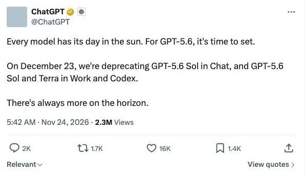

The GPT-5.6 Sol retirement takes effect on December 23, 2026: OpenAI will remove GPT-5.6 Sol from ChatGPT's Chat tab and remove both GPT-5.6 Sol and GPT-5.6 Terra from ChatGPT Work and Codex on that day. Paid ChatGPT users are already being moved to GPT-6.2 in Chat, and new Work chats already start on GPT-6.2 Sol.

Developers have more time. As of November 26, `gpt-5.6-sol` is not on OpenAI's API deprecation list, and Microsoft's Azure catalog keeps it until 2028. The work before December 23 is mostly configuration: model names saved in Codex, workspace defaults that admins have to change, and a quick check that your important prompts still behave the same on GPT-6.2 Sol.

## GPT-5.6 Sol retirement date: what leaves ChatGPT on December 23 {#gpt-5-6-sol-retirement-date}

GPT-5.6 Sol leaves ChatGPT on December 23, 2026. ChatGPT's official account announced the date on November 23 at 21:42 UTC, and the post names three surfaces: Sol leaves Chat, while Sol and GPT-5.6 Terra both leave Work and Codex.



*ChatGPT's retirement notice on X. The timestamp is shown in the capturing browser's time zone (Japan, UTC+9); the post went out at 21:42 UTC on November 23. Screenshot: x.com/ChatGPT, read November 26, 2026.*

| Where you use it | GPT-5.6 Sol | GPT-5.6 Terra | What you get instead |
|---|---|---|---|
| ChatGPT Chat tab (Plus, Pro, Business, Enterprise) | Removed Dec 23 | Not named in the post | GPT-6.2, a version of GPT-6.2 Sol tuned for conversation |
| ChatGPT Work | Removed Dec 23 | Removed Dec 23 | GPT-6.2 Sol (new chats already start on it) or GPT-6.2 Astra |
| Codex signed in with ChatGPT | Removed Dec 23 | Removed Dec 23 | GPT-6.2 Sol or GPT-6.2 Astra |
| OpenAI API and Codex with an API key | No shutdown date | No shutdown date | Optional switch to `gpt-6.2-sol` |
| Azure Foundry | Retires Jan 11, 2028 | Retires Jan 11, 2028 | Microsoft lists no replacement yet |

OpenAI gave its reason in a follow-up, quoted by TechRadar: "we'll generally continue to retire models that are two generations back," which "frees up compute so more people can use our more capable models." GPT-5.6 Sol shipped on July 9, so it will have spent about five and a half months in ChatGPT. GPT-5.5 went the same way on October 14, when it left Codex for ChatGPT sign-ins and OpenAI's docs pointed paid users to GPT-6.1 Sol.

The replacement in Chat is already live for most paid users. OpenAI's [ChatGPT release notes](https://help.openai.com/en/articles/6825453-chatgpt-release-notes) for November 23 say GPT-6.2 is rolling out to Plus, Pro, Business and Enterprise, with Enterprise availability depending on admin settings, and that the Chat model "is powered by a version of GPT-6.2 Sol" tuned for everyday conversation. Free users are mostly outside this change: OpenAI made GPT-5.6 Luna the Free plan's default in August, and the retirement post does not mention Luna.

OpenAI has not said what happens to an existing conversation, project or custom GPT that was explicitly set to GPT-5.6 Sol. Anything you rely on, from a long-running chat to a project's instructions, is worth re-testing on GPT-6.2 while you can still switch back and compare.

## GPT-5.6 Sol API after December 23: shutdown status and pricing {#gpt-5-6-sol-api-after-retirement}

The GPT-5.6 Sol API is not part of the December 23 retirement. As of November 26, OpenAI's [API deprecations page](https://developers.openai.com/api/docs/deprecations) does not list `gpt-5.6-sol` or `gpt-5.6-terra`, and the same page promises at least six months' notice before a generally available model shuts down, plus an email to customers who are actively using it. Under that policy, a notice issued today would put the earliest API shutdown in late May 2027, unless OpenAI uses the safety or compliance exception the page reserves.

Two other places keep the model longer than ChatGPT does:

- **Codex with an API key.** When GPT-5.5 left Codex on October 14, OpenAI's Codex docs said "the OpenAI API and Codex sessions authenticated with an API key aren't affected." OpenAI has not yet published a GPT-5.6 section, but the X post only names ChatGPT's Chat, Work and Codex surfaces.
- **Azure.** Microsoft Foundry's [retirement schedule](https://learn.microsoft.com/en-us/azure/foundry/openai/concepts/model-retirement-schedule) lists `gpt-5.6-sol`, `gpt-5.6-terra` and `gpt-5.6-luna` as generally available until January 11, 2028. It even names `gpt-5.6-sol` as the replacement for several retiring o-series models.

To watch for an API date programmatically, OpenAI recommends calling `GET /v1/models` and reading each model's optional `shutdown_date` field.

<p><strong>Keeping 5.6 Sol outside ChatGPT.</strong> Because the model stays in the API, people who want its writing style or its handling of security work after December 23 can keep calling <code>gpt-5.6-sol</code> from their own scripts or a third-party chat client, while testing <code>gpt-6.2-sol</code> side by side. A shared gateway such as
<a href="https://www.packyapi.ai/register?aff=5W73&amp;utm_source=agentspulse&amp;utm_medium=affiliate&amp;utm_campaign=gpt-5-6-sol-retirement" rel="sponsored nofollow noopener" target="_blank">PackyAPI</a>, whose model directory lists both, is one option for running the two from one endpoint.</p>

The price comparison favors moving anyway. These are OpenAI's list prices per million tokens at standard processing:

| API model | Input | Cached input | Output | Knowledge cutoff | Notes |
|---|---|---|---|---|---|
| `gpt-5.6-sol` | $4.00 | $0.40 | $20.00 | Feb 16, 2026 | Promotional pricing "available until November 30, 2026"; the `gpt-5.6` alias routes here |
| `gpt-6.2-sol` | $2.00 | $0.10 | $10.00 | Jun 1, 2026 | Same prices as GPT-6.1 Sol; rejects `reasoning.effort: none` |
| `gpt-6.2-astra` | $8.00 | $0.40 | $40.00 | Not checked | OpenAI's frontier model, 20% below GPT-6 Astra |

Both Sol models have a 1,050,000-token context window and a 128,000-token output limit, and both bill prompts over 272,000 input tokens at a higher long-context rate. OpenAI's GPT-5.6 Sol page does not say what the model will cost after the promotion ends on November 30, so budget estimates for staying on it past that date are uncertain.

## GPT-5.6 Sol vs GPT-6.2 Sol: what the replacement changes {#gpt-5-6-sol-vs-gpt-6-2-sol}

GPT-6.2 Sol is newer, cheaper in the API and, by OpenAI's numbers, stronger at agentic and coding work, but OpenAI has not published a direct GPT-5.6 Sol vs GPT-6.2 Sol benchmark. Its launch figures compare GPT-6.2 against GPT-6 and GPT-6.1, so the evidence for the jump from 5.6 is indirect.

What OpenAI does report:

- **In the Chat tab**, GPT-6.2 scored 71.7% on image understanding against 47.4% for GPT-6, followed instructions on especially hard prompts 78.1% of the time against 62.5%, and scored about 10 points higher on an internal version of BrowseComp at Extra high reasoning (64.5% vs 54.4%). These are OpenAI's own tests, run against GPT-6 rather than GPT-5.6.
- **For coding**, OpenAI says GPT-6.2 Sol came within half a point of GPT-6.2 Astra on Cognition's FrontierCode 2.0 at about one-fifth of the cost, with both at maximum reasoning. FrontierCode measures whether changes to real codebases are good enough for maintainers to merge.
- **For everyday tasks**, OpenAI says GPT-6.2 Sol beat GPT-6 Astra on its [LifeVal benchmark](/tutorials/openai-lifeval/) at about one-seventh of the cost.

The older generation shows up in a few OpenAI evaluations we covered earlier. On [BioBasicsBench](/tutorials/biobasicsbench/), OpenAI's wet-lab data benchmark, GPT-6.1 Sol, the model 6.2 Sol replaced, had a 62.0% mean reward against 43.8% for GPT-5.6 Sol at xhigh reasoning. Independent results are thinner: Artificial Analysis' Coding Agent Index, which we summarized in our [GPT-6.2 benchmarks roundup](/tutorials/gpt-6-2-benchmarks/), actually moved down for 6.2 Sol compared with 6.1 Sol (49 vs 52), so the gains depend on the task.

Two groups should test the switch before relying on it:

- **Writers and long-running conversations.** Several OpenAI Developer Community threads ask OpenAI to keep 5.6 Sol. In one, a user who switched an established conversation to GPT-6.2 described it as "more constrained and accommodating," with less initiative and humor, then switched back. That is one person's experience, and it is the kind of difference a side-by-side test of your own prompts will show or rule out.
- **Security researchers.** A user quoted by TechRadar called Sol-5.6 "the only model usable for cybersecurity research." OpenAI's GPT-6.2 announcement says both new models reach its "Critical" cyber threshold and ship with stricter safeguards that "limit some legitimate vulnerability research and security testing workflows." For defenders, OpenAI points to GPT-6 Sol on Daybreak Blue, which refuses fewer security requests, and to [GPT-6 Cyber](/tutorials/gpt-6-cyber/) on Daybreak Red for authorized testing.

There is also a mechanical difference for API users: GPT-5.6 Sol accepts `reasoning.effort` values from `none` to `max`, while the GPT-6.2 Sol API rejects `none`. Any request that sets it will fail until you change the value.

## How to migrate from GPT-5.6 Sol before December 23 {#how-to-migrate-from-gpt-5-6-sol}

To migrate from GPT-5.6 Sol, test your important prompts on GPT-6.2 Sol now, then replace every saved reference to `gpt-5.6-sol` and `gpt-5.6-terra` before December 23. Where you make those changes depends on how you use the model.

### Test prompts while both models are available

OpenAI's own migration advice for API retirements applies here too: "Run representative requests against both models. Compare outputs, latency, and cost before switching." Pick five to ten prompts that matter, such as a writing brief, a recurring analysis, a code review or a custom instruction set, and run each on GPT-5.6 Sol and GPT-6.2 Sol. Save both outputs. If GPT-6.2 drifts on tone, length or format, adjust the prompt or your custom instructions now, while you can still switch back and check what changed. Leaving it to the week before December 23 leaves no time to fix a large gap.

### Update Codex model settings

When GPT-5.5 left Codex, OpenAI's docs listed every place a model name can hide: workspace defaults, saved model settings, managed configurations, custom agents, scheduled tasks and scripts. The same list applies to GPT-5.6. In `config.toml`, which the ChatGPT desktop app, Codex CLI and IDE extension share, set:

```toml
model = "gpt-6.2-sol"
```

For one-off runs and scripts, pass the model explicitly:

```bash
codex --model gpt-6.2-sol
codex exec -m gpt-6.2-sol "Review the current changes"
```

In an interactive CLI session, `/model` switches models and reasoning effort. OpenAI has not named a successor for GPT-5.6 Terra; its Codex docs list GPT-6.1 Terra (`codex -m gpt-6.1-terra`, Codex CLI 0.159.0 or later) as the current Terra model, and GPT-6.2 Sol at a lower reasoning effort is the other option. If you share one config with the IDE extension, pick a model every client you use can run.

### Enable GPT-6.2 Sol in Enterprise and Edu workspaces

GPT-6.2 Astra and GPT-6.2 Sol are off by default in ChatGPT Enterprise and Edu workspaces. An administrator has to enable them in the workspace model settings before members can pick them in Work or Codex, and OpenAI's docs note that "changing a default doesn't grant model access." If your workspace still defaults to GPT-5.6 Sol or Terra, enable a GPT-6.2 model first, then change the default, then confirm access on each client your users rely on. In the Chat tab, Enterprise access to GPT-6.2 also depends on admin settings, according to the November 23 release notes.

### Switch API calls when you choose to

API users have no hard deadline today. The practical migration is to swap the model string to `gpt-6.2-sol`, change any `reasoning.effort: "none"` to a supported value, rerun your evaluation set and compare cost per finished task rather than token price alone, which we explain in [cost per successful task for coding agents](/tutorials/coding-agents-finops-cost-per-successful-task/). If you call the bare `gpt-5.6` alias, note that it routes to GPT-5.6 Sol, so it will need the same change if OpenAI ever lists a shutdown date.

## References {#references}

- ChatGPT (@ChatGPT), ["Every model has its day in the sun…"](https://x.com/ChatGPT/status/2124981905380569283), X, November 23, 2026.
- OpenAI, [ChatGPT release notes: "GPT-6.2, now in the chat tab"](https://help.openai.com/en/articles/6825453-chatgpt-release-notes), November 23, 2026.
- OpenAI, [Introducing GPT-6.2 Astra and Sol](https://openai.com/index/introducing-gpt-6-2-astra-sol/), November 17, 2026.
- OpenAI, [API deprecations](https://developers.openai.com/api/docs/deprecations) and [GPT-5.6 Sol model page](https://developers.openai.com/api/docs/models/gpt-5.6-sol), read November 26, 2026.
- OpenAI, [Codex models](https://learn.chatgpt.com/docs/models) and [workspace model availability](https://learn.chatgpt.com/docs/enterprise/workspace-model-availability), read November 26, 2026.
