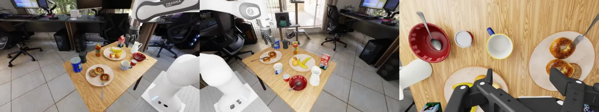

GPT-6 Astra robotics results are the reason OpenAI gives for its latest reorganization. On November 13, OpenAI confirmed to Fortune that it had disbanded its stand-alone robotics team and moved the researchers into its main research and applied organizations, because general-purpose models "including GPT-6 Astra" turned out to be directly usable for controlling robots. The clearest public evidence for that claim is a study from NVIDIA's Seattle Robotics Lab, in which Astra, given camera images and a control interface in its prompt, completed 74.8% of 600 simulated pick-and-place episodes, well above every purpose-trained robot policy on the benchmark's leaderboard.

The same study shows what that capability costs. Each direct API call took 18.56 seconds on average, inference filled about 97% of the episode clock, and the best-scoring setup used 30.9 million tokens per successful episode. This explainer walks through the benchmark, how Astra was wired to the robot, which settings moved the score, where it failed, and what other evaluations found.

## OpenAI robotics team disbanded: what changed and why {#openai-robotics-team-disbanded}

OpenAI's stand-alone robotics team no longer exists as a separate unit. According to the company's statement to Fortune, the robotics research group now sits in the main research team under Chief Research Officer Mark Chen, and the applied robotics and hardware teams have moved into the Applied organization under President Greg Brockman. A spokesperson described the change as a sign of commitment to robotics, and said OpenAI still plans to bring general-purpose robots to market. Sam Altman has targeted a first public demonstration of OpenAI's own humanoid robot in 2027.

The explanation OpenAI gave is about method. At the start of 2026, its researchers expected progress in robotics to come from building on video models such as Sora, which need some implicit grasp of physics to generate realistic footage. Since then, the spokesperson said, frontier models including GPT-6 Astra have shown they can be applied to robotics directly, so the researchers were moved onto teams building those general models.

Fortune also reported a second pressure: OpenAI has been cutting "side quests," dropped Sora to free up compute, and reportedly posted a $10.9 billion operating loss in its most recent quarter while preparing for a possible IPO in early 2027. The change was recent enough that OpenAI's registered booth, #208 at the CoRL robotics conference in Austin, stood empty that week.

This is the second time OpenAI has wound down a dedicated robotics group. The first closed in 2020, when cofounder Wojciech Zaremba cited the shortage of robot data. A rebuilt team arrived in 2024 alongside a partnership with Figure, which ended in February 2025.

## GPT-6 Astra robotics benchmark: RoboLab-120 results {#gpt-6-astra-robotics-benchmark}

On RoboLab-120, GPT-6 Astra's best configuration reached a 74.8% success rate and an 83.6 completion score, against 51.0% for Lakeside, the strongest policy on the benchmark's leaderboard. The study, "Astranomy: An empirical study of GPT-6 Astra as a native robot policy" by Jenai Xuning Yang, Ashna Khetan and Shun Zhang of NVIDIA, was published on October 14, 2026 as a late-breaking report for CoRL 2026. It is the "Nvidia study" Fortune cites. GPT-6 Astra itself is OpenAI's mainline frontier model, the baseline its security-focused [GPT-6 Cyber model](/tutorials/gpt-6-cyber/) is measured against.

RoboLab-120 is a simulated pick-and-place benchmark of 120 tasks on a DROID setup, a Franka Panda arm with a Robotiq gripper. Tasks range from putting a banana in a bowl to packing food by color and stacking blocks in a specified order, and instructions vary in how specific they are while the scene stays fixed. NVIDIA ran each task five times. The chart at the top of this page is NVIDIA's summary; the main rows are below.

| Policy | Type | Success rate | Completion score |
|---|---|---|---|
| GPT-6 Astra, Agentic Policy | General model in a Codex session | 74.8% | 83.6 |
| GPT-6 Astra, Orchestrated Policy | Astra reviewing a robot model's proposals | 66.5% | 79.1 |
| GPT-6 Astra, Direct Policy (end-effector poses) | General model via API | 66.3% | 76.7 |
| Lakeside | Best leaderboard policy | 51.0% | 65.3 |
| GPT-6 Astra, Direct Policy (joint positions) | General model via API | 50.2% | 63.7 |
| FLUX 3 Action | World action model | 42.9% | n/a |
| Cosmos3-Nano-Policy | World action model, finetuned on DROID | 36.8% | 51.9 |
| π0.5 | Vision-language-action model | 28.0% | 43.4 |

*Source: NVIDIA Seattle Robotics Lab, Astranomy, Figures 2 and 3.*

Astra received no robot-policy training for any of this. Everything it knew about the arm, the cameras and the action format arrived in the prompt. The robot foundation models in the table, the [vision-language-action and world action models](/tutorials/physical-agents-world-action-models/) the field has been building, were trained or finetuned on robot data for exactly this kind of control.

## How GPT-6 Astra controls a robot arm: Direct, Agentic and Orchestrated {#gpt-6-astra-robot-control}

GPT-6 Astra controls the simulated arm by reading three camera images plus the robot's joint and gripper state, then writing out numeric targets for the arm to move to. The host executes those targets, the simulation advances, and Astra sees a new observation. NVIDIA tested three ways of placing the model in that loop.

*Figure 1. What Astra sees at each step: two shoulder cameras and a wrist camera on a simulated DROID arm, sent at 384 × 216 in the evaluation. Image: NVIDIA Seattle Robotics Lab, Astranomy.*

- **Direct Policy** calls Astra through the API with no memory between calls. Each call returns a chunk of typically 3 to 15 absolute end-effector poses, which the robot executes before the next observation. The prompt carries three observations spanning roughly the last second, plus a description of the gripper and camera geometry.
- **Agentic Policy** runs Astra in a persistent Codex session. It keeps the full text and image history of the episode, proposes one end-effector target at a time, holds it for one to five control steps, and gets feedback on how far the arm actually moved.
- **Orchestrated Policy** puts Astra in a supervisor role. Cosmos3-Nano-Policy, a world action model finetuned on DROID data, proposes 15-step trajectories; Astra reviews each one and can accept it, edit it, or take over with its own target.

All three used medium reasoning effort and 15 Hz control, with the simulation paused while the model thought. The agentic form is the one that set the 74.8% record, and its main advantage turned out to be memory: an episode-long record of what it had tried, similar to the context handling that [long-horizon agent research](/tutorials/stateful-long-horizon-agents-review/) has been focusing on. The Codex session is a harness in the same sense coding agents use the word, a runtime that [owns state, tools and the control loop](/tutorials/agent-framework-harness-runtime-production/) around the model.

In the orchestrated setup Astra stepped in on 14.5% of simulation steps. Grasping problems accounted for 64.4% of those interventions, and choosing the wrong object or step for another 20.2%. Delegating motion to the world action model did not clearly beat Astra generating actions itself, which NVIDIA leaves as an open question for hybrid designs.

## GPT-6 Astra prompt and context settings that change success rates {#gpt-6-astra-prompt-context}

The prompt and context settings changed GPT-6 Astra's success rate more than any other variable NVIDIA tested apart from the choice of model. These ablations ran on a 30-task subset, 150 episodes per condition.

| Setting | Variants | Success rate |
|---|---|---|
| Geometry in the prompt (Direct) | Base prompt → gripper and camera geometry added | 19.3% → 72.7% |
| Geometry in the prompt (Agentic) | Base prompt → geometry added | 83.3% → 86.0% |
| Action format (Direct) | End-effector poses / joint positions / joint-space B-splines | 72.7% / 48.7% / 37.3% |
| Action format (Agentic) | End-effector poses / joint positions | 86.0% / 84.0% |
| Observation history (Direct) | Current frame only → three recent frames | 49.3% → 72.7% |
| Model (Direct, same setup) | GPT-6 Astra / GPT-6 Sol / Claude Opus 5.5 / GPT-6 Luna | 72.7% / 33.3% / 25.3% / 2.0% |
| Reasoning effort (Direct) | medium → xhigh | 72.7% → 74.5% at 2.6× latency, 2.2× cost |

*Source: NVIDIA Seattle Robotics Lab, Astranomy, Figures 6, 10, 11, 14 and 15.*

The direct setup depends heavily on being told where the gripper's fingers sit relative to its mounting flange and how each camera maps to robot coordinates; without that, NVIDIA's videos show the arm making repeated small adjustments around a cup instead of grasping it. The agentic setup barely needs it, which the authors attribute to the model inferring geometry from its own action history. Model choice dominates everything: the same prompt and harness that gave Astra 72.7% gave [Claude Opus 5.5](/tutorials/claude-fable-5-2/) 25.3%.

Several additions that sound useful did little. With optional tools enabled, Astra wrote and ran Python in every episode, averaging 19.7 tool calls, often for stereo triangulation or inverse kinematics, and still reached about the same conclusions as without them. Explicit motion-error feedback moved success from 85.2% to 85.9%. Video demonstrations worked as in-context learning, with 87.9% success against 90.0% without them, and the episodes ran 8.8% more control steps.

## GPT-6 Astra latency and cost per successful episode {#gpt-6-astra-latency-cost}

GPT-6 Astra is slow and expensive as a controller. Across successful RoboLab-120 episodes, a direct API call averaged 18.56 seconds, and model inference made up 97.0% of estimated episode time. NVIDIA's yogurt-in-bowl example took about 3 minutes 57 seconds end to end, of which roughly 5.2 seconds was the arm actually moving.

| Configuration | Latency per call | Share of episode spent on inference | Tokens / estimated API cost per successful episode |
|---|---|---|---|
| Astra, Direct Policy | 18.56 s | 97.0% | 160k / $1.96 |
| Astra, Agentic Policy | 13.37 s | 97.8% | 30.9M / $36.40 |
| Astra, Orchestrated Policy | 11.50 s (Astra) + 2.74 s (Cosmos) | 94.9% | 11.0M / $17.72 |
| Cosmos3-Nano-Policy | 713.76 ms | 25.6% | n/a |
| π0.5 | 46.96 ms | 4.6% | n/a |

*Source: NVIDIA Seattle Robotics Lab, Astranomy, Table 3 and Figure 2. Astra latency includes network delay; robot-model latencies are median per action chunk on an H200 in BF16, as reported by Black Forest Labs.*

The agentic setup bought its extra 8.5 points of success over direct calls with about 190 times the tokens, the price of keeping the whole episode in context. Measured as [cost per successful task](/tutorials/coding-agents-finops-cost-per-successful-task/), that is $36.40 per completed pick-and-place job in simulation, before any hardware or engineering cost.

The pause matters as much as the price. RoboLab freezes the simulated world while Astra thinks, so none of these results test whether the robot can react while things move. Guanya Shi of Carnegie Mellon's Robotics Institute told Fortune that cloud-hosted large models also need a constant network connection, and that he still sees a role for smaller models running on the robot's own computer. That is the same trade [teams make when they swap an LLM for a small decision model](/tutorials/decision-model-vs-llm/) in latency-bound production work.

## GPT-6 Astra robot failure modes and test limits {#gpt-6-astra-failure-modes}

The failure NVIDIA saw again and again on RoboLab-120 was GPT-6 Astra turning an attempted grasp into a finished one. NVIDIA's failure rollouts show the gripper adjusting around an object without securing it, objects pushed aside without reaching their destination, items dropped in transport, objects placed in the wrong bin, and recovery attempts that repeat the same ineffective motion. Some tasks stayed at zero success for every Astra configuration, including packing two or three boxes and packing food by color.

The authors list the limits of their own test:

- **Five episodes per task.** Inference cost and wall-clock time capped repetitions, so the differences between configurations, especially the small gaps in the ablations, are not statistically established.
- **Pick-and-place only.** No contact-rich work such as insertion or assembly, no long-horizon mobile manipulation, and no dynamic tasks.
- **Paused simulation.** Real-time responsiveness was not tested.
- **Opaque serving.** NVIDIA evaluated Astra through its exposed interface and cannot separate the model from whatever processing happens on OpenAI's servers.

## GPT-6 Astra vs robot foundation models on other benchmarks {#gpt-6-astra-other-benchmarks}

Other evaluations of GPT-6 Astra as a robot policy find the same strength in understanding tasks and much lower success on harder suites, other robot types and real hardware.

| Study (arXiv) | Setting | Reported result |
|---|---|---|
| "An Unexpected Robot Policy" (2609.24170), Sept 21 | All 42 RoboDojo manipulation tasks, 50 episodes each | Astra 22.48% average success, above all 40 public policies; GPT-5.5 0.88%. Weak on precision, dynamic control and bimanual tasks |
| Galbot Team (2609.38537), Sept 29 | Six domains, direct and hybrid control | Hybrid with π0.5: 48% on a RoboDojo subset, 38.7% on RoboCasa365 mobile manipulation; navigation 92% (RxR); locomotion: none of five attempts reached the goal; a 30-second locomotion run needed 250 calls averaging 39.86 s |
| "Has GPT-6-Astra Achieved Embodied Intelligence?" (2610.22471), Oct 15 | 12 benchmarks plus 8 real robot configurations | Pairing Astra as planner with a fast low-level controller such as π0.5 is "costly but effective"; on real robots, demonstrations are expensive to collect and slow deliberation cannot be traded for success under physical constraints |

*Results as reported in each paper's abstract.*

The third paper's conclusion summarizes the state of the evidence: GPT-6 Astra "has largely crossed the threshold of embodied competence, but not yet that of practical embodied intelligence." NVIDIA and Galbot both paused physics while Astra reasoned, and the strongest numbers come from simulation; the third paper proposes benchmarks whose clock keeps running while the agent deliberates.

## Specialized robot models vs general models after OpenAI's reorg {#specialized-robot-models-vs-general-models}

For robot builders, the evidence supports a split: general models for deciding what to do, specialized models for doing it fast. OpenAI's reorg is a bet that the first part keeps growing. Guanya Shi read it as OpenAI treating robotics as "no longer a special problem," a downstream application of general intelligence in the way frontier models now power coding or legal tools. The RoboLab-120 and RoboDojo rankings back that up on task understanding: no purpose-trained policy on either leaderboard matched Astra.

The latency and cost tables point the other way for the control loop itself. Russ Tedrake, MIT professor and CEO of Walden Robotics, told Fortune that robotics companies keep an advantage the labs lack, robots already working on factory floors and collecting site-specific data, and that better foundation models make that data more valuable. Pete Florence, cofounder of Generalist, said it is unclear whether any existing model will dominate robotics in the long run. On Hacker News, where the Fortune story drew 179 points and 73 comments, the practical objections were the same: real robots layer fast embedded control loops under slower planners, and a robot has to earn enough to pay for its tokens.

If you are evaluating a general model for a robot today, NVIDIA's results suggest where to start:

1. **Use it where seconds are acceptable.** Task selection, error checking and recovery planning tolerate a 10–20 second call; closing a gripper on a moving object does not.
2. **Put geometry and recent history in the prompt.** On RoboLab, removing geometry cut direct control from 72.7% to 19.3%, and removing history cut it to 49.3%.
3. **Keep a fast policy underneath.** The orchestrated and hybrid setups in NVIDIA's and Galbot's work give that policy the motion and leave review and intervention to the large model.
4. **Budget per success.** At $36.40 per successful simulated episode for the best configuration, the economics only work for high-value tasks.

OpenAI's humanoid demonstration, which Altman has targeted for 2027, is where the company will have to show these trade-offs on real hardware.

## References {#references}

1. Wen Shao, ["Exclusive: OpenAI disbands its stand-alone robotics team as its general-purpose AI models start running robots"](https://fortune.com/2026/11/13/openai-disbands-robotics-team-as-its-general-models-start-running-robots/), Fortune, November 13, 2026.
2. Jenai Xuning Yang, Ashna Khetan and Shun Zhang, ["Astranomy: An empirical study of GPT-6 Astra as a native robot policy"](https://research.nvidia.com/labs/srl/projects/astranomy/), NVIDIA Seattle Robotics Lab, CoRL 2026 late-breaking report, October 14, 2026.
3. Zhang et al., ["An Unexpected Robot Policy: Early Evaluations of GPT-6 Astra on RoboDojo and Beyond"](https://arxiv.org/abs/2609.24170), arXiv, September 21, 2026.
4. Galbot Team, ["Systematically Exploring the Capabilities of GPT-6 Astra as Embodied Policies"](https://arxiv.org/abs/2609.38537), arXiv, September 29, 2026.
5. ["Has GPT-6-Astra Achieved Embodied Intelligence?"](https://arxiv.org/abs/2610.22471), arXiv, October 15, 2026.
