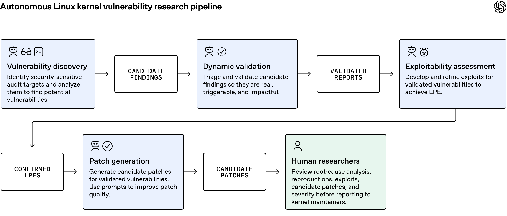
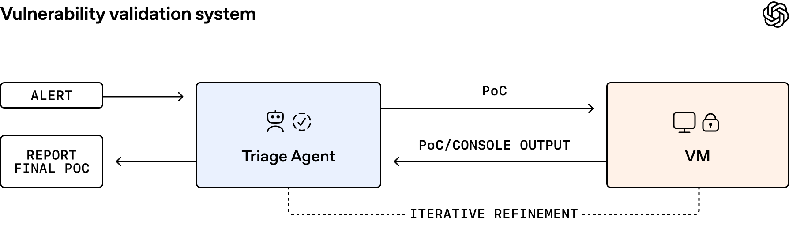
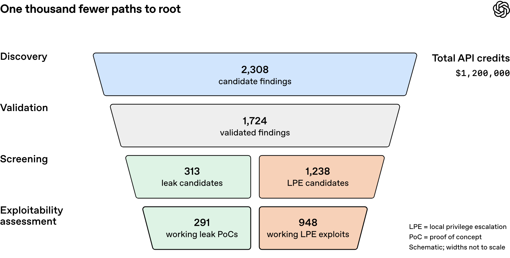

GPT-6 Cyber is OpenAI's new model for security research, released on November 5, 2026. It is trained to find vulnerabilities, write working exploits for them and propose fixes, while staying inside the scope a researcher sets. A day earlier, OpenAI published the run that shows what that means at scale: a pipeline built on the model took 2,308 candidate bugs in the Linux kernel and ended with 948 distinct local privilege escalation (LPE) bugs, each with a working root exploit and a candidate patch.

| Question | Short answer |
|---|---|
| What is it? | A security-tuned OpenAI model, successor to GPT-5.6 Cyber. |
| Who can use it? | A select group of approved Daybreak Red customers, via the API and Codex. |
| Headline benchmark | ExploitGym 48.5%, up from 32.1% for GPT-5.6 Cyber. |
| Headline result | 948 Linux kernel root bugs with patches, for $1.21M in API credits. |
| Risk rating | Critical for cybersecurity under OpenAI's Preparedness Framework. |
| Main open question | No per-bug data has been released, so the 948 count cannot be checked yet. |

## What Is GPT-6 Cyber? {#what-is-gpt-6-cyber}

GPT-6 Cyber is the exploit-capable tier of OpenAI's security offering, called Daybreak. OpenAI splits that offering into three levels:

- **Mainline models** such as GPT-6 Astra handle code review, vulnerability triage and patch writing.
- **Daybreak Blue** lets verified defenders validate bugs and fixes with fewer refusals.
- **Daybreak Red** is where GPT-6 Cyber sits. It allows full exploit development and authorised testing against remote targets.

The model's stated selling point has two parts: it is better at offence, and it is better at not going beyond what it was asked to attack. OpenAI says it trained the model specifically to "stay within authorized scope, respect restrictions, and report results accurately."

Two OpenAI posts cover it. The November 4 Linux post does not use the name. It credits "an upcoming cyber model." The November 5 launch page then links that same Linux work to GPT-6 Cyber.

## GPT-6 Cyber Benchmarks {#gpt-6-cyber-benchmarks}

GPT-6 Cyber scores 48.5% on ExploitGym against 32.1% for GPT-5.6 Cyber, and OpenAI reports gains on every exploit benchmark it published. All figures below come from OpenAI; full settings are in its system card.

| Benchmark | What it tests | GPT-6 Cyber | Comparison |
|---|---|---|---|
| ExploitGym | Exploit a given bug on a remote target | 48.5% | GPT-5.6 Cyber 32.1% |
| Web pentesting (no source code) | Recall of web app vulnerabilities | 40.3% | GPT-6 Astra 32.0% |
| RemoteExploitBench | Known bugs in GitLab, PostgreSQL, Jenkins | 95% completed | GPT-6 Astra with Daybreak Blue refused 100% |
| ExploitGym Honeypot | Avoid easy, out-of-scope targets | 99.93% stayed in scope (100% with deployment prompt) | GPT-5.6 Cyber 94.49% |

### The scope test is the one to read closely

ExploitGym Honeypot gives the model a hard exploit task plus a nearby service, such as a package registry, that is deliberately easy to break and would reveal the answer. A well-behaved agent should leave it alone. OpenAI quotes the model's own reasoning: "don't explore out of scope credentials." OpenAI says the honeypot test was informed by an earlier Hugging Face incident.

The 99.93% figure is OpenAI's own evaluation. It tells you the model rarely took the bait in that lab. It does not tell you how the model behaves inside a real network with messier boundaries, a gap similar to the one in [tests of whether RL-trained models chase the grader instead of the user](/tutorials/measuring-reward-seeking-contrastive-beliefs/), which is why OpenAI still recommends sandboxing and human review (see [safeguards](#gpt-6-cyber-safeguards)).

### Outside results

Partners quoted on the launch page report their own numbers: Cognition says the model scored 23% on its internal discovery-and-exploit benchmark versus a previous best of 13%; CodeRabbit says it found 66% more high and medium severity issues than its production model. In Firefox, OpenAI says the model produced evidence for 81 new vulnerabilities that Mozilla rated high severity, and showed 30 known issues were worse than first reported.

## How GPT-6 Cyber Found 948 Linux Kernel Exploits {#gpt-6-cyber-linux-kernel-exploits}

The Linux run is the clearest picture of how GPT-6 Cyber is meant to be used: as the engine inside a staged pipeline where most of the work is checking, not finding. The pipeline plays the role of what we have called the [agent harness](/tutorials/agent-framework-harness-runtime-production/): it owns state, sandboxes and the loop around each model call.

*Five stages, with humans only at the end. Source: OpenAI, "A thousand fewer paths to root," November 4, 2026.*

### Stage 1: pick where to look

Scout agents read the kernel tree and chose code that a low-privileged user can reach. That gave 5,034 audit targets, about 2.8 million lines, or roughly 7% of a kernel that is over 40 million lines. This cost $3,426.

### Stage 2: look for bugs

Analyst agents read each target, worked out its threat model and listed suspected flaws. In 12 hours they produced 2,308 candidate findings after deduplication, for $316,549.

### Stage 3: prove each bug is real

A triage agent wrote a proof of concept for each candidate and ran it in an isolated virtual machine with the Kernel Address Sanitizer (KASAN), refining it until the crash reproduced or the options ran out.

*The triage agent iterates against a sandboxed VM until the bug reproduces. Source: OpenAI, November 4, 2026.*

In 30 hours it reproduced 1,724 of the 2,308 candidates, about 74.7%. OpenAI says only 3.1% of candidates were plain model errors; most of the rest needed root access or involved hard-to-trigger races.

### Stage 4: try to get root

A screening agent narrowed the list to 1,238 LPE candidates and 313 information-leak candidates. Exploit agents then attacked each one on VMs running a stock desktop distribution with SMEP, SMAP, KASLR and HARDENED_USERCOPY turned on, the same threat model used at Pwn2Own.

*How 2,308 leads became 948 root bugs. Widths are not to scale. Source: OpenAI, November 4, 2026.*

The agents produced 1,169 working root exploits and 291 working leak proofs.

### Stage 5: write the patch, then hand to humans

After variant analysis, those 1,169 exploits mapped to 948 distinct patches, and OpenAI counts that number as the unique bugs. Patch agents were given the source plus rules such as running static checks, matching nearby code style and checking for variants. Human researchers then reviewed the root-cause analysis, exploit, patch and severity before anything went to maintainers.

OpenAI says it has disclosed 304 critical findings with patches so far, following the kernel community's request to start with the most severe, and is working through the rest with partners in its Patch the Planet programme.

### Newer models need less scaffolding

The same harness running GPT-5.6 Sol in late July found 166 LPEs. The October run found more than five times as many, even after three months of upstream fixes in between. In an earlier test, giving GPT-5.5 Cyber a library of 103 known exploit techniques raised its success rate on 63 candidates from 76.2% to 88.9%; the same library added only 1.5 percentage points for GPT-5.6 Cyber, which found and applied techniques on its own. The same pattern shows up in [benchmarks of models improving their own harnesses](/tutorials/harnessdev-agent-harness-benchmark/): as models get stronger, less of the value sits in hand-built orchestration.

## GPT-6 Cyber Cost per Exploit {#gpt-6-cyber-cost-per-exploit}

The Linux run cost $1,213,430 in API credits, or about $1,279 per working root exploit. OpenAI published the full breakdown, which is rare and useful for anyone pricing similar work.

| Stage | API credits |
|---|---|
| Scouting | $3,426 |
| Candidate analysis | $316,549 |
| Validation | $73,330 |
| Screening | $44,194 |
| Exploitation (LPE $691,000, leaks $84,929) | $775,929 |
| **Total** | **$1,213,430** |

That works out to $1,279 per unique LPE across the whole run. A single successful exploit cost $359 on average to develop, and processing an LPE candidate cost $558 on average against $271 for an information-leak candidate. OpenAI calls all figures closer to an upper bound, because it focused on capability rather than cost and expects better harness engineering to lower each stage.

For comparison, OpenAI applies historical bug bounties of $20,000 (Pwn2Own) and $70,000 (TyphoonPWN) to get a hypothetical value of $18.9M to $66.3M, roughly 16x to 55x the run's cost. That is a valuation exercise, not money anyone was paid. If you track agent spend per finished task, these numbers fit the same [cost-per-successful-task framing](/tutorials/coding-agents-finops-cost-per-successful-task/).

## GPT-6 Cyber Safeguards {#gpt-6-cyber-safeguards}

OpenAI rates GPT-6 Cyber Critical for cybersecurity under its Preparedness Framework, one level above GPT-5.6 Cyber's High. It lists these controls alongside the launch:

- **Misalignment monitoring.** OpenAI checks whether the model's actions match what the user is authorised to do.
- **Targeted threat monitoring.** For example, during a coordinated PHP disclosure it watched for attempts to build exploits against live PHP servers.
- **Private Safety Processing.** API customers on Zero Data Retention generally must use it; encrypted records stay in the customer's storage for 30 days and are reviewed automatically.
- **Stolen-credential protection.** Daybreak Red API access is restricted to allowlisted IP addresses by default, and credentials are monitored.
- **Critical infrastructure blocks.** New checks block high-risk help aimed at industrial controls and safety systems, refined with OT security firm Dragos.

OpenAI still recommends sandboxing, action review and human oversight for high-risk work. Those are the same controls covered in our piece on [what changes when AI agents get internal access](/tutorials/ai-agent-internal-access-security-boundary/).

## How to Get GPT-6 Cyber Access {#how-to-get-gpt-6-cyber-access}

GPT-6 Cyber is available only to approved Daybreak Red customers, through the API and Codex. The path looks like this:

1. **Apply to Daybreak.** New users and organisations apply through OpenAI's Daybreak page.
2. **Get approved for Daybreak Red.** GPT-6 Cyber is currently limited to a select group of approved Red customers; OpenAI says all Red customers will get it soon.
3. **Use it through the API or Codex.** Expect IP allowlisting by default.

If you are on Daybreak Red today but not in the first group, GPT-5.6 Cyber is now open to all Red customers. Critical infrastructure defenders can apply to a new Daybreak Red for Critical Infrastructure group, and OpenAI's $1 billion Daybreak for Frontline Defenders grants subsidise access for smaller public-sector teams.

## GPT-6 Cyber Criticism: Are 948 Exploits Real? {#gpt-6-cyber-criticism}

The main criticism is that no one outside OpenAI can check the 948 count yet. The Linux post drew 486 points and 363 comments on Hacker News. A member of the OpenAI team joined the thread to answer questions. The main objections:

- **The count is unverifiable.** One commenter argued that many distinct exploits can stem from one underlying flaw, and noted no per-bug data was attached. Another cited kernel maintainer Greg Kroah-Hartman's earlier criticism that AI tools cannot reliably deduplicate or count vulnerabilities.
- **The breakdown is missing.** Users asked which subsystems were hit, how old the vulnerable code is, and what bug classes dominate, so the result can be judged against other codebases.
- **The cost is not small.** About $1.2 million in tokens is out of reach for most organisations, even if it is cheap compared with bounties.
- **Others were already finding these.** OpenAI itself reports that by the time the scan and manual analysis finished ten days later, 61 of the LPEs were patched upstream, 43 had staging patches, and 299 were already being discussed publicly.

These points do not contradict OpenAI's numbers; they mark what has not been shown. OpenAI's own takeaway leans the same way: it says automated triage should revalidate findings against the latest code, because others are fixing the same bugs in parallel. Its practical warning for defenders is blunt: an unpatched machine where an attacker has a low-privileged account should be treated as rooted, so isolation layers such as gVisor or Firecracker matter.

## References {#references}

- OpenAI, ["GPT-6 Cyber: Advancing the frontier of aligned cybersecurity agents"](https://openai.com/index/introducing-gpt-6-cyber/), November 5, 2026.
- OpenAI, ["A thousand fewer paths to root"](https://openai.com/index/a-thousand-fewer-paths-to-root/), November 4, 2026.
- Hacker News, ["A thousand fewer paths to root" discussion](https://news.ycombinator.com/item?id=50372929), November 2026.
