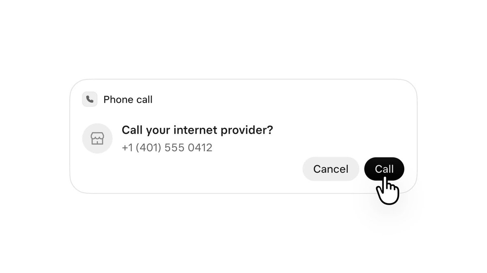
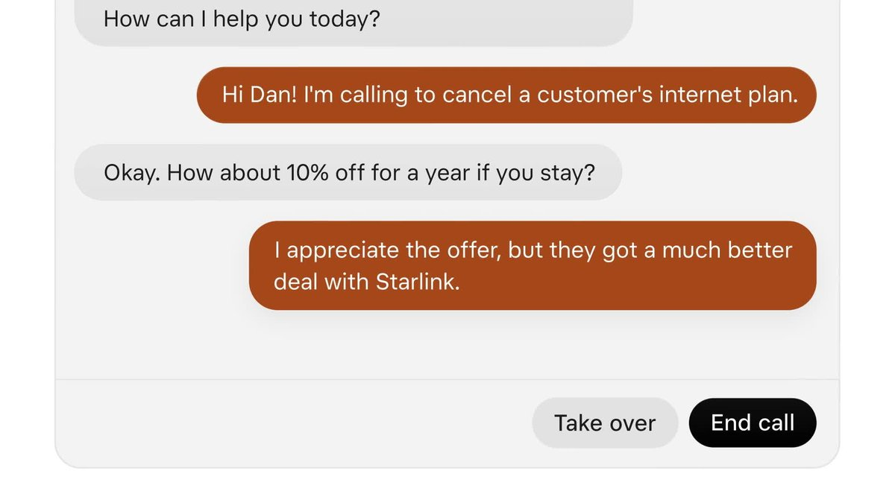
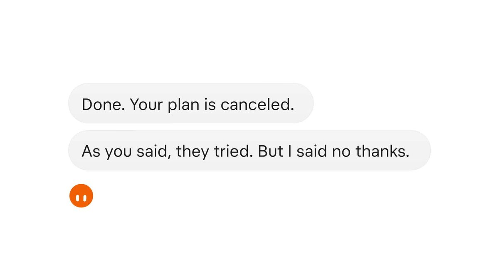
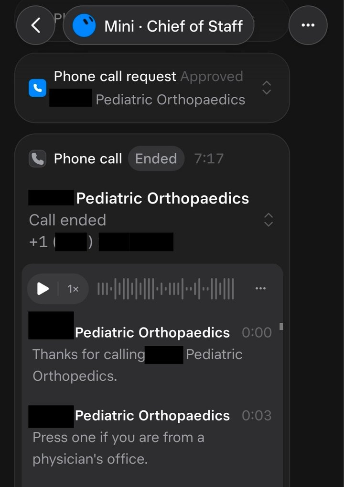

Grok Bot phone calls let SpaceXSI's agent dial a US business for you, talk to whoever answers, and send back a transcript and summary. Elon Musk announced calling on October 25, 2026, users began placing calls on November 3, and the official Grok Bot account posted a demo on November 4. The most-shared claim came from Musk on X the same week: Grok Bot "can research which doctors are the best in your area, call them by phone and make an appointment!"

| Question | Short answer |
|---|---|
| Who can place calls? | Grok Bot users; creator Peter Yang said on November 3 that all users could call US businesses. |
| Does it ask first? | Yes. The bot shows a call card with the number, and dials only after you tap Call. |
| Can you watch the call? | A live transcript runs during the call, with Take over and End call buttons. |
| Can it book doctors? | One user booked a pediatric orthopedics visit this way. How the bot picks the "best" doctor is undocumented. |
| Where does it work? | Reported as US numbers only. |

## What Are Grok Bot Phone Calls? {#what-are-grok-bot-phone-calls}

Grok Bot is SpaceXSI's agent product, launched in beta on August 11, 2026. [SpaceXSI describes it](https://x.ai/news/introducing-grok-bot) as "your team of always-on agents": each bot has a cloud computer of its own, signs into the tools you use, works across apps and websites, and only comes back "when something needs your approval." Phone calls extend that to businesses that are easiest to reach by phone.

Musk first described the feature on October 25: Grok Bot "can now call someone or a business for you, make a request on your behalf, take notes on the response and send you a note summarizing the conversation." At that point it showed up only in preview builds with no release notes, [Teslarati reported](https://www.teslarati.com/elon-musks-grok-bot-is-picking-up-the-phone-now-and-the-first-calls-are-wild/). On November 3 Yang said all Grok Bot users should now be able to call US businesses, and Musk reposted his demo with "Try asking Grok @Bot to make calls!"

## How a Grok Bot Call Works {#how-a-grok-bot-call-works}

The official [Grok Bot demo on X](https://x.com/bot/status/2118043939592942052) (November 4, 42 seconds) shows the full loop. The bot notices an internet contract renews in three days and asks, "Want me to call and cancel?" The user replies "Yes please. And don't let them talk me into a discount."

*Before dialing, Grok Bot shows who it will call and waits for the user to tap Call. Source: Grok Bot (@bot) demo video on X, November 4, 2026.*

Once connected, both sides of the conversation appear as a live transcript. When a support agent offers 10% off for a year, the bot declines, saying the customer "got a much better deal with Starlink." Take over and End call stay on screen throughout, so the user can step in. Real-time phone agents like this depend on low-latency turn-taking, covered in our guide to [real-time voice agents as distributed systems](/tutorials/real-time-voice-agents-distributed-systems/).

*The live transcript during the demo call. Source: Grok Bot (@bot) demo video on X, November 4, 2026.*

After the call the bot reports back in chat: "Done. Your plan is canceled. As you said, they tried. But I said no thanks." A report from The Rundown AI, [summarized by Blockchain.News](https://blockchain.news/ainews/grok-bot-adds-u-s-phone-call-automation-with-live-transcript), adds that after approval the bot can wait on hold, navigate automated phone menus and talk to live representatives, then leave a post-call summary.

*The post-call report in chat. Source: Grok Bot (@bot) demo video on X, November 4, 2026.*

## Can Grok Bot Book a Doctor Appointment? {#can-grok-bot-book-a-doctor-appointment}

Musk's doctor post on November 3 quoted a thread by creator Min Choi. [Choi wrote](https://x.com/minchoi/status/2117633564736938471) that Grok Bot "just made a doctor's appointment for me while I was driving": his daughter had hurt her foot at dance practice, he described her symptoms to the bot, and it offered a few options before calling. His screenshot shows an approved "Phone call request" to a pediatric orthopaedics practice, a 7-minute-17-second call with a recording, and a transcript that opens with the practice's phone menu ("Press one if you are from a physician's office").

*Min Choi's call to a pediatric orthopaedics practice; names and numbers were redacted by the poster. Source: @minchoi on X, November 3, 2026.*

About two hours later [Musk generalized it](https://x.com/elonmusk/status/2117665964862939320): Grok Bot "can research which doctors are the best in your area, call them by phone and make an appointment!" The calling and booking steps match what Choi's screenshot shows. The research step has less behind it. SpaceXSI has not published how the bot finds doctors, what sources it uses to judge which are "the best," or whether it checks insurance networks, and no clinic or medical-scheduling integration has been announced.

The closest related reports involve dentists. On November 4 one user posted that Grok was on the phone with a dental office confirming his insurance, [Crypto Briefing reported](https://cryptobriefing.com/grok-calls-dentist-verify-insurance/); an earlier dentist booking in October was done through a web browser, not a call.

## Calls Users Have Reported {#calls-users-have-reported}

Most early calls were about bills and subscriptions:

| Call | Result reported | Source |
|---|---|---|
| Peter Yang to Comcast | Worked through the phone menu, turned down three upsells, used a cheaper Sonic fiber offer as leverage; bill fell from $84 to $45 a month on a faster plan, about $500 a year, in roughly 25 minutes | Teslarati |
| A user to Verizon Fios | Recovered a $100 gift card after a 51-minute call | Teslarati |
| Pediatric orthopaedics practice | Appointment booked after a 7:17 call | @minchoi |
| Dental office | Call to confirm insurance coverage | Crypto Briefing |
| Subscription cancellation | Failed: the representative refused to cancel once it was clear an AI was calling | Teslarati |

In the failed call the business on the other end chose not to deal with an agent, and the bot had no way around that.

## Grok Bot Calling Rules {#grok-bot-calling-rules}

Teslarati's summary of the [Grok Bot terms](https://x.ai/legal/grok-bot-terms) lists four rules for calls:

- Every call must identify itself as a virtual assistant calling on the user's behalf.
- Calls may be recorded.
- Marketing, mass calling and impersonation are prohibited.
- Calling currently works only with US numbers.

The Rundown AI's report adds that Washington and Illinois numbers are excluded. Teslanorth noted that the official demo post did not say who can use calls, whether they cost extra, or which countries are supported. SpaceXSI has not explained the state exclusions. Approval before dialing and the take-over button are the user-side controls; for how agent permissions are scoped more generally, see [AI agent access and security boundaries](/tutorials/ai-agent-internal-access-security-boundary/).

## Grok Bot Limits and Cost {#grok-bot-limits-and-cost}

Calling launched days after a usage squeeze. Around Halloween weekend, some users found their weekly Grok Bot limits maxed out early, and on November 1 Musk replied on X that "the cost of serving Grok Bot was unsustainably high relative to revenue," [TechCrunch reported](https://techcrunch.com/2026/11/02/elon-musk-throttles-grok-bot-limits-due-to-unsustainably-high-costs/). Musk has said Grok Bot has no free tier, and at launch it came with its own usage, separate from Grok and Cursor plans.

A call that spends 25 to 50 minutes on hold is the kind of long-running task that eats into that pool, and SpaceXSI has not said how calls count against weekly limits. Google showed a similar idea with Duplex in 2018, when its assistant called a restaurant and a hair salon on stage; Grok Bot puts the same kind of call inside a general-purpose agent with a visible transcript and a take-over button.

## Grok Bot FAQ {#grok-bot-faq}

### What is Grok Bot?

Grok Bot is SpaceXSI's agent product, launched in beta on August 11, 2026. Each bot has its own cloud computer, works across apps and websites, and returns when it needs your approval. Phone calls were added in early November 2026.

### Is Grok Bot free?

No. Musk has said Grok Bot has no free tier. At launch it was offered to SuperGrok, SuperGrok Plus and SuperGrok Heavy subscribers and to several Cursor plans, with its own usage pool. SpaceXSI has not said whether phone calls cost extra.

### Does Grok Bot have usage limits?

Yes, a weekly limit. Around November 1, 2026 users found their limits used up early, and Musk said serving Grok Bot had been unsustainably expensive relative to revenue. SpaceXSI has not said how call minutes count against the weekly pool.

## References

- Grok Bot (@bot), ["Grok Bot can now make phone calls."](https://x.com/bot/status/2118043939592942052), X, November 4, 2026.
- Elon Musk (@elonmusk), [post on doctor appointments](https://x.com/elonmusk/status/2117665964862939320), X, November 3, 2026.
- Min Choi (@minchoi), ["Grok Bot just made a doctor's appointment for me while I was driving"](https://x.com/minchoi/status/2117633564736938471), X, November 3, 2026.
- SpaceXSI, ["Introducing Grok Bot"](https://x.ai/news/introducing-grok-bot), August 11, 2026.
- SpaceXSI, [Grok Bot Terms](https://x.ai/legal/grok-bot-terms).
- Gene, ["Elon Musk's Grok Bot is picking up the phone now, and the first calls are wild"](https://www.teslarati.com/elon-musks-grok-bot-is-picking-up-the-phone-now-and-the-first-calls-are-wild/), Teslarati, November 3, 2026.
- Sarah Lee-Jones, ["Grok Bot Phone Calls Go Live, Turning Down a 10% Retention Offer"](https://teslanorth.com/2026/11/04/grok-bot-phone-calls-live/), Teslanorth, November 4, 2026.
- Amanda Silberling, ["Elon Musk throttles Grok Bot limits due to 'unsustainably high' costs"](https://techcrunch.com/2026/11/02/elon-musk-throttles-grok-bot-limits-due-to-unsustainably-high-costs/), TechCrunch, November 2, 2026.
- Joey Klender, ["Grok Bot users hit with weekly limits early, Elon Musk explains what happened"](https://www.teslarati.com/grok-bot-users-hit-weekly-limits-early-elon-musk-explains-what-happened/), Teslarati, November 2, 2026.
- Crypto Briefing, ["Grok calls a dentist's office to verify insurance for a user"](https://cryptobriefing.com/grok-calls-dentist-verify-insurance/), November 5, 2026.
- Blockchain.News, ["Grok Bot adds U.S. phone call automation with live transcript"](https://blockchain.news/ainews/grok-bot-adds-u-s-phone-call-automation-with-live-transcript), November 4, 2026.
