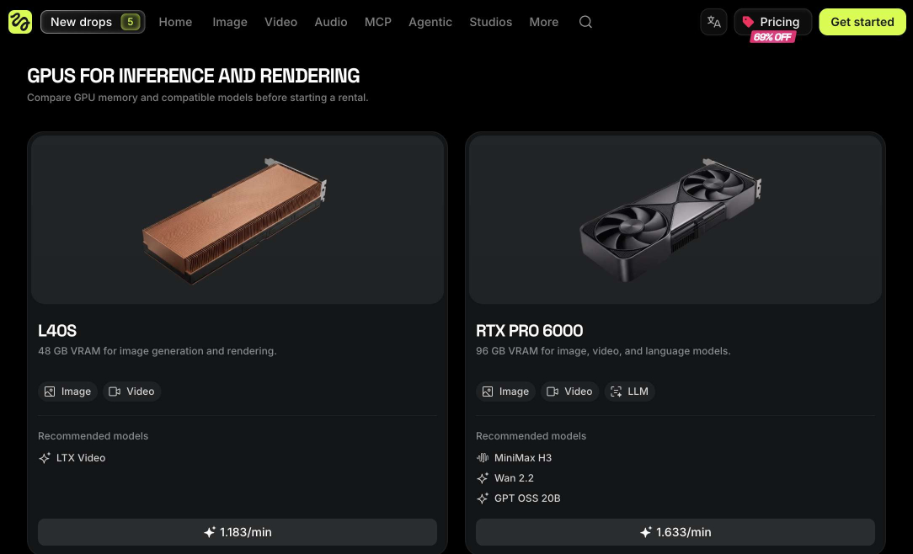

Higgsfield GPU Harness lets Claude or ChatGPT rent a cloud computer with an NVIDIA GPU and run Blender, Unreal Engine or Houdini on it, and every minute is paid in Higgsfield credits. That makes the real price depend on the plan you bought the credits with. At monthly list prices, an hour on an L40S costs $2.96 to $5.00 through Higgsfield, against $1.09 on Runpod's Secure Cloud, while a B300 hour costs $8.21 to $13.86 against $8.99.

Higgsfield launched GPU Harness on November 20, 2026, and its GPU page lists each card's rate in credits only. This page converts those rates into dollars for each plan, sets them next to Runpod's list prices for the same cards, and prices the four render jobs Higgsfield has published so far, from a 17-credit Blender test to a 5,653-credit Houdini film.

| Question | Short answer (Nov 24, 2026) |
|---|---|
| What does Higgsfield GPU Harness cost? | 71 credits an hour (L40S) to 197 (B300), billed per second while the machine is on. Rubin is sales-only. |
| How much is a credit worth? | About $0.049 on Plus ($59 for 1,200), $0.042 on the largest Ultra plan ($375 for 9,000), $0.070 on Starter ($19 for 270). |
| Is it cheaper than Runpod? | For L40S, RTX PRO 6000 and H100 on Plus or Ultra: no, about 1.5 to 3.2 times Runpod's Secure Cloud rate. For B200 and B300 on those plans: within 10% either way. |
| What do real jobs cost? | Higgsfield's published runs used 16.79 to 5,653 credits: about $0.83 to $278 at the Plus rate. |
| What do you need? | A paid Higgsfield plan and Claude, ChatGPT, Cursor or Claude Code. The free plan has no monthly credits. |

## Higgsfield GPU Harness Pricing: Credits per Hour by GPU {#higgsfield-gpu-harness-pricing}

Higgsfield GPU Harness prices six NVIDIA cards in credits per minute, from 1.183 for an L40S to 3.283 for a B300, which works out to 71 to 197 credits an hour. A seventh option, Rubin, is listed with 288 GB of memory and a "Contact sales" button instead of a rate.



*The first two cards on Higgsfield's All GPUs page, priced in credits per minute. Screenshot of higgsfield.ai/gpu/all, November 24, 2026; the H100, H200, B200 and B300 cards continue below and are listed in the table.*

| GPU | Memory | Credits per minute | Credits per hour | Higgsfield's suggested use |
|---|---|---|---|---|
| L40S | 48 GB | 1.183 | 71 | Image generation and rendering |
| RTX PRO 6000 | 96 GB | 1.633 | 98 | Image, video and language models |
| H100 | 80 GB HBM3 | 2 | 120 | Model inference and fine-tuning |
| H200 | 141 GB HBM3e | 2.233 | 134 | Larger models and longer contexts |
| B200 | 180 GB HBM3e | 2.933 | 176 | Large-model inference and training |
| B300 | 288 GB HBM3e | 3.283 | 197 | Memory-intensive AI workloads |

*Higgsfield All GPUs page and GPU page, November 24, 2026. Hourly figures are the per-minute rate times 60; the GPU page itself shows 71, 120 and 197 credits an hour for the L40S, H100 and B300.*

Three of Higgsfield's four published render projects ran on the two cheapest cards. For Unreal Engine work it rented RTX PRO 6000 and L40S machines and "left the H100, H200 and B200 alone", because its renders needed hardware ray tracing and, in Higgsfield's words, both of those cards "trace rays in hardware". The larger data-center cards match the other jobs the GPU page advertises, running open-weight models and training LoRAs, including an option to import a custom LoRA from Hugging Face.

## Higgsfield Credits to Dollars: What One Credit Costs on Each Plan {#higgsfield-credits-to-dollars}

A Higgsfield credit costs between about $0.042 and $0.070 at monthly list prices, depending on the plan that issued it. Higgsfield's pricing file, updated November 24, lists these US plans:

| Plan | Credits per month | Monthly list price | Dollars per credit |
|---|---|---|---|
| Starter | 270 | $19 | $0.070 |
| Plus | 1,200 | $59 ($40 first month) | $0.049 |
| Ultra | 3,000 | $129 ($75 first month) | $0.043 |
| Ultra | 6,000 | $250 ($140 first month) | $0.042 |
| Ultra | 9,000 | $375 ($199 first month) | $0.042 |

*Higgsfield pricing.md, last updated November 24, 2026; dollars per credit is our division of price by credits. Prices exclude VAT and local taxes.*

Two discounts change the picture for a while. A Black Friday sale that ends at 00:00 UTC on November 25 cuts annual billing to $30 a month for Plus and $117 a month for the 9,000-credit Ultra plan, which brings a credit down to $0.025 and $0.013. First-month prices on monthly billing are also lower than the list price shown above. Neither lasts, so the rest of this page uses the monthly list rate.

Three rules from the same file matter for GPU rental:

- **Credits are shared.** The same balance pays for image and video generation, and for the text requests the Supercomputer agent makes. Higgsfield's unlimited and free generations do not apply in MCP, the CLI or Supercomputer, which is where GPU Harness runs.
- **Subscription credits expire.** They do not roll over; they reset each monthly or 30-day cycle. A Plus plan's 1,200 credits cover about 17 hours of L40S time or 6 hours of B300 time in a month, and whatever is left disappears.
- **Extra credits cost extra.** Credit packs can be bought on top of a plan, but the pricing file does not list their price, so the figures here cover subscription credits only.

## Higgsfield GPU Harness vs Runpod: Hourly Cost per GPU {#higgsfield-gpu-harness-vs-runpod}

At the Plus plan's list price, every card costs more per hour on Higgsfield GPU Harness than on Runpod's Secure Cloud, from 8% more for a B300 to 3.2 times as much for an L40S. On the 9,000-credit Ultra plan the two largest cards turn slightly cheaper than Runpod, while the smaller ones stay well above it.

| GPU | Higgsfield, Starter | Higgsfield, Plus | Higgsfield, Ultra 9,000 | Runpod Secure Cloud | Plus ÷ Runpod |
|---|---|---|---|---|---|
| L40S | $5.00 | $3.49 | $2.96 | $1.09 | 3.2× |
| RTX PRO 6000 | $6.90 | $4.82 | $4.08 | $2.69 | 1.8× |
| H100 | $8.44 | $5.90 | $5.00 | $2.89 (PCIe) / $4.39 (SXM) | 2.0× / 1.3× |
| H200 | $9.43 | $6.59 | $5.58 | $5.29 | 1.25× |
| B200 | $12.39 | $8.65 | $7.33 | $7.99 | 1.08× |
| B300 | $13.86 | $9.69 | $8.21 | $8.99 | 1.08× |

*Dollars per GPU-hour. Higgsfield columns are credits per hour times dollars per credit at monthly list prices (Nov 24, 2026). Runpod figures are its Secure Cloud, per-hour Pod prices as shown on runpod.io/pricing, updated November 12, 2026. Higgsfield does not say which H100 variant it rents.*

The pattern follows from how the two services price. Runpod's rates scale steeply with the card, from about a dollar for an L40S to nearly nine for a B300. Higgsfield's credit rates are flatter: a B300 costs 2.8 times as many credits as an L40S, where on Runpod it costs 8.2 times as much. A flat rate card looks expensive on small GPUs and competitive on big ones.

The two hours are also not the same product. A Runpod Pod is a dedicated GPU instance that you configure yourself; its pricing page lists storage separately, from $0.05 per GB a month. A Higgsfield machine arrives with an agent that installs and drives the creative apps, takes instructions from a Claude or ChatGPT chat, and shows its desktop in a browser tab. If you would otherwise spend an hour installing Unreal Engine and writing render scripts, that labor belongs in the comparison. If you already have a working pipeline in a Docker image, it does not. For the wider market, including what an H100 or L40S costs on AWS and Google Cloud, see our [cloud GPU price comparison for late 2026](/tutorials/cloud-gpu-prices/).

## Higgsfield GPU Harness Render Costs: Four Published Jobs in Dollars {#higgsfield-gpu-harness-render-costs}

Higgsfield has published four GPU Harness projects with their GPUs, times and, in three cases, credits spent. Converted at the Plus rate, they range from under a dollar for a Blender test to about $278 for a 75-second Houdini film. In each case Claude wrote the scenes and scripts, and the rented machines did the final rendering.

| Job (Higgsfield write-up) | GPUs | Time | Credits | At Plus list ($0.049) | Same GPU time on Runpod |
|---|---|---|---|---|---|
| Mech walk cycle, 62 frames at 1920×1080 in Blender Cycles | 1× L40S | 14 min 11 s rental (6 min 52 s rendering) | 16.79 | $0.83 | about $0.26 |
| Zombie character, two 929-frame films in Blender | 1 machine with 4× H100 | 3 h 33 min | 1,705 | $83.83 | about $41 (PCIe) to $62 (SXM) |
| Liquid film, 2,167 frames in Blender from a Houdini simulation | 14 machines, 1× RTX PRO 6000 each | 4 h 11 min wall clock | 5,653 | $277.94 | about $155 |
| Seaside town, 40-second Unreal Engine 5.8 film | 7× RTX PRO 6000 and 4× L40S machines over three days | not published | not published | — | — |

*Credits, times and GPUs from Higgsfield's @higgsfield.studio write-ups, November 19–21, 2026. Dollar columns are our conversion; the Runpod column multiplies the same GPU hours by Runpod's Secure Cloud rate and ignores setup, storage and the agent.*

The arithmetic checks out against the rate card, which shows the meter really runs by the second. The walk cycle's 14 minutes 11 seconds at 71 credits an hour comes to 16.78 credits, against the 16.79 Higgsfield reported. The zombie job's 3 hours 33 minutes at 480 credits an hour, four H100s at 120 each, comes to 1,704. The liquid film's 5,653 credits at 98 an hour equal 57.7 machine-hours, which is where the Runpod comparison comes from.


*The mech's legs after Claude's joint pass. Higgsfield rendered the full 62-frame walk of this model on one rented L40S for 16.79 credits. Image: Higgsfield, "How to Model in Blender With Claude and Render on Higgsfield GPU", November 20, 2026.*

Three details from those write-ups explain where the money went:

- **Most of the work happened elsewhere.** The liquid film's simulation and draft renders ran on one Mac with an M4 Max; the 14 rented GPUs did only the full-quality frames, at 86 to 90 seconds each. The Unreal town's grey-model shots were drawn on a laptop. Higgsfield's zombie write-up states the rule behind this: rent the machine when the plan is ready, so the credits go into the render.
- **Tests are cheap, full renders are not.** A 150-frame test shot of the liquid film cost about 640 credits ($31 at the Plus rate); the zombie project's first test frame cost 23 credits.
- **Estimates were close.** Higgsfield estimated about 6,000 credits for the liquid film and 1,800 for the zombie films; actual spend came in under both. Its prompts ask Claude to state the hourly price and wait for a yes before renting anything, which is the habit to copy.

## Higgsfield GPU Harness Billing: What Time You Pay For {#higgsfield-gpu-harness-billing}

Higgsfield GPU Harness bills by the second from the moment a machine is ready until it stops, with no minimum. Higgsfield's Unreal Engine guide adds the two rules that decide most of the bill: a rented card "costs credits by the hour even while it waits", and a machine stops by itself after 10 minutes with nothing running.

Several kinds of waiting are billed time:

- **Software setup.** Choosing Unreal Engine when you launch a machine starts an agent that installs it, which takes about 15 to 20 minutes. The first start of the Unreal editor on a fresh machine then took Higgsfield between 15 and 113 minutes, mostly compiling shaders; a restart afterwards took about a minute. On an RTX PRO 6000, 15 to 113 minutes is 25 to 185 credits, or about $1.20 to $9 at the Plus rate, before a single frame renders.
- **Installs and test frames.** The 6 minute 52 second walk-cycle render was billed as 14 minutes 11 seconds, because the rental also covered installing Blender and four test frames.
- **The idle tail.** If an agent finishes and nobody stops the machine, it runs another 10 minutes before the automatic stop. On a B300 that is about 33 credits, roughly $1.60 at the Plus rate.
- **Failed renders.** In the Unreal project, 4 of 7 final renders in one round came back with darker rectangles in the picture and had to be rendered again. Higgsfield's fix is to render the first frames of every shot twice and compare them, which costs a little extra up front.

Two more lessons from the same projects affect which card to pay for. An L40S rendered the same Unreal shot slightly darker than an RTX PRO 6000, so frames that meet in one shot should come from one card model, and the liquid film used RTX PRO 6000 machines only. Files are not kept: Higgsfield tells readers to "copy the frames to your own computer as soon as a part is done", because whatever is still on a stopped machine goes with it.

To stop a machine yourself, use **Stop** on its card under **My computers & GPUs** on the Higgsfield site; the History list under it shows the run time and the credits spent. The rental also continues without your computer: Higgsfield's liquid-film queues kept rendering for 95 minutes while the Mac that started them was asleep, which helps long jobs and is also how a forgotten machine keeps billing.

## How to Connect Higgsfield GPU Harness to Claude, ChatGPT or Claude Code {#connect-higgsfield-gpu-harness}

Higgsfield GPU Harness runs through the Higgsfield MCP connector, so connecting takes a paid Higgsfield subscription and one of four routes, according to Higgsfield's help center:

| Client | How it connects |
|---|---|
| Claude (claude.ai or Claude Desktop) | Settings → Connectors → Add custom connector, name it Higgsfield, paste `https://mcp.higgsfield.ai/mcp`, then sign in |
| ChatGPT | Add the Higgsfield plugin from the Plugins Directory |
| Cursor | Customize → Marketplace → Higgsfield |
| Claude Code, OpenClaw, Hermes | The agent installs the CLI: `npm i -g @higgsfield/cli`, `higgsfield auth login`, then `npx skills add higgsfield-ai/skills` |

No API key is involved, and Claude and ChatGPT draw on the same account and credits. To check the connection, ask the agent for your Higgsfield credit balance. If the reply does not call a Higgsfield tool, check that the connector is switched on for that chat and reconnect it if needed.

Then type `/gpu` in the chat and say what you want to run. In Higgsfield's guides, Claude answers with the cards, their memory and price, then names the hourly price and waits for a yes. The requests in those guides are worth copying because they put the cost controls into the prompt; condensed:

```text
Show me the GPUs I can rent, with the memory and the price per hour of each one.
Recommend one and say why. Tell me the hourly price and wait for my yes before you rent anything.
Render one test frame first and show it to me.
After the render, check that every frame is there, download the files, then stop the rental.
Report the GPU model, the render time and the credits spent.
```

The same machine can be launched without a chat from the GPU page's **Launch a computer** button, which shows the price per minute before you confirm. To have an agent drive desktop apps on your own machine instead of a rented one, see [how agent-desktop gives coding agents computer use](/tutorials/agent-desktop-computer-use/), and for how connectors like Higgsfield's handle authorization, our explainer on [stateless MCP and agent gateways](/tutorials/stateless-mcp-agent-gateway/).

## Higgsfield GPU Harness or Runpod: Which Cloud GPU Rental to Use {#higgsfield-gpu-harness-or-runpod}

Higgsfield GPU Harness is worth its premium when the agent and the ready-made app setup replace work you would otherwise do yourself, and when the job is short enough that the hourly difference stays small. For long renders on L40S, RTX PRO 6000 or H100 machines, renting the card directly from a GPU cloud such as Runpod costs roughly a third to a half of Higgsfield's Plus-price rate.

The numbers point to a few practical choices:

1. **Short creative jobs on a Higgsfield plan you already pay for:** GPU Harness is convenient and cheap in absolute terms. The walk-cycle render cost under a dollar of credits, and the credits would otherwise expire at the end of the cycle.
2. **Long renders or many machines:** price the job first. The liquid film's 57.7 machine-hours cost about $278 at the Plus rate against about $155 for the same RTX PRO 6000 hours on Runpod, and it needed more than four months of Plus credits, so in practice an Ultra plan or credit packs.
3. **B200 and B300 work:** the gap mostly closes. At Ultra list prices, a B300 hour is $8.21 through Higgsfield against $8.99 on Runpod.
4. **Running open-weight models or LoRAs:** compare the card's memory with the model first; our [MiniMax H3 Image vs P-H3-Image comparison](/tutorials/minimax-h3-image-vs-p-h3-image/) shows how much VRAM one current open-weight image model needs on different GPUs.

Whichever you choose, keep Higgsfield's habits: confirm the hourly price before renting, approve one test frame, copy results off the machine as they finish, and stop it yourself rather than waiting for the 10-minute idle timer. Higgsfield's guides drove all of this with [Claude Fable 5.2](/tutorials/claude-fable-5-2/), and its ArtCraft presets use apps such as EffectCraft from the [ArtCraft suite of open-source Adobe-style apps](/tutorials/artcraft-adobe-clones/). For lighter video work that needs no rented GPU at all, [Claude Code with ffmpeg-skill on a Mac](/tutorials/claude-code-video-editing/) handles cuts and encodes locally.

## References {#references}

- Higgsfield, [All GPUs](https://higgsfield.ai/gpu/all) and [GPU](https://higgsfield.ai/gpu) pages, credit rates per GPU, checked November 24, 2026.
- Higgsfield, [Pricing for AI agents (pricing.md)](https://higgsfield.ai/pricing.md), last updated November 24, 2026.
- Higgsfield Studio, [How We Rendered a 3D-Modeled City in Unreal Engine on Higgsfield GPU](https://higgsfield.ai/@higgsfield.studio/blogs/how-we-rendered-a-3d-modeled-city-in-unreal-engine-on-higgsfield-gpu), November 21, 2026; with [How to Render Houdini Simulations](https://higgsfield.ai/@higgsfield.studio/blogs/how-to-render-houdini-simulations-on-higgsfield-gpu), [How to Render Blender Animation With Claude](https://higgsfield.ai/@higgsfield.studio/blogs/how-to-render-blender-animation-with-claude-on-higgsfield-gpu) and [How to Model in Blender With Claude](https://higgsfield.ai/@higgsfield.studio/blogs/how-to-model-in-blender-with-claude-and-render-on-higgsfield-gpu) on Higgsfield GPU, November 19–21, 2026.
- Higgsfield Help Center, [How do I connect Higgsfield to Claude, ChatGPT, or another AI agent?](https://higgsfield.ai/creator-hub/help-center/integrations/how-do-i-connect-higgsfield-to-ai-agent), read November 24, 2026.
- Runpod, [GPU Cloud Pricing](https://www.runpod.io/pricing), Secure Cloud per-hour Pod prices, updated November 12, 2026.
