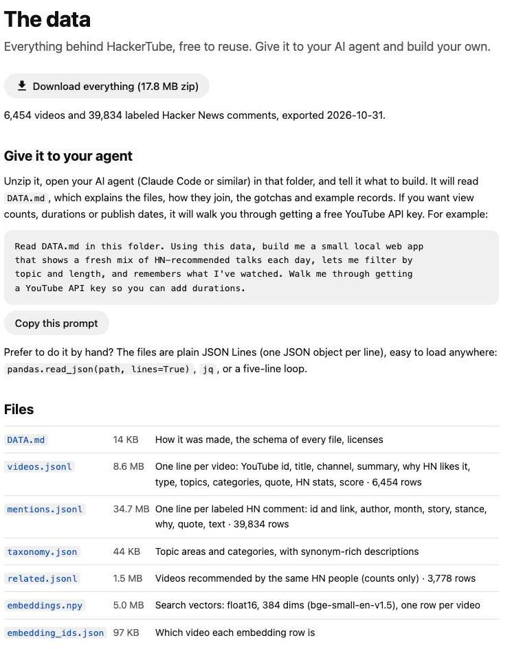

Andrej Karpathy built HackerTube, a YouTube-style site made only of videos that Hacker News commenters keep recommending, in roughly two hours by directing Claude Code rather than writing code himself. This breakdown covers how Karpathy built HackerTube with Claude Code, what the agents did at each step, what the build cost in tokens, and why the public dataset he released on October 31, 2026 produced dozens of "HackerTube, but for X" sites within three days.

## What Is HackerTube

HackerTube ([hackertube.org](https://hackertube.org/)) is a YouTube alternative that lists 6,454 videos recommended in HN comments from 2007 to 2026, grouped into 16 topic areas and 150 categories. It plays videos through YouTube's privacy-enhanced embed, has a "For You" feed with no account (state stays in your browser), keyboard shortcuts, and thumbnails taken from the frame halfway through each video instead of the creator's chosen image. The home page shown at the top of this article is Karpathy's own screenshot from his launch post.

Karpathy explained the thumbnail choice on HN: a frame "from exactly halfway in the video" gives a representative picture, where typical YouTube thumbnails are tuned for clicks. Users who prefer the original thumbnails can switch back in Settings. The launch post reached 2,860 points and 633 comments on Hacker News, and the most upvoted replies were about the feel of a feed with no engagement optimization: "it feels like I don't have to constantly be on high alert," wrote one commenter.

| Item | Value |
|---|---|
| Videos | 6,454 (2007–2026) |
| Source comments | 39,834 labeled HN comments |
| Taxonomy | 16 areas, 150 categories |
| Accounts | None; history and likes live in the browser |
| Build time | About 2 hours, per Karpathy |
| Server code | Not published |

## How Karpathy Built HackerTube with Claude Code

Karpathy built HackerTube by talking to the Claude Code Mac desktop app running Opus 5.5 at Medium effort, according to an edit to his post. The agents did the data work and the engineering; he chose what to build and handled four account-bound steps. The pipeline, as described in his post and HN replies:

1. **Collect.** Opus 5.5 downloaded every Hacker News comment. Karpathy noted that an HN export already exists on Hugging Face as Parquet files.
2. **Filter.** Comments linking to YouTube were kept.
3. **Label.** Sonnet read each comment inside a Claude Code workflow and judged whether it actually recommended the video. Spam was removed, leaving about 40,000 recommending comments.
4. **Organize.** Videos were scored and sorted into a topic taxonomy.
5. **Ship.** Opus wrapped the data in a YouTube-like UI, pushed it to a VPS, and secured and hardened the server.

Asked which parts he did by hand, Karpathy replied: "I didn't touch anything manually I only talked to Claude the whole project, except for YouTube API key, domain, its DNS record and VPS node boot." For security review he sometimes says "check recent cyber stuff," and the agent dispatches subagents to do it. He added that he gives this much autonomy "only with Opus 5.5+" and would not trust weaker models the same way. How much a model can improve its own agent setup is the question the [HarnessDev benchmark](/tutorials/harnessdev-agent-harness-benchmark/) measures.

His prompting is minimal. "My prompts are getting shorter and dumber because the model 'gets' what I'm doing even with fewer words," he wrote, adding that over-specifying can constrain the model when its default would have been better.

The same loop kept running after launch. Within hours of the HN post, Karpathy shipped filters for upload date, duration and video type, a "Recently recommended" sort that surfaces old talks HN linked last month, a damped like-ratio sort, and a "Play all on YouTube" button, crediting the commenters who asked for each.

## HackerTube Build Cost in Tokens

HackerTube cost about 504M input tokens and 7.6M output tokens, according to a tally Karpathy had Claude compute; he works on a subscription rather than paying per token. Most of that went to bulk classification of comments.

| Part of the work | Model | Tokens (Karpathy's tally) |
|---|---|---|
| Labeling HN comments | Sonnet | 90%+ of the total |
| App, deploy, hardening | Opus 5.5 | ~1M |
| All work | Mixed | 504M input (90% cached), 7.6M output |

The context was compacted once over the whole project. Karpathy called it "very small project by modern standards." In this split, a cheaper model does the high-volume judgment calls, and the strongest model handles the smaller amount of design and code. Teams that route work this way at scale usually put the choice of model in a [model gateway](/tutorials/model-gateway-enterprise-ai-control-plane/). For a framework to compare spend like this across agent tasks, see [cost per successful task for coding agents](/tutorials/coding-agents-finops-cost-per-successful-task/).

## HackerTube Dataset and Data Export

The HackerTube dataset is a 17.8 MB zip exported on October 31, 2026, downloadable from the site's [data page](https://hackertube.org/data). Karpathy did not release the server ("it's a vibe coded mess"), and suggested pointing Opus 5.5 at the zip instead; the YouTube-like site part "was like 3 min."

*The HackerTube data page, with a ready-made prompt for an AI agent. Screenshot taken Nov 4, 2026 from hackertube.org/data.*

| File | One row is | Size |
|---|---|---|
| `videos.jsonl` | A video, best-scored first | 6,454 rows, 8.6 MB |
| `mentions.jsonl` | A labeled HN comment linking a video | 39,834 rows, 34.7 MB |
| `related.jsonl` | Videos recommended by the same people | 3,778 rows, 1.5 MB |
| `taxonomy.json` | The topic tree | 16 areas, 150 categories |
| `embeddings.npy` | A 384-dim float16 vector (bge-small-en-v1.5) | 5.0 MB |
| `DATA.md` | Schema, joins, gotchas and licenses | 14 KB |

`DATA.md` opens with a section addressed to AI agents. A video's `score` is the number of distinct months in which HN recommended it, with strong recommendations counting extra. Each mention carries a `stance`; only `rec` and `strong_rec` count as recommendations, while `reference`, `joke` and `critical` mentions are kept for context.

YouTube's own metadata (descriptions, view counts, durations, publish dates) is left out because YouTube's API terms do not allow redistribution. `DATA.md` walks the human through creating a free YouTube Data API key in about five minutes and gives the agent a standard-library script that fetches all 6,454 videos in about 130 requests, well inside the 10,000-unit daily quota. HackerTube found about 6% of the originally linked videos already deleted or private. The data is licensed ODC-By 1.0; reuse requires crediting HackerTube and the [open-index/hacker-news](https://huggingface.co/datasets/open-index/hacker-news) dataset.

## HackerTube Copycats: HackerBooks, Wikihack and HackerTV

The HackerTube copycats arrived within a day, and most used the same recipe: an HN archive, Claude, and a few hours. HackerBooks, posted November 1, collected about 16,500 books mentioned by at least two HN commenters and reached 1,842 points; its author wrote that Claude (Opus 5.5) "wrote almost all of it, including the data pipeline and the site." Wikihack did the same for Wikipedia articles (339 points), and HackerTV (262 points, November 3) turned HackerTube's own data into 24/7 topic channels, "built with Claude Code in a few hours," with all data credit to HackerTube.

Smaller entries followed for GitHub repositories, Amazon products, games, words and an Apple TV client. By November 2 an Ask HN thread asked whether anyone was "worried about this flood of HackerTube-but-for apps." One reply drew the distinction the votes seemed to show: LLM-written content tends to be unpopular on HN, while LLMs used to aggregate and organize human content, especially HN's own, go to the front page. Another commenter raised a practical cost: as a source like HN becomes a dataset, its comment section draws more spam for moderators to handle.

Each of these builds pairs a labeled, documented dataset with a coding agent and ships in an afternoon. The harness around the model shapes how far that goes; see [why harnesses are becoming the runtime](/tutorials/agent-framework-harness-runtime-production/) and how other harnesses such as [DeepSeek Harness and Pi Agent](/tutorials/deepseek-harness-vs-pi-agent/) approach the same job.

## HackerTube FAQ

### Is the HackerTube source code available?

No. Karpathy said he did not publish the server, and recommended giving the data export to a coding agent instead. The data page includes a starter prompt: "Read DATA.md in this folder. Using this data, build me a small local web app…"

### How much did it cost to build HackerTube?

Karpathy reported 504M input tokens (90% cached) and 7.6M output tokens on a subscription plan. Over 90% went to Sonnet labeling comments; the app and deployment used about 1M Opus 5.5 tokens.

### What does a "50% thumbnail" mean?

The thumbnail is the frame from exactly halfway through the video, so it shows representative content rather than a designed click image. It can be switched off in Settings.

### What did Karpathy do manually?

He created the YouTube API key, bought the domain, set its DNS record and booted the VPS. Everything else went through conversation with Claude.

## References

- Andrej Karpathy, ["HackerTube"](https://karpathy.bearblog.dev/hacker-tube/), Oct 31, 2026 (with later edit on tools)
- [HackerTube: YouTube built from videos recommended by HN](https://news.ycombinator.com/item?id=50319510), Hacker News thread with Karpathy's replies, Oct 31, 2026
- HackerTube, [The data](https://hackertube.org/data) and DATA.md export, generated Oct 31, 2026
- [Show HN: HackerBooks – HackerTube, but for books mentioned on HN](https://news.ycombinator.com/item?id=50326821), Nov 1, 2026
- [Show HN: HackerTV – HN's most-recommended YouTube videos as 24/7 TV channels](https://news.ycombinator.com/item?id=50346755), Nov 3, 2026
