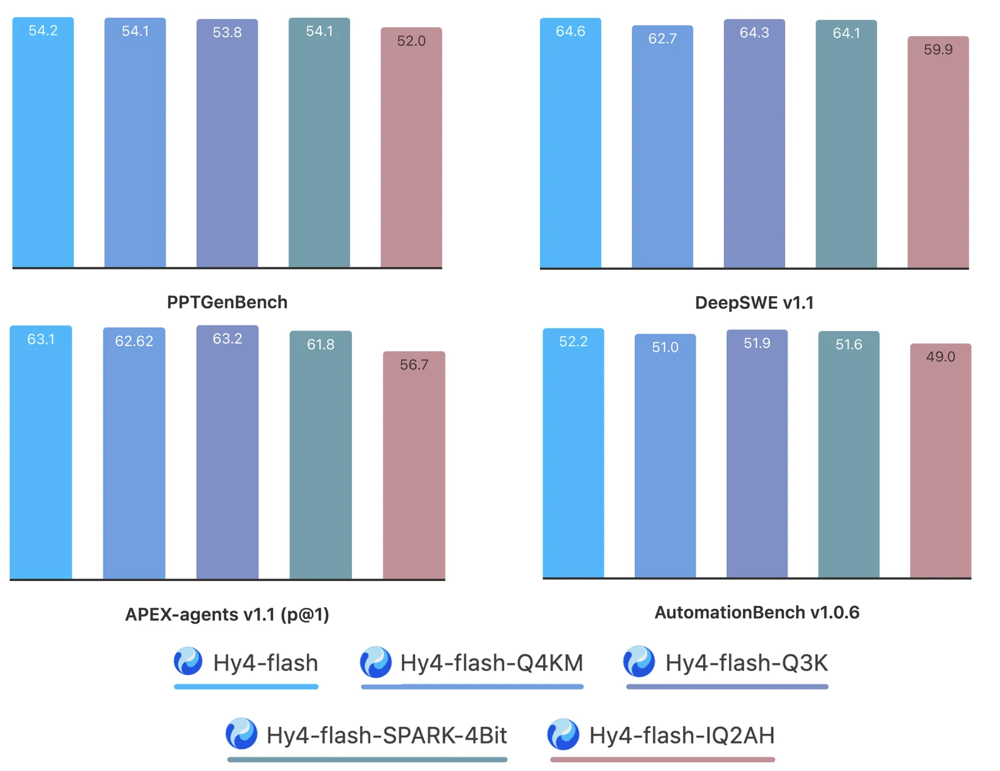
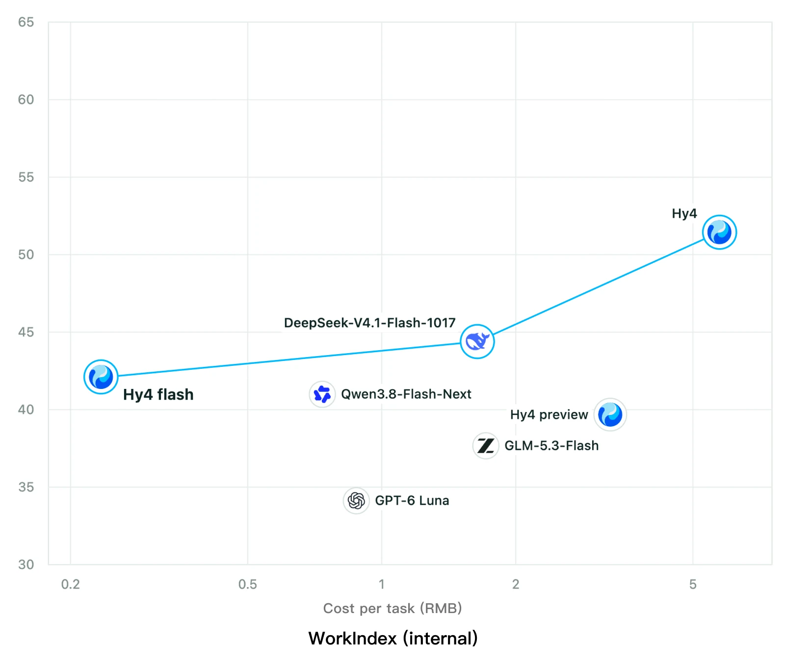

Hy4 Flash GGUF files let you run Tencent's 220B-parameter Hy4 Flash on a single machine, because 63.5B of those parameters sit in an Engram lookup table that llama.cpp can leave on the SSD. What has to fit in memory is the rest: 105 GB for Tencent's standard 4-bit build, 72 GB for its smallest one, and 49.1 GB for a community 2-bit build aimed at 64 GB machines. Tencent announced Hy4 Flash on November 16, 2026 and published the weights on Hugging Face a day later, with GGUF builds from its AngelSlim quantization team. This guide compares those builds, shows how to run them, and lists what each quant gives up in quality and speed.


## Hy4 Flash GGUF Files Compared: Memory, Disk and Quality {#hy4-flash-gguf-files-compared}

Pick the Hy4 Flash GGUF by the size of its first file, because that part has to sit in RAM or VRAM; the second file is the Engram table and can stay on disk. On a 128 GB machine that means Tencent's Q4_K_M or Q3_K, on 96 GB the IQ2-AH build, and on 64 GB only AtomicChat's community build.

| Build (repo) | In memory | Engram file | Total download | Agreement with full model* | Best fit |
|---|---:|---:|---:|---:|---|
| Q4_K_M (AngelSlim, Tencent) | 105.0 GB | 63.4 GB | 168.4 GB | 89.3% | 128 GB Mac or larger |
| Q3_K (AngelSlim, Tencent) | 92.0 GB | 63.4 GB | 155.4 GB | not measured | 128 GB, more headroom for context |
| IQ2-AH (AngelSlim, Tencent) | 71.6 GB | 63.4 GB | 135.0 GB | 77.9% | 96 GB machines |
| AD-IQ2_S-IQ2_XXS (AtomicChat) | 49.1 GB | 35.6 GB | 84.7 GB | 76.4% | 64 GB machines |
| SPARK-4Bit / -Fast (AngelSlim, Tencent) | one file, 162.5 / 159.6 GB | same file | 162.5 / 159.6 GB | not measured | NVIDIA "Spark" devices with 128 GB |

*\*Share of tokens where the build picks the same next token as AtomicChat's BF16 conversion, measured by AtomicChat with `llama-perplexity` on a 30-language corpus. Sizes are decimal GB from the Hugging Face file lists; all builds also need a vision projector file of about 1 GB for image input.*

Two things the table hides. First, "in memory" counts weights only: AtomicChat's 49.1 GB file held 51.4 GB of GPU memory once the vision projector and a 32K context were loaded on a CUDA machine, while the GPU limit AtomicChat suggests for a 64 GB Mac is 56 GB, so there is little room to spare. Second, the AngelSlim README calls its GGUF files a build "for end-to-end testing purposes"; for production serving, the Hy4 Flash model card points to vLLM and SGLang with the FP8 checkpoint on eight GPUs. If you are pricing that route, our [cloud GPU price guide](/tutorials/cloud-gpu-prices/) lists current hourly rates.

## How Hy4 Flash's Engram Table Stays on the SSD {#hy4-flash-engram-ssd}

Hy4 Flash can leave more than a quarter of its weights on disk because the Engram table is a lookup: each token reads only a handful of rows from it. Tencent's model card splits the model into 155.5B parameters for the network itself (512 routed experts with 16 active per token, about 11.3B active text parameters) and 63.5B in Engram, a table of learned bigram and trigram embeddings.

At four points in the 42-layer backbone (layers 1, 11, 21 and 31), the model hashes the last two and three tokens with eight hash heads per n-gram order and fetches the matching rows from a table of about 10.3 million entries per head. Each lookup returns a short embedding, 96 values per head, so a token needs a few kilobytes from the table no matter how large the table is. AtomicChat, which built the 64 GB GGUF, describes it this way: the table "is read row by row, a few kilobytes per token, so it can stay on disk."

The idea comes from DeepSeek's January 2026 paper *Conditional Memory via Scalable Lookup*, which introduced Engram as a second kind of sparsity next to mixture-of-experts. Because the rows to fetch depend only on the input tokens, the addresses are known before the layer runs, and the paper reports that the table can be prefetched from host memory "incurring negligible overhead." In llama.cpp, that becomes one flag: `-ot 'per_layer_token_embd\.weight=CPU'` keeps the Engram tensor on the host side while the rest of the model goes to the GPU; AtomicChat's README says the table then stays on the SSD instead of taking up memory.

The table also tolerates compression well. AtomicChat stored it at Q4_0, F8_E4M3 and Q8_0 with the same expert weights and measured almost no difference (mean KL divergence 0.7255, 0.7203 and 0.7204), which is why its Engram file is 35.6 GB against 63.4 GB in Tencent's builds.

## How to Run Hy4 Flash Locally with llama.cpp {#run-hy4-flash-locally-llama-cpp}

To run a Hy4 Flash GGUF today, build llama.cpp from pull request #32517, download both parts of one build, and point `llama-server` at the first part; it loads the second by itself. The PR adds the `hy_v4_flash` architecture (hybrid sparse and sliding-window attention, the Engram hash embeddings and latent-space experts) and was still open on November 19, 2026, so released llama.cpp binaries will refuse the files.

1. **Build llama.cpp from the PR.** Add `-DGGML_CUDA=ON` for NVIDIA GPUs; Metal is on by default on macOS.

   ```bash
   git clone https://github.com/ggml-org/llama.cpp && cd llama.cpp
   git fetch origin pull/32517/head:hy4-flash && git checkout hy4-flash
   cmake -B build && cmake --build build --config Release -j
   ```

   AtomicChat tested its files at commit `0a054d0b` of that branch. For the M5 Max, AngelSlim instead documents commit `2cbca389f` plus a `hy4-flash-mac-minimal.patch` from its repo.

2. **Download both GGUF parts** (for example `Hy4-flash-Q4_K_M-00001-of-00002.gguf` and `-00002-of-00002.gguf`) and the `mmproj` file if you want image input. Keep them in one folder.

3. **On a 64 GB Mac, raise the GPU memory limit** before loading AtomicChat's build. AtomicChat suggests `sudo sysctl iogpu.wired_limit_mb=57344`, which resets on reboot.

4. **Start the server with the Engram table on the host side:**

   ```bash
   ./build/bin/llama-server -m Hy4-flash-AD-IQ2_S-IQ2_XXS-00001-of-00002.gguf \
     --mmproj mmproj-Hy4-flash-F16.gguf \
     -ngl 99 -ot 'per_layer_token_embd\.weight=CPU' \
     -c 32768 --jinja --temp 0.9 --top-p 1.0
   ```

   Swap in the Q4_K_M or Q3_K file name for Tencent's builds; AngelSlim's own example uses `-c 8192 -ngl 99 --jinja` and serves an OpenAI-compatible API on port 8080. Temperature 0.9 and top-p 1.0 are Tencent's recommended sampling settings.

5. **Choose the reasoning mode.** Reasoning is on by default. For direct answers add `--chat-template-kwargs '{"reasoning_effort":"no_think"}'`, but read the tool-calling note under [limitations](#hy4-flash-gguf-limitations) before using it with an agent.

If you have run other open models this way, the steps match our [Qwen 3.8 27B local setup](/tutorials/qwen-3-8-27b/); the differences are the PR build and the `-ot` override for the Engram tensor.

## Hy4 Flash Quantization Benchmarks: What Each GGUF Loses {#hy4-flash-quantization-benchmarks}

Tencent's 4-bit and 3-bit GGUF builds score within about 2 points of the full model on its agent benchmarks, while the 2-bit IQ2-AH build loses 2.2 to 6.4 points. AngelSlim's chart compares the original weights with each build on four task suites:



*Hy4 Flash GGUF builds vs the full model on four agent benchmarks. Image by Tencent's AngelSlim team, from the AngelSlim/Hy4-flash-GGUF model card.*

| Benchmark | Full model | Q4_K_M | Q3_K | SPARK-4Bit | IQ2-AH |
|---|---:|---:|---:|---:|---:|
| APEX-Agents v1.1 (pass@1) | 63.1 | 62.62 | 63.2 | 61.8 | 56.7 |
| DeepSWE v1.1 | 64.6 | 62.7 | 64.3 | 64.1 | 59.9 |
| AutomationBench v1.0.6 | 52.2 | 51.0 | 51.9 | 51.6 | 49.0 |
| PPTGenBench | 54.2 | 54.1 | 53.8 | 54.1 | 52.0 |

Q3_K matches or beats Q4_K_M on three of the four suites while needing 13 GB less memory, which makes it the better pick on a 128 GB machine unless you have a reason to prefer the more standard Q4_K_M recipe. These are Tencent's own runs on its own harness.

AtomicChat measured the builds a different way: how closely each one's next-token distribution matches a BF16 conversion of the original weights. On that scale Tencent's Q4_K_M picks the same top token 89.3% of the time, IQ2-AH 77.9%, and AtomicChat's 64 GB build 76.4%, so the community build gives up 1.4 points of agreement to save 22.5 GB of memory against Tencent's smallest file. AtomicChat ran no task benchmarks on it and calls it "an experimental build."

AtomicChat also found that Hy4 Flash is unusually sensitive to quantization. Even its unpublished Q8_0 build differs from BF16 on 8.2% of tokens, where most models stay above 98% agreement. The errors are concentrated: Tencent's Q4_K_M has a median KL divergence of 0.008, so most tokens come out nearly exact and a minority diverge a lot. AtomicChat's explanation is that small rounding differences change which 16 of the 512 experts the router picks; treat that as its hypothesis rather than a measured cause.

## Hy4 Flash Local Speed on Mac and NVIDIA {#hy4-flash-local-speed}

On Apple silicon, Tencent measured 44 to 50 tokens per second of generation with its Q4_K_M and Q3_K builds on an M5 Max with 128 GB, in what AngelSlim describes as real WorkBuddy tasks:

| Hardware and build | Decode tok/s at 4K / 16K / 32K context | Prefill tok/s at 4K / 16K / 32K |
|---|---|---|
| M5 Max 128 GB, Q4_K_M | 48.13 / 45.18 / 44.15 | 629.8 / 448.1 / 418.6 |
| M5 Max 128 GB, Q3_K | 50.34 / 49.47 / 47.37 | 743.2 / 563.0 / 520.6 |
| RTX Spark 128 GB, SPARK-4Bit-Fast | 31.95 / 33.14 / 33.39 | 799 / 717 / 707 |
| RTX Spark 128 GB, SPARK-4Bit | 25.80 / 28.16 / 30.3 | 765 / 686 / 666 |

AngelSlim adds that Q3_K reaches up to 70 tokens per second on code generation, and SPARK-4Bit-Fast up to 40. Decode speed barely drops from 4K to 32K context, which fits the model card's claim that the hybrid attention cuts the KV cache to one sixth of Hy4's.

There is no published Mac number for AtomicChat's 64 GB build. On four A100 80 GB GPUs, with layers split across the cards and the Engram table on the host, AtomicChat measured about 23 to 26 tokens per second. Tencent's own figure of more than 150 tokens per second applies to its serving stack with megakernels, 4-bit weights and the DFly2 drafter, none of which a llama.cpp GGUF run uses; our piece on [megakernels vs CUDA Graphs](/tutorials/megakernel-vs-cuda-graphs/) covers what megakernels change in a serving stack.

## Hy4 Flash GGUF Limitations: Tool Calls, MLX and Ollama {#hy4-flash-gguf-limitations}

The biggest practical limit is software support: as of November 19, 2026, every Hy4 Flash GGUF needs the unmerged llama.cpp PR, and AtomicChat notes that "stock llama.cpp, LM Studio and Ollama do not load these files yet." If the PR's format changes before it is merged, the files may need to be rebuilt; AtomicChat says it will update its build if that happens.

- **Tool calls in no_think mode.** With reasoning on, AtomicChat's 2-bit build called the tool it was given. With `reasoning_effort` set to `no_think`, it answered in prose instead. Its Q8_0 build called the tool in both modes. For agents on a heavily quantized build, keep reasoning on.
- **No DFly2 drafter.** Hy4 Flash ships a 0.85B speculative-decoding drafter, DFly2, that reuses the main model's KV cache. llama.cpp does not support it, so GGUF runs decode without it.
- **MLX is not ready.** TensorFold has published MLX 4-bit (129.86 GB) and 8-bit (239.30 GB) conversions, but marks them as preview checkpoints: its own runtime, TensorFold 1.2.9, rejects the architecture at startup, and generation has not been validated.
- **Translation quality.** On the Hacker News launch thread, one user reported that Hy4 Flash made many more translation errors than DeepSeek V4.1 Flash 1017. That is a single report, but worth a test before you rely on it for multilingual work.
- **License terms.** Hy4 Flash uses the Tencent Hy License. AtomicChat summarizes it as Apache 2.0 with extra commercial terms: a separate license is needed for model-as-a-service businesses above US$50 million in annual revenue or products above 100 million monthly active users.

## Hy4 Flash GGUF vs API: Cost per Task Comparison {#hy4-flash-gguf-vs-api}

For occasional use, the Hy4 Flash API costs far less than the memory needed to run the GGUF. Tencent lists the model at $0.070 per million input tokens and $0.281 per million output tokens ($0.003 cached), and OpenRouter serves it at $0.035 and $0.1405 with a 1,048,576-token context. On Tencent's internal WorkIndex benchmark, Hy4 Flash scores 42.1 at about a quarter of a yuan per task, against 51.4 for the full Hy4 at about 20 times the cost:



*WorkIndex score vs cost per task. WorkIndex is Tencent's internal benchmark of eight everyday task sets such as slide creation and spreadsheet repair. Image by Tencent Hy, from the Hy4 flash model card.*

Outside Tencent's own tests, Mercor ran Hy4 Flash on APEX-Agents, its benchmark of long professional tasks in banking, consulting and law, and measured 62.4% pass@1 at about $0.009 per successful task. That puts it behind DeepSeek V4.1 Flash 1017 (69.8%), Meta's [Muse Ember](/tutorials/muse-ember/) (64.3%) and Google's [Gemini 4 Hydrogen](/tutorials/gemini-4-hydrogen-benchmarks/) (78.0%), ahead of Claude Haiku 5.5 (56.1%), and 15.2 points below the full Hy4 at about a twentieth of the cost. Our guide to [cost per successful task](/tutorials/coding-agents-finops-cost-per-successful-task/) explains why that is the number to compare.

Running the GGUF locally makes sense when data cannot leave the machine, when you need to work offline, or when you already own a 96 or 128 GB Mac. For those cases, Tencent's Q3_K is the build to start with on 128 GB, IQ2-AH on 96 GB, and AtomicChat's experimental 2-bit file on 64 GB, with reasoning left on for any agent work.

## References {#references}

1. Tencent Hy, [Hy4 flash model card](https://huggingface.co/tencent/Hy4-flash), Hugging Face, November 2026.
2. Tencent AngelSlim, [Hy4-flash GGUF](https://huggingface.co/AngelSlim/Hy4-flash-GGUF), Hugging Face, accessed November 19, 2026.
3. AtomicChat, [Hy4-flash for 64 GB machines (GGUF)](https://huggingface.co/AtomicChat/Hy4-flash-GGUF), Hugging Face, November 18, 2026.
4. ggml-org, [Model: add hy_v4_flash support, llama.cpp PR #32517](https://github.com/ggml-org/llama.cpp/pull/32517), opened November 18, 2026.
5. Cheng et al., [Conditional Memory via Scalable Lookup: A New Axis of Sparsity for Large Language Models](https://arxiv.org/abs/2601.07372), arXiv, January 2026.
