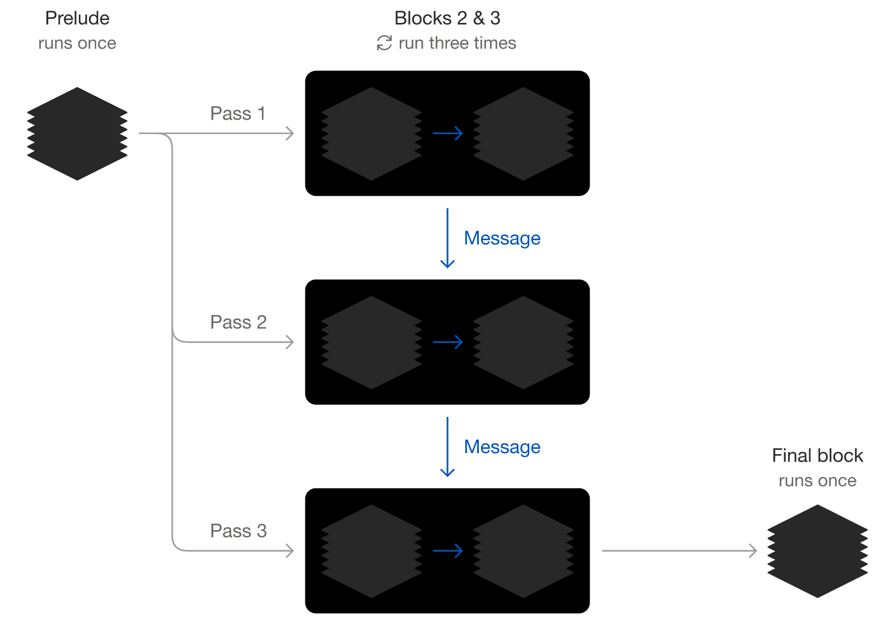

Inkling 2 Mini runs in Ollama with one command, `ollama run inkling-2-mini`, but for now only on an Apple silicon Mac with 32GB or more of memory. Ollama 0.40.17, the release that added the model, states that Inkling 2 Mini "is supported on Apple silicon only in this release" and that PC support will follow in an upcoming one. Thinking Machines Lab released the 26.4B-parameter open-weights model on November 20, 2026, as its first model aimed at local hardware, and Ollama is the runtime it names for Macs.

This guide covers the Mac path from install to API call, the pull error most people hit first, the limits Thinking Machines recommends before you let a coding agent drive the model, the GGUF route for Windows, Linux and smaller Macs, and how it compares with Qwen 3.8 27B, the local model Thinking Machines measures it against.

| Your machine | What to use today |
|---|---|
| Apple silicon Mac, 32GB+ | Ollama 0.40.17 or newer: `ollama run inkling-2-mini` |
| Apple silicon Mac, 16 to 24GB | A 2- to 4-bit GGUF through Unsloth or llama.cpp |
| Windows or Linux PC with a GPU | GGUF through llama.cpp or Unsloth until Ollama adds PC support |
| NVIDIA DGX Spark or a data-center GPU | SGLang, vLLM or the GGUF route |

## Inkling 2 Mini Ollama Requirements: Which Machines Run It {#inkling-2-mini-ollama-requirements}

To run Inkling 2 Mini in Ollama you need Ollama 0.40.17 or newer and an Apple silicon Mac (MacBook, Mac mini or Mac Studio) with at least 32GB of unified memory. Ollama's Windows and Linux builds do not run it yet.

The 32GB floor comes from Thinking Machines' model card. The model ships as a single checkpoint of about 20GB, with 20 layers in NVFP4 and the last four in MXFP8, the same precisions it was trained in, so Ollama serves it without a conversion step. The rest of the memory goes to the context cache, image inputs and everything else running on the Mac. Ollama lists a 1M-token context window for every tag, but Unsloth's guide notes that longer contexts and image inputs need memory beyond the weights, so leave headroom rather than sizing to the 20GB download. The model card names three supported local setups: Apple silicon with 32GB or more, one NVIDIA DGX Spark, and other GPUs with 32GB or more of VRAM recommended. Thinking Machines' own demo, in which the model built a playable flight simulator offline, ran on a 48GB MacBook Pro with an M5 Pro chip.

There is no official tokens-per-second figure for a Mac. The model card says plainly that "support for looped models in local runtimes is new, and speed varies by runtime and hardware." Each token passes through 48 layer applications from 24 stored layers, so it does more work per token than its 3.4B active parameters suggest; Thinking Machines counts 5.4B effective active parameters once the loops are included.

<p><strong>No 32GB Mac yet?</strong> The model card says Inkling 2 Mini is also served through Thinking Machines' Tinker API and third-party inference providers, so you can judge its output before committing hardware to it. If you would rather keep one API key across the hosted models you are comparing it with, a shared gateway such as
<a href="https://www.packyapi.ai/register?aff=5W73&amp;utm_source=agentspulse&amp;utm_medium=affiliate&amp;utm_campaign=inkling-2-mini-ollama"
rel="sponsored nofollow noopener" target="_blank">PackyAPI</a> is one option.</p>
<p><small>Disclosure: this page contains an affiliate link. If you sign up through it, we
may earn a commission at no extra cost to you.</small></p>

## How to Run Inkling 2 Mini in Ollama on a Mac {#run-inkling-2-mini-in-ollama}

Update Ollama to 0.40.17 or later, confirm the version with `ollama -v`, then run `ollama run inkling-2-mini`. The first run downloads about 20GB and opens an interactive chat that takes text and image input.

1. **Update and check the version.** Install the current macOS build from Ollama's download page, then run `ollama -v`. If it prints an older version, or warns that the client version differs from the server, quit the Ollama app and start it again so the new server is the one answering.
2. **Pull and chat.** `ollama run inkling-2-mini` pulls the model and opens a prompt.
3. **Pick a tag, or don't.** The library lists `inkling-2-mini:latest`, `inkling-2-mini:26b-a5b` and `inkling-2-mini:26b-a5b-nvfp4` (labeled MLX). All three are 20GB and carry the same digest, `d183b1321cb5`, so they are one build under three names. Ollama had no smaller quantization of the model as of November 22.
4. **Call it from code.** The server listens on port 11434:

```bash
curl http://localhost:11434/api/chat -d '{
  "model": "inkling-2-mini",
  "messages": [{"role": "user", "content": "Hello!"}]
}'
```

Two changes in 0.40.17 matter for this model. Ollama on Apple silicon now serves several requests at once, which helps when more than one agent shares the model; Thinking Machines' Thinkyville demo runs all 20 residents of a pixel town on one offline MacBook. And turning thinking off now maps to the model's lowest reasoning level instead of being ignored. That level still reasons a little: the model card notes that minimum effort "does not fully disable reasoning," so expect some thinking tokens even with it switched off.

### Fixing "pull model manifest: 412" {#ollama-412-error}

The message `Error: pull model manifest: 412: The model you are attempting to pull requires a newer version of Ollama` means the registry checked your client version and refused the download. Upgrading fixes it in most cases. If `ollama -v` still shows the old number after an upgrade, a second, older Ollama binary is answering; in [Ollama issue #12826](https://github.com/ollama/ollama/issues/12826) the culprit was an editor extension that had started its own old copy. Stop that process and restart the Ollama app.

On Windows or Linux, an up-to-date Ollama still hits the platform limit: the 0.40.17 notes restrict the model to Apple silicon. Use the GGUF route below until Ollama's PC release lands.

## Inkling 2 Mini with Claude Code and OpenCode via Ollama {#inkling-2-mini-coding-agents}

Ollama's library page lists one-line launchers that point a coding agent at the local model: `ollama launch claude --model inkling-2-mini` for Claude Code, and the same pattern with `opencode`, `hermes` and `openclaw`. Once launched, the agent's file edits and shell commands follow Inkling 2 Mini's decisions.

Thinking Machines' model card is direct about what can go wrong there. When using tools, the model "may take destructive actions, such as deleting or overwriting files, without confirmation, and may not report the outcome of its work accurately." In internal testing it also sometimes got stuck in long reasoning loops, re-checking its own work without progress, particularly while debugging code. The card's recommendations translate into a short setup checklist:

- Run the agent in a sandbox, a container or a throwaway git worktree, and keep its approval prompts on for deletions and shell commands.
- Cap output tokens and agent turns so a reasoning loop ends on its own.
- Check the diff yourself; do not rely on the agent's summary of what it changed.

In 0.40.17, `ollama launch claude` also supports Claude Code's deferred tool loading, so MCP tools load when needed instead of all at once. Keep in mind that Thinking Machines' coding scores come from its own harnesses (mini-swe-agent, bash-only runs and the pi agent, where it scores 71.6% on Terminal-Bench 2.1), not from Claude Code or OpenCode; results in a different harness can differ, as the [Qwen3.8 27B pi adapter numbers](/tutorials/qwen3-8-27b-pi-adapted/) showed for another local model. The card also reports lower output quality outside English, with clipped phrasing and mixed languages in Chinese tests.

## Inkling 2 Mini GGUF for Windows, Linux and Smaller Macs {#inkling-2-mini-gguf}

Until Ollama ships PC support, Windows and Linux users run Inkling 2 Mini from GGUF files with llama.cpp or Unsloth, and the same files let 16GB and 24GB Macs run a smaller quantization. Two GGUF sets are available, from ggml-org and from Unsloth, and they need different llama.cpp builds.

Unsloth publishes these memory starting points for RAM plus VRAM, or unified memory:

| Quantization | Memory needed (Unsloth) | Example file |
|---|---|---|
| 1-bit | 9GB | UD-IQ1_S, 7.76GB |
| 2-bit | 10 to 11GB | UD-IQ2_XXS, 8.49GB |
| 3-bit | 13 to 15GB | UD-Q3_K_XL, 13.63GB |
| 4-bit (recommended) | 17 to 18GB | UD-Q4_K_XL, 17.63GB |
| 8-bit | 24GB | UD-Q8_K_XL, 22.87GB |

Longer contexts and images need more, and the F16 vision projector adds 639MB to the download. In Unsloth's comparison against its 8-bit reference, UD-Q4_K_XL picks the same top token 98.0% of the time, and UD-IQ2_XXS still agrees 90.6% of the time at 8.49GB.

Which build to use:

- **Unsloth Desktop (macOS, Windows, Linux).** Search the model hub for `unsloth/Inkling-2-Mini-GGUF`, download the quant that fits, and chat. From the command line: `unsloth run --model unsloth/Inkling-2-Mini-GGUF:UD-Q4_K_XL --temp 1.0 --top-p 1.0 --top-k 0 --min-p 0.0`.
- **llama.cpp with Unsloth's files.** The GGUFs in the root of Unsloth's repository use its own looped-layer layout and need Unsloth's llama.cpp build `b12588-mix-c0c3de8`. For mainline llama.cpp, Unsloth points to the files in its `Mainline_Support` folder instead.
- **llama.cpp with ggml-org's files.** The [Hugging Face launch post](https://huggingface.co/blog/inkling2mini) gives `llama serve -hf ggml-org/Inkling-2-Mini-GGUF:IQ4_NL` for the 4-bit build; change the suffix to `:Q8_0` for 8-bit.

Unsloth recommends temperature 1.0, top-p 1.0, top-k 0 and min-p 0.0. For CPU-only machines its guide sets `--n-gpu-layers 0`. On NVIDIA data-center hardware, the model card lists SGLang, vLLM, NVIDIA Dynamo and TokenSpeed; Hugging Face notes that SGLang's day-zero support needs an SM103 GPU. If you are sizing a GGUF for a different model, the same memory logic is worked through in our [Hy4 Flash GGUF guide](/tutorials/hy4-flash-gguf/) and the [Edge0-145B hardware breakdown](/tutorials/edge0-145b-hardware-requirements/).

## Inkling 2 Mini vs Qwen 3.8 27B for Local Use {#inkling-2-mini-vs-qwen-3-8-27b}

Artificial Analysis scores Inkling 2 Mini at 20 on its Intelligence Index, level with Qwen3.8 27B. In Thinking Machines' own table, Inkling 2 Mini leads on agentic coding benchmarks and trails Qwen3.8 27B on factual recall, multi-turn chat and some automation tasks.

| Benchmark (Thinking Machines' table) | Inkling 2 Mini | Qwen3.8-27B |
|---|---|---|
| DeepSWE v1.1 (mini-swe-agent) | 48.2% | 42.2% |
| SWE-bench Pro v2 Hard (mini-swe-agent) | 77.9% | 73.8% |
| SWE-bench Verified (bash only) | 79.2% | 77.8% |
| Terminal-Bench 2.1 (pi) | 71.6% | 73.0% |
| AutomationBench-AA v1.0.6 | 41.8% | 48.2% |
| AA-Omniscience non-hallucination rate | 63.4% | 71.4% |
| Download for local use | 20GB native build | 17GB Q4_K_M build |

The coding rows are self-reported and evaluation setups vary by model. Thinking Machines' launch post also lists multi-turn chat as a weak spot, with 50.0% on MultiChallenge, behind Qwen3.8-27B. Hugging Face's engineers, after informal vibe tests, called it "at least comparable with Qwen 3.8 27B" and added that more validation is needed. The 17GB Qwen figure is the build Simon Willison ran in our [Qwen 3.8 27B guide](/tutorials/qwen-3-8-27b/).



*Inkling 2 Mini's looped layout: the prelude and final blocks run once, and the shared middle blocks run three times per token, 48 layer applications from 24 stored layers. Source: Thinking Machines Lab, "Introducing Inkling 2 Mini" (rendered from the post's SVG).*

The speed difference comes from that design. Qwen3.8 27B is a dense model that reads all 27B parameters for every token, while Inkling 2 Mini routes each token through 8 of 128 experts and loops its middle layers, for 5.4B effective active parameters per token. Artificial Analysis measured the trade-off through hosted APIs, pricing Inkling 2 Mini at Thinking Machines' first-party rates: Inkling 2 Mini writes about 38% more output tokens per Intelligence Index task than Qwen3.8 27B (about 152K against 110K) but uses roughly 2.8 times less compute, and it finished each task in 9.0 minutes for $0.59, against 38.2 minutes and $3.53 for Qwen3.8 27B. Those are hosted figures. The speed chart in Thinking Machines' launch post shows a theoretical ceiling at 614GB/s of memory bandwidth, and on a Mac the real gap depends on how well the runtime handles looped layers, which the model card calls new.

For a 32GB Mac, the choice follows the work. Inkling 2 Mini is the stronger pick for agentic coding in a sandboxed agent, where its benchmark lead and lower compute per token both count. Qwen3.8 27B is the safer default for factual questions, long multi-turn chats and instructions with many constraints. Both fit in the same memory, so the practical test is to run your own task through each and compare the diffs, and to judge cost per finished task rather than per token, as we argued in our piece on [coding-agent cost per successful task](/tutorials/coding-agents-finops-cost-per-successful-task/). If you need more headroom than either, the 594B [Inkling 2 Small](/tutorials/inkling-2-small/) from the same model ladder runs on Tinker.

## References {#references}

1. Thinking Machines Lab, ["Introducing Inkling 2 Mini"](https://thinkingmachines.ai/news/inkling-2-mini/), November 20, 2026.
2. Thinking Machines Lab, [Inkling 2 Mini Model Card](https://thinkingmachines.ai/model-card/inkling-2-mini/), November 20, 2026.
3. Ollama, [v0.40.17 release notes](https://github.com/ollama/ollama/releases/tag/v0.40.17) and [inkling-2-mini library page](https://ollama.com/library/inkling-2-mini), accessed November 22, 2026.
4. Unsloth, ["Inkling 2 Mini - Run Locally Guide"](https://unsloth.ai/docs/models/inkling-2-mini), accessed November 22, 2026.
5. Artificial Analysis, [Inkling 2 Mini: Intelligence, Performance & Price Analysis](https://artificialanalysis.ai/models/inkling-2-mini), accessed November 22, 2026.
