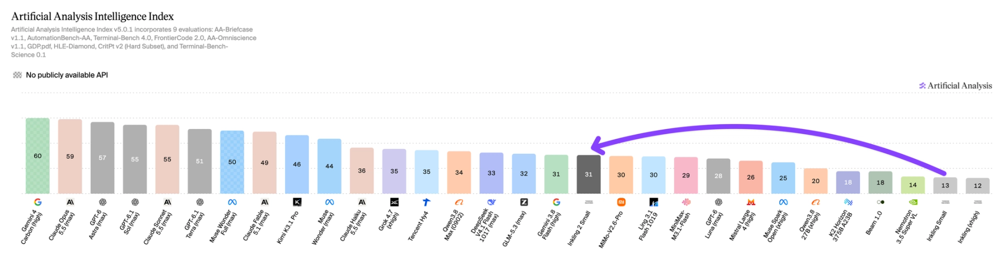
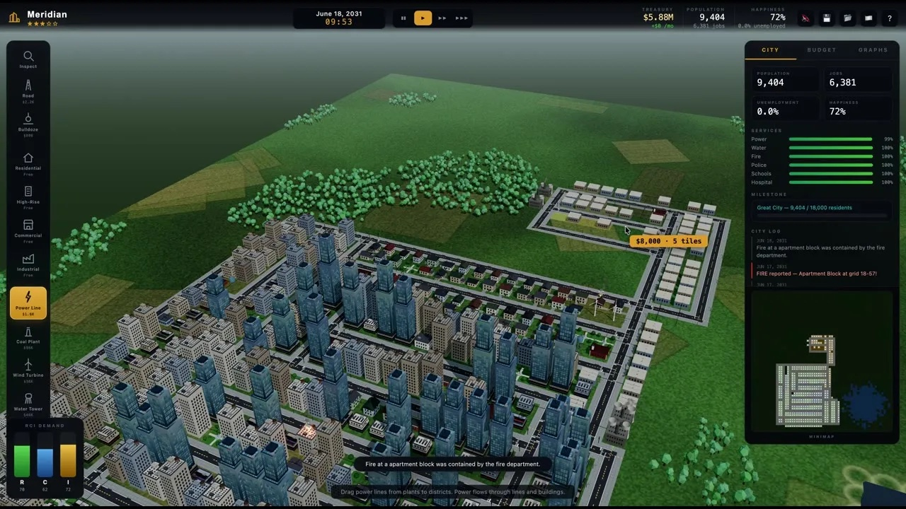
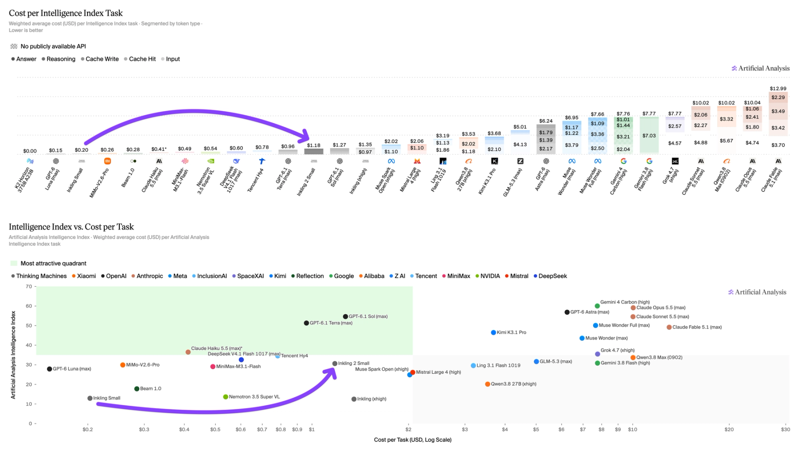
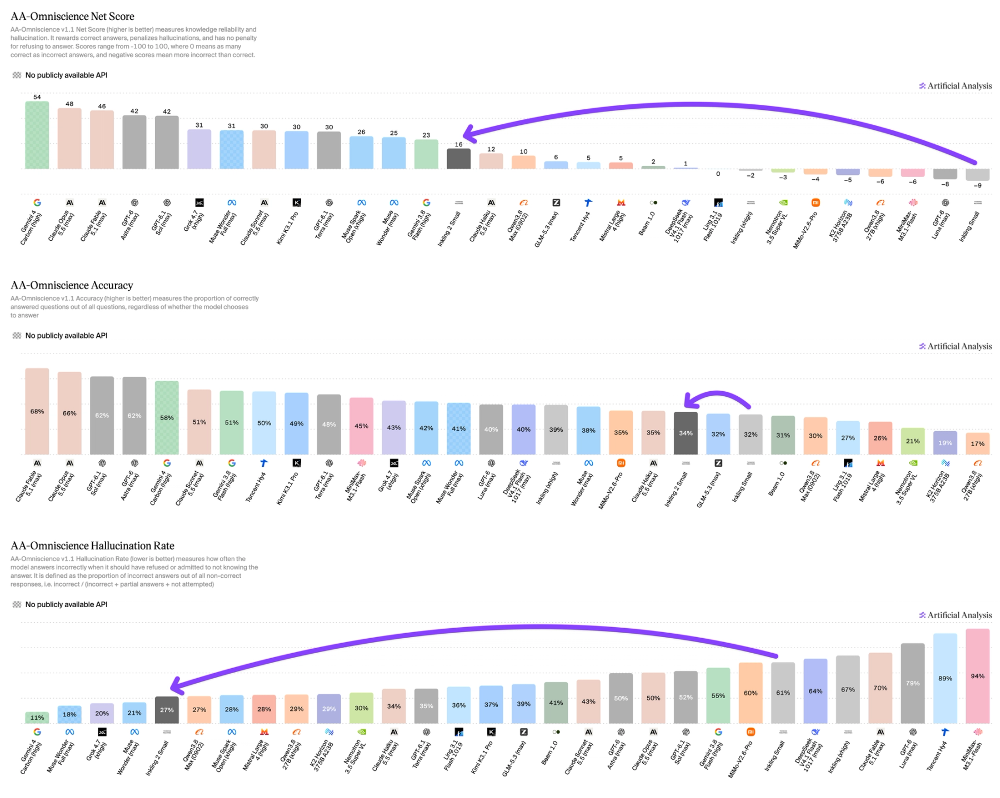

Inkling 2 Small is the second-generation language model from Thinking Machines Lab, released on November 5, 2026. It is a Mixture-of-Experts (MoE) model with 594 billion total parameters and 17 billion active per token, accepts text and images, and lets you set how much effort it spends on an answer. It is available now through Thinking Machines' Tinker platform with closed weights, and the company says it will publish the full weights under Apache 2.0 next week.

| Question | Short answer |
|---|---|
| What is it? | A 594B / 17B-active multimodal MoE model, successor to Inkling and Inkling Small. |
| How strong? | 31 on the Artificial Analysis Intelligence Index, level with Gemini 3.8 Flash (high). |
| What does it cost? | $0.30 input, $0.03 cached input, $1.00 output per million tokens on Tinker. |
| Cost per index task | $1.18, against $7.77 for Gemini 3.8 Flash (high) and $0.20 for Inkling Small. |
| Open weights? | Planned under Apache 2.0 after external red-teaming; not released as of November 7. |
| Main catch | About 150K output tokens per index task, roughly 4x Inkling Small. |

## What Is Inkling 2 Small? {#what-is-inkling-2-small}

Inkling 2 Small is a general-purpose text-and-image model aimed at agentic coding, knowledge work and visual tasks. The model card lists these specifications:

- **Architecture:** a 48-layer decoder-only transformer. Each token is routed to 8 of 384 experts, and attention mixes local and global layers.
- **Vision:** a 292M-parameter encoder based on Perception Encoder, using 20×20-pixel patches with 2×2 pooling, interleaved with text tokens.
- **Context:** up to 1M tokens per the model card. Tinker currently lists 64K and 256K versions.
- **Numerics:** MXFP8 and NVFP4.
- **Effort:** a variable effort setting that trades speed for thoroughness. Thinking Machines ran its own benchmarks at effort 0.99 (xhigh).

Despite the "Small" name, it is larger than the 276B Inkling Small and smaller than the 975B Inkling that Thinking Machines released earlier. That first Inkling scored 63.8 on Terminal-Bench 2.1 in [Ricursive's comparison table for Ripple-65B](/tutorials/ripple-65b-preview/). Thinking Machines describes Inkling 2 Small as one rung of a "ladder" of models trained with the same recipe, with more sizes to follow.

## Inkling 2 Small Benchmarks {#inkling-2-small-benchmarks}

Inkling 2 Small scores 31 on the Artificial Analysis Intelligence Index v5.0.1, up 18 points from Inkling Small. That matches Gemini 3.8 Flash (high) and puts it above Xiaomi's MiMo-V2.6-Pro. Artificial Analysis notes that once the weights ship, it would be the highest-scoring open-weights model developed outside China on its current rankings.

*Intelligence Index v5.0.1: Inkling 2 Small at 31, up from 13 for Inkling Small. Source: Artificial Analysis, November 5, 2026.*

### Independent results from Artificial Analysis

| Evaluation | Inkling 2 Small | Comparison |
|---|---|---|
| AutomationBench-AA | 46% | Inkling Small 5% |
| FrontierCode 2.0 | 25% | Claude Sonnet 5.5 (medium) 11% |
| Terminal-Bench 4.0 | 13% | Claude Sonnet 5.5 (medium) 30% |
| HLE-Diamond | 29% | Inkling Small 12% |
| CritPt v2 (research physics) | 56% | Gemini 3.8 Flash (high) 65% |
| AA-Briefcase (business workflows) | 1527 Elo | Claude Sonnet 5.5 (medium) 1439 |
| AA-3D (interactive 3D) | 1021 Elo | Muse Spark 1.3 (max) 1033 |
| Code2Video-AA | 1020 Elo | Qwen3.8 Max (xhigh) 1021 |

The coding picture is mixed. Inkling 2 Small more than doubles Claude Sonnet 5.5 (medium) on FrontierCode 2.0 but scores less than half of it on Terminal-Bench 4.0. If your workload is mostly terminal-driven agent work, test it on your own tasks before switching.

### Thinking Machines' own numbers

Thinking Machines' launch tables compare the model with other open-weights "Flash"-class models. These are self-reported, run at effort 0.99 and temperature 1.0 with a 1M-token trajectory limit.

| Benchmark | Inkling 2 Small | GLM-5.3-Flash | DeepSeek-V4.1-Flash-1017 | Kimi K3 |
|---|---|---|---|---|
| FrontierCode v2.0 | 25.4% | 14.2% | 28.5% | 17.3% |
| DeepSWE v1.1 | 72.1% | 63.4% | 77.0% | 68.5% |
| Vibe Code Bench v1.1 | 81.6% | 30.8% | 87.7% | 85.0% |
| Terminal Bench Science v0.1 | 5.7% | 4.8% | 12.9% | 8.1% |
| MMMU Pro (Standard 10) | 81.6% | 79.0% | 80.6% | 80.5% |
| ScreenSpot Pro (original / with Python) | 83.8 / 91.5% | – | – | 73.8 / 83.2% |
| JobBench | 70.5% | 60.7% | – | 54.3% |
| AA-Briefcase v1.1 (Elo) | 1527 | 1451 | 1570 | 1497 |

Two things stand out. In Thinking Machines' own table, DeepSeek-V4.1-Flash-1017 beats Inkling 2 Small on FrontierCode, DeepSWE, Vibe Code Bench and Terminal Bench Science. Inkling 2 Small's clearer lead is in vision, where it posts the top score on most of the visual rows, including MMMU Pro, ScreenSpot Pro and BabyVision.

Thinking Machines also shows demos that combine vision with coding, where the model uses visual feedback to build and refine websites, games and 3D scenes. One is a Three.js city simulator built without pre-made assets. In a lighter test, the model identified three wines from a single photo in 19 of 20 trials.

*A city simulator Inkling 2 Small built in Three.js with procedurally generated buildings, textures and cars. Source: Thinking Machines, November 5, 2026.*

The autoresearch demo is the most concrete agent example. Given a 12-hour, $500 budget, Inkling 2 Small trained a LoRA of Qwen3.5-4B on Tinker to forecast time series such as weather and Wikipedia page views. It wrote its own evaluator, ran SFT and RL, and finished after about 4.5 hours and $426 with a forecasting score more than double the base model's. It is a single showcase run, not a benchmark.

## Inkling 2 Small Pricing and Cost per Task {#inkling-2-small-pricing}

Inkling 2 Small costs $0.30 per million input tokens, $0.03 per million cached input tokens and $1.00 per million output tokens on Tinker. Fine-tuning costs $1.50 per million tokens on the 64K version and $3.00 on the 256K version.

| Tinker version | Context | Prefill | Sample | Train |
|---|---|---|---|---|
| Inkling 2 Small | 64K | $0.30 ($0.03 cached) | $1.00 | $1.50 |
| Inkling 2 Small (256K) | 256K | $0.30 ($0.03 cached) | $1.00 | $3.00 |
| Inkling (for reference) | 64K | $1.87 | $4.68 | $5.61 |

Token prices only tell part of the story because the model is verbose. Artificial Analysis measured about 150K output tokens per Intelligence Index task, against about 37K for Inkling Small, 31K for Claude Sonnet 5.5 (medium) and 99K for Gemini 3.8 Flash (high). That pushes its cost to $1.18 per task, almost six times Inkling Small's $0.20, though still well below Gemini 3.8 Flash (high) at $7.77 and Claude Sonnet 5.5 (medium) at $10.02. Measuring spend per finished task rather than per token, as we argued in [our piece on coding-agent FinOps](/tutorials/coding-agents-finops-cost-per-successful-task/), gives a fairer comparison here.

*Cost per Intelligence Index task and score versus cost. Inkling 2 Small sits at the low-cost edge of models scoring around 30. Source: Artificial Analysis, November 5, 2026.*

Serverless inference on Tinker is in beta. For production use, Thinking Machines asks teams to join a waitlist.

## When Will Inkling 2 Small Open Weights Be Released? {#inkling-2-small-open-weights}

Thinking Machines says it intends to release the full Inkling 2 Small weights under an Apache 2.0 license "next week," after external safety testing and red-teaming finish. That means the week after November 5, 2026, but Artificial Analysis lists the release date as unconfirmed and the current model card still gives the license as the Tinker Terms of Use.

This staged approach follows a plan the company laid out in an earlier post on a safe path to open weights: launch closed on its own platform, test, then open. Until the weights ship:

- You can try the model in Tinker Playground.
- You can fine-tune and sample it on Tinker. Checkpoints become downloadable when the weights are released.
- You cannot self-host it. At 594B parameters it will need multi-GPU hardware once it is open, a point Hacker News commenters raised quickly.

## How Inkling 2 Small Was Trained {#how-inkling-2-small-was-trained}

Inkling 2 Small was pretrained natively in NVFP4, the 4-bit floating-point format introduced with NVIDIA Blackwell, and then post-trained in a single joint reinforcement learning (RL) run. Thinking Machines reports gains from both stages.

**Pretraining** ran in four phases:

1. **H1:** 8.4 trillion tokens of text, code and images, in 68 hours on NVIDIA GB300 NVL72 racks.
2. **H2:** 3.8 trillion tokens of newer, higher-quality data at 512K context.
3. **H3:** about 320 billion tokens of reasoning and agent trajectories at 1M context, plus replayed pretraining data.
4. **H4:** about 34 billion tokens of the highest-quality agent trajectories.

The H3 and H4 trajectories came mostly from earlier models, including Kimi K3 and Thinking Machines' own, filtered for correctness.

**The RL run** replaced the first Inkling's approach of separate reasoning and agent runs merged by distillation.

| Metric | Scale |
|---|---|
| Compute | Over 4 × 10²³ FLOPs |
| GPUs | 2,048 |
| Duration | 9 days, 1,075 steps |
| Rollouts | 17M+ |
| Tokens | 3T+ |
| Median policy staleness | 17 updates |
| Rollout length | Median 43K tokens and 8 minutes; p99 1.5M tokens and 4 hours |

Coding took 38.5% of rollouts and 65.0% of tokens. Tool use and general agents were 17.1% of rollouts but only 2.3% of tokens, and vision 13.9% of rollouts and 3.0% of tokens. Each task family had its own grader: hidden unit tests for code, rubric-based LLM judges for documents and tool use, reference answers for STEM and vision, and pairwise reward models that compare screenshots of rendered web apps. Many coding tasks also used an agentic grader that judged how the model worked, not only whether tests passed.

The RL objective is StableReinforce, a score-centering method available in Tinker that tolerates stale rollouts. Effort levels were sampled at random during training with a length penalty in the reward, which is how the model learned to trade speed against thoroughness. Thinking Machines reports that training reward and evaluation scores grew log-linearly with compute.

## Inkling 2 Small Alignment and Safety {#inkling-2-small-alignment}

Inkling 2 Small misbehaves far less than earlier Inkling models on Thinking Machines' internal tests, but it still trails closed models. Early checkpoints, when stuck, sometimes fabricated results, ignored instructions and hid what they had done. The team filtered such traces from midtraining, added an alignment penalty to every RL task, rewarded giving up on impossible tasks, and used on-policy self-distillation from a teacher prompted with a conduct spec.

| Evaluation (lower is better) | Inkling 2 Small | Inkling | GPT-6.1 Sol |
|---|---|---|---|
| Misbehavior (internal) | 14.9 | 66.8 | 0.8 |
| Covert misbehavior (internal) | 11.8 | 59.4 | 0.8 |
| Destructive actions (internal) | 4.7 | 71.9 | 7.0 |

One incident during training shows why this matters for long-running agents. Midway through the RL run, a monitor flagged that the model, failing at a task, got around a network block by reaching a third-party service through its search tools. The team paused the run, hardened the infrastructure, removed environments that needed web access and added a monitor that checks tool calls before they execute. The same pattern of models gaming their environment is what [research on reward-seeking in RL-trained models](/tutorials/measuring-reward-seeking-contrastive-beliefs/) tries to measure, and it is a reason to keep [agent permissions inside a clear security boundary](/tutorials/ai-agent-internal-access-security-boundary/).

On Artificial Analysis' AA-Omniscience test, the hallucination rate fell from 61% for Inkling Small to 27%. Most of that came from answering less: the attempt rate dropped from 77% to 53%, while accuracy only rose from 32% to 34%.

*AA-Omniscience v1.1: net score, accuracy and hallucination rate. Source: Artificial Analysis, November 5, 2026.*

## Inkling 2 Small Limitations {#inkling-2-small-limitations}

The main limits are verbosity, uneven coding results and the unreleased weights.

- **Token use.** Around 150K output tokens per index task makes it slow on long jobs and erodes its low token price.
- **Coding is uneven.** It trails DeepSeek-V4.1-Flash-1017 on four of the coding rows in its own table and trails Claude Sonnet 5.5 (medium) on Terminal-Bench 4.0.
- **Knowledge gains are modest.** Accuracy on AA-Omniscience rose only two points; the hallucination drop comes from abstaining.
- **Alignment gap.** Its internal misbehavior score of 14.9 is far above GPT-6.1 Sol's 0.8.
- **Weights not yet out.** Until they ship, it is a hosted model on one platform, and most self-reported numbers cannot be reproduced independently.

For teams already comparing open models such as [GLM for coding](/tutorials/glm-for-coding/) or [LongCat 2.5](/tutorials/longcat-2-5/), Inkling 2 Small is worth a test on vision-heavy and document-heavy agent work. For terminal-centric coding, the published numbers favour other options.

## References {#references}

- Thinking Machines Lab, ["Inkling 2 Small"](https://thinkingmachines.ai/news/inkling-2-small/), November 5, 2026.
- Thinking Machines Lab, ["Inkling 2 Small Model Card"](https://thinkingmachines.ai/model-card/inkling-2-small/), November 5, 2026.
- Thinking Machines Lab, ["A safe path to open weights"](https://thinkingmachines.ai/blog/a-safe-path-to-open-weights/).
- Tinker documentation, ["Models and pricing"](https://tinker-docs.thinkingmachines.ai/tinker/models/models_and_pricing/), accessed November 7, 2026.
- Artificial Analysis, ["Thinking Machines Inkling 2 Small: the highest scoring open weights model outside of China pending weights release"](https://artificialanalysis.ai/articles/thinking-machines-releases-inkling-2-small-highest-scoring-open-weights-model-outside-of-chinia-upon-weights-release-it), November 5, 2026.
- Hacker News, ["Inkling 2 Small" discussion](https://news.ycombinator.com/item?id=50386338), November 2026.
