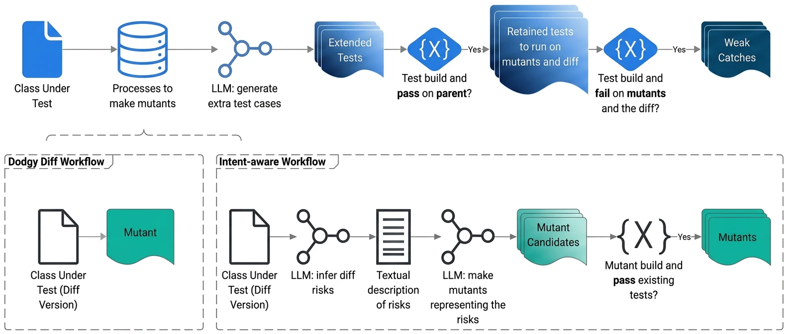
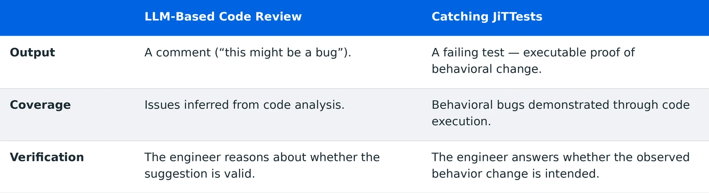
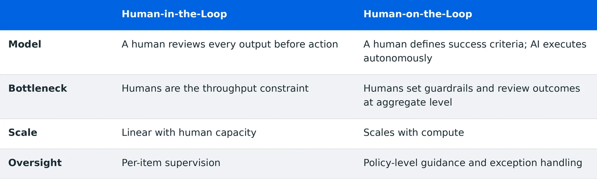
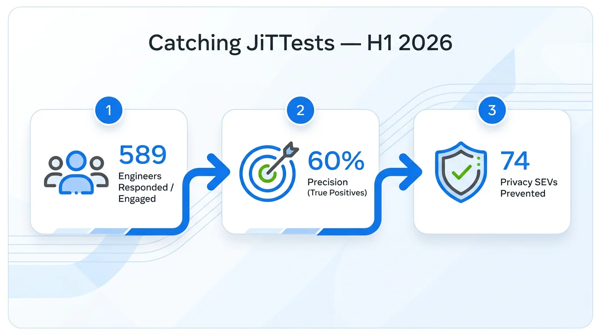

Meta's just-in-time catching test generation reverses the usual job of a unit test. After an engineer submits a code change, an LLM writes tests aimed at that one diff, and a useful test is one that fails: it passes on the parent revision and breaks on the change, which turns a suspected bug into an executable behavior difference. Meta calls these Catching Just-in-Time Tests, or JiTTests. On October 29, 2026, the company said they are no longer a research prototype but part of its infrastructure, and that in the first half of 2026 they played a key role in catching 74 serious privacy bugs before those changes landed.

The evidence comes in two layers. Meta's paper, "Just-in-Time Catching Test Generation at Meta" (FSE 2026 industry track), measures the generators on 22,126 tests and reports an initial rollout in which 8 of 41 flagged changes turned out to be real bugs. The October engineering post reports production results that look much better, with engineers rating 60% of findings as true positives. Both are Meta's own measurements on Meta's backend code, and the system is not public. The mechanics behind those numbers are what other teams can learn from.

## Catching Tests vs Hardening Tests: Why a JiTTest Is Built to Fail {#catching-vs-hardening-tests}

A catching test is designed to fail on the proposed change and pass on its parent, while a hardening test passes when it is written and stays in the suite to guard against future regressions. Almost all automated test generation, including Meta's own earlier tools, produces hardening tests. The paper estimates that a freshly generated hardening test fails on only about 1% of the arbitrary diffs it later meets, because it was written without knowing what the next change will be.

A catching test can use the diff itself. It cannot land with the code it tests, since it fails on that code, so one of two things happens: the engineer decides the behavior change was intended and the test is thrown away, or the change is fixed. Meta's February 2026 post by Mark Harman frames the payoff for teams writing code with agents. JiTTests are generated per change and never stored in the codebase, so nobody maintains them or reviews their code, and a person only looks when something has been caught.

The two kinds of test still feed each other. Most catch attempts end with a test that passes on the diff, and those passing tests are ordinary hardening tests. In one month of production (Nov 11 to Dec 11, 2025), the catch workflows produced 8,797 tests across 2,729 diffs, and 7,987 of them passed, so the same run doubles as a hardening-test generator.

## How Just-in-Time Catching Test Generation Works: Meta's Five-Stage Pipeline {#how-jittests-pipeline-works}

Just-in-time catching test generation at Meta runs as a five-stage batch pipeline: pick risky diffs, generate tests that fail on them, score each failure with LLM judges and with rules, then decide whether to ask the diff's author. According to the October 2026 post, the production system runs as an overnight batch on spare capacity. Meta's February post had described generation at pull-request time; the production description is the one used here.

1. **Targeting.** Each night the system selects diffs submitted the previous day that a risk model, similar to Meta's Diff Risk Score and trained on past changes, flags as risky.
2. **Generation.** Two diff-aware workflows write candidate tests (described below). A test that passes on the parent but fails on the diff is a "weak catch", a candidate bug.
3. **LLM-as-Judge.** An ensemble of LLMs reads each weak catch's test code, its failure output and trace, the diff, and the inferred intent of the diff, then scores how likely the failure is a real bug.
4. **RubFake.** The Rule-Based False-Positive Killing Environment applies deterministic pattern checks. Its verdicts and the judges' scores are combined into one ranking.
5. **Human-on-the-loop.** Only highly ranked candidates trigger a message to the engineer, who is asked whether the observed behavior change was intended.

### Dodgy Diff vs Intent-Aware Workflow {#dodgy-diff-vs-intent-aware}

The two generators differ in how much they try to understand the change. The **dodgy diff** workflow assumes nothing about intent. It treats the diff as if it were a mutant, a deliberately faulty version of the parent, and uses Meta's mutation-guided LLM test generator to write tests that tell the two versions apart. The goal is volume: many weak catches, so the filters downstream have more chances to find a real one.

The **intent-aware** workflow first asks an LLM to infer what the diff is trying to do from its code, title and summary, then to list the "risks", the ways an attempt at that intent could go wrong. A second LLM call turns each risk into a mutant of the parent. Mutants that build and pass the existing tests are kept, tests are generated to kill each one, and those tests are finally run against the real diff. Any that fail become weak catches. The bet, taken from decades of mutation-testing research, is that real faults tend to be coupled to plausible simulated ones.

*Figure: The dodgy diff workflow (lower left) uses the diff itself as the mutant; the intent-aware workflow (lower right) builds mutants from LLM-inferred risks. Both feed the same test generation path (top). Source: Meta, Engineering at Meta, Oct 29, 2026 (also Figure 1 of the paper).*

The first intent-aware version used only the code, diff title and summary. The paper notes that richer context, such as task descriptions and reviewer discussion, is available inside Meta and was left for later work.

## JiTTests Benchmark: What the 4x and 20x Numbers Measure {#jittests-benchmark}

The 4x and 20x figures in the paper's abstract measure how often a generator produces a weak catch, a test that fails on the diff and passes on the parent. They do not measure bugs found. Some coverage has turned this into "4x higher bug detection"; the paper's own Table 1 shows what was counted. The two diff-aware workflows came from production, which started in September 2025. The baselines were run for 10 days, November 14 to 24, 2025, on the same diffs.

| Approach | Tests generated | Weak catches | Per test | Diffs with a weak catch |
|---|---:|---:|---:|---:|
| Coincidental catches from hardening runs | 13,001 | 29 | 0.2% | n/a |
| TestGen-LLM, coverage not required | 4,499 | 89 | 2.0% | 43 of 1,185 (3.6%) |
| TestGen-LLM, must add coverage | 1,440 | 14 | 0.9% | n/a |
| ACH mutation-guided hardening | 754 | 6 | 0.8% | 5 of 322 (1.6%) |
| Dodgy diff (catching) | 1,621 | 41 | 2.5% | 26 of 654 (4.0%) |
| Intent-aware (catching) | 811 | 52 | 6.4% | 49 of 617 (7.9%) |
| **Total** | **22,126** | **231** | **1%** | |

*Source: Table 1 of "Just-in-Time Catching Test Generation at Meta" (arXiv 2601.22832v1). Meta's own measurements on its backend code.*

Read per diff, intent-aware generation found a candidate failure on 7.9% of changes, about twice the dodgy diff rate and five times ACH's. It also generated fewer tests per diff, so each test was more productive. The authors say they do not claim these are the best obtainable workflows and present them as a baseline for future research. Weak catches are where the hard part begins: most are false positives, and turning them into confirmed bugs is the job of the next two stages.

## JiTTests False-Positive Filtering: LLM-as-Judge and RubFake Rules {#jittests-false-positive-filtering}

JiTTests filter false positives with two independent assessors, an LLM judge ensemble and a deterministic rule engine, and combine their outputs into one ranking that decides who gets contacted. Each assessor always sees the diff and its inferred intent, even for tests from the intent-unaware workflow.

**LLM-as-Judge.** The paper lists Llama3.3-70B, Gemini 3 Pro and Claude Sonnet 4 in the ensemble. Each judge scores a weak catch from -1 (likely false positive) to 1 (likely real bug). One score comes from Llama's token probability on a yes/no question; another is the median of each model's High/Medium/Low rating, mapped to 1, 0 and -1. On 600 weak catches that Meta engineers analyzed by hand between October and November 2025, discarding the lowest-scored candidates removed about 70% of human review work. The paper also reports over 98% precision for that discard rule, and a footnote warns that the population was almost entirely false positives, so the 70% saving is the number that matters.

**RubFake.** The rules came from patterns the reviewers kept seeing in those 600 cases. Examples from the paper's tables:

- **Likely false positives:** tests using reflection, broken mocks or data providers, tests that expect a method to be private, a `NotImplemented` exception the engineer threw on purpose, key-value pairs required in a fixed order, tests that expect a function to be called a certain number of times, a crashed test runner or web server, and flakiness.
- **Promising true positives:** a boolean that flipped without its defining expression changing, a value that became null, a container that became empty, an object that can no longer be created, any behavior change in a diff whose intent is a refactor or dead-code removal, existing behavior that changed when the diff only meant to add something such as logging, and unexpected access-control (RBAC) changes.

The three scores agreed with each other poorly (Fleiss' kappa around 0.01 across all three). The authors read that as the assessors catching different things, and support it with a test on 'good' diffs (accepted by reviewers) versus 'bad' ones (reverted, abandoned or sent back): on dodgy-diff tests, all three assessors rated failures as true positives significantly more often on the bad diffs.

## JiTTests vs LLM Code Review {#jittests-vs-llm-code-review}

LLM code review produces a comment that something might be a bug; a JiTTest produces a failing test that shows the behavior actually changed. Meta's October post draws the line in a table: review tools reason about the code the way a faster human reviewer would, while catching tests execute it. Meta concedes that this takes more computation and argues it catches classes of bugs that LLM or agent reviewers miss. It has not published a head-to-head comparison against a code-review model.

*Figure: Key differences between LLM-based code review and Catching JiTTests. Source: Meta, Engineering at Meta, Oct 29, 2026.*

The verification step is where the design pays off. The paper found that asking an engineer to debug test code is slow, while asking a yes/no question about behavior is fast: a message such as "this expression used to evaluate to true, but now evaluates to false; is that expected?" can be dismissed in seconds if the change was deliberate. A difference in the ordering of elements inside a large data structure takes far longer to judge. RubFake therefore ranks candidates by how cheap a false alarm would be to dismiss as well as by how likely they are to be real, and the paper says it can tolerate an order of magnitude more false positives for the cheap kind. Timing helps too, because the question arrives while the author still has the change in mind.

Meta calls the resulting process human-on-the-loop. Engineers set the criteria and review outcomes in aggregate, rather than checking every generated test, and they only read test code when a behavior change surprises them. If you have written evals for coding agents, as in [Google's Modern Web Guidance checks for Claude Code and Codex](/tutorials/modern-web-guidance-evals/), the shift is familiar: humans own the policy and the thresholds, and the machine produces evidence that is quick to accept or reject.

*Figure: Operational differences between human-in-the-loop and human-on-the-loop review. Source: Meta, Engineering at Meta, Oct 29, 2026.*

## JiTTests Production Results: From 19.5% to 60% True Positives {#jittests-production-results}

The two published true-positive rates, 19.5% and 60%, come from different stages and different counting methods. They track the system's progress, and the second one is less precisely defined.

**Initial deployment (paper).** From mid-September to the end of October 2025, the team contacted 41 engineers with a short chat message about an observed behavior change. Eight confirmed a real bug, a 19.5% true-positive rate as the engineers experienced it, and four of those eight would have caused serious production failures, by Meta's in-depth review. Two led to defensive fixes and two diffs were abandoned. Engineers said dismissing a false alarm took a few minutes. The authors add that they have too few data points for strong claims.

**Full scale (October 2026 post).** As of the post, 589 engineers had engaged with JiTTests, 64% of those contacted, and they reported a 60% true-positive rate. In the first half of 2026 the system "played a key role" in catching 74 serious (SEV) privacy bugs at the diff stage, and Meta says privacy SEV occurrence fell 20% over the same period. The post does not explain how the 60% was measured or how much of the 20% drop it attributes to JiTTests.

*Figure: Meta's self-reported H1 2026 figures for Catching JiTTests. Source: Meta, Engineering at Meta, Oct 29, 2026.*

The headline result is about privacy bugs, and several of the paper's true-positive rules, such as unexpected null values and access-control changes, describe that kind of silent regression: nothing crashes, but data reaches a place it should not. Teams weighing AI-written code against the cost of [verifying it per successful task](/tutorials/coding-agents-finops-cost-per-successful-task/) will find the same lesson here: the signal is worth paying for when it targets the changes most likely to hurt.

## Can You Use JiTTests? Availability and the Parts You Can Copy {#can-you-use-jittests}

You cannot run JiTTests outside Meta: it is internal infrastructure, and Meta has released no code, models or API for it. The design is documented in enough detail that a team with its own CI, a test generator and access to a few strong models could rebuild the main pieces:

- **Aim at the diff, not the codebase.** Generate tests against a specific change and keep the ones that pass on the parent and fail on the child. In Meta's Table 1, the intent-aware workflow found a candidate failure on 7.9% of diffs, against 1.6% to 3.6% for its hardening generators.
- **Turn intent into mutants.** Ask a model what the change is meant to do and how that could go wrong, write each risk as a faulty version of the parent, and generate tests that tell the faulty version apart. This was Meta's most productive workflow.
- **Pair judges with rules.** Use more than one model to score failures, and keep a deterministic rule list beside them for known noise such as reflection, broken mocks and runner crashes. The rules are easy to audit; the judges cover semantics.
- **Ask a cheap question.** Contact the author with a plain description of the behavior change and a yes/no question, while the diff is fresh, and rank candidates partly by how quickly a false alarm can be dismissed.
- **Batch it.** Meta targets only diffs a risk model flags and runs overnight on spare capacity, which keeps compute and interruptions bounded.

The open questions are the ones Meta also leaves open: results come from one company's backend code, the production 60% lacks a published method, and nobody outside Meta has replicated the workflows. Teams already giving agents real authority over code, as in [harness-based production agent systems](/tutorials/agent-framework-harness-runtime-production/) or [AI bug-hunting setups like Claude-BugHunter](/tutorials/claude-code-bug-bounty/), can treat catching tests as a check on agent-written diffs. The [Lovable data leaks](/tutorials/lovable-security/) show what behavior changes cost when they reach production unchecked.

## References {#references}

1. Becker, Harman, Zeng et al. (Meta), [Just-in-Time Catching Test Generation at Meta](https://arxiv.org/abs/2601.22832), arXiv:2601.22832v1, January 30, 2026; FSE 2026 Companion, industry track.
2. Thummala, Zeng, Harman, Liu and Liu, [Catching Bugs Before They Land: JiTTesting's Human-on-the-Loop Approach at Full Scale](https://engineering.fb.com/2026/10/29/security/catching-bugs-before-they-land-jittestings-human-on-the-loop-approach-at-full-scale/), Engineering at Meta, October 29, 2026.
3. Mark Harman, [The Death of Traditional Testing: Agentic Development Broke a 50-Year-Old Field, JiTTesting Can Revive It](https://engineering.fb.com/2026/02/11/developer-tools/the-death-of-traditional-testing-agentic-development-jit-testing-revival/), Engineering at Meta, February 11, 2026.
4. Michal Sutter, [Meet Meta's JiTTests: LLM-Generated Tests Designed to Fail Before Risky Code Lands](https://www.marktechpost.com/2026/11/16/meta-jittests-llm-catching-tests-privacy-bugs/), MarkTechPost, November 16, 2026: availability (no code, models or API released).
