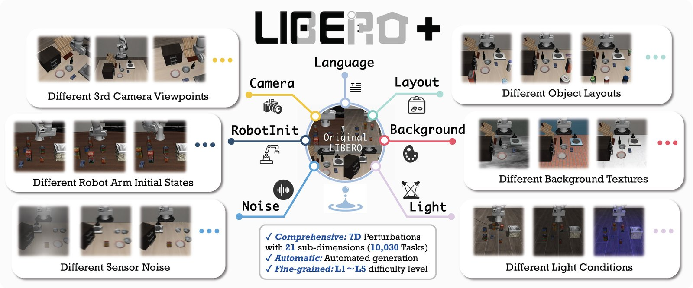
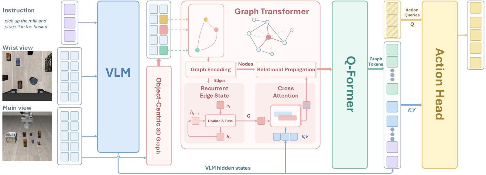

WeaveVLA, posted to arXiv on November 23, 2026, is the newest vision-language-action (VLA) model to clear 98% on the LIBERO benchmark: 98.3% on a StarVLA-GR00T backbone and 98.2% on π0.5, the top two rows in the authors' comparison of twelve models. The same table also shows why that ranking says little. Eight of the twelve models average between 96.5% and 98.3%, and when the authors evaluated the same LIBERO-trained checkpoints on LIBERO-Plus, a perturbed version of the benchmark, the spread widened to 34 points, from 53.6% to 87.8%.

Zien Wang, Yuhao Pan and colleagues at HKUST, Hong Kong PolyU, Xidian University and Zhejiang University built WeaveVLA to give a VLA an explicit model of 3D relations between objects and the gripper. Their paper is also the most recent compilation of LIBERO benchmark results that comes with robustness numbers for the same checkpoints, which makes it a good place to see what a 98% score does and does not tell you about a policy.

## LIBERO benchmark tasks: the four suites VLA papers report {#libero-benchmark-tasks}

VLA papers report LIBERO as four success rates, one each for LIBERO-Spatial, LIBERO-Object, LIBERO-Goal and LIBERO-Long, plus their mean. Each suite has 10 language-conditioned tasks in a robosuite tabletop simulation, and each task comes with 50 human-teleoperated demonstrations that models are fine-tuned on.

The suites were designed in 2023 by Bo Liu, Yifeng Zhu and colleagues at UT Austin, Sony AI and Tsinghua to isolate one kind of knowledge at a time:

| Suite | What changes between tasks | What a model has to get right |
|---|---|---|
| LIBERO-Spatial | Layout; the robot must place one of two identical bowls on a plate | Which bowl, by its position relative to other objects |
| LIBERO-Object | The object to pick and place, in a fixed scene | Recognizing the target object |
| LIBERO-Goal | The goal, with the same objects and layout | Which motion the instruction asks for |
| LIBERO-Long (LIBERO-10) | Ten long-horizon tasks across varied scenes | Chaining several steps without an error |

The figure at the top of this page is the benchmark's own overview, Figure 1 of Liu et al. from the LIBERO repository. The full benchmark has 130 tasks; VLA papers use the three 10-task suites and the 10 long-horizon tasks of LIBERO-100.

LIBERO-Long is split from LIBERO-100, a 100-task suite whose other 90 short tasks (LIBERO-90) were meant for pretraining. The original paper studied lifelong learning, so its protocol trained on tasks in sequence. VLA papers instead fine-tune a policy on the demonstrations, either one per suite or one for all four, and roll it out. WeaveVLA, for example, runs 50 episodes per task, 500 per suite, with step limits of 220, 280, 300 and 520 for Spatial, Object, Goal and Long.

## LIBERO benchmark results: the VLA leaderboard in November 2026 {#libero-benchmark-results}

The LIBERO benchmark results below are the twelve rows of Table 1 in the WeaveVLA paper. Baseline rows are cited from each model's own paper, so the table compiles separate runs rather than one shared evaluation.

| Model | Average | Long | Spatial | Object | Goal |
|---|---:|---:|---:|---:|---:|
| WeaveVLA (StarVLA-GR00T) | **98.3** | 96.0 | 98.8 | 99.6 | 98.8 |
| WeaveVLA (π0.5) | **98.2** | 96.4 | 99.0 | 99.2 | 98.2 |
| VLA-JEPA | 97.2 | 95.8 | 96.2 | 99.6 | 97.2 |
| OpenVLA-OFT | 97.1 | 94.5 | 97.6 | 98.4 | 97.9 |
| DeepThinkVLA | 97.0 | 96.2 | 96.6 | 99.0 | 96.4 |
| π0.5 | 96.9 | 92.4 | 98.8 | 98.2 | 98.0 |
| MemoryVLA | 96.7 | 93.4 | 98.4 | 98.4 | 96.4 |
| StarVLA-GR00T | 96.5 | 92.0 | 97.8 | 98.8 | 97.4 |
| π0 | 94.2 | 85.2 | 96.8 | 98.8 | 95.8 |
| GR00T-N1 | 93.9 | 90.6 | 94.4 | 97.6 | 93.0 |
| DreamVLA | 92.6 | 89.5 | 97.5 | 94.0 | 89.5 |
| OpenVLA | 76.5 | 53.7 | 84.7 | 88.4 | 79.2 |

*Success rates (%) from Table 1 of Wang et al., arXiv 2611.31126, sorted by average. The average is the mean of the four suites; Long is LIBERO-10.*

Most of the remaining spread is in LIBERO-Long. Among the top eight, Spatial, Object and Goal all sit between 96.2% and 99.6%, while Long runs from 92.0% to 96.4%. WeaveVLA's improvement follows the same pattern: on both backbones it gains 4.0 points on Long and 0.2 to 1.4 points on each of the other three suites.

OpenVLA's 76.5% shows how quickly the ceiling arrived. OpenVLA-OFT, a 2025 follow-up that changes how the same model is fine-tuned, reaches 97.1%, and every newer entry in the table has added at most 1.2 points to that.

## LIBERO benchmark saturation: why a 1.8-point spread is mostly noise {#libero-benchmark-saturation}

LIBERO is saturated in the plain sense that the top scores no longer rank models reliably. The eight best averages in the table above fall within 1.8 points, and a single 500-episode suite cannot resolve gaps that small.

A back-of-envelope binomial check shows why. At a true success rate of 97% over 500 rollouts, the 95% confidence interval is about ±1.5 points. A model that really succeeds 97% of the time will usually post somewhere between roughly 95.5% and 98.5% on one suite, and the table reports one number per suite with no interval. Averaging four suites narrows the interval somewhat, but differences of a few tenths, such as WeaveVLA's 98.3% against 98.2% or VLA-JEPA's 97.2% against OpenVLA-OFT's 97.1%, are not evidence that one model is better.

LIBERO's design adds a second reason: its evaluation tasks are the training tasks. The LIBERO-PRO authors point out that a test episode differs from the demonstrations only in the initial placement of objects, a change they describe as visually imperceptible. A policy that memorizes the 50 demonstrations per task can score near the ceiling without understanding the scene or the instruction.

LIBERO still works as a shared regression test for VLA work: a new model or training change that lands well below the mid-90s points to a problem, and the Long suite still separates models by a few points. The ranking at the top has to come from somewhere else.

## LIBERO vs LIBERO-Plus: what happens when the camera, robot or wording changes {#libero-vs-libero-plus}

LIBERO-Plus re-runs LIBERO tasks under seven kinds of controlled perturbation, and on it the same checkpoints that tie on LIBERO separate by tens of points. Senyu Fei, Siyin Wang and colleagues at Fudan University, Tongji University, the Shanghai Innovation Institute and NUS released it in October 2025. It has 10,030 tasks across object layout, camera viewpoint, robot initial state, language instructions, lighting, background texture and sensor noise, each graded into five difficulty levels.

*LIBERO-Plus overview from Fei et al., “LIBERO-Plus: In-depth Robustness Analysis of Vision-Language-Action Models” (arXiv 2510.13626), from the project's GitHub repository.*

The WeaveVLA paper is useful here because it reports both benchmarks for the same models. Each LIBERO-trained checkpoint was run zero-shot on all 10,030 LIBERO-Plus tasks, once each, with the same inference settings:

| Model | LIBERO | LIBERO-Plus | Drop |
|---|---:|---:|---:|
| WeaveVLA (π0.5) | 98.2 | 87.8 | 10.4 |
| π0.5 | 96.9 | 85.7 | 11.2 |
| WeaveVLA (StarVLA-GR00T) | 98.3 | 82.0 | 16.3 |
| VLA-JEPA | 97.2 | 79.5 | 17.7 |
| StarVLA-GR00T | 96.5 | 74.9 | 21.6 |
| OpenVLA-OFT | 97.1 | 69.6 | 27.5 |
| π0 | 94.2 | 53.6 | 40.6 |

*Success rates (%) from Tables 1 and 2 of Wang et al., arXiv 2611.31126: LIBERO four-suite average, LIBERO-Plus overall, and the drop in points. The StarVLA-GR00T LIBERO-Plus result is the authors' own reproduction; other rows are as compiled by the WeaveVLA authors.*

On LIBERO, OpenVLA-OFT and π0.5 are 0.2 points apart. On LIBERO-Plus, π0.5 leads by 16.1. π0 sits 2.9 points behind OpenVLA-OFT on LIBERO and 16.0 points behind it here. The ordering of the top of the table changes too: WeaveVLA on StarVLA-GR00T leads LIBERO but trails both π0.5 rows on LIBERO-Plus.

The perturbation categories explain where the points go. In the LIBERO-Plus paper's own measurements, the camera and the robot's starting pose do the most damage: OpenVLA-OFT falls from 97.1% to 59.7% when the third-person camera moves and to 37.2% when the arm starts in a different pose, and π0 falls to 15.8% and 6.6%. Lighting and background changes cost far less. These per-category numbers differ somewhat from the ones in the WeaveVLA table (OpenVLA-OFT's camera score is 56.4% there), so compare categories within one table rather than across the two.

Two other findings matter for anyone choosing a VLA. A wrist camera helps a lot: OpenVLA-OFT with its wrist view keeps 59.7% under camera shifts, against 16.8% for a variant that sees only the third-person view. And the language part of these models does less than the name suggests. When the LIBERO-Plus authors replaced the instruction with an empty string, OpenVLA-OFT's success on the Object suite stayed largely the same, and only the Long suite dropped substantially. For OpenVLA-OFT on most of these tasks, the scene alone carried enough information to act.

## LIBERO-PRO results: 0% when the task itself changes {#libero-pro-results}

LIBERO-PRO, from Xueyang Zhou, Lichao Sun and colleagues, tests the memorization problem directly, and under its generalized setting the models it evaluated fall to 0%. It perturbs four things: the manipulated objects, their initial positions, the task instructions and the environment, while keeping every perturbed task physically doable.

The authors evaluated OpenVLA (four per-suite checkpoints), π0 and π0.5 (one official checkpoint each), 50 episodes per task as in standard LIBERO. In the authors' summary, models that exceed 90% under standard LIBERO evaluation collapse to 0.0% under the generalized setting. The failures show up in behavior: when the target object is swapped for an unrelated one, the policies still run the grasp they learned, and their actions stay the same when the instruction is corrupted or replaced with meaningless tokens.

The one sign of real generalization was π0.5, which kept a 0.38 success rate on LIBERO-Goal when object positions changed, against 0 for OpenVLA and π0. That is a large difference between models, and standard LIBERO, where π0 and π0.5 are 2.7 points apart, does not show it.

## WeaveVLA architecture: a 3D relation graph beside the VLA {#weavevla-architecture}

WeaveVLA adds an explicit graph of 3D relations to an existing VLA and feeds it to the action head as 16 extra tokens. The base model is unchanged: its vision-language model still reads the camera images and the instruction, and its action expert still produces continuous actions.

*Figure 2 from Wang et al., “WeaveVLA: 3D Relational Grounding for Vision-Language-Action Models” (arXiv 2611.31126), shown for the StarVLA-GR00T integration.*

The graph is built in four steps:

1. **Detect and lift objects.** A YOLOE detector, fine-tuned separately for LIBERO and for CALVIN, passes boxes to a frozen SAM 3 segmenter, Cutie tracks the masks across frames, and predicted depth places each object in 3D. The gripper's position comes from robot kinematics. Fine-tuning the detector mattered: with SAM 3 fixed, mean object-mask IoU on LIBERO frames rose from 12.1% to 97.0%.
2. **Connect only what the task needs.** A sparse, task-conditioned graph links the objects named in the instruction, the gripper and nearby reference objects, with edges carrying relative 3D geometry. Relative displacements were more reliable than absolute positions; in the authors' error analysis they cut RMSE by 53.6% from the same depth estimates.
3. **Remember each relation.** Every selected pair of entities keeps a recurrent edge state that is updated whenever new geometric evidence arrives, so the policy can track how a relation changes during a grasp or a placement.
4. **Compress into tokens.** A learned-query readout, a Q-Former in the figure, turns the graph into 16 relational tokens that condition the action expert alongside the original vision-language context. An auxiliary loss trains those features to reconstruct the geometry.

The ablations line up with the benchmark story above. Removing the geometry loss or the edge memory, or replacing the task-conditioned edges with a fully connected graph, costs 0.5 to 0.8 points on LIBERO and 1.3 to 2.2 points on LIBERO-Plus. Each part matters more when the scene departs from the training layout. The same holds for the whole module: on the StarVLA-GR00T backbone WeaveVLA adds 1.8 points on LIBERO and 7.1 on LIBERO-Plus, including 15.4 points under camera changes, 9.4 under sensor noise and 8.9 under rephrased instructions. On π0.5 the LIBERO-Plus gain is 2.1 points, with 8.2 under robot-pose changes, and the language and noise categories drop slightly, by 2.5 and 0.4 points.

## WeaveVLA latency, CALVIN and real-robot results {#weavevla-latency-real-robot}

WeaveVLA's latency cost sits mostly in the perception pipeline around the policy. On a single RTX 4090 at batch size 1, the policy call slows by 12.0 ms on StarVLA-GR00T (46.9 to 58.9 ms) and by 3.6 ms on π0.5. The full client response, which includes detection, depth and geometry processing, grows by 63.1 ms and 48.9 ms, to 112.9 ms and 157.1 ms. The authors consider that compatible with real-time control; whether it is depends on a robot's control rate.

Outside LIBERO the gains hold up in the authors' tests. On CALVIN D→D, a 1,000-sequence test of five chained instructions, the average completed sequence length rises from 3.645 to 3.910 on StarVLA-GR00T and from 3.885 to 3.997 on π0.5. On a dual-arm robot with three tasks (stacking bowls, placing pens in cups and clearing a table), 30 standard and 30 out-of-distribution trials per task, the StarVLA-GR00T variant averaged 70.0% success against 61.1% for π0.5 and 55.6% for the unmodified backbone. Under clutter, lighting and background changes it averaged 53.3%, against 41.1% and 33.3%. Table clearing remained hard at 46.7% even in standard conditions.

The LIBERO numbers can be checked: the [WeaveVLA repository](https://github.com/Kingzein/WeaveVLA) includes training and evaluation launchers for LIBERO and CALVIN on both backbones, and its Hugging Face release has the two LIBERO policies and both fine-tuned YOLOE detectors. Three days after the preprint appeared, we found no independent rerun.

## How to report LIBERO benchmark results in 2026 {#how-to-report-libero-results}

Report LIBERO benchmark results as a regression check and pair them with at least one perturbation benchmark. The evidence above supports a short checklist for anyone publishing or comparing VLA models:

- **Give the four suite scores, not only the average.** LIBERO-Long carries most of the remaining spread, and a model's average can hide a weak Long score.
- **State the protocol.** Episodes per task, one checkpoint or one per suite, step limits, and whether a wrist camera is used. Each of these can move the number.
- **Treat sub-point gaps as ties.** At 500 episodes per suite, differences under about 1.5 points on a suite are within sampling noise unless you report multiple seeds or intervals.
- **Add LIBERO-Plus with the per-category breakdown.** Camera viewpoint and robot initial state are where current VLAs fail; the overall score alone hides that.
- **Run a LIBERO-PRO style check for memorization.** Swapping objects, moving them or corrupting the instruction shows whether the policy reads the scene and the language at all.
- **Test outside the training scenes.** WeaveVLA's real-robot OOD trials and NVIDIA's RoboLab-120 study, where [π0.5 succeeds on 28.0% of episodes](/tutorials/gpt-6-astra-robotics/), give a very different picture of the same policies than LIBERO does.

For readers comparing models rather than publishing them, the practical reading is that a 98% LIBERO score establishes competence on LIBERO's own tasks. The LIBERO-Plus column, the camera and robot-pose categories in particular, is the better guide to how a policy will hold up when your scene looks different. That gap between benchmark competence and behavior in new scenes is also the argument behind pairing VLA policies with [world action models](/tutorials/physical-agents-world-action-models/).

## References {#references}

1. Zien Wang, Yuhao Pan, Yunfeng Fan, Nan Cheng, Xin Xia, Wenchao Xu, [“WeaveVLA: 3D Relational Grounding for Vision-Language-Action Models”](https://arxiv.org/abs/2611.31126), arXiv 2611.31126v2, November 24, 2026; code at [Kingzein/WeaveVLA](https://github.com/Kingzein/WeaveVLA).
2. Bo Liu, Yifeng Zhu, Chongkai Gao, Yihao Feng, Qiang Liu, Yuke Zhu, Peter Stone, [“LIBERO: Benchmarking Knowledge Transfer for Lifelong Robot Learning”](https://arxiv.org/abs/2306.03310), NeurIPS 2023 Datasets and Benchmarks, arXiv 2306.03310v2.
3. Senyu Fei, Siyin Wang, Junhao Shi, et al., [“LIBERO-Plus: In-depth Robustness Analysis of Vision-Language-Action Models”](https://arxiv.org/abs/2510.13626), arXiv 2510.13626v3, December 26, 2025.
4. Xueyang Zhou, Yangming Xu, Guiyao Tie, et al., [“LIBERO-PRO: Towards Robust and Fair Evaluation of Vision-Language-Action Models Beyond Memorization”](https://arxiv.org/abs/2510.03827), arXiv 2510.03827v2, May 25, 2026.
5. Lifelong-Robot-Learning, [LIBERO code and datasets](https://github.com/Lifelong-Robot-Learning/LIBERO), retrieved November 26, 2026.
