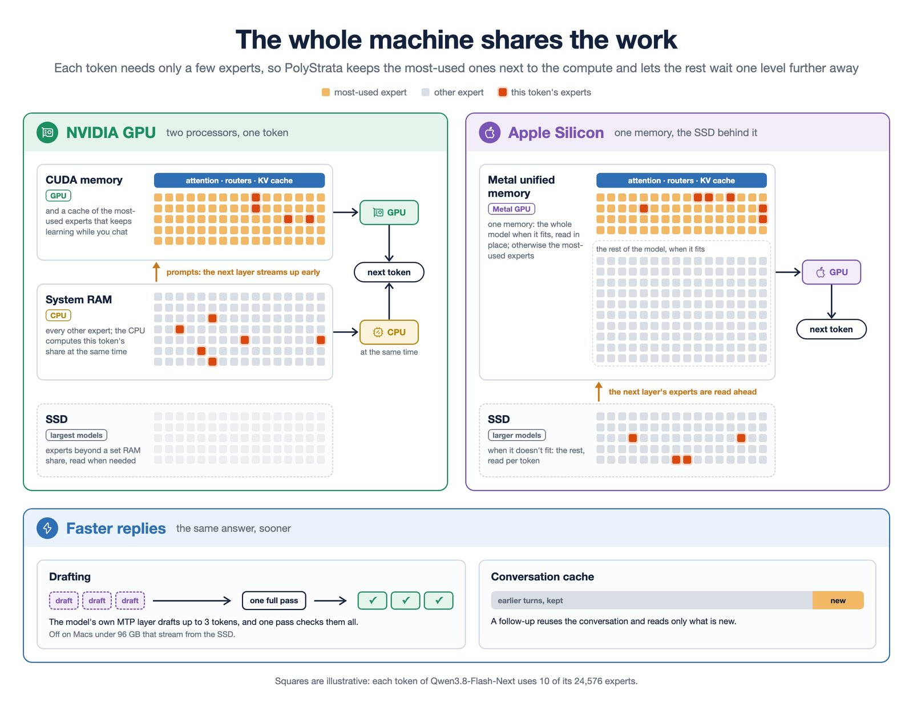

The Linger AI agent, SimplexAI's open-source personal agent, picks its local model from your hardware, and the 125B model in its headline is the default only on the largest Macs. The README promises "a 125B model on a 12 GB GPU". The installer's current default for a 12 GB NVIDIA card is Qwen3.6-35B-A3B; the 125B Qwen3.8-Flash-Next is the default plan only on Macs with 96 GB or more of memory.

That gap matters because every Linger agent, from the proactive "Another Me" to the agents it creates for a job, runs on whatever model setup picks for your hardware. This guide lines up the three places SimplexAI publishes hardware information: the README, the Hardware compatibility page, which reflects the planner in stack CLI 0.1.0.dev49 (code dated November 23, 2026), and the Benchmarks page, which separates measured speeds from estimates. The packaged desktop app, at 0.1.11 beta on November 27, can bundle an earlier toolkit, so the plan setup prints on your machine is the final word.

## Linger AI agent hardware requirements {#linger-ai-agent-hardware-requirements}

To run the Linger AI agent on a local model you need an Apple silicon Mac with at least 16 GB of unified memory, or a Windows 11 x64 or Linux x64 PC with an NVIDIA GPU of 8 GB or more and enough free system RAM for the plan. Intel Macs are not supported by the desktop app, AMD and Intel graphics cards are outside Linger's model plans, and an 8 GB Mac gets no automatic local-model plan.

| Requirement | What Linger's docs specify |
| --- | --- |
| Desktop app (beta) | macOS 14 or later on Apple silicon; Windows x64 installer or portable zip; Linux x64 with glibc 2.35 or newer |
| GPU for local models | Apple silicon with Metal, or an NVIDIA card; 7.5 GiB of free VRAM is the floor for any automatic plan |
| NVIDIA driver | Branch 580 or newer (CUDA 13.0) for models on PolyStrata; CUDA 12.8 on Linux or 12.4 on Windows for llama.cpp models; the CUDA Toolkit is not needed |
| Memory headroom on a PC | 1 GiB of VRAM kept free, plus 4 GiB of system RAM for the OS and 1 GiB for Linger's local gateway |
| Memory headroom on a Mac | 2 GiB for macOS and the gateway and a 512 MiB display reserve, taken from memory that is available right now |
| Disk | Model files, checkpoints and runtime downloads; the plan lists the total before you approve it |

Setup reads the memory that is free at that moment, not the number on the box. A 12 GiB card with only 6 GiB free does not get a 12 GiB plan, and a Mac never counts more than about 13 GiB available on a 16 GiB machine, 21 GiB on 24 GiB or 29 GiB on 32 GiB. The planner shows its choice, waits for approval, checks memory again when you apply it, and counts a model as installed only after it answers a real question. If nothing fits, it explains why and points you to a Runtime that uses a cloud subscription.

Intel Mac owners and anyone who wants one server for several computers can run Linger's server with Docker Compose (at least 5 GiB of memory for Docker's virtual machine), but models and agents still run on the computer you connect to it, so the same GPU rules apply there.

## Which model Linger installs on an NVIDIA GPU {#linger-nvidia-gpu-models}

On an NVIDIA PC, Linger's default plan is Qwen3.6-35B-A3B on 8 and 12 GiB cards and Inkling 2 Mini on 16 GiB cards and up. These rows assume an idle card and the RAM listed under the table; they are the planner's defaults for a fresh install, not speed tests.

| Total VRAM (idle card) | Default model | Quant | Shared context | Slots | Engine |
| --- | --- | --- | --- | --- | --- |
| 8 GiB | Qwen3.6-35B-A3B | UD-Q3_K_M | 64K | 1 | PolyStrata, experts on the CPU |
| 12 GiB | Qwen3.6-35B-A3B | UD-Q4_K_M | 64K | 1 | PolyStrata, experts on the CPU |
| 16 GiB | Inkling 2 Mini | UD-IQ3_XXS | 64K | 2 | llama.cpp (CUDA) |
| 24 GiB | Inkling 2 Mini | UD-Q4_K_M | 128K | 2 | llama.cpp (CUDA) |
| 32, 48 or 96 GiB | Inkling 2 Mini | UD-Q4_K_M | 200,000 tokens | 2 | llama.cpp (CUDA) |

*Source: Linger docs, Hardware compatibility, planner for stack CLI 0.1.0.dev49. The 8 to 16 GiB rows assume 32 GiB of RAM with 28 GiB available; the 24 to 48 GiB rows assume 64 GiB with 60 GiB available.*

System RAM decides as much as the card does. On 8 and 12 GiB cards the model's experts live in system RAM and the CPU computes them, so the Linux plan needs about 25 GiB of RAM available. Windows has a fallback the Linux planner lacks: when RAM is tight, it drops to Spark-X2.6-4B at Q8_0 on llama.cpp, which needs about 9.75 GiB of RAM and 7.5 GiB of free VRAM. One worked example from the docs: a PC with a 16 GiB card and 16 GiB of RAM, about 12 GiB of it available, gets Spark-X2.6-4B on Windows and no automatic plan on Linux.

Two caveats sit in the docs next to these rows. SimplexAI has not finished full product acceptance on physical 8 and 12 GiB cards, and Spark-X2.6-4B is still a catalog candidate. Slots also share the context: two slots on a 128K pool split 128K between them, they do not get 128K each.

When another program holds VRAM, setup steps down: first to a smaller context, then a smaller quantization, then a smaller model. With 11.5 to 14.5 GiB free it lands on Qwen3.6-35B-A3B UD-Q4_K_M; with 7.5 to 11.5 GiB, UD-Q3_K_M; below 7.5 GiB there is no plan. Between those bands the planner also uses [Qwen3.8-27B](/tutorials/qwen-3-8-27b/) at UD-Q4_K_M (18.5 to 19.5 GiB free) and UD-IQ3_S (14.5 to 15 GiB free). If you would rather run the 16 GiB-tier model by hand, our [Inkling 2 Mini Ollama setup guide](/tutorials/inkling-2-mini-ollama/) covers its memory needs outside Linger.

## Which model Linger installs on an Apple silicon Mac {#linger-mac-models}

On an Apple silicon Mac, Linger installs Spark-X2.6-4B on 16 GiB machines, Inkling 2 Mini on 24 to 64 GiB machines and the 125B Qwen3.8-Flash-Next only from 96 GiB up. An 8 GiB Mac gets no automatic plan.

| Unified memory | Default model | Quant | Shared context | Slots |
| --- | --- | --- | --- | --- |
| 8 GiB | No automatic plan | — | — | — |
| 16 GiB | Spark-X2.6-4B | Q4_K_M | 64K | 2 |
| 24 GiB | Inkling 2 Mini | UD-IQ3_XXS | 64K | 2 |
| 32 GiB | Inkling 2 Mini | UD-Q4_K_M | 128K | 2 |
| 48 or 64 GiB | Inkling 2 Mini | UD-Q4_K_M | 200,000 tokens | 2 |
| 96 GiB | Qwen3.8-Flash-Next | GSQ-RCO-IQ2_XS | 200,000 tokens | 2 |
| 128 or 256 GiB | Qwen3.8-Flash-Next | GSQ-RCO-IQ3_S | 200,000 tokens | 2 |

*Source: Linger docs, Hardware compatibility, default preference with enough available memory and a sufficient Metal working-set limit.*

Available memory moves a Mac down this table quickly. A 24 GiB Mac gets Inkling 2 Mini only with about 19.5 GiB free; between 9 and 19.5 GiB it falls back to Spark-X2.6-4B, and below 9 GiB there is no plan on any Mac. A 32 GiB Mac needs about 24 GiB free for Inkling 2 Mini at a 64K context and about 26 GiB for 128K. Because macOS and the GPU share the same memory, quitting browsers and other apps before setup can change the model you get.

The 16 GiB tier carries the weakest evidence. Spark-X2.6-4B has only an interim, estimated capability score, its speed on a 16 GiB Mac is an estimate, and SimplexAI lists full acceptance on a physical 16 GiB Mac as pending.

## Linger AI agent benchmark: measured vs estimated speeds {#linger-ai-agent-benchmark}

SimplexAI's benchmark table has six hardware rows, and two of them are measurements: a 24 GB Mac mini writing at 29.12 tokens per second, and an RTX 4090 D writing at 126.7 tokens per second with a model that is not that machine's default. The other four speeds are estimates scaled from other devices. The Benchmarks page also states that its rows "do not describe the model that setup selects today".

| Machine | Model in the benchmark | Writing speed, tokens/s | How it was obtained | Capability score |
| --- | --- | --- | --- | --- |
| Mac 16 GB | Spark-X2.6-4B Q4_K_M, 64K | ~41 | Estimate from a 24 GB Mac mini running the 16 GB recipe (38.87 to 41.35) | ~31.5 (estimate) |
| Mac 24 GB | Inkling 2 Mini UD-IQ3_XXS, 64K | 29.12 short chat; 26.15 after 8K; 22.28 after 32K | Measured: Apple M6 Mac mini, llama.cpp b12588 Metal, 2 slots | 53.4 |
| Mac 32 GB | Inkling 2 Mini UD-Q4_K_M, 128K | ~30 | Estimate scaled by memory bandwidth for 32 to 36 GB Pro Macs | 54.2 |
| Linux NVIDIA 8 GB + 32 GB RAM | Inkling 2 Mini UD-Q3_K_XL, 64K | ~50 | Estimate from an RTX 4070 Laptop run on Windows (47.7 to 50.0) | 53.9 |
| Linux NVIDIA 12 GB + 32 GB RAM | Inkling 2 Mini UD-Q3_K_XL, 64K | ~68 | Estimate from a community RTX 3060 12 GB run (68.2) | 53.9 |
| Linux NVIDIA 24 GB + 64 GB RAM | Qwen3.8-Flash-Next GSQ-RCO IQ2_XS, 256K | 126.7 median; 117.1 after 32K | Measured: RTX 4090 D, Strata v0.2.4; not the current default recipe | 58.8 |

*Source: Linger docs, Benchmarks, read Nov 27, 2026. Scores sit on a third-party capability scale where 50 is the average of 123 reference models; on the same scale Claude Sonnet 4.6 is 52.8 and Claude Opus 4.6 is 59.7.*

Set the two tables side by side and the mismatch shows. The benchmark's 8 GB and 12 GB NVIDIA rows use Inkling 2 Mini, while today's planner installs Qwen3.6-35B-A3B on those cards. The 24 GB row is the 125B Qwen3.8-Flash-Next, while the planner gives a 24 GiB card Inkling 2 Mini. On an 8, 12 or 24 GiB NVIDIA card, then, the published speed and score describe a model that setup will not choose by default.

The capability score has limits SimplexAI spells out. It rates the installed model alone, adjusted down for quantization, and moves with each leaderboard round (this one is dated November 22, 2026). It is not a speed, and it is not an agent result: Linger has not yet published how well its agents finish research or computer-use tasks on any of these machines. Gaps under 3 points count as the same level.

The closest published numbers for the 8 and 12 GiB default come from PolyStrata, the engine Linger uses for those plans. On an RTX 4070 Laptop (8 GB, Core i7-14700HX, 32 GB of RAM), Linger's Benchmarks page lists Qwen3.6-35B-A3B at 94 to 100 tokens per second and PolyStrata's current README lists 106, each at the size the PolyStrata installer picks, which may not match Linger's UD-Q3_K_M or UD-Q4_K_M plan. PolyStrata also reports reading prompts 2.7 to 3.5 times as fast and writing 1.5 to 1.8 times as fast as llama.cpp b11540 on that laptop. All of these are the project's own runs. The quickest way to know what your machine does is to measure the local endpoint yourself, for example with [gBench against a local server](/tutorials/gbench/).

## How Linger runs a 125B model on a 12 GB GPU {#how-linger-runs-125b-on-12gb}

Linger fits a 125B model onto a 12 GB card through mixture-of-experts offloading in PolyStrata: each token uses only a few of the model's experts, so the most-used experts stay in GPU memory, the rest wait in system RAM, and rarely used ones are read from the SSD. The README's configuration is Qwen3.8-Flash-Next, whose 2-bit file is 39 GB, on a 12 GB RTX 3060 with 64 GB of RAM, writing at 45.5 tokens per second.

*How PolyStrata places experts on an NVIDIA PC and on Apple silicon. Per SimplexAI's note, each token of Qwen3.8-Flash-Next uses 10 of its 24,576 experts. Source: Linger docs, "Local Inference".*

On a PC the GPU and CPU work on the same token at once: CUDA memory holds attention, the routers, the KV cache and a cache of popular experts, while the CPU computes that token's remaining experts straight from RAM. On a Mac, unified memory holds the whole model when it fits; when it does not, the SSD serves the rest and the next layer's experts are read ahead. The model's own multi-token prediction layer drafts up to three tokens for one full pass to check, a step SimplexAI switches off on Macs under 96 GB that stream from the SSD.

Dominic Plouffe's analysis of the Strata engine underneath puts numbers on the trade. Qwen3.8-Flash-Next has about 125B parameters in total but activates about 5.9B per token, and its experts take 43 GB of RAM at IQ3_XXS and 50 GB at IQ3_S. The Strata README warns that a PC can be slow or stop responding for one to three minutes while the model loads 35 to 55 GB into RAM. He also points out that every published speed is single-stream: one request, one answer.

That last point carries over to Linger, because one local model serves the whole agent. Every agent, tool approval and background job on the computer shares it through a priority queue: approvals first, then recording questions, then your chat, then agent-to-agent work, then tasks and documents. A model that tests as single-slot runs one unit of work at a time. Proactive checks, nightly memory updates and a long background task all wait for the same GPU you are chatting on.

## Linger local model vs subscription vs BYOK {#linger-local-vs-subscription-vs-byok}

Linger offers three model sources per computer, and the local model is only one of them: Local model runs the Pi runtime on a model loaded on your machine, Subscription runs Claude Code or Codex on the plan you already pay for, and BYOK (bring your own key) runs Claude Code, Codex or Pi against any OpenAI-compatible or Anthropic endpoint you configure. One source serves every agent on that computer at a time.

| | Local model | Subscription | BYOK |
| --- | --- | --- | --- |
| Runtime | Pi | Claude Code or Codex | Claude Code, Codex or Pi |
| Where the model runs | Your Mac or NVIDIA PC, through Linger's local gateway | The provider, under the runtime's own sign-in | The endpoint you enter, through the local gateway |
| Token fees | None for inference | Your plan's limits | Your API bill |
| Web search | `teamhub web search`, with DuckDuckGo when no search key is set | The runtime's own search first | `teamhub web search` |
| Hardware needed | A plan from the tables above | None beyond the desktop app | None beyond the desktop app |

*Source: Linger docs, "Local Inference" and Hardware compatibility.*

The local route makes sense when your machine lands on a tier with a measured speed and a model you trust for agent work, such as Inkling 2 Mini on a 24 GB-plus Mac or a 16 GiB-plus NVIDIA card, and when you want mail, chats and meeting notes to stay on the device. On an 8 or 12 GiB card you are relying on a plan SimplexAI has not finished accepting on physical hardware, with one slot and 64K of context for every agent. On a 16 GiB Mac you get a 4B model.

BYOK is the practical middle ground for a local personal AI agent on modest hardware: memory, the wiki and files stay on disk, while the model calls go to an endpoint you choose. The API key stays in an owner-only file on the computer, and switching source moves every agent at once (leaving Local model unloads the local weights to free memory). Linger's own code uses a modified Apache 2.0 license: a company can run it for its own work, but offering it as a hosted service to people outside your organization needs a commercial license, and the web frontend's logo must stay.

If you plan to let Linger drive your desktop and signed-in Chrome, its desktop layer (Cua) reads app windows as elements before it clicks and types, an approach our [agent-desktop computer-use guide](/tutorials/agent-desktop-computer-use/) explains in detail. The Pi runtime it uses for local models is Earendil's `pi-coding-agent`, which we compare with another harness in [DeepSeek Harness vs Pi Agent](/tutorials/deepseek-harness-vs-pi-agent/). Before installing, write down your free VRAM, available RAM and OS, find your row in the two default-plan tables, and treat any speed marked as an estimate as a hypothesis to measure on your own machine.

## References {#references}

1. SimplexAI, [Linger README](https://github.com/simplexai-labs/linger) and [docs/local-inference.md](https://github.com/simplexai-labs/linger/blob/main/docs/local-inference.md), GitHub, Desktop 0.1.11 beta, read Nov 27, 2026.
2. SimplexAI, [Hardware compatibility](https://docs.heylinger.com/hardware/compatibility), Linger docs, planner for stack CLI 0.1.0.dev49 (code dated Nov 23, 2026), read Nov 27, 2026.
3. SimplexAI, [Benchmarks](https://docs.heylinger.com/hardware/benchmarks), Linger docs, read Nov 27, 2026.
4. PolyStrata project, [PolyStrata README](https://github.com/simplexai-labs/PolyStrata), GitHub, read Nov 27, 2026.
5. Dominic Plouffe, [MoE Expert Offloading: 125B on a 12GB GPU, With Catches](https://www.dplouffe.ca/2026/10/06/moe-expert-offloading-125b-gpu/), Oct 6, 2026.
