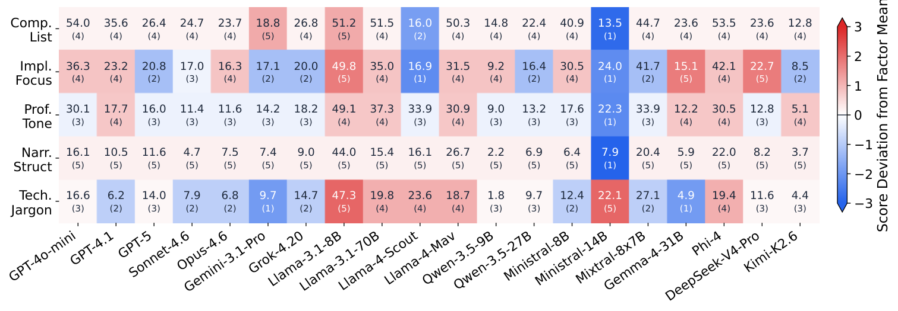

LLM-as-a-judge biases are usually listed as a handful of known quirks, the ones the [MT-Bench study](https://arxiv.org/abs/2306.05685) named in 2023: judges prefer the first answer they see, the longer answer, or answers from their own model. A study posted to arXiv on November 24, 2026 went looking for the ones nobody had named. Hamin Koo and colleagues at Yonsei University and Microsoft Research Asia took 1,830 cases where five LLM judges all overruled human raters, extracted what the judges seemed to be rewarding, and found that rewriting a losing answer as a longer, more comprehensive list flipped GPT-4o's verdict 39.4% of the time.

The framework, called HuB-J, then measures how strongly each of those factors moves 25 judge models and fits a regression that removes part of the effect from a win rate without retraining anything. For anyone who scores model outputs, ranks prompts or trains on AI feedback with an LLM judge, it is a concrete list of what to test and a method for testing it.

## LLM-as-a-judge biases HuB-J found: five factors beyond verbosity {#llm-as-a-judge-biases}

HuB-J found five biases that pull LLM judges away from human raters: a preference for comprehensive lists, a professional tone, narrative structure, implementation detail and technical jargon. Each one makes an answer look more expert or thorough without making it more correct. Comprehensive lists and narrative structure overlap with the known verbosity bias; the other three were new.

| Bias factor | What the judge rewards | Avg. flip rate, 5 judges | Overlap with known biases |
|---|---|---|---|
| Comprehensive List | Longer lists of items, quantity taken for relevance | 28.6% | Correlates with verbosity |
| Implementation Focus | Concrete steps and implementation detail over strategy | 19.6% | Low |
| Professional Tone | Formal wording read as credibility | 15.4% | Low |
| Technical Jargon | Specialist terms read as expertise | 8.3% | Low |
| Narrative Structure | Story-like flow and progression | 7.9% | Correlates with verbosity |

*Bias definitions from Table 1 and held-out flip rates from Table 3 of Koo et al. (arXiv 2611.33065). The flip rate is how often a judge switched to a losing answer after that answer was rewritten to carry the factor. "Low" means a Pearson correlation below 0.5 with the five previously known biases tested.*

For comparison, the same test gave 26.1% for verbosity and 26.0% for the length bias found by BiasScope, an earlier automatic method. Older entries on most bias lists moved these judges far less: beauty 10.5%, authority 8.1%, bandwagon 6.1% and sentiment 5.1%.

The five factors also fit the original disagreements better. On held-out cases where all five judges overruled the humans, the answer the judges picked scored higher than the human-preferred answer on every HuB-J factor, by 0.480 intensity points on average across the five, against 0.238 for the known biases and 0.308 for BiasScope's factors. All five HuB-J factors were significant at p < 0.01; bandwagon, authority and two BiasScope factors were not.

## How HuB-J measures LLM judge bias from human disagreement {#how-hub-j-works}

HuB-J measures bias in three steps: it finds candidate biases in cases where judges and humans disagree, measures each one's strength in cases where they agree, and then estimates how much of a judge's verdicts the bias explains. The diagram at the top of this page, Figure 1 of the paper (CC BY-NC-ND 4.0, reproduced unmodified), shows the three stages.

The data comes from five public human-preference sets: MT-Bench, MultiPref, WebGPT-Comparisons, HelpSteer2-Pref and HelpSteer3, keeping only pairs where at least half the annotators agreed. Five judges, GPT-4o, Claude Haiku 4.5, Gemini 3 Flash Preview, Qwen-Plus and DeepSeek-V3.2, compared every pair at temperature 0, and each pair was judged twice with the answers swapped to cancel position bias.

**Finding candidates.** The 1,830 pairs where all five judges picked the answer humans rejected became the discovery set. An LLM wrote down, for each pair, what might explain the judges' choice; those notes were clustered, named as candidate factors, de-duplicated by embedding similarity and narrowed greedily to the five factors that covered the most notes. Requiring all five judges to agree keeps one model's quirks out of the list.

**Measuring strength.** For each factor, the authors wrote a five-level intensity scale tied to observable properties. For narrative structure, level 1 is a factual answer under about 20 tokens and level 5 is an extensive narrative over 80 tokens. They then took pairs where humans and all five judges agreed, and had an LLM rewrite only the losing answer at each level while keeping its facts, final answer and named entities. If a judge now preferred the rewritten loser, the factor had flipped it. The level that flipped a judge most often on 100 calibration pairs became that judge's effective intensity, and the flip rate at that level on 500 held-out pairs became its score.

<strong>Running the check on your own judges.</strong> The measurement step is a loop of judge calls: every pair is scored twice, at up to five intensity levels, by every judge model you want to compare. If those judges come from several vendors, a shared gateway such as
<a href="https://www.packyapi.ai/register?aff=5W73&amp;utm_source=agentspulse&amp;utm_medium=affiliate&amp;utm_campaign=llm-as-a-judge-biases" rel="sponsored nofollow noopener" target="_blank">PackyAPI</a> is one option for sending the same comparisons to all of them through one API.

<small>Disclosure: this page contains an affiliate link. If you sign up through it, we may earn a commission at no extra cost to you.</small>

## Quantifying biases in LLM-as-a-judge: flip rates across 25 judge models {#judge-flip-rates}

Judge models differ widely in how easily these factors move them. Among the five main judges, GPT-4o flipped most often on four of the five new factors and on verbosity; which judge held up best depended on the factor. Across 20 further models, several older open-weight judges were the most swayable, and some recent ones resisted better than frontier models.

The main-study numbers, held-out flip rates at each judge's effective intensity:

| Judge | Comprehensive List | Implementation Focus | Professional Tone | Narrative Structure | Technical Jargon | Verbosity (known) |
|---|---|---|---|---|---|---|
| GPT-4o | 39.4% | 27.5% | 26.7% | 9.5% | 14.9% | 36.6% |
| Claude Haiku 4.5 | 24.8% | 17.4% | 9.4% | 9.9% | 5.3% | 18.6% |
| Gemini 3 Flash Preview | 23.3% | 15.2% | 13.0% | 8.6% | 7.6% | 21.6% |
| Qwen-Plus | 25.3% | 17.4% | 13.7% | 6.4% | 7.7% | 26.4% |
| DeepSeek-V3.2 | 30.0% | 20.6% | 14.1% | 4.9% | 5.8% | 27.3% |

*From Table 3 of Koo et al. (arXiv 2611.33065), 500 held-out agreement pairs per cell.*

The intensity that does the damage also varies. Claude Haiku 4.5 reacted to technical jargon only at the strongest level, while Qwen-Plus and DeepSeek-V3.2 flipped most at level 2, a few specialist terms in an otherwise plain answer. A bias test that injects one fixed dose can therefore understate a judge's weakness.

*Figure 3 of Koo et al. (arXiv 2611.33065, CC BY-NC-ND 4.0): flip rate in percent for each factor and judge, with the calibrated intensity level in parentheses. Colors show how far that level sits from the factor's average.*

In the wider test, Llama-3.1-8B flipped on comprehensive lists 51.2% of the time and on technical jargon 47.3%; Phi-4 and Mixtral-8x7B were also high across the board, and GPT-4o-mini reached 54.0% on comprehensive lists. GPT-5, Qwen-3.5-9B and Kimi-K2.6 held up best. Kimi-K2.6 flipped on comprehensive lists 12.8% of the time against 26.4% for GPT-5, and Qwen-3.5-9B flipped on technical jargon just 1.8% of the time. Model size alone does not predict it: the 9B Qwen judge resisted better than several frontier models.

The authors also checked whether the rewrites changed what the answers said. On [JudgeBench](https://arxiv.org/abs/2410.12784), where pairs are labeled by objective correctness, GPT-4o rated the underlying answer as changed in only a small share of rewrites, while the factors still flipped judges at their calibrated levels: 8.4% on average against 7.0% for the known biases and 6.9% for BiasScope's. The exception is narrative structure. Human checkers found that its rewrites kept the original meaning in 70% of cases, against 88% to 92% for the other four factors, so part of that factor's effect may come from changed content.

## How to fix LLM judge bias without retraining: regression correction {#fix-llm-judge-bias}

HuB-J corrects a judge's win rate with a regression, without retraining or re-prompting the judge. It models each verdict as a logistic function of three parts: the judge's baseline preference, a per-query effect shared by all judges, and the difference in bias intensity between the two answers times a judge-specific sensitivity. Dropping the bias term and averaging over queries gives a bias-controlled win rate, and the gap between that and the raw win rate is the share the bias explains.

The idea comes from [Length-Controlled AlpacaEval](https://arxiv.org/abs/2404.04475), which uses a similar regression to report win rates with answer length held constant. HuB-J applies it to any factor that can be scored on an intensity scale, and uses the same two-stage fitting to separate the shared query effect from each judge's own sensitivity.

The test case is the rewritten pairs from the measurement step, where every flip toward the rewritten loser is bias-driven by construction. There the regression attributed 31.8% of the judges' win rate to the HuB-J factors on average, against 27.3% for the known biases and 28.2% for BiasScope's. The figure varied with judge and factor: it rose to 59.1% for GPT-4o on narrative structure and averaged 40.3% across GPT-4o's five factors, but only 15.3% for Claude Haiku 4.5. So the correction removed about a third of the measured bias; the rest stayed in the win rate.

Three costs come with it. The method needs human preference labels to sort pairs into agreement and disagreement sets. Discovery, rewriting and measurement all take extra LLM calls, which the authors argue are paid once because factors transfer across judges and benchmarks. And LLMs write the factor descriptions and rewrites, so their own biases can enter the pipeline; the authors list stronger human or non-LLM validation as open work.

## How to test an LLM judge for bias: a HuB-J-style audit {#test-llm-judge-for-bias}

You can run a reduced version of HuB-J's measurement step on the judge you already use, as long as you have a few hundred pairs with human preference labels from your own task. The paper's public code was not available when we checked, so the steps below follow the method as described.

1. **Judge every pair twice with the answers swapped.** This is the paper's control for LLM-as-a-judge position bias. Count a pair as a win only if the judge picks the same answer in both orders, and treat a split decision as a tie.
2. **Split by agreement.** Pairs where your judge and the humans agree are your test bed; pairs where they disagree are where to look for factors specific to your domain.
3. **Rewrite the losing answer one factor at a time.** Start with the five factors above and verbosity. Write a five-level scale with observable anchors, such as token counts or the number of jargon terms, rewrite the losing answer at each level, and keep its facts and final answer fixed. Spot-check that meaning survived, especially for narrative rewrites.
4. **Measure flips on calibration and held-out pairs.** Pick the level that flips your judge most on a small calibration split, then report the flip rate at that level on pairs you held out. HuB-J used 100 and 500.
5. **Act on what moves.** A factor that flips your judge a quarter of the time is a reason to try another judge, rubric or ensemble before you trust its rankings. If you keep the judge, fit the regression for that factor and report the bias-controlled win rate next to the raw one.

The numbers above come from general chat, long-form QA and helpfulness data. A judge that grades code, math or a domain rubric may respond to different features, which is the case the disagreement step is built for. Pipelines that grade with LLM judges, like the judge ensemble in [Meta's JiTTests test triage](/tutorials/just-in-time-catching-test-generation/), the model judge behind the [unsafe Rust agent audits](/tutorials/unsafe-rust-llm-agents/) or the GPT-6 Astra scorer next to human raters in the [AI pixel art benchmark](/tutorials/ai-pixel-art-benchmark/), can use the same flip test to see what their judge rewards. When the judge's verdicts also feed training, as in the reward-seeking checks covered in [measuring reward-seeking in RL-trained models](/tutorials/measuring-reward-seeking-contrastive-beliefs/), a bias the judge carries becomes something the policy learns to produce. Keeping the check outside the judge's reach follows the same principle as [verification agents can't game](/tutorials/claude-code-verification/), and a rubric-based scorer such as the [Gemini Decisions API score mode](/tutorials/gemini-decisions-api/) is another judge worth putting through the same test.

## References {#references}

1. Hamin Koo, Chanjoo Jung, Fangzhao Wu and Jaehyung Kim, [“Auditing the Judge: Human-Derived Bias Discovery, Quantification, and Mitigation in LLM Judges”](https://arxiv.org/abs/2611.33065), arXiv 2611.33065v1, November 24, 2026 (NeurIPS 2026).
2. Yann Dubois, Balázs Galambosi, Percy Liang and Tatsunori B. Hashimoto, [“Length-Controlled AlpacaEval: A Simple Way to Debias Automatic Evaluators”](https://arxiv.org/abs/2404.04475), arXiv 2404.04475, 2024.
3. Lianmin Zheng et al., [“Judging LLM-as-a-Judge with MT-Bench and Chatbot Arena”](https://arxiv.org/abs/2306.05685), arXiv 2306.05685, 2023.
4. Sijun Tan et al., [“JudgeBench: A Benchmark for Evaluating LLM-based Judges”](https://arxiv.org/abs/2410.12784), arXiv 2410.12784, 2024.
