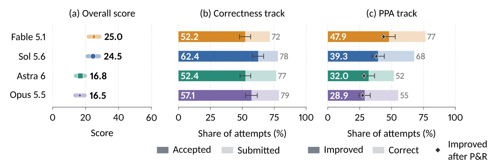

LLM RTL generation now gets tested on whole accelerators. AIChipBench, posted to arXiv on November 24, 2026, had four frontier coding agents write synthesizable register-transfer-level (RTL) code for quantized Qwen3.5, Gemma 3, Gemma 4 and Llama 3.2 decoders, then graded the frozen designs on tests the agents never saw. Over 9,136 attempts, Claude Fable 5.1 and GPT-5.6 Sol came out on top. The more useful result is where the failures sit: 45 of 69 accepted designs broke within 32 decoding steps once the prompts, resets or memory timing changed, and most failing sequences went wrong in stored hardware state several steps before any wrong token appeared.

The benchmark comes from Guangyuan Wang (Mila and McGill), Minchen Luo (Erised Labs), Mengdi Wang and Yifan Zhang (Princeton) and co-authors, with the paper and an Apache-2.0 repository released together. It targets the hardest part of building LLM inference hardware: a decoder carries a key–value cache and recurrent state from one token to the next, so a design can emit the right token today and corrupt the output several tokens later. That makes it a sharp test of how far agentic RTL generation has come, and of how weak a test suite can be without anyone noticing.

## LLM RTL generation benchmark results: the AIChipBench leaderboard {#llm-rtl-generation-benchmark-results}

Claude Fable 5.1 leads AIChipBench with an overall score of 25.0, just ahead of GPT-5.6 Sol at 24.5; OpenAI's Astra 6 (16.8) and Claude Opus 5.5 (16.5) trail by about eight points. The score multiplies two rates, so an agent needs to do well on both tracks: building a correct decoder from a specification, and making a correct design faster without breaking it.

| Agent | Score (95% CI) | Correctness, C | PPA, Q |
|---|---:|---:|---:|
| Claude Fable 5.1 | **25.0** (21.8–28.4) | 52.2% | 47.9% |
| GPT-5.6 Sol | **24.5** (21.2–28.1) | 62.4% | 39.3% |
| Astra 6 | **16.8** (14.1–19.7) | 52.4% | 32.0% |
| Claude Opus 5.5 | **16.5** (13.7–19.4) | 57.1% | 28.9% |

*Score = 100 × C × Q, where C is the acceptance rate averaged over the 12 correctness tasks and Q is the rate of improved designs averaged over the four PPA targets. Values from the AIChipBench README and paper Table 53.*

*Figure: AIChipBench leaderboard. Dark bars are accepted (correctness) or improved (PPA) attempts; light bars are attempts that submitted or stayed correct. Source: AIChipBench authors, GitHub README / paper Figure 2.*

The two tracks rank the agents differently. On correctness alone, Sol has the most attempts accepted when pooled across tasks, 61.2%, followed by Opus 5.5 at 55.9%, Astra 6 at 49.8% and Fable 5.1 at 48.3%. Fable takes first place overall on the optimization track, where it improved a correct design in 184 of 384 attempts against 151 for Sol. The authors re-scored the optimization results at the clock each design actually reached after place-and-route; Sol then edges ahead, 23.7 to 22.8, and the top pair still sits clearly above Astra 6 (14.9) and Opus 5.5 (15.6).

The split between the top two and the bottom two is stable. When the authors divided each task's matched instances into random halves 200 times, both halves ranked Sol and Fable above Astra and Opus every time; shuffling the agents' outcomes produced that order only 17% of the time. The paper pins each agent to a provider model ID (`openai/gpt-5.6-sol-20261015`, `openai/astra-6-20260930`, `anthropic/claude-opus-5-5-20251101` and `anthropic/claude-fable-5-1-20261101`), and all four ran through the same MathCode harness at their provider's default medium reasoning effort, so these are results for a model plus a harness. A different agent setup could move the numbers, a point our [HarnessDev benchmark write-up](/tutorials/harnessdev-agent-harness-benchmark/) covers from the harness side.

Cost is high at every rank. On the correctness track, each accepted design took 23.9 to 31.4 agent-hours once failed attempts are counted, and about 26% of attempts ran out of budget before submitting anything. Teams budgeting for this kind of work should price it per accepted design, the same [cost-per-successful-task view](/tutorials/coding-agents-finops-cost-per-successful-task/) that applies to software agents.

## AI accelerator design tasks in AIChipBench: what the agents had to build {#ai-accelerator-design-tasks}

Each AIChipBench task asks an agent to implement a complete quantized decoder, from embedding lookup to output projection, in RTL that synthesizes onto an AMD Alveo U250 FPGA. The 12 correctness tasks cover seven targets: a four-layer "Qwen3.5-nano" (two tasks, decoding one and eight steps), Qwen3.5-0.8B and 4B, Gemma 4 E4B, Gemma 3 4B (text) and Llama 3.2 in 1B and 3B sizes. Ten tasks require exact output over 32 decoding steps. The diagram at the top of this page, from the AIChipBench repository, traces one attempt from task inputs to frozen grading.

What counts as correct is fixed by an executable integer reference the authors call the numerical contract. It pins down every bit width, rounding mode, saturation rule and lookup table, and gives the exact logits and the exact stored state the hardware must hold after each accepted transfer. Agents can query this oracle but cannot read its code. Each target qualifies only if the authors' reference design passes every gate and the contract matches the FP32 model on at least 99% of top-1 next-token choices; the 0.8B contract agrees on 99.14%.

The scale is closer to real hardware work than earlier RTL benchmarks. Reference designs run from 6,843 to 31,884 lines of RTL. Starting from a supplied scaffold, an accepted adaptation adds a median of 1,382 to 2,311 lines; starting from bare interfaces, accepted designs add 6,154 to 34,300. The tools are slow too: one clean validation-and-synthesis pass on the 0.8B reference takes 162 minutes, so the 12-hour, 420-tool-call budget for that task allows fewer than five full passes.

After the agent submits, its RTL is hashed, frozen and graded on a clean copy. It is accepted only if it passes five gates: protected files unchanged, the full public suite rerun with state checks, a held-out suite with new weights, token sequences, nonzero cache positions, resets after activity, memory stalls and parameter reloads, synthesis, and bounded safety checks on the controller. Held-out results never reach the agent.

## Decoder state bugs in RTL: how a correct token hides a wrong cache {#decoder-state-bugs-in-rtl}

A decoder state bug is an error in what the hardware stores between tokens, such as the key–value cache or a recurrent layer's state, that leaves the current output correct. Because later steps read that state, the wrong value surfaces as a wrong token only several steps later, so short output-only tests pass the design.

The authors built a small decoder with one such defect to show the mechanism. Modules in an accelerator hand data to each other with valid/ready handshakes, and a result should be committed only in the cycle where the receiver accepts it. Their cache wrote an entry whenever the result was valid. When the next module stalled for a few cycles, the cache wrote the same entry again. The stored state went wrong at transaction 2, the logits at transaction 5 and the chosen token at transaction 6. A test that compares output tokens over the first few steps passes this design.

Qwen3.5's hybrid layers make the target harder still: the 0.8B model has 18 Gated DeltaNet layers with recurrent and convolution state next to 6 full-attention layers with KV caches, and every word of that state has to match the contract at every transaction. The paper lists five things a design must get right at once: integer arithmetic to the bit (round-half-to-even requantization, for example), state committed only on accepted transfers, state that stays exact across resets, cache offsets and memory stalls, hardware quality, and all of it inside a fixed budget of slow tools.

## State-level feedback for RTL agents: 25 to 47 points more accepted designs {#state-feedback-for-rtl-agents}

Telling an agent exactly where the stored state first diverges is the single biggest lever in the paper. On three tasks (both nano tasks and Qwen3.5-0.8B), each agent attempted the same 32 instances under three kinds of public test feedback:

| Feedback setting | What a failing test reports | Accepted (of 384, pooled) | Agent-hours per accepted design |
|---|---|---:|---:|
| Output-only | Mismatching outputs and protocol errors | 144 | 13.4 |
| Coarse state | Adds that some state word is wrong | 208 | 9.3 |
| Full state | Adds the first wrong word: layer, token, tensor, index, expected and received values | 295 | 6.5 |

*Pooled over four agents and three tasks. Source: AIChipBench paper, Section 4.2 and Appendix D.4.*

Full-state feedback beat output-only feedback in all 12 agent–task cells, by 25.0 to 46.9 percentage points, with every bootstrap interval excluding zero. Total agent time was nearly the same across settings, so cost per accepted design roughly halved. Locating the mismatch also mattered beyond flagging it: full-state feedback beat coarse-state feedback in all 12 cells, by 9.4 to 37.5 points.

*Figure: Agent-hours per accepted design under the three feedback settings, overall and per agent–task cell. Source: AIChipBench paper, Appendix Figure 14.*

The gap comes mostly from repairing the bug, less from finding it. Among attempts that hit a state defect, agents found it in 151 of 166 cases with full-state feedback and 142 of 169 with coarse feedback, a small difference. They fixed it in 123 of 166 versus 87 of 169. In the constructed decoder above, GPT-5.6 Sol made the same one-line repair under both full-state and output-only feedback, committing the cache entry only when the output transfer is accepted. With full-state feedback, the report it received said the cache valid count was 4 at transaction 2 where the oracle expected 2; with output-only feedback, it saw only wrong logits three transactions later.

With good feedback, the budget becomes the limit. On the three feedback tasks, 43 of the 89 failed full-state attempts ended at a cap, and 39 of those had no state defect left or had already fixed it.

## Held-out tests for RTL agents: 45 of 69 accepted designs fail new conditions {#held-out-tests-for-rtl-agents}

Passing the public test suite told the authors little about whether a design was exact. On the correctness track, 148 agent designs passed every public test and still failed final acceptance, 115 of them on the held-out suite. Under output-only feedback the gap is wider: of 384 attempts, 219 submitted a design that passed every check the agent could see, and only 144 were accepted.

Accepted designs were not safe either. The authors regraded 144 frozen submissions on Qwen3.5-0.8B, Gemma 4 E4B and Llama 3.2 3B, 69 of them accepted, by decoding eight new prompts under four conditions for up to 256 steps. The three reference designs stayed exact throughout. Of the 69 accepted designs, 45 failed at least one sequence within the 32 steps their own tests had required, even though 2,123 of their 2,208 sequences stayed exact.

The failures cluster where state gets exercised:

| Regrading condition | Failing sequences within 32 steps (of 85) |
|---|---:|
| Bounded memory stalls | 29 |
| Reset after activity | 28 |
| Nonzero cache positions | 19 |
| New prompt only | 9 |

*Source: AIChipBench paper, Section 4.3.*

Over the full 256 steps, 482 of 624 failing sequences diverged first in persistent state, a median of four steps before the output went wrong. Within the 32 required steps, 17 of the 85 failing sequences were wrong only in state, so a 32-step output check would have passed them. Output checks caught up only when lengthened: at 35 steps they still missed 10 sequences that the 32-step state check found, and at 48 steps they missed none.

The full evaluator holds up on known bugs. It rejected all 12 seeded development defects and 43 of 48 held-out defects (89.6%), and accepted every repaired version and correct control. The public tests alone rejected 3 of the 12 and 3 of the 48. Robot-learning benchmarks show the same gap between development tests and new conditions: policies near 98% on LIBERO lose 10 to 41 points on the perturbed suite, as our [LIBERO benchmark results](/tutorials/libero-benchmark-results/) piece shows. For software agents, the matching fix is checks the agent cannot see or edit, the idea behind [setting up Claude Code verification](/tutorials/claude-code-verification/) so an agent can't game it.

## Scaffold vs from-scratch RTL generation: the starting workspace effect {#scaffold-vs-from-scratch-rtl-generation}

Agents adapt an existing accelerator far more reliably than they build one from module interfaces. On the four full-size targets offered both ways, 408 of 704 scaffold attempts were accepted against 239 of 704 from interfaces, and every agent did better from the scaffold.

| Target | From interfaces (pooled acceptance) | From a scaffold |
|---|---:|---:|
| Gemma 4 E4B | 26.0% | 56.3% |
| Llama 3.2 3B | 32.3% | 64.6% |
| Gemma 3 4B (text) | 32.0% | 47.7% |
| Llama 3.2-1B | 39.5% | 66.4% |
| Qwen3.5-0.8B | – | 78.9% |
| Qwen3.5-4B | – | 77.1% |

*Pooled over the four agents. The small Qwen3.5-nano tasks start from interfaces and reach 80.5% (one step) and 71.1% (eight steps). Source: AIChipBench paper, Table 5.*

Building from interfaces was also expensive, at 46 to 184 agent-hours per accepted design, and caps ended 260 of the 465 failed attempts. Individual results swing widely: Astra 6 built Gemma 4 E4B from interfaces in 3 of 24 attempts, and no agent got past 10 of 24 on either Gemma 4 E4B or Llama 3.2 3B from interfaces. Repeated attempts on the same instance also disagreed often; with three tries on each of 16 adaptation instances, the outcomes differed in 26 of 64 agent–instance groups. One run of a hardware agent says little about the next one on the same task.

Length of the required decode matters too. In a controlled matrix on the nano scaffold, pooled acceptance fell from 87.5% at one decoding step to 39.9% at 16 steps. Giving 1.5 times the budget lifted the 16-step result to 58.7%, but acceptance still fell as the horizon grew.

## PPA optimization by LLM agents: speedups that break correctness {#ppa-optimization-by-llm-agents}

The PPA (power, performance, area) track hands each agent a correct reference design and asks for at least 5% more throughput with no more than 2% more lookup tables, while every correctness check still passes. Each agent made 96 attempts on each of four targets: Qwen3.5-0.8B and 4B, Gemma 4 E4B and Llama 3.2 3B, all at a 126 MHz target clock on the U250.

| Agent | Stayed correct (of 384) | Improved (of 384) | Median throughput gain when improved | Agent-hours per improved design |
|---|---:|---:|---:|---:|
| Fable 5.1 | 294 | 184 | +14.5% | 24.9 |
| Sol 5.6 | 260 | 151 | +17.0% | 31.6 |
| Astra 6 | 199 | 123 | +12.9% | 39.8 |
| Opus 5.5 | 212 | 111 | +12.2% | 43.0 |

*Source: AIChipBench paper, Table 2.*

Across all agents, 571 of 1,536 optimization attempts ended without a correct design, even though every one started from a design that passed every gate: 194 submitted a broken design and 377 hit a cap with RTL that failed the checks. In one example, Sol started from the correct 0.8B design at 3.999 tokens per second and stopped at the 420-tool-call cap with a design that failed correctness and ran slower, at 3.803 tokens per second.

The improvements mostly survive physical implementation. The authors placed and routed every correct design with three seeds in Vivado 2024.1: 495 of 569 nominal improvements held at the clock actually achieved, 74 were lost and 33 new ones appeared. For scale, the authors' own optimized reference schedules gained 11.4% to 12.0% in throughput and 7.5% to 8.5% in energy efficiency, measured after routing and on the board. All results are for an FPGA; an ASIC flow would need a process design kit and libraries, and its numbers would not compare.

## AIChipBench vs VerilogEval, RTLLM, CVDP and ChipBench {#aichipbench-vs-other-rtl-benchmarks}

Most LLM RTL generation benchmarks grade a module or a design generated from a description, checked in simulation against a reference. AIChipBench grades a whole decoder accelerator over many decoding steps, and checks the committed state as well as the outputs. Its own comparison table, which describes the neighboring benchmarks as their sources do, lines up like this:

| Benchmark | What the model or agent produces | How it is graded |
|---|---|---|
| VerilogEval, RTLLM, TuRTLe, RTL-Repo | A module or design from a description, or a completed line | Simulation against references; RTLLM and TuRTLe also score synthesis or PPA |
| ChipBench | Hierarchical modules, CPU components, bug fixes, reference models | Golden references on random stimuli |
| CVDP (and LBC-bench results on it) | Design, verification, debugging and comprehension outputs, including agentic repository tasks | Hidden test harnesses; BLEU or LLM judging for comprehension |
| Build-A-Chip-Bench | An ASIC layout from a workload specification | Hidden functional tests, routability, timing, design rules, PPA |
| AIChipBench | Decoder RTL inside a fixed module structure, plus faster versions of correct designs, over repeated budgeted attempts | Exact outputs and committed state against an integer oracle on held-out sequences, resets and stalls; synthesis; PPA after FPGA routing |

*Source: AIChipBench paper, Appendix Table 75.*

The closest earlier result on feedback comes from ChipBench, which gave models a buggy design with or without simulation waveforms; waveforms helped 8 models and hurt 13. The protocols differ, so the two results do not compare directly. AIChipBench's version is narrower: the agent gets one located state mismatch, not a full trace. Note that ChipBench and the separate chipbench.ai "Chip-Bench" are different benchmarks from AIChipBench despite the similar names.

AIChipBench also leaves parts of chip design out. The module structure is fixed, agents never place or route their own designs, architecture and high-level synthesis sit upstream of the task, and graded horizons stop at 32 steps (256 in regrading). Its results describe agents filling in and optimizing a known accelerator design on an FPGA. Agentic hardware work outside that frame, like the analog synth that [Claude Code took from spec to PCB](/tutorials/claude-code-pcb-design/), runs into different checks.

## How to evaluate LLM RTL generation: five lessons from AIChipBench {#how-to-evaluate-llm-rtl-generation}

For anyone building or buying an RTL agent, the paper's numbers translate into concrete changes to the debug loop and the test plan:

1. **Report state alongside outputs.** Give the agent a reference model that exposes the expected stored state per transaction, and have failing tests name the first mismatching word with its layer, token, tensor and index. In AIChipBench that alone raised acceptance by 25 to 47 points and halved cost per accepted design.
2. **Keep the final verdict out of the agent's reach.** Freeze the submission, rerun the full suite with state checks, and grade on held-out weights and sequences. Public tests alone rejected 3 of 48 held-out defects that the full evaluator caught 43 of.
3. **Test the conditions that touch state.** Memory stalls, reset after activity and nonzero cache positions produced 76 of the 85 failing sequences in regrading; a fresh prompt from reset produced 9. If you can only compare outputs, run well past the nominal horizon: 48 steps caught what a 32-step state check found.
4. **Start agents from a working scaffold when one exists.** Adaptation roughly doubled acceptance over building from interfaces on the full-size targets, at a fraction of the agent-hours.
5. **Re-verify after every optimization.** More than a third of speed-up attempts lost correctness. Treat PPA changes as new designs that must pass every gate again, and confirm gains after place-and-route.

Budget is the other dial. Even with full-state feedback, 43 of 89 failed attempts ran out of wall time, tool calls or tokens, and 39 of those had already fixed their state bug or never had one, so cost per accepted design is the number to track. GPT-5.6 Sol posted the best correctness-track acceptance here, and OpenAI is [retiring GPT-5.6 Sol from ChatGPT on December 23](/tutorials/gpt-5-6-sol-retirement/) while the API keeps it, so teams copying this setup should re-run their own matched instances on whichever model they deploy next.

## References {#references}

1. Guangyuan Wang, Chengran Li, Minchen Luo, Jichen Feng, Mengdi Wang, Yifan Zhang. "[AIChipBench: Benchmarking LLM Agents for Automated AI Accelerator Design](https://arxiv.org/abs/2611.33093)." arXiv 2611.33093v1, November 24, 2026.
2. frontiereval. "[AIChipBench repository and leaderboard](https://github.com/frontiereval/AIChipBench)." GitHub, Apache-2.0, accessed November 26, 2026.
3. AIChipBench authors. "[AIChipBench HTML paper with appendices](https://arxiv.org/html/2611.33093v1)." arXiv, November 2026 (Appendix D.4 feedback study, Table 75 benchmark comparison).
