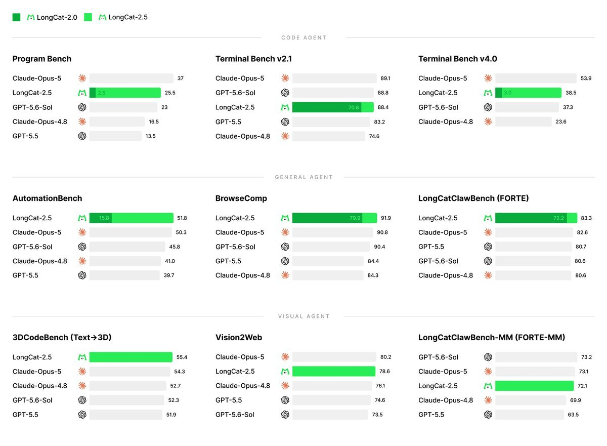
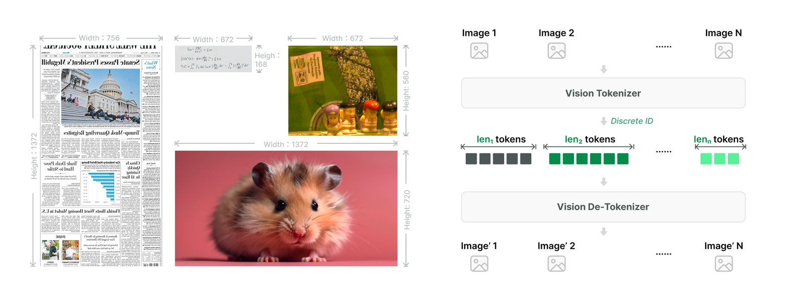
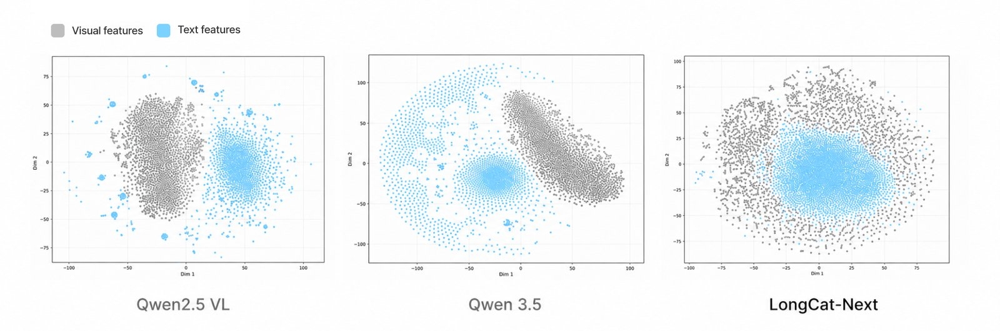

**LongCat 2.5** is the newest model from Meituan's LongCat team. Announced on X on November 2, 2026, it is a mixture-of-experts model with 1.6 trillion total parameters and about 48 billion active per token. It accepts text, images and video, and Meituan trained it for long agent runs such as building a whole project or working through a large codebase, the kind of work covered in our [review of long-horizon agent research](/tutorials/stateful-long-horizon-agents-review/). Compared with LongCat-2.0, the main changes are stronger native visual understanding and much higher scores on agent coding tests.

The model is available through the LongCat API Platform, which speaks both the OpenAI and Anthropic formats. The weights are not public yet. This guide covers the benchmark numbers and how to read them, how the model handles images, the price and limits, and how to run it in Claude Code or from the OpenAI SDK.

## What Is LongCat 2.5

LongCat 2.5 is Meituan's natively multimodal mixture-of-experts model for long agent tasks, served through the LongCat API. The [LongCat-2.5 blog post](https://longcat.ai/blog/longcat-2.5/) lists four changes from LongCat-2.0:

- **More long-horizon training.** Long agent trajectories are added to long-sequence training, followed by large-scale reinforcement learning on full-project builds and complex codebases.
- **Failures turned into training data.** Meituan says it converts real agent failure trajectories into reproducible tasks with checks, then adds them to training.
- **Images as tokens.** Visual input is turned into discrete tokens that the same backbone reads alongside text.
- **Domestic accelerators.** Long-context training and 4-bit inference run on Chinese AI chips. The post does not name the chip.

The [API change log](https://longcat.ai/platform/docs/change-log) dates the general release to November 2. A LongCat-2.5-Preview went out on September 25 with image understanding and coding support. Meituan lists Claude Code, Codex and Hermes as supported agent harnesses.

### Model specs at a glance

| Item | LongCat-2.5 |
|---|---|
| Architecture | Mixture of experts, 1.6T total, ~48B active per token |
| Input | Text, images, video |
| Context length | 1,048,576 tokens (input + output) |
| Max output | 262,144 tokens |
| API formats | OpenAI-compatible and Anthropic-compatible |
| Weights | Not released as of Nov 5, 2026 |

## LongCat 2.5 Benchmarks

In Meituan's own table, LongCat 2.5 scores 88.4 on Terminal Bench v2.1 and 38.5 on Terminal Bench v4.0. That puts it near the leaders on several agent tests and behind Claude Opus 5 on the hardest coding ones. Meituan published a table of 31 tests across code agent, general agent and visual tasks. Every number below comes from that table. Scores marked with an asterisk in the original were taken from other labs' reports or leaderboards. The rest were run by Meituan, which calls them "indicative only." Unless a footnote says otherwise, LongCat-2.5 ran with thinking on, temperature 1.0 and top_p 0.95.



*Nine of the 31 tests, with LongCat-2.0 shown as the darker inner bar. The chart leaves out GLM-5.3, Kimi K3 and DeepSeek-V4.1-Flash, which appear in the full table. Image: Meituan LongCat launch post.*

### Coding agent results

| Test (Meituan's table) | LongCat-2.5 | LongCat-2.0 | Best other model in table |
|---|---|---|---|
| Terminal Bench v2.1 | 88.4 | 70.8 | 90.6 DeepSeek-V4.1-Flash |
| Terminal Bench v4.0 | 38.5 | 3.0 | 53.9 Claude Opus 5 |
| Program Bench (almost resolved) | 25.5 | 2.5 | 37.0 Claude Opus 5 |
| DeepSWE v1.1 | 64.6 | 9.7 | 74.2 DeepSeek-V4.1-Flash |
| NL2Repo | 60.5 | 40.9 | 75.3 Claude Opus 5 |
| SWE Atlas Codebase QnA | 58.3 | 33.1 | 63.2 Claude Opus 5 |

The jump over LongCat-2.0 is the clearest signal. Terminal Bench v4.0 went from 3.0 to 38.5 and DeepSWE from 9.7 to 64.6, both measured by the same team with the same setup. Against other vendors, LongCat-2.5 sits close to the leaders on Terminal Bench v2.1 and behind Claude Opus 5 on the harder Terminal Bench v4.0 and Program Bench.

The coding runs used the Claude Code harness (v2.1.280) with a 512K sequence limit, and Terminal Bench v2.1 is an average of three runs. DeepSWE used mini-swe-agent with a 1M limit. Copied competitor scores came from each lab's own setup, so the harness is not held constant across columns. The harness is itself a variable in agent scores, which is what [the HarnessDev benchmark](/tutorials/harnessdev-agent-harness-benchmark/) sets out to measure.

### Agent and visual results

| Test | LongCat-2.5 | Closest others |
|---|---|---|
| BrowseComp | 91.9 | 91.5 DeepSeek-V4.1-Flash, 91.2 Kimi K3 |
| AutomationBench v1.0.6 | 51.8 | 54.8 DeepSeek-V4.1-Flash, 50.3 Claude Opus 5 |
| MCP Atlas | 83.1 | 85.8 Claude Opus 5 |
| 3DCodeBench (text to 3D) | 55.4 | 54.3 Claude Opus 5 |
| Vision2Web | 78.6 | 80.2 Claude Opus 5 |
| VideoMME | 85.2 | 90.0 Kimi K3, 89.5 GPT-5.6-Sol |

Three entries are Meituan's own tests: LongCat AppDev (73.7), LongCatClawBench (83.3) and its multimodal version (72.1). Outsiders cannot check them.

### Which models are missing

The chart compares against GPT-5.5, GPT-5.6-Sol, Claude Opus 4.8 and Claude Opus 5. Commenters on Hacker News asked why newer frontier models were left out; one noted that the preview shipped on September 25, when these comparisons were more current. The table also omits Kimi K3.1, which another commenter called the closest rival in its class.

## How LongCat 2.5 Reads Images

Most vision-language models attach a separate image encoder that hands continuous features to the language model. LongCat-2.5 converts each image into a sequence of discrete token IDs from a fixed vocabulary, then feeds those IDs to the same backbone as text.



*Images keep their native resolution, so larger images produce longer token sequences. Image: LongCat-2.5 blog, Figure 1.*

The blog describes the pieces:

- **Native-resolution tokenizer.** Features come from a Semantic-and-Aligned Encoder, then Residual Vector Quantization turns them into multi-level tokens, the same method as Meituan's earlier LongCat-Next.
- **Offline preprocessing.** Because the tokenizer is fixed, image token IDs can be computed and cached before training. The vision encoder drops out of the training graph, which makes it easier to pack long sequences and balance work across chips.
- **Shared embeddings.** The visual codebook embeddings are learned together with the backbone.



*Gray points are visual features and blue points are text. The LongCat panel is from a smaller test model with about 3B active parameters, not LongCat-2.5. Image: LongCat-2.5 blog, Figure 2.*

Meituan says the mixed clusters "suggest" images and text share one semantic space. That evidence comes from the small test model, so treat it as a design rationale. The benchmark table is the only evidence for LongCat-2.5 itself.

## How Meituan Trained LongCat 2.5 for Long Agent Runs

The training section of the blog is mostly about making reinforcement learning work on long coding tasks.

### Building verifiable tasks

Meituan filters GitHub pull requests and their linked issues, has agents annotate tasks and build environments, and checks each task with fail-to-pass and pass-to-pass tests. Internal coding tasks add everyday engineering work. Live pass rates during training decide which tasks get relabeled or dropped.

### Keeping rollouts honest

To stop the model from gaming tests, task environments have no network access, git history and cached files are removed, and an LLM judge audits trajectories for exploits. Extra penalties target repeated reasoning and repeated tool calls. Meituan also redistributes reward among successful samples to keep response length from growing too fast.

### Mixing harnesses

During RL, tasks tied to different benchmarks run in different scaffolds in varying proportions. Meituan reports that this mix improved generalization across tasks. Meituan then distills skills from LongCat-2.0's expert models for agent work, reasoning and interaction back into the main model, with the student sampling its own outputs online.

### Infrastructure numbers

Meituan reports these figures for its own setup:

- Training on domestic accelerators with less than 80 GB of memory each. Its FSDP setup reached 86% higher per-device throughput than a DDP baseline in long-sequence fine-tuning.
- W4A4 inference, with 4-bit weights and activations for the experts, compared with a W8A8 INT8 baseline in online stress tests: prefill throughput up 43.3%, decode throughput up 42.77%, time to first token down 15.91% and time per output token down 19.72%. Meituan says quality was comparable to the unquantized model on all downstream tasks it evaluated.

These are internal serving numbers. They do not tell you what speed the public API delivers.

## LongCat 2.5 Pricing and API Limits

The [LongCat-2.5 pricing page](https://longcat.ai/platform/docs/pricing/longcat-2.5) lists pay-as-you-go prices labeled as a limited-time discount:

| Item | Discounted price per 1M tokens |
|---|---|
| Uncached input | $0.30 |
| Cached input | $0.006 |
| Output | $1.20 |

The page says prices may change and that the console and your billing records are authoritative. LongCat also sells token packs valid for 30 days. A Hacker News commenter pointed out that the price matches DeepSeek-V4.1-Flash, which scores in the same range on several of Meituan's tests. For working out what a coding agent costs per finished task, see [cost per successful task](/tutorials/coding-agents-finops-cost-per-successful-task/).

The [model parameters page](https://longcat.ai/platform/docs/api/model-params) sets these limits:

- Context: 1,048,576 tokens, input plus output.
- `max_tokens`: up to 262,144.
- `temperature` is fixed at 1.0 with thinking on and 0.7 with thinking off. Other values are silently replaced.
- `top_p` defaults to 0.95; `top_k` ranges from -1 to 100; `thinking_budget` goes up to 262,144.
- Thinking is switched with `"thinking": {"type": "enabled"}` or `{"type": "disabled"}`.

## How to Use LongCat 2.5 in Claude Code

LongCat's [Claude Code guide](https://longcat.ai/platform/docs/claude-code) uses the Anthropic-compatible endpoint.

### 1. Get an API key

Sign up on the LongCat API Platform, open the API Keys page and create a key. Keys are created manually.

### 2. Edit the Claude Code settings

Add this to `~/.claude/settings.json`:

```json
{
  "env": {
    "ANTHROPIC_AUTH_TOKEN": "your_longcat_api_key",
    "ANTHROPIC_BASE_URL": "https://api.longcat.ai/anthropic",
    "ANTHROPIC_MODEL": "LongCat-2.5",
    "ANTHROPIC_SMALL_FAST_MODEL": "LongCat-2.5",
    "ANTHROPIC_DEFAULT_SONNET_MODEL": "LongCat-2.5",
    "ANTHROPIC_DEFAULT_OPUS_MODEL": "LongCat-2.5",
    "CLAUDE_CODE_MAX_OUTPUT_TOKENS": "262144",
    "CLAUDE_CODE_DISABLE_NONESSENTIAL_TRAFFIC": 1
  }
}
```

All four model variables point to LongCat-2.5, so Claude Code uses it for both main and background calls. If you already use Claude Code with Anthropic, keep a copy of your old settings or put this in a project-level settings file so you can switch back. Teams that switch models often route this through [a model gateway](/tutorials/model-gateway-enterprise-ai-control-plane/) instead of editing each machine.

### 3. Test it

Run `claude` and send a short message. A reply from LongCat means the endpoint and key work. LongCat's docs have similar pages for Codex, OpenCode, Cline and Kilo Code. If you run several agents side by side, [T3 Code as a control plane for Claude Code and Codex](/tutorials/t3-code/) is one way to compare them on the same task.

## LongCat 2.5 API: Image and Video Input

The [visual understanding docs](https://longcat.ai/platform/docs/image-video-understanding) use the OpenAI chat completions format at `https://api.longcat.ai/openai`:

```python
import base64
from openai import OpenAI

client = OpenAI(api_key="YOUR_API_KEY", base_url="https://api.longcat.ai/openai")

with open("screenshot.png", "rb") as f:
    b64 = base64.b64encode(f.read()).decode("utf-8")

response = client.chat.completions.create(
    model="LongCat-2.5",
    messages=[{
        "role": "user",
        "content": [
            {"type": "text", "text": "Rebuild this page as HTML and CSS."},
            {"type": "image_url", "image_url": {"url": f"data:image/png;base64,{b64}"}},
        ],
    }],
)
print(response.choices[0].message.content)
```

Video goes in a `video_url` block and must be a public URL. The Anthropic endpoint accepts images as `image` blocks with a `base64` or `url` source.

| Limit | Images | Video |
|---|---|---|
| Formats | PNG, JPG, JPEG, WebP, GIF (no SVG or HEIC) | URL only |
| Size per file | 10 MB | 100 MB |
| Per request | 100 | 10 |
| Other | Up to 5,120 px per side, 5,242,880 total pixels | Under 3,600 seconds |

One inconsistency: the sample response on the Retrieve Model docs page lists LongCat-2.5 as `text->text` with prices that differ from the pricing page. The visual understanding page and the launch post both describe image and video input, so treat the sample response as a placeholder and check the live response.

## LongCat 2.5 Early User Reports

The [Hacker News thread](https://news.ycombinator.com/item?id=50337716) had a handful of first impressions. These are individual reports, not measurements:

- One user said the preview had been free on OpenCode for a couple of weeks and handled simple coding tasks.
- One user filled 200K tokens of context in five minutes in a first test; a second session ran at about 80 tokens per second.
- Two users said the web chat answered English questions in Chinese, and one said a follow-up crashed the chat.
- Users noted that the chat login redirects to a Meituan Keeta account page, and that earlier LongCat releases required logging in to the API console through the Meituan app.

The language problems were reported on the consumer chat, not the API. Check the API on your own tasks before relying on it.

## Should You Try LongCat 2.5

The case is price. At the discounted $0.30 input and $1.20 output per million tokens, with a 1M context and image input, LongCat-2.5 is cheap enough to test on real agent tasks. Meituan's own table puts it close to the leaders on several tests and behind Claude Opus 5 on the hardest coding ones.

The limits are just as clear. The scores are self-reported and partly self-run. The price is a limited-time discount. The weights are not out, so you cannot self-host it yet the way teams do with GLM; see [how Revolut runs GLM for coding](/tutorials/glm-for-coding/), or [Ripple-65B Preview](/tutorials/ripple-65b-preview/) for an open-weight coding model.

A sensible test: point a spare Claude Code profile at LongCat, run it on a task your team has already solved with another model, and compare the result, tokens used and cost.

## LongCat 2.5 FAQ

### Is LongCat 2.5 open source?

Not yet. The launch post links to Hugging Face and GitHub with a Coming soon label. On November 5, 2026, the meituan-longcat Hugging Face account had no LongCat-2.5 model and the GitHub repository returned 404. For now the model is available through the LongCat API.

### How much does LongCat 2.5 cost?

LongCat's pricing page lists a limited-time discounted price of $0.30 per million uncached input tokens, $0.006 per million cached input tokens and $1.20 per million output tokens. The page says prices may change and that the console and billing records are authoritative.

### Can I use LongCat 2.5 in Claude Code?

Yes. Set `ANTHROPIC_BASE_URL` to `https://api.longcat.ai/anthropic`, put your LongCat API key in `ANTHROPIC_AUTH_TOKEN` and set the model variables to `LongCat-2.5` in `~/.claude/settings.json`. LongCat's docs also cover Codex, OpenCode, Cline and Kilo Code.

## References

- Meituan LongCat, [LongCat-2.5: Native Multimodality for Agentic Tasks](https://longcat.ai/blog/longcat-2.5/), Nov 1, 2026
- Meituan LongCat, [launch post on X](https://x.com/Meituan_LongCat/status/2117264311714537633), Nov 2, 2026
- LongCat API docs: [pricing](https://longcat.ai/platform/docs/pricing/longcat-2.5), [model parameters](https://longcat.ai/platform/docs/api/model-params), [visual understanding](https://longcat.ai/platform/docs/image-video-understanding), [Claude Code](https://longcat.ai/platform/docs/claude-code), [change log](https://longcat.ai/platform/docs/change-log), checked Nov 5, 2026
- Hacker News, [LongCat-2.5: Native Multimodality for Agentic Tasks](https://news.ycombinator.com/item?id=50337716), discussion, Nov 2026
