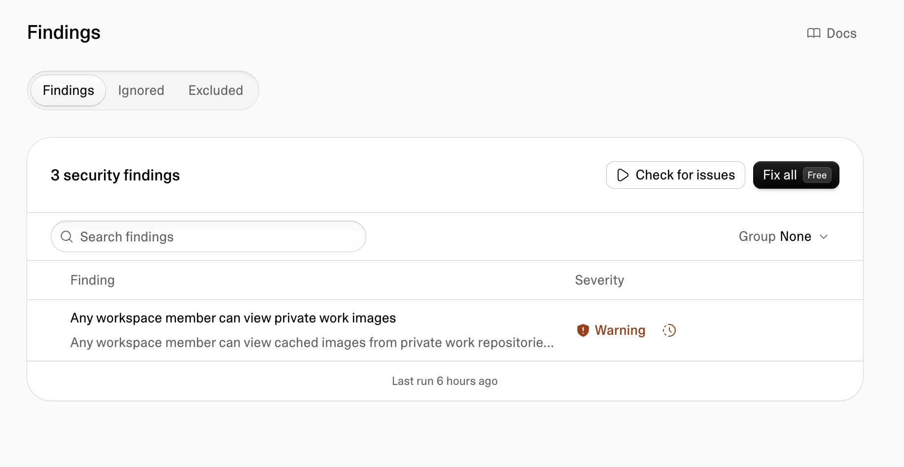
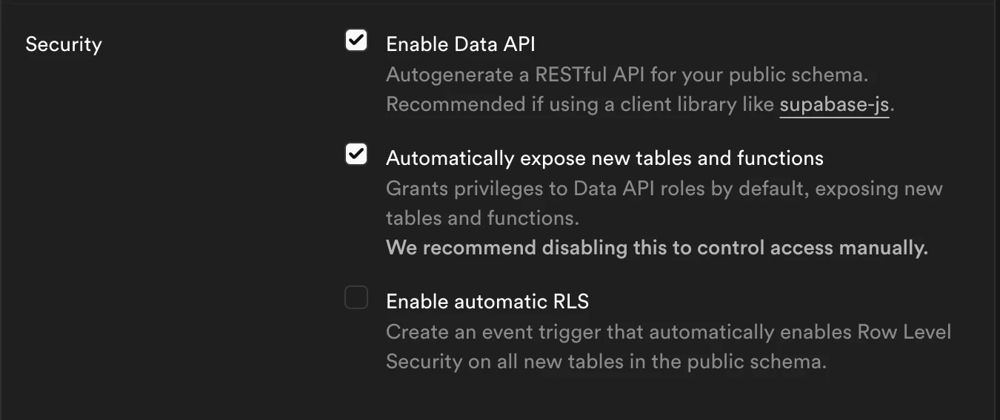

Lovable security is back in question after Crissy Field, a Hamburg application-security consultancy, reported that thousands of apps built on Lovable hand their database contents to anyone who asks. Working from Common Crawl, the firm identified 159,041 Lovable projects and found that 7,403 sites served records containing email addresses to requests made without logging in, using only the public key each site already ships to its visitors. Among the records it pulled were passport numbers, payment details and more than 200,000 private chat messages.

Lovable turns plain-language descriptions into web apps, and the apps in this study store their data in Supabase. That pairing has a specific weak point: the browser talks to the database directly, so the database's own access rules are the only thing between a visitor and every row. This guide explains how that fails, what Lovable's built-in security scan covers, why Supabase's recent change to default permissions does not reach older tables, and how to check and fix your own app.

## Lovable security issues: what Crissy Field found {#lovable-security-issues}

Crissy Field found that a large share of Lovable apps using Supabase return private records to unauthenticated requests. The study, run with the German business daily Handelsblatt (which published a first story on November 2, 2026), covered Lovable projects seen by Common Crawl between December 2025 and September 2026. The English report carries newer figures than the newspaper story, and its Hacker News thread drew nearly 1,000 points and more than 370 comments on November 14.

The numbers narrow in steps:

| Step | Count |
|---|---|
| Lovable projects identified in Common Crawl | 159,041 |
| Projects using Supabase | 34,545 |
| Sites that sent Supabase records on first load, with no login | 24,664 |
| Sites where further read-only requests with the same key returned email-bearing records | 7,403 (30% of 24,664) |
| Tables those records came from | 10,560 |

Sending some data on page load is normal, since a menu or an event listing is meant to be public. The finding that matters is the last two rows: the researchers asked for more than the page displayed, with the same key, and got it. Crissy Field treats email addresses as a proxy for personal data and is explicit about the limits. Some addresses are public contacts or test data, some personal records contain no email at all, the Common Crawl sample is not representative of every Lovable app, and the firm downloaded only parts of each dataset. It says the 30% should not be read as a confirmed leak rate.

The individual cases are what make it serious. A German lifestyle forum exposed more than 80,000 profiles with names, email addresses, dates of birth and gender, plus more than 200,000 chat messages. Event organizers and restaurants exposed tens of thousands of ticket and food-sale records with phone numbers, postal addresses, payment information and ticket codes. A property manager exposed AI-generated summaries of internal emails about tenants and owners. One service provider exposed more than 1,000 identity-document records, including passport numbers, expiry dates and nationalities. In another case, 280,000 emails a provider had sent to its customers were readable. Crissy Field could not tell whether any of it had been misused, and it withheld the access details.

The study looked only at apps that connect to Supabase. Lovable's own database features, introduced in late 2025, were not examined, although the report notes that similar mistakes are possible there.

## Lovable Supabase RLS: why the anon key exposes data {#lovable-supabase-rls}

Lovable apps on Supabase expose data because the frontend queries the database directly with a public "anon" key, and Supabase's row-level security (RLS) policies are the only check on what that key can read. If a table is reachable by the anon role and has RLS off, or a policy that lets everyone through, any visitor can read the whole table.

Matt Palmer, the researcher behind CVE-2025-48757, described the same mechanism in 2025: an attacker inspects the app's network traffic, finds the database endpoint and key the page already uses, and calls the REST API directly. Supabase's anon key is designed to be public. It tells the Data API which project a request is for, not who the user is, so it appears in every visitor's browser bundle. The diagram at the top of this page traces what happens to a request made with it.


Two layers decide what comes back. The first is a Postgres grant: whether the `anon` role may touch the table at all. Until this year Supabase granted select, insert, update and delete on every new table in the `public` schema to `anon`, `authenticated` and `service_role` by default, so that layer was usually open. The second is RLS, which filters rows per request. A policy such as `USING (auth.uid() = user_id)` returns only the caller's own rows. RLS turned off, or a policy written as `USING (true)`, returns all of them.

RLS also works on whole rows. Palmer notes that if a table mixes a public column such as a username with a private one such as payment details, a policy that allows the row exposes both. Hacker News commenters who build on Supabase made the same point from experience: policies get hard to audit as schemas grow, and one missing condition is enough to leak. That is harder still when an agent writes the schema, the point Supabase itself makes below, and the reason teams running coding agents in production put [tool and data boundaries in the harness](/tutorials/agent-framework-harness-runtime-production/) rather than trusting each generated change.

## Lovable security scan: what it checks and what it misses {#lovable-security-scan}

Lovable's security scan checks RLS on every publish, but by default it warns rather than blocks, so an app with open tables can still go live. Igor Andriushchenko, Lovable's head of security, replied in the Hacker News thread that the root cause in these apps was "insufficient Row-Level Security, which is exactly what our scanning is built to catch." He pointed to the free pre-publish scan, the deeper scan, the Fix button and auto-fix as the tools meant to catch it.

Lovable's documentation describes two built-in scans. The Quick scan runs automatically each time you open the publish dialog and finishes in seconds. Its database review flags tables without row-level security, access rules that let everyone through and leaked-password protection being off; it also audits dependencies and checks for an MCP server exposed without authentication. The Deep scan reads all application code for broken access control, unauthenticated endpoints, injection, leaked secrets and personal data in error messages. Findings are labeled Critical, Warning or Info, and a Fix button sends a finding to Lovable's agent with instructions for that issue. A November 10 post from Lovable's security team adds an "Auto-fix security issues" project setting that resolves many findings with your next chat message.



*Lovable's security Findings view, from the company's November 10, 2026 post "Find it, fix it, ship it." Severity labels and the Fix action are where a scan result turns into a change.*

The gaps are in the defaults:

- **Publishing is not blocked unless an admin turns that on.** "Block publishing with critical issues" lives in Workspace settings → Security → Privacy & security → Publishing. The docs say new Enterprise workspaces created by Lovable start with it enabled; elsewhere it is a choice.
- **The blocking dialog is described for the built-in backend.** According to the docs, Lovable opens a "Review security findings" dialog on Publish for projects on its built-in backend with unresolved critical findings, and even there you can publish anyway.
- **The Deep scan is manual.** It does not run as you work. Scheduled deep scans are an Enterprise feature in the docs today; the November 10 post says scheduled scans are coming to all paid plans.
- **The scan cannot know your intent.** The post itself notes a finding may flag data you mean to show, such as public usernames on a forum, and leaves the final call to you. The docs add that the tools "cannot guarantee complete security."

Hacker News commenters seized on that gap. One replied to Andriushchenko that some 7,500 site operators failing to act on findings was a systemic failure on Lovable's part, and several asked why a platform aimed at non-programmers lets a Critical finding ship at all. Lovable's terms place responsibility for apps and their data on the customer, which Crissy Field contrasts with marketing that says no technical knowledge is needed. The same pattern, where an AI tool's default quietly skips a safeguard the underlying system already offers, showed up in the [Payload MCP plugin's handling of document locks](/tutorials/payload-mcp-plugin-document-locks/).

## Supabase Data API grants after October 30: what changed for old tables {#supabase-data-api-grants-october-30}

Supabase's October 30, 2026 change stops new tables from being exposed automatically, but it leaves existing tables as they were, so Lovable apps built before the change keep their open grants. A Hacker News comment pointed to the change as a fix for this class of leak; Supabase's own changelog shows why it is only a partial one.

The changelog, published April 28, 2026, removes the default grant of select, insert, update and delete to `anon`, `authenticated` and `service_role` on new tables in the `public` schema. It became the default for new projects from May 30 and was applied to all existing projects on October 30. Supabase gives the reason directly: "agents, CLI scripts, and AI platforms create tables too, and many of those operations do not have a human reviewing the diff."



*Supabase's project-creation security options, from its April 28, 2026 changelog. Unchecking "Automatically expose new tables and functions" stops new tables from being granted to the Data API roles.*

The key sentence for existing apps: "Existing tables are not affected in your project, they keep their current grants and stay reachable." A Lovable project whose tables were created before its change date still grants those tables to `anon`, and RLS is still the only filter. After the change, a new table without an explicit grant fails with error `42501` ("permission denied for table"), which is safe but can break an app that expects the table to appear. Supabase's Table Editor shows a Data API exposure badge, and its Security Advisor lists tables worth reviewing.

## Lovable security check: how to test your own app {#lovable-security-check}

To check a Lovable app, find which tables the anon role can reach, confirm each has RLS with an ownership condition, and then request the data yourself while logged out and as a second user. Run the checks on your own project only.

1. **Run both scans.** In Lovable, open the project's Security view and run the Deep scan as well as the Quick scan, or ask Lovable in chat to review security. Read every Critical and Warning finding rather than dismissing them as noise.
2. **List what the anon role can read.** In the Supabase SQL Editor, this query lists tables in `public` that `anon` can select from and shows whether RLS is on:

   ```sql
   select c.relname as table_name,
          c.relrowsecurity as rls_enabled
   from pg_class c
   join pg_namespace n on n.oid = c.relnamespace
   where n.nspname = 'public'
     and c.relkind in ('r', 'p')
     and has_table_privilege('anon', c.oid, 'SELECT')
   order by rls_enabled, table_name;
   ```

   Any row with `rls_enabled = false` is readable by every visitor. Supabase's Security Advisor and the Data API exposure badge in the Table Editor flag the same tables.
3. **Read the policies on every table that holds personal data.** In Lovable they are under More → Database → Manage → Policies; in Supabase, `select tablename, policyname, roles, cmd, qual from pg_policies where schemaname = 'public';` lists them. A `qual` of `true` on a select policy for `anon` or `public` means everyone can read every row.
4. **Test from the outside.** Open your published app in a private window, watch the network panel for requests to `/rest/v1/`, and repeat one of them for a table that should be private. Then sign in as a second test user and try to read the first user's rows. Palmer's write-up recommends exactly this pair of tests, because a policy can look right and still let the wrong person through.
5. **Check functions and storage too.** RLS on tables does not cover database functions that run with elevated rights, and the Register's February case below involved an access check inside a function that was written backwards. File storage buckets have their own rules, which the Quick scan also reviews.

## How to fix Lovable RLS policies {#fix-lovable-rls-policies}

Fix Lovable RLS problems by removing anon access from tables the public should not read, turning RLS on everywhere, and replacing permissive policies with rules tied to the signed-in user. Lovable's Fix button can draft these changes; review what it writes before publishing.

Supabase's changelog treats three steps as one unit: grant each role only what it needs, enable RLS, then add the policy. For a private table that signed-in users read, that looks like this:

```sql
-- Take the table away from anonymous visitors entirely
revoke all on table public.messages from anon;
grant select on table public.messages to authenticated;

-- Make sure row-level security is on
alter table public.messages enable row level security;

-- Signed-in users see only their own rows
create policy "users read own messages"
  on public.messages
  for select
  to authenticated
  using ((select auth.uid()) = user_id);
```

Then make the safe behavior the default for tables you add later. On an existing project, Supabase's changelog gives the statements that stop new `public` tables from being granted to the Data API roles automatically, which is the same setting new projects now get at creation:

```sql
alter default privileges for role postgres in schema public
  revoke select, insert, update, delete on tables from anon, authenticated, service_role;
alter default privileges for role postgres in schema public
  revoke usage, select on sequences from anon, authenticated, service_role;
```

A few habits close the remaining gaps. Keep sensitive columns such as payment or identity data in their own table with its own policy, since RLS cannot hide one column of a row it allows. Move secret API keys out of database tables and into Lovable's Secrets with server-side functions, as both Lovable's docs and Palmer advise; client-side code leaks in ways that are easy to miss, as the [Claude Code email leak](/tutorials/claude-code-email-leak/) showed with account addresses sent in request headers. In Lovable workspace settings, turn on "Block publishing with critical issues" so a Critical finding stops a release instead of producing a warning. And repeat the outside-in test after any change to sign-in, roles or the schema. If the app holds identity documents, payments or health data, Lovable's docs and Crissy Field both recommend a professional review before real users arrive.

## Lovable security breach history: from CVE-2025-48757 to 2026 {#lovable-security-breach-history}

The November 2026 study is the largest look at a problem that has surfaced around Lovable several times. In March 2025 Matt Palmer found missing or insufficient RLS in Lovable projects; it was published as CVE-2025-48757 on May 29, 2025, with a CVSS 3.1 score of 9.3 from the CVE numbering authority. Lovable disputes the CVE on the grounds that each customer is responsible for protecting their app's data. Palmer's timeline lists a vendor patch on April 24, 2025, and his write-up notes that the publish-time check confirmed RLS was enabled without judging whether the policies were sufficient.

In February 2026, The Register reported that researcher Taimur Khan found 16 vulnerabilities, six of them critical, in a single app showcased on Lovable's Discover page. One access check inside a database function blocked signed-in users and admitted anonymous ones, and Khan counted 18,697 exposed user records. Lovable said the project included code it had not generated and a database it did not host.

A separate April 2026 episode, also reported by The Register, concerned Lovable's own platform rather than customer apps: a researcher showed that any free account could read the chats and code of projects set to public. Lovable said public code was visible by design, that chat access had been re-enabled by mistake during a February backend change, and reverted it.

The two app-level cases follow the path in the diagram above. Prompt-to-product tools can now turn one prompt into an [overnight 12-level game](/tutorials/fable-5-2-review/), but a Lovable app is ready for real data only when its database rules were written for that data and tested from the outside. Treat the scan as the first check, block publishing on Critical findings, and test anonymous and cross-user access yourself after every schema or sign-in change. For the wider shift this belongs to, see how [AI agents with internal access](/tutorials/ai-agent-internal-access-security-boundary/) change the security boundary.

## References {#references}

- Crissy Field GmbH, ["Lovable: Many Apps Built on the Platform Expose Sensitive Data"](https://www.crissyfield.de/research/lovable-en/), research report, November 2026 (Hacker News discussion: [item 50499017](https://news.ycombinator.com/item?id=50499017))
- Igor Andriushchenko (Lovable), ["Find it, fix it, ship it: building secure apps on Lovable"](https://lovable.dev/blog/find-it-fix-it-ship-it), November 10, 2026, and Lovable's [Security documentation](https://docs.lovable.dev/features/security)
- Supabase, ["Breaking Change: Tables not exposed to Data and GraphQL API automatically"](https://supabase.com/changelog/45329-breaking-change-tables-not-exposed-to-data-and-graphql-api-automatically), changelog, April 28, 2026
- Matt Palmer, ["CVE-2025-48757"](https://mattpalmer.io/posts/CVE-2025-48757/), May 29, 2025
- Connor Jones, ["AI-built app on Lovable exposed 18K users, researcher claims"](https://www.theregister.com/software/2026/02/27/ai-built-app-on-lovable-exposed-18k-users-researcher-claims/5038511), The Register, February 27, 2026
