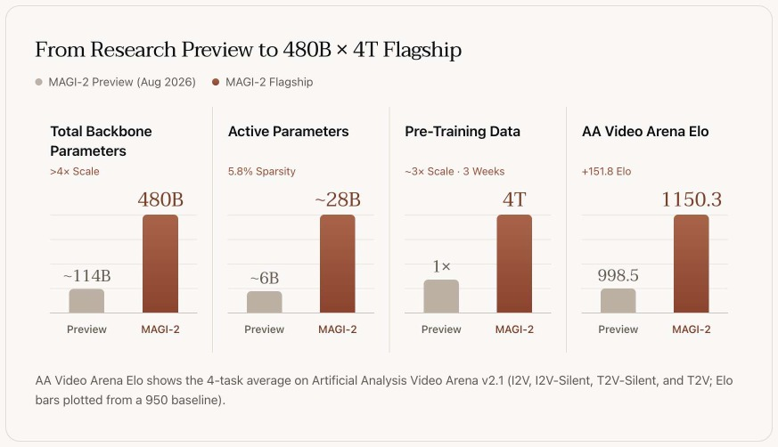
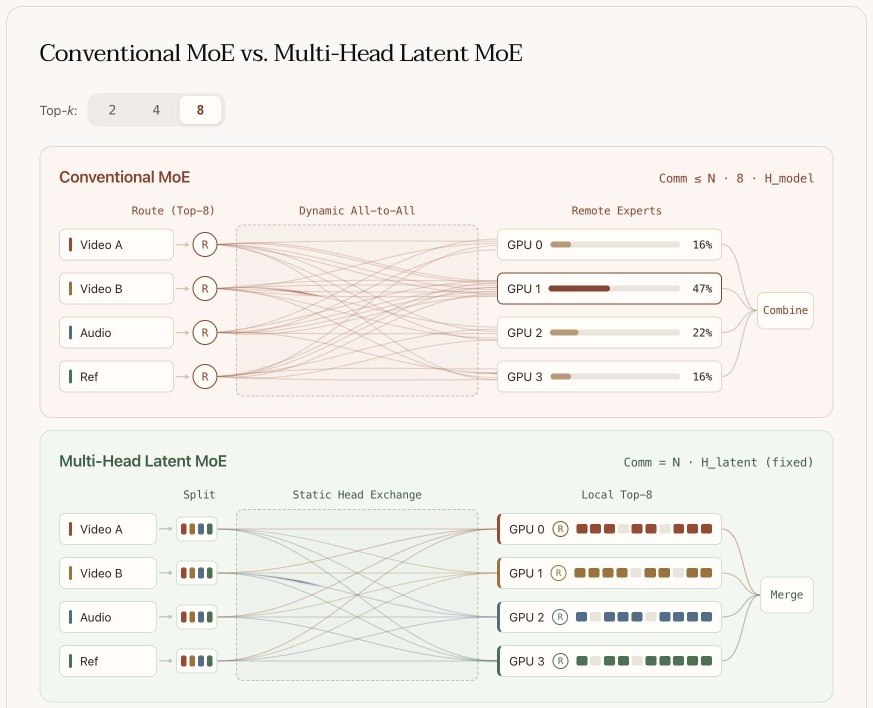
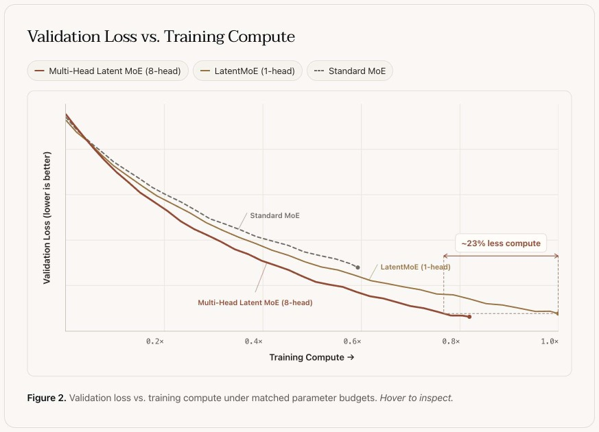
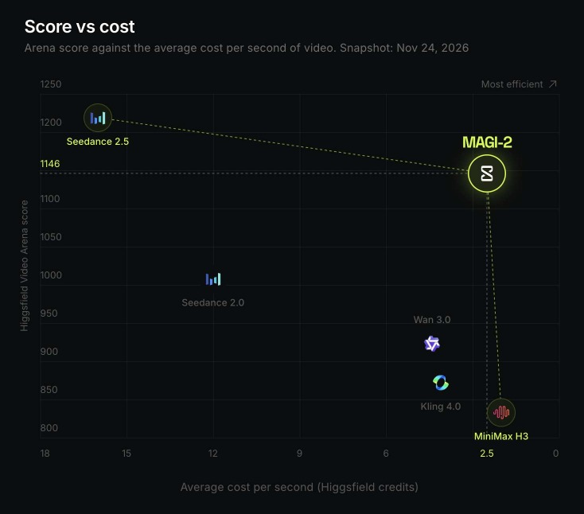

MAGI-2 AI is Sand.ai's new audio-and-video generation model, released on November 24, 2026: 480 billion parameters in total, about 28 billion active per token, and up to 30 seconds of 1080p video with dialogue, sound effects and music generated in the same pass. It launched as a Higgsfield exclusive at $0.80 per 10-second clip through the API, and on Higgsfield's own blind arena it ranks second of six models, behind ByteDance's Seedance 2.5.

The name now covers two different releases. MAGI-2 Preview, published in August, is a 114B open-weight model you can download and run on eight Hopper GPUs. MAGI-2, the 480B model, is available only as a hosted service until Sand.ai publishes the weights it has promised. This guide separates the two, explains the Multi-Head Latent MoE design they share, and compares MAGI-2 with [Seedance 2.5](/tutorials/seedance-2-5-api/) on scores and price per clip.

## MAGI-2 vs MAGI-2 Preview: Which Model You Can Use {#magi-2-vs-magi-2-preview}

MAGI-2 and MAGI-2 Preview share an architecture but differ in size, output and access. MAGI-2 is the 480B model you can use today only through Higgsfield's web app and API; MAGI-2 Preview is the 114B model whose weights and inference code are public under Apache-2.0.

| | MAGI-2 Preview | MAGI-2 |
|---|---|---|
| Released | August 2026 | November 24, 2026 |
| Total / active parameters | ~114B / ~6B | 480B / ~28B |
| Pre-training data | 1× (baseline) | ~4T tokens, about 3× the Preview |
| Clip length | 10 seconds only | 4 to 30 seconds |
| Output | Two-stage, refined to 1088×1920 | 1080p, 25 fps, six aspect ratios |
| Inputs | Text, or text plus one still image | Up to 10 images, 5 videos and 5 audio clips, or a start and end frame |
| Audio | Generated with the video | Generated with the video, with lip-sync |
| Where to use it | Your own 8-GPU Hopper node | Higgsfield web app and API |
| Weights | Hugging Face, Apache-2.0 | Promised, no date |
| Sand.ai's reported AA Video Arena Elo | 998.5 | 1150.3 |

Sand.ai scaled the backbone more than four times and the data about three times between the two releases, then added reinforcement-learning post-training and a separate 1080p upscaler. The upscaler re-reads the original reference images while sharpening the output, which Sand.ai credits for keeping small faces and on-screen text legible across a 30-second shot.



*From research preview to the 480B model. The Elo bars are Sand.ai's four-task average on Artificial Analysis Video Arena v2.1 (image-to-video and text-to-video, with and without audio), plotted from a 950 baseline. Screenshot of sand.ai, November 25, 2026.*

The Elo numbers come from Sand.ai's launch post, so treat them as the developer's own measurement. One more discrepancy to know about: Higgsfield's announcement calls MAGI-2 a 400B model, while Sand.ai's post and charts say 480B total parameters. Both agree on about 28B active.

## MAGI-2 Architecture: How Multi-Head Latent MoE Works {#magi-2-architecture}

MAGI-2's architecture is a single Transformer that reads text, video and audio tokens as one sequence, with most of its feed-forward layers replaced by a Multi-Head Latent Mixture-of-Experts. Each token is split into several heads, and every head has its own router and its own pool of small experts. Sand.ai chose this layout mainly so that a 480B sparse model would train and serve efficiently across many GPU nodes.

The single-stream part comes from Sand.ai's earlier MagiHuman work. Instead of separate towers for picture and sound joined by cross-attention, all three modalities pass through the same self-attention layers, so a line of dialogue, the lip movement that goes with it and the room's echo are modeled together from the first layer.

### Why standard MoE struggles with video

In a conventional Mixture-of-Experts with expert parallelism, a router picks the top-k experts for each token and the whole token is sent to whichever GPUs hold those experts. Traffic grows with k, and the number of tokens each GPU receives changes with every batch. Video makes this worse: a single sequence mixes video latents, audio and reference inputs, so routing is lopsided and one overloaded GPU holds up the rest. Sand.ai lists stragglers, pipeline bubbles and memory spikes as the result.

### Head Parallel: routing without dynamic all-to-all

Multi-Head Latent MoE splits each token's hidden state into slices and assigns each slice, or head, to a fixed GPU before any routing happens. That GPU then runs the head's router and experts locally. Because ownership is fixed, the cross-node exchange always has the same shape regardless of which experts get picked, a scheme the underlying paper calls Head Parallel.



*Conventional MoE vs Multi-Head Latent MoE at top-8. Conventional routing sends whole tokens across devices and lets per-GPU load drift; the multi-head version exchanges fixed slices first and routes on each GPU. The load percentages are illustrative. Figure 1 from Sand.ai's MAGI-2 post, screenshot of sand.ai, November 25, 2026.*

The 480B layout has not been published yet; Sand.ai has promised a technical report. The Preview's layout shows how fine-grained the design is: in its 40-layer backbone, the middle 36 layers are sparse. Each token's 3,072-dimensional hidden state is projected and cut into twelve 256-dimensional heads, and each head picks 6 experts from its own pool of 256. That makes 3,072 narrow expert units per layer, each working on one 256-dimension slice rather than the full token.

On a real cluster, the fixed-shape head slices travel over InfiniBand between nodes, while expert weights, gradients and optimizer state are sharded inside each node over NVLink. Sand.ai built three pieces of software around this: MagiFSDP for the sharding, MagiMoE kernels for running thousands of small experts, and MagiMuon, a version of the Muon optimizer that treats each head's experts as a batch of small matrices.

### Multi-Head Latent MoE vs LatentMoE: training speed and loss

At matched total FLOPs and with each architecture in its best configuration, Sand.ai reports that 480B pre-training ran about 22% faster with Multi-Head Latent MoE than with LatentMoE, the one-head version of the same idea. In smaller controlled runs with the same total and active parameter counts, the 8-head model also reached lower validation loss than a standard MoE and slightly lower than LatentMoE.



*Validation loss against effective training compute under matched parameter budgets. The 8-head model reaches the 1-head model's final loss with about 23% less compute. Figure 2 from Sand.ai's MAGI-2 post, screenshot of sand.ai, November 25, 2026.*

These are the developer's own ablations, and the full curves and configurations are due in the technical report. The practical point for anyone planning to serve the open weights is that the design targets multi-node throughput. Higgsfield's summary puts it plainly: each piece of video is split evenly across GPUs, so every GPU picks its experts locally.

## MAGI-2 vs Seedance 2.5: Arena Benchmarks {#magi-2-vs-seedance-2-5}

In the only head-to-head test published so far, Seedance 2.5 beats MAGI-2: on Higgsfield's Video Arena, Seedance 2.5 scored 1219 and won 61% of its direct matchups against MAGI-2, which scored 1146 and placed second of six. MAGI-2 beat every other model in the pool by a wide margin.

Higgsfield's arena shows professional directors, animators and designers two clips made from the same prompt without model names, and fits a Bradley-Terry model to their picks. The snapshot below is from November 24, 2026 at 16:00 UTC, launch day.

| Model | Higgsfield Arena score | MAGI-2's win rate against it |
|---|---|---|
| Seedance 2.5 | 1219 | 39% |
| **MAGI-2** | **1146** | 60.5% overall |
| Seedance 2.0 | 1008 | 71% |
| Wan 3.0 | 923 | 79% |
| Kling 4.0 | 872 | 83% |
| MiniMax H3 | 833 | 83% |

The 39% is the complement of Seedance 2.5's reported 61% win rate against MAGI-2.

Two cautions apply. Higgsfield is MAGI-2's exclusive launch partner and runs this arena, and the pool has only six models. The 1150.3 Elo on the larger Artificial Analysis Video Arena is Sand.ai's own figure from its launch post, averaged over four task boards. Our [Seedance 2.5 guide](/tutorials/seedance-2-5-api/#seedance-2-5-benchmarks) shows how much a model's standing can shift between arenas: on Arena's November leaderboard, Seedance 2.5 only tied Seedance 2.0.



*Arena score against average cost per second on Higgsfield, where cost falls from left to right. MAGI-2 sits at 2.5 credits per second; Seedance 2.5's position reads at roughly 16. Chart from Higgsfield's MAGI-2 announcement, screenshot of higgsfield.ai, November 25, 2026.*

What the votes cannot show is how MAGI-2 handles its own strengths: 30-second single takes, 20 mixed references, and cut-by-cut timeline control. Sand.ai also lists where it still breaks. Very fast motion can produce trajectory or continuity artifacts, medium and wide shots of 2D animation can look too smooth, and layered soundscapes still lack physical realism. Sand.ai also found that post-training on a few thousand curated clips made the base model's emergent skills, such as solving a Sudoku on screen or translating a character's lines into another language, harder to trigger.

## MAGI-2 API Price per Clip {#magi-2-api-price}

The MAGI-2 API on Higgsfield costs $0.80 for a 10-second clip and $2.40 for a 30-second clip, which is $0.08 per second of 1080p video with sound. In the Higgsfield web app the same clips cost 25 and 75 credits.

| Length | Higgsfield API | Web app credits | Web app at Plus plan rate |
|---|---|---|---|
| 10 seconds | $0.80 | 25 | about $1.23 |
| 30 seconds | $2.40 | 75 | about $3.69 |

The web-app dollar figures assume the $59-a-month Plus plan with 1,200 credits, about $0.049 a credit; our [Higgsfield GPU Harness cost guide](/tutorials/higgsfield-gpu-harness/) converts credits on the other plans. MAGI-2 only renders at 1080p, so the way to spend less is a shorter clip, from 4 seconds up. Credit-based accounts run one MAGI-2 job at a time; more parallel jobs require an Enterprise plan. At /bin/bash.08 a second, MAGI-2 also undercuts the roughly /bin/bash.10 a second that Google's [Genie 4 API](/tutorials/genie-4-api/) charges for video output, a different kind of model billed the same way.

### MAGI-2 vs Seedance 2.5 cost per clip

For a 30-second 1080p clip, MAGI-2 through Higgsfield's API costs $2.40, while Seedance 2.5 lists at about $17.06 on BytePlus ModelArk and about $6.93 even at 720p, by the per-token formula in our [Seedance 2.5 API guide](/tutorials/seedance-2-5-api/#seedance-2-5-api-price). Inside Higgsfield's own credit system the gap is similar: 2.5 credits per second for MAGI-2 against roughly 16 for Seedance 2.5, read from the chart above.

The two prices come from different sellers, and Seedance 2.5 offers features MAGI-2 does not, including 4K, a cheaper Flash tier and a 480p draft mode. For 1080p clips with sound, though, MAGI-2's launch price is about one-seventh of Seedance 2.5's list price, for a model that loses 61% of blind matchups to it.

## MAGI-2 Open Source Status {#magi-2-open-source}

MAGI-2 open source status splits by version. MAGI-2 Preview is open now: Sand.ai published its 114B weights on Hugging Face and its inference code on GitHub, both under Apache-2.0. The 480B MAGI-2 is closed for now. Sand.ai's launch post says it will open-source MAGI-2 and publish a detailed technical report, without a date, and Higgsfield describes the open weights as "coming soon."

Until then, no one outside Sand.ai and its launch partner can self-host the 480B model, whatever a third-party "MAGI-2 generator" site suggests. If you need a model you can host, fine-tune or audit today, the Preview is the version to evaluate, with its 10-second limit and lower arena standing in mind. Sand.ai's own comparison puts the Preview about 150 Elo points below the full model.

## How to Run MAGI-2 Preview Locally {#run-magi-2-preview-locally}

To run MAGI-2 Preview locally you need one node with eight NVIDIA Hopper GPUs, Python 3.12 with a recent CUDA toolkit, ffmpeg for the audio track, and about 307 GB of disk for the checkpoints. The model generates fixed 10-second clips, from text or from text plus a still image.

1. **Get the runtime.** The quickest route is Sand.ai's Docker image, which already includes the compiled dependencies:

   ```bash
   docker pull sandai/magi-2-preview:latest
   docker run --gpus all -it -v /path/to/ckpt:/workspace/ckpt sandai/magi-2-preview:latest
   ```

   Each commit also has its own image tag; use that one when you report results, since `latest` moves. Building from source means `pip install -r requirements.txt` plus Sand.ai's MagiAttention and MagiCompiler at the revisions pinned in the Dockerfile.

2. **Download the weights.** Everything sits in one Hugging Face repository:

   ```bash
   pip install huggingface_hub
   hf download sand-ai/MAGI-2-preview --local-dir ckpt
   ```

   The 228 GB preview-stage transformer is the bulk of it. The rest is a 56 GB text encoder (Qwen3.5-27B), the 14 GB refiner, a 5 GB audio VAE from Stable Audio Open 1.0, a 3 GB video VAE from Wan2.2-TI2V-5B and a 2 GB distilled decoder. Set `MAGI2_CKPT_ROOT` if the weights live elsewhere.

3. **Generate a clip.** The demo script runs a sample batch at 1080p with seed 42; for a single prompt, call the entry point on all eight GPUs:

   ```bash
   bash scripts/run_demo.sh
   torchrun --nproc_per_node=8 inference/pipeline/entry.py \
       --prompt "a red fox in snow" --output output/
   ```

   Add `--image` for image-to-video. The preview stage denoises at 512×896 and the refiner lifts it to 1088×1920, because the VAE needs dimensions divisible by 16; pass `--output-width` and `--output-height` to rescale to exactly 1080×1920.

Three details from the README save time. The model was trained on long, structured captions, so a short hand-written prompt underuses it; the repository ships system prompts for a prompt-enhancing LLM (`prompts/t2v.md` and `prompts/i2v.md`) that turn a one-line idea into the JSON caption the pipeline expects. At 1080p, the preview and refiner stages do not fit on an 80 GB card next to each other's activations, so both are moved in and out of GPU memory by default; the `MAGI2_*_OFFLOAD_MODE` variables control this. Finally, `--deterministic` makes the MoE scatter and attention kernels bit-exact, at some cost in speed.

If you do not own a Hopper node, renting is the realistic route. At Runpod's Secure Cloud list rate of $2.89 per H100 hour, which we recorded in our [Higgsfield GPU Harness comparison](/tutorials/higgsfield-gpu-harness/), eight H100s cost about $23 an hour before storage; our [cloud GPU price roundup](/tutorials/cloud-gpu-prices/) lists H100 rates on other clouds. Hugging Face lists no hosted inference provider for the Preview.

## MAGI-2 or Seedance 2.5: Which to Use {#magi-2-or-seedance-2-5}

For 1080p clips with sound where price per clip matters, MAGI-2 on Higgsfield is the cheaper choice and the second-best model in Higgsfield's blind votes. Choose Seedance 2.5 when you need the top-rated output, 4K, a draft-then-render workflow or an API outside Higgsfield.

- **Long single takes and reference-heavy scenes:** MAGI-2 handles up to 30 seconds and 20 mixed references per request at $0.08 a second through the API.
- **Highest blind-test quality or 4K delivery:** Seedance 2.5, at several times the cost per 1080p second.
- **Self-hosting, fine-tuning or research on the architecture:** MAGI-2 Preview today, and the 480B weights once Sand.ai releases them.
- **High-volume short drafts:** compare MAGI-2's 4-second minimum at 1080p with Seedance 2.5 Flash at 480p or 720p, which our [Seedance guide](/tutorials/seedance-2-5-api/#seedance-2-5-vs-seedance-2-5-flash) prices per clip.

If you use AI video inside a larger product, such as the clip generators in [Arcade's marketing-video tool](/tutorials/arcade-ai-video-generator/), the price of an accepted clip matters more than the price of a render. MAGI-2's low per-second rate leaves room for several takes before it costs what one Seedance 2.5 render does.

## References {#references}

1. Sand.ai, [MAGI-2: A 480B Frontier Video Generation Model](https://sand.ai/blog/magi-2), November 24, 2026.
2. Sand.ai, [MAGI-2 Preview: Scaling Video Generation Models Efficiently](https://sand.ai/blog/magi-2-preview), August 2026.
3. Sand.ai, [MAGI-2-preview model card and inference README](https://huggingface.co/sand-ai/MAGI-2-preview), Hugging Face, accessed November 25, 2026.
4. Higgsfield, [Announcing MAGI-2: Open Weights 400B Multimodal-to-Video Model](https://higgsfield.ai/announcing-magi-2), Video Arena snapshot November 24, 2026.
5. Higgsfield, [Meet MAGI-2: Sand AI's New Video Model With Built-In Sound on Higgsfield](https://higgsfield.ai/blog/higgsfield-magi-2), November 25, 2026.
