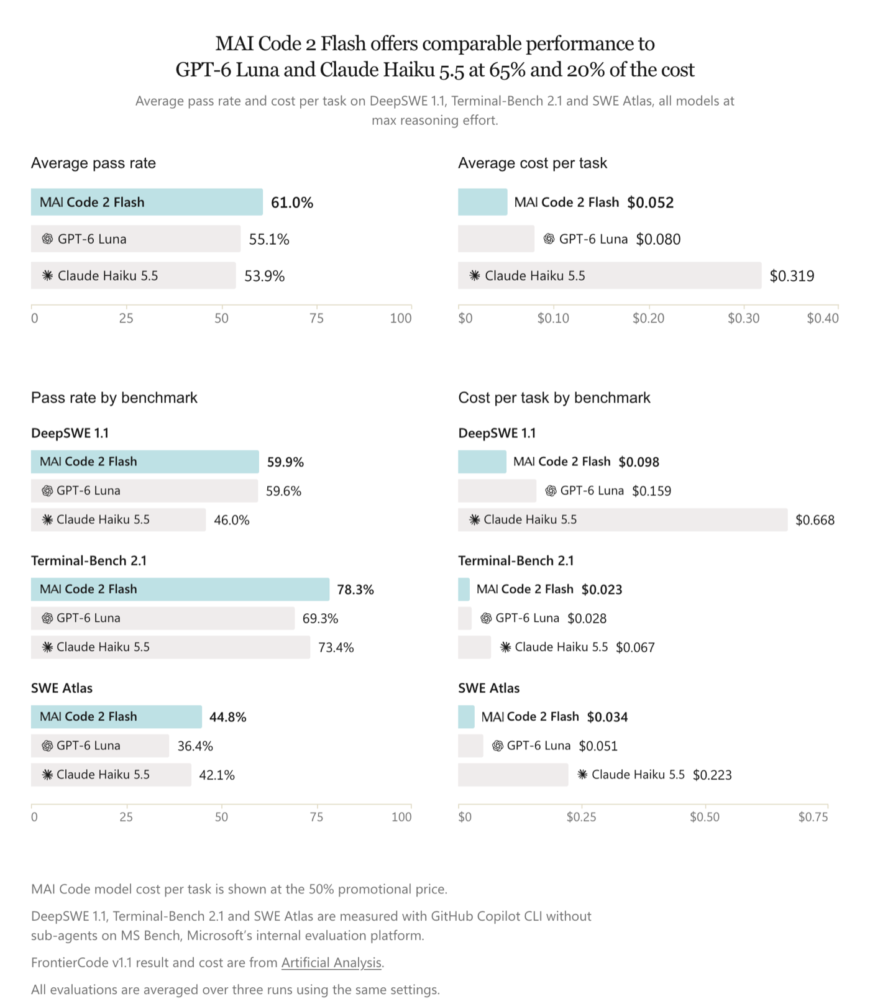
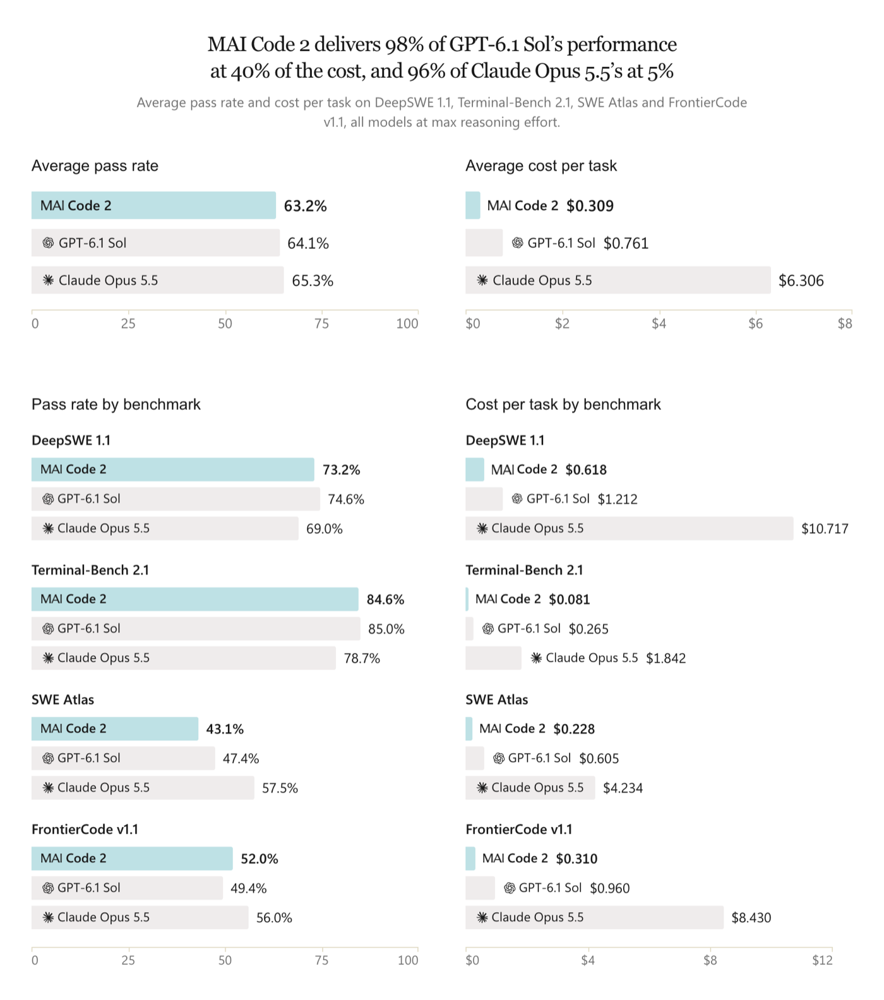

MAI Code 2 Flash beats GPT-6 Luna and Claude Haiku 5.5 on Microsoft's own coding benchmarks, 61.0% average pass rate against 55.1% and 53.9%, but the cost lead Microsoft advertises depends on a launch discount. Microsoft AI released Flash on November 17, 2026, alongside the larger MAI Code 2, as the low-cost model for routine, high-volume coding in GitHub Copilot. At the 50% promotional price GitHub charges until May 17, 2027, Flash averages $0.052 per task, 65% of Luna's cost. At the list price after that date, the same runs come to about $0.104 per task, roughly 30% more than Luna and still about a third of Haiku 5.5.

Until then, Flash is both the cheapest and the highest-scoring of the three in Microsoft's tests, so it is the default pick for small Copilot tasks. For multi-file features and deep debugging, MAI Code 2 scores about six points higher on the same benchmarks at roughly six times the cost per task.

## MAI Code 2 Flash at a Glance {#mai-code-2-flash-at-a-glance}

MAI Code 2 Flash is Microsoft's small agentic coding model, built for code explanations, targeted edits, routine fixes and fast iteration. It runs inside GitHub Copilot on every plan from Free upward, and in a limited Microsoft Foundry preview.

| Question | Short answer |
|---|---|
| Position | Low-cost tier of the MAI Code 2 family; the larger MAI Code 2 handles complex, multi-file work. |
| Headline score | 61.0% average pass rate on three agentic coding benchmarks, Microsoft's runs at max reasoning effort. |
| Copilot price | $0.05 input / $0.25 output per million tokens until May 17, 2027, then $0.10 / $0.50. |
| Cost per task | $0.052 at the promotional price; about $0.104 at list price (our arithmetic). |
| Context | 1,050,000 tokens, up to 922,000 input and 128,000 output; text and image input. |
| Main catch | Every published score is Microsoft's own, on benchmark versions older than the current ones. |

## MAI Code 2 Flash Benchmarks vs GPT-6 Luna and Claude Haiku 5.5 {#mai-code-2-flash-benchmarks}

On Microsoft's three-benchmark average, MAI Code 2 Flash passes 61.0% of tasks, about six points ahead of GPT-6 Luna (55.1%) and seven ahead of Claude Haiku 5.5 (53.9%). Its clearest wins are Terminal-Bench 2.1 and SWE Atlas; on DeepSWE 1.1 it ties Luna.

*MAI Code 2 Flash vs GPT-6 Luna vs Claude Haiku 5.5, pass rate and cost per task. Chart by Microsoft AI, rendered from the interactive chart on its model page; Flash cost shown at the 50% promotional price.*

| Benchmark | MAI Code 2 Flash | GPT-6 Luna | Claude Haiku 5.5 |
|---|---|---|---|
| DeepSWE 1.1 | 59.9% ($0.098) | 59.6% ($0.159) | 46.0% ($0.668) |
| Terminal-Bench 2.1 | 78.3% ($0.023) | 69.3% ($0.028) | 73.4% ($0.067) |
| SWE Atlas | 44.8% ($0.034) | 36.4% ($0.051) | 42.1% ($0.223) |
| **Average** | **61.0% ($0.052)** | **55.1% ($0.080)** | **53.9% ($0.319)** |

*Pass rate and cost per task. Source: Microsoft AI launch charts, November 17, 2026.*

Microsoft ran all three models on MSBench, its internal evaluation platform, through GitHub Copilot CLI 1.0.102 with sub-agents turned off and every model at max reasoning effort. Each score is the mean single-attempt pass rate over three runs, and infrastructure errors count as failures, according to the model card. Running every model in the same Copilot harness makes the comparison fair for Copilot users; it also means these numbers describe each model inside Microsoft's agent tooling, which may differ from how Luna or Haiku perform in their own vendors' harnesses.

Microsoft's headline wording, "comparable performance" to Luna and Haiku 5.5 at "65% and 20% of the cost", undersells the score gap and slightly rounds the cost one: $0.052 is 16% of Haiku's $0.319. The model page phrases the same result as one-fifth of Haiku's cost with 12% higher performance.

## MAI Code 2 Flash Pricing After the Promotion {#mai-code-2-flash-pricing}

In GitHub Copilot, MAI Code 2 Flash costs $0.05 per million input tokens and $0.25 per million output tokens until May 17, 2027. From that date GitHub's pricing page lists $0.10 and $0.50, the same per-token rates as GPT-6 Luna and Claude Haiku 5.5 in their default context tiers.

| Model (GitHub Copilot) | Input | Cached input | Output |
|---|---|---|---|
| MAI Code 2 Flash, promotional (to May 17, 2027) | $0.05 | $0.005 | $0.25 |
| MAI Code 2 Flash, list (from May 17, 2027) | $0.10 | $0.01 | $0.50 |
| GPT-6 Luna (up to 272K input) | $0.10 | $0.01 | $0.50 |
| Claude Haiku 5.5 (up to 100K input) | $0.10 | $0.01 | $0.50 |
| Claude Haiku 5.5 (over 100K input) | $0.50 | $0.05 | $2.50 |
| MAI Code 2, promotional / list | $0.50 / $1.00 | $0.025 / $0.05 | $2.50 / $5.00 |

*Per million tokens. Source: GitHub Docs, Models and pricing for GitHub Copilot, accessed November 20, 2026. Luna and Haiku 5.5 also charge $0.125 per million tokens for cache writes. Copilot bills these rates in AI credits, where one credit is $0.01.*

### MAI Code 2 Flash cost per task at list price

Microsoft's charts state that Flash's cost per task is shown at the 50% promotional price. Doubling those figures gives the cost of the same runs at list price, assuming the token counts stay the same.

| Benchmark | Flash, promo | Flash, list (×2) | GPT-6 Luna | Claude Haiku 5.5 |
|---|---|---|---|---|
| DeepSWE 1.1 | $0.098 | $0.196 | $0.159 | $0.668 |
| Terminal-Bench 2.1 | $0.023 | $0.046 | $0.028 | $0.067 |
| SWE Atlas | $0.034 | $0.068 | $0.051 | $0.223 |
| Average | $0.052 | $0.104 | $0.080 | $0.319 |
| Average cost ÷ average pass rate | $0.085 | $0.170 | $0.145 | $0.592 |

*Promo, Luna and Haiku figures from Microsoft's chart; list-price and per-solved-task columns are AgentsPulse arithmetic on those figures.*

At list price Flash costs more than Luna on every benchmark. Because the two models then charge identical per-token rates, the gap comes from token use: in Microsoft's runs, Flash consumed roughly 30% more billable tokens per task than Luna, give or take differences in caching. Divide cost by pass rate, a rough [cost per successful task](/tutorials/coding-agents-finops-cost-per-successful-task/), and Luna comes out about 15% cheaper per solved task once the promotion ends, while Flash keeps its six-point lead in pass rate.

Haiku 5.5 has the same default rate as Luna yet costs four times as much per task. Microsoft does not break the cost down; Haiku may simply use more tokens per task, and any request above 100K input tokens is billed at its long-context rate, five times the default. Either way, Flash stays at about a third of Haiku's cost per task even at list price.

The practical reading: through May 2027, Flash is both the cheapest and the highest-scoring of the three in Microsoft's tests. After that, the choice against Luna becomes a trade between six points of pass rate and about 30% more spend per task, which is worth re-testing on your own repositories before the promotion ends.

## MAI Code 2 Flash vs MAI Code 2 {#mai-code-2-flash-vs-mai-code-2}

On the three benchmarks both models share, MAI Code 2 averages about 67.0% against 61.0% for Flash, at $0.309 per task against $0.052, roughly six times the cost. The larger model pulls ahead on DeepSWE 1.1 and Terminal-Bench 2.1; Flash scores slightly higher on SWE Atlas.

| Benchmark | MAI Code 2 Flash | MAI Code 2 |
|---|---|---|
| DeepSWE 1.1 | 59.9% ($0.098) | 73.2% ($0.618) |
| Terminal-Bench 2.1 | 78.3% ($0.023) | 84.6% ($0.081) |
| SWE Atlas | 44.8% ($0.034) | 43.1% ($0.228) |
| Average of the three | 61.0% ($0.052) | 67.0% ($0.309) |

*Microsoft's runs at max reasoning effort; both costs at the 50% promotional price, so the ratio holds at list price. Source: MAI Code 2 model card and launch charts.*

DeepSWE 1.1, a set of software-engineering tasks across several languages graded by hidden tests, shows the widest gap: 13 points. That matches the model card's guidance that Flash "is less capable than MAI Code 2 on complex, long-horizon tasks and may need more guidance". SWE Atlas mixes codebase Q&A, test writing and refactoring tasks from 18 open-source repositories, closer to the targeted work Flash is pitched for, and there the small model holds its own.

Per token, MAI Code 2 costs ten times as much as Flash, yet only about six times as much per task, so in these runs it finished tasks with noticeably fewer tokens. Microsoft compares MAI Code 2 against GPT-6.1 Sol and Claude Opus 5.5 on a fourth benchmark, FrontierCode v1.1, where it scores 52.0%.

*MAI Code 2 vs GPT-6.1 Sol vs Claude Opus 5.5. Chart by Microsoft AI; MAI Code 2 cost shown at the 50% promotional price.*

A sensible split follows from the numbers: route explanations, single-file fixes and test scaffolding to Flash, and send multi-file features and deep debugging to MAI Code 2. Copilot's model picker makes that a per-session choice; teams calling models through an API can automate it with a [model gateway](/tutorials/model-gateway-enterprise-ai-control-plane/). For how the frontier models in Microsoft's comparison score in other tests, see our reviews of [GPT-6.2 Astra and Sol](/tutorials/gpt-6-2-benchmarks/) and [Claude Fable 5.2 against Opus 5.5](/tutorials/claude-fable-5-2/).

## MAI Code 2 Flash Specs and Limitations {#mai-code-2-flash-limitations}

MAI Code 2 Flash is a sparse Mixture-of-Experts transformer with an integrated vision encoder, so it accepts screenshots, UI mockups and diagrams as input. Its context window is 1,050,000 tokens, with input capped at 922,000 and output at 128,000, and it offers five reasoning-effort settings: low, medium, high, xhigh and max.

- **Size.** Section 1 of the model card gives Flash 12 billion active and about 398 billion total parameters, pre-trained on about 25 trillion tokens with logit distillation from a larger in-house teacher. The card's summary table lists "5B-15B (12B active)", which conflicts with that total; the 12B active figure is consistent in both places. Its predecessor, MAI-Code-1.1-Flash, had 5B active parameters.
- **Scope.** Microsoft says the family is "explicitly not yet tuned" for fundamental science research or very long-horizon agentic work, and that at release both models are optimized for English code production only.
- **Knowledge cutoff.** Pre-training data runs to August 2026, so recent libraries and APIs may be missing.
- **Long sessions.** The card warns that in long agentic sessions the models can repeat tool calls, drift from instructions or stop before fully verifying their work, and that higher reasoning effort "does not always improve results".
- **Training data.** Flash's data card says prompts from Copilot Free, Pro and Pro+ users who had not opted out were used to build software-engineering tasks for synthetic post-training data; the model's responses, not the users' logs, were the training targets.
- **Weights.** Both models are hosted only; Microsoft does not distribute weights.

Two customer quotes on Microsoft's model page show what fine-tuning adds. An AT&T data-science lead says a custom version of Code 2 Flash beats GPT-6.1 Sol on standard 5G network analysis at one-fiftieth of the cost. Woven by Toyota says Flash, fine-tuned on its MISRA fix history, produced ready-to-merge fixes in 44% of cases where its production frontier models needed human rework, at under a tenth of the cost. Both describe customized models, which the stock Copilot version is not.

## How to Use MAI Code 2 Flash in GitHub Copilot and Microsoft Foundry {#mai-code-2-flash-availability}

To use MAI Code 2 Flash, pick it in the Copilot model picker. GitHub's changelog lists it on Copilot Free, Student, Pro, Pro+, Max, Business and Enterprise, while MAI Code 2 starts at Pro. Both appear in VS Code, Visual Studio, Copilot CLI, the Copilot cloud agent and app, github.com, GitHub Mobile, JetBrains, Xcode and Eclipse.

- **Business and Enterprise:** new models are on by default unless an administrator has turned off default enablement; admins control MAI access through the model policy in Copilot settings.
- **Annual Pro and Pro+ plans:** GitHub says both models are available to eligible annual subscribers as well.
- **Microsoft Foundry:** Flash only, in limited-access preview. Developers create a deployment and call it through the OpenAI-compatible Responses API with standard Azure authentication and content filtering, according to the model card.
- **Other platforms:** Microsoft says releases on OpenRouter, Vercel, Hermes, OpenCode and Kilo are coming "soon"; none had a public date at launch.

Because Copilot bills these models by tokens, the promotional rates above apply to Copilot usage directly. GitHub's pricing page does not list a separate Foundry rate for Flash, so API users should confirm pricing in the Foundry portal.

## MAI Code 2 Flash Independent Tests and Developer Feedback {#mai-code-2-flash-independent-tests}

No independent benchmark of MAI Code 2 Flash had been published by November 19, 2026. We found no Artificial Analysis model page for it, and BenchLM's comparison against Claude Haiku 5.5 declined to rank the pair because Flash had no public score.

The Hacker News launch thread (422 points and 171 comments by November 20) raised three recurring points:

- **Discounted cost in the charts.** Commenters noted that the cost comparison prices Microsoft's models at the 50% promotional rate, which ends in May 2027.
- **Older benchmark versions.** One commenter pointed out that Microsoft reports Terminal-Bench 2.1 while the benchmark has moved to version 4, and FrontierCode 1.1 while version 2.0 is current. Recent reviews such as [Gemini 4 Neon's](/tutorials/gemini-4-neon-benchmarks/) already use Terminal-Bench 4.1 and FrontierCode 2.0, so Flash's scores cannot be lined up against them.
- **Early reliability.** One developer said the new model (the comment does not say which of the two) sat on "Preparing..." for more than 20 minutes on basic prompts in two attempts at work; another, testing MAI Code 2, said it fixed Python build and Bicep deployment issues with no noticeable drop from Claude Opus. Both are single reports.

One commenter said most of their day-to-day coding already goes to Haiku or Luna, the exact slot Flash targets. For teams in that position, the useful test is a week of their own Copilot tasks on Flash during the promotion, tracking pass rate and spend per task against the model they use now. Other low-cost options we have covered include [Muse Ember](/tutorials/muse-ember/) and [GLM for coding](/tutorials/glm-for-coding/).

## References {#references}

1. Microsoft AI, [MAI Code 2 and Code 2 Flash: Everyday coding at scalable prices](https://microsoft.ai/news/introducing-mai-code-2-and-mai-code-2-flash/), November 17, 2026.
2. Microsoft AI, [MAI Code 2 and MAI Code 2 Flash model card](https://microsoft.ai/pdf/MAI-Code-2-And-MAI-Code-2-Flash-Model-Card.pdf) and [MAI Code 2 Flash data card](https://microsoft.ai/pdf/MAI-Code-2-Flash-Data-Card.pdf), November 17, 2026.
3. Microsoft AI, [MAI Code 2 model page](https://microsoft.ai/models/mai-code-2/), accessed November 20, 2026.
4. GitHub Docs, [Models and pricing for GitHub Copilot](https://docs.github.com/en/copilot/reference/copilot-billing/models-and-pricing), accessed November 20, 2026; GitHub Changelog, [MAI Code 2 and MAI Code 2 Flash in GitHub Copilot](https://github.blog/changelog/2026-11-17-mai-code-2-and-mai-code-2-flash-in-github-copilot/), November 17, 2026.
5. Hacker News, [MAI Code 2 and Code 2 Flash](https://news.ycombinator.com/item?id=50535885), November 17–19, 2026.
