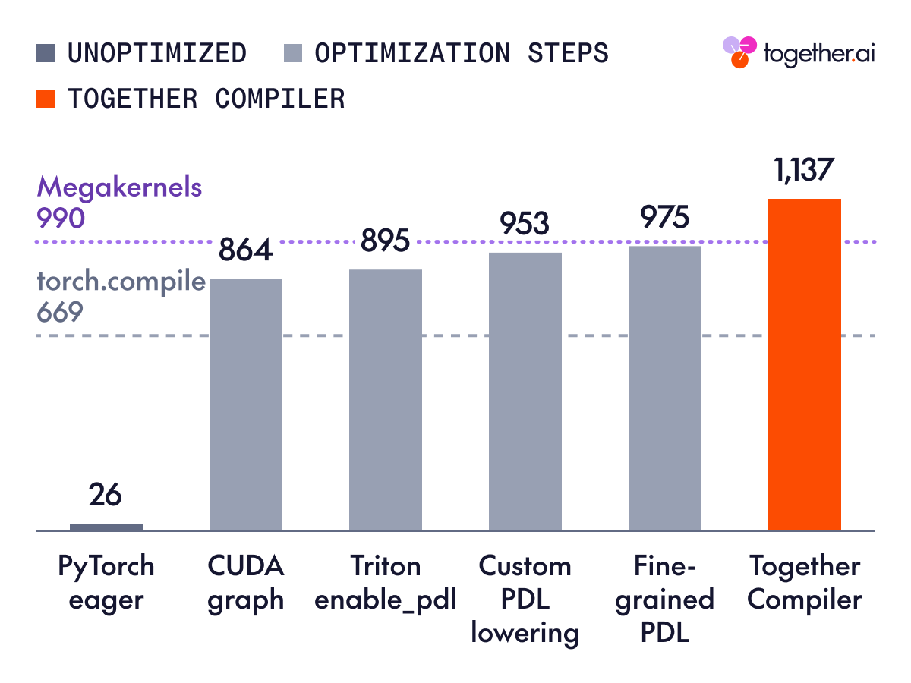
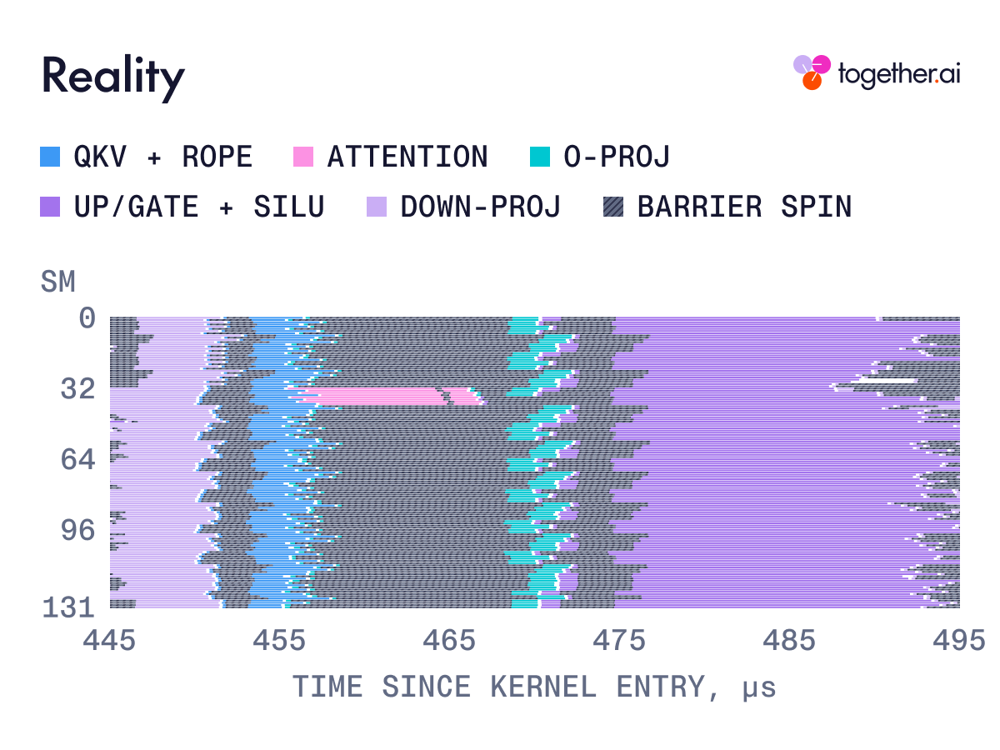
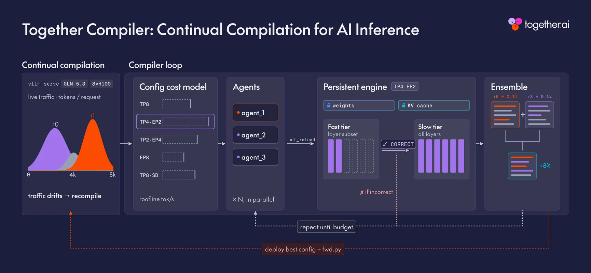
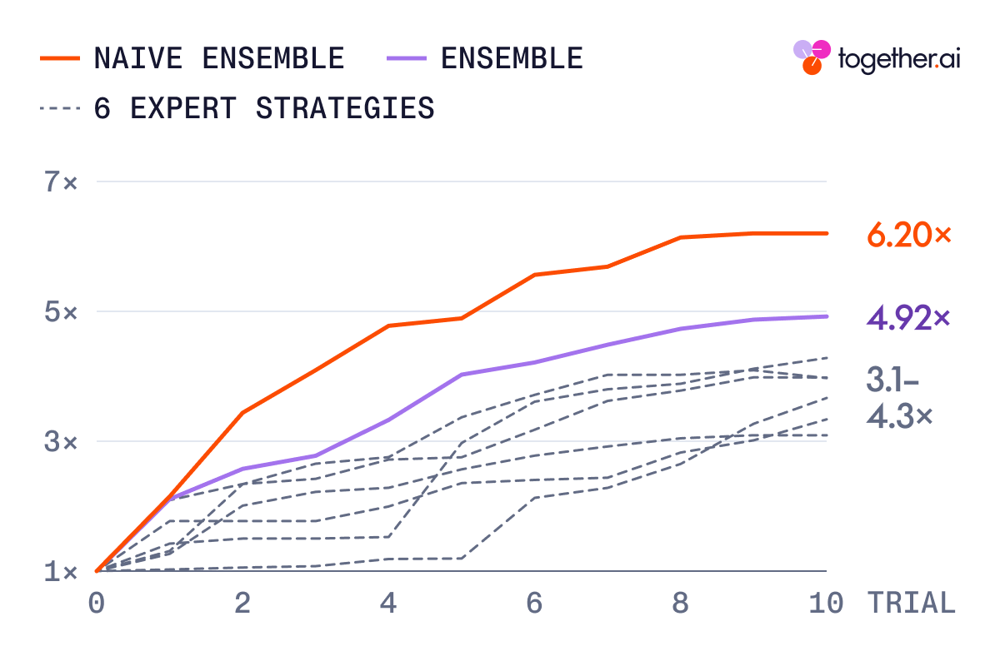
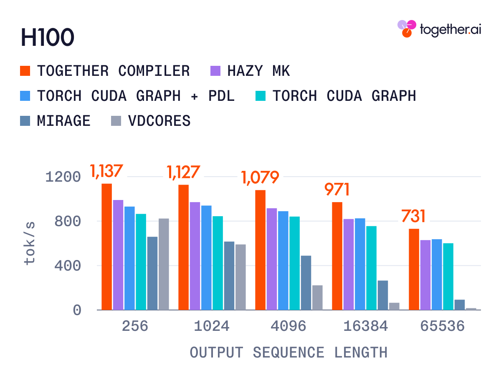
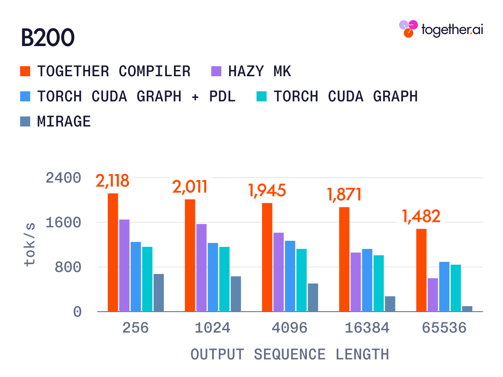

A megakernel puts a model's entire forward pass inside one persistent GPU kernel, and in 2025 it was the fastest way anyone had found to decode Llama 1B at batch size 1. Together AI, which helped build one of the first, has now deleted its megakernels. In a November 16, 2026 post, the team shows that default torch.compile kernels plus two NVIDIA features, CUDA Graphs and Programmatic Dependent Launch (PDL), recover 98% of the megakernel's speed on an H100, and that coding agents tuning ordinary kernels beat it. The system built on that result is Together Compiler, announced on November 4.

The reason was practical. After months of integrating paged KV caches, porting to Blackwell and chasing race conditions, the production megakernel supported one model (Llama 1B), one batch size (1), one precision (BF16) and one customer. Together then took the megakernel apart to see which of its gains ordinary kernels could reproduce, and an independent replication on H100 and H200 GPUs reached a similar answer.

## Megakernel vs CUDA Graphs + PDL: The Llama 1B Benchmark {#megakernel-vs-cuda-graphs-pdl}

On Llama 1B at batch size 1 on an H100, Together's megakernel decodes 990 tokens per second, and default torch.compile kernels with CUDA Graphs and fine-grained PDL reach 975, or 98% of it, without a single hand-written kernel. The team got there by starting from torch.compile and adding one megakernel benefit at a time:

| Configuration (Llama 1B, batch 1, H100) | Tokens/s | Share of megakernel |
|---|---:|---:|
| PyTorch eager | 26 | 3% |
| torch.compile (Inductor) | 669 | 68% |
| + CUDA Graphs | 864 | 87% |
| + Triton `enable_pdl` | 895 | 90% |
| + custom PDL lowering in PTX | 953 | 96% |
| + fine-grained PDL placement | 975 | 98% |
| Hand-written megakernel | 990 | 100% |
| Together Compiler (agent-tuned) | 1,137 | 115% |

CUDA Graphs record a sequence of kernel launches once and replay it, cutting launch overhead to about 1 µs. PDL lets the next kernel start on SMs as they free up, before its predecessor finishes. Inductor's Triton backend did not expose the PDL controls Together needed at the time, so the team compiled the generated kernels to PTX and inserted two instructions by hand: `griddepcontrol.launch_dependents` at the end of each producer and `griddepcontrol.wait` at the start of each consumer.

*Figure: Each bar adds one optimization on top of torch.compile; the megakernel line is 990 tokens/s. Source: Together AI, "The road to Together Compiler", Nov 16, 2026.*

An independent study points the same way. The [megakernels-vs-cuda-graphs](https://github.com/msaroufim/megakernels-vs-cuda-graphs) repository compares the original, unmodified Hazy Research Llama 1B megakernel against a conventional 100-kernel decode step with CUDA Graphs and PDL. Over 127 timed decode steps (32 input tokens, 128 outputs), the megakernel was 0.69% faster on an H100 (972.78 vs 979.51 µs per step) and 4.59% faster on an H200 (759.83 vs 794.74 µs). The conventional path passed the study's numerical-fidelity criteria against an FP32 reference, and the megakernel missed them. The author notes the timings cover decode steps only, not end-to-end serving.

The 98% figure is an H100 result with fine-grained PDL. On a B200, Together's own chart shows plain CUDA Graphs + PDL at 1,249 tokens/s against 1,649 for the megakernel at 256 output tokens, so on Blackwell the stock primitives leave a real gap that the agent-tuned kernels then close.

## Megakernel Launch Overhead: Synchronization Cost by Method {#megakernel-launch-overhead}

A megakernel trades kernel launches for synchronization inside the kernel, and Together measured the two as roughly equal: a megakernel grid sync costs 646 ns on an H100, while a kernel boundary under CUDA Graphs + PDL costs 645 ns. The time is measured from the end of the first kernel to the point where the second has passed its synchronization step.

| Launch or sync method | H100 (ns) | B200 (ns) |
|---|---:|---:|
| Normal launch (`cudaLaunchKernelEx`) | 2,077 | 2,496 |
| CUDA Graph | 1,051 | 915 |
| PDL | 731 | 814 |
| CUDA Graph + PDL | 645 | 642 |
| Cooperative `grid.sync()` | 1,043 | 1,281 |
| Megakernel grid sync | 646 | 795 |

The expensive part sits in PyTorch, before the GPU sees anything. For an H100 Llama 1B down-projection, ATen dispatch takes 37 µs to pick an implementation, more than twice the kernel's 15 µs of GPU time. Launching from pure C++ still costs about 2 µs, which adds up over the hundreds of kernels in a forward pass. CUDA Graphs remove most of that, and that step alone moved Llama 1B from 669 to 864 tokens/s. Intra-kernel sync on a B200 is slightly slower than on an H100 because the B200 is built from two dies; measured on one die, it matches an H100 with the same number of SMs.

## Megakernel Compute and Memory Overlap: Where the Gains Shrink {#megakernel-overlap}

The other promise of a megakernel is overlap: an SM that finishes one operation can start the next, and the next layer's weights can load while the current one computes. On Llama 1B, both effects turned out small. Three of the five producer-consumer edges in each layer need a full barrier, a fourth is effectively full (one CTA waits on 128 CTAs of the previous step), and only attention got meaningful compute overlap.

| Edge in one Llama 1B layer | Synchronization |
|---|---|
| down_proj → rms_qkv_rope_append | Full barrier |
| rms_qkv_rope_append → attention_partial | Fine-grained (each CTA waits for 18–20 CTAs) |
| attention_partial → o_proj | Full barrier |
| o_proj → rms_upgate_silu | Full barrier |
| rms_upgate_silu → down_proj | Fine-grained (each CTA waits for 128 CTAs) |

A full grid sync inside the megakernel costs about the same as launching a fresh kernel, so these barriers cancel most of the persistent kernel's advantage. Together's profiler, extended to record when compute warps start and stop, shows SMs spending long stretches spinning at barriers between operations.

*Figure: Measured warp activity inside the Llama 1B megakernel. Hatched regions are barrier spin; only the attention step (pink) overlaps with other work. Source: Together AI, Nov 16, 2026.*

Memory preloading, where the megakernel pages shared memory so the next instruction can fetch weights early, was worth 3.3% of the forward pass: removing it dropped throughput from 990 to 961 tokens/s. Placing the PDL `griddepcontrol.wait` just before a kernel's first read of its predecessor's output recovered up to 98% of that gain with no paging system. The megakernel version also had a cost PDL avoids: waiting loader warps spin on the same SM queue the compute warps use, which added 1.3 µs at Llama 1B's attention-to-o_proj boundary. At the down_proj-to-QKV boundary, memory bandwidth was already saturated, so early loading only moved time from one kernel to the other.

Llama 1B decode at batch size 1 is a memory-bound workload, the same bandwidth ceiling behind hardware like [Google's dual-chip TPU 8i Max](/tutorials/tpu-8i-max/). That is exactly the case megakernels were designed for, and even there the gains came from a handful of effects that ordinary kernels can reproduce.

## Megakernel Limits on MoE Models and Blackwell {#megakernel-moe-blackwell}

On newer hardware and mixture-of-experts models, a megakernel's single launch configuration becomes a cost. Every operation inside one persistent kernel shares the same warp count, register budget and cluster shape, and Together found several cases where that made the megakernel slower than separate kernels:

- **Warp count on Hopper.** The H100 Llama 1B megakernel used 20 warps (16 compute, 4 control), because short batch-1 decode steps finish sooner spread across more warps. Tensor-core GEMMs run best with 12 warps on Hopper, since `wgmma` accumulates into registers and larger tiles stop fitting in the 65,536-register file per SM. Forced into the 20-warp envelope, those GEMMs ran 1.2–1.5x slower. Blackwell's `tcgen05` accumulates in tensor memory instead, but AMD GPUs hit the same register limit.
- **Instruction cache.** A whole model compiled into one binary often exceeds the SM's instruction cache, so each new operation evicts the previous one's code, which then has to be fetched again on the next layer.
- **Mixed attention on Blackwell.** Kimi K3 interleaves KDA and MLA layers. KDA runs best with single-CTA tensor-core instructions and MLA with CTA pairs, and PTX does not allow both `cta_group` modes in one kernel.
- **Mixed parallelism.** In some Kimi K3 deployments the MoE GEMMs run tensor-parallel while attention projections run data-parallel, and the tensor-parallel GEMMs process 8x more tokens and prefer a different cluster size. One shared cluster size cost 5–19%.
- **MoE dispatch.** Under imbalanced expert routing, moving Kimi K3's expert dispatch onto the GPU's copy engine beat the Mixture of Kittens MoE megakernel by 6.9%. FlashInfer's MegaMoE ran 17% faster after its dispatch was split into its own small kernel.

The independent repository found a similar pattern outside language models. On one B300, a CUDA Graph capture of Evo 2 7B decode (no PDL) was within 0.5% of the Hyperkernel megakernel at 1,024 tokens of context and faster at longer contexts: 7.38 ms per token against 16.48 ms at 65,536. The author labels it a single-session example, not a validated result.

Together's conclusion is that the useful work is choosing which operations to group and tuning each group, rather than fusing everything. That choice changes with model, hardware and traffic, which is what pushed the team toward a compiler. Serving large MoE models such as [GLM-5.3 in NVFP4 on two DGX Stations](/tutorials/glm-5-3-nvfp4/) shows how many deployment-specific settings already sit around the kernels.

## Torch Compile Benchmarking Errors That Mislead Kernel Selection {#torch-compile-benchmarking}

Before building its own system, Together traced why torch.compile's Inductor backend stops at 669 tokens/s on Llama 1B. The answer was mostly measurement: Inductor times kernels in isolation, and isolated timings disagree with a live forward pass.

- **Cache state.** Inductor flushes the L2 cache before timing a kernel, but in real inference kernels reuse data cached by the previous operation. Isolated timings were 39–58% slower than the same kernels in a live forward pass.
- **Unrealistic inputs.** Inductor fills token IDs with zeros when benchmarking `torch.embedding`, so every token reads the same row; for a 64K-token sequence that made the kernel 2.1x faster than with random IDs. On GLM 5.3, random inputs misjudged the MoE grouped-GEMM by 4–21%.
- **Harness overhead.** The harness reported 2.5 µs for an operation that did no GPU work, and other timings ran about 3.6 µs over what Nsight Systems recorded. For Llama 1B's output projection, Inductor picked a Triton kernel that ran 7.4 µs in the live pass, while cuBLAS ran 6.4 µs.
- **Flags that interact.** Inductor had 607 tuning flags as of Q3 2026, 198 of them added in the past year. Its `freezing` flag raised throughput 10–26% at larger batch sizes and cut it 49% at batch size 1, because an FP32 weight conversion was never undone for matrix-vector operations.
- **Fusion by memory traffic only.** Inductor left an elementwise kernel launching 6 CTAs unfused from its neighbor because the two share no memory, which kept most of the H100's 132 SMs idle during that step.

The same trap caught Together's agents. One wrote a top-k kernel that ran in 20 µs on random inputs and 62 ms on real ones, where ReLU produced many exact zeros, piled candidates into one histogram bin and triggered quadratic work. Real data inside a real forward pass became the rule for every measurement in the final system.

## Together Compiler Architecture: Agents, Persistent Engines and a Cost Model {#together-compiler-architecture}

Together Compiler (TKCC) takes a model, a hardware target and the live traffic shape, and runs parallel coding agents that rewrite the inference engine's forward pass until a time budget runs out; when traffic drifts, it recompiles. Together describes three parts:

- **Persistent engines.** Starting a stock engine such as vLLM, SGLang or TensorRT-LLM took 467 seconds in Together's measurement, most of it in process start-up, weight loading, kernel warm-up and autotuning. TKCC keeps an engine running and hot-reloads each candidate forward pass, which brings time-to-serving down to 9 seconds. Together says this gives 252x higher experiment throughput than baseline agentic optimization systems.
- **Two measurement tiers.** "Fast" engines load a few layers for quick, low-variance timing. "Slow" engines load many layers and check whether a speed-up survives real data distributions before it is kept.
- **A parallelism cost model.** Before agents start, a cost model picks a layout such as tensor, expert or decode-context parallelism from hardware specs, microbenchmarks and measured forward passes, then prunes the space as traffic changes.

*Figure: The Together Compiler loop: cost model, parallel agents, a persistent engine with fast and slow tiers, and an ensemble that deploys the best configuration. Source: Together AI, "Together Compiler: Continual Compilation for AI Inference", Nov 4, 2026.*

The design came from removing structure. Together first built BlockIR, an intermediate representation that captured every kernel launch at the driver level through CUPTI on NVIDIA and rocProf on AMD, because 23 of the 24 kernels in a Kimi K2.6 decoder layer on TensorRT-LLM were opaque custom ops to PyTorch. BlockIR could not express host-side changes, such as splitting Kimi K3's MLA metadata planning across thread blocks, which sped up the MLA kernel 1.7–2.5x. Its pointer tracking was also fragile: on GLM 5.3 on AMD, two clocks drifted by up to 325 µs and pointers were matched to the wrong buffers. Agents spent more time debugging pointer tracking than optimizing, so Together dropped the IR and had them edit the forward-pass source code directly.

Traffic is the reason the loop never stops. Together reports that one country's working-hours traffic had 1.4x longer prompts than another's (97k vs 70k tokens), and that prompt length rose 80% within two weeks of a model release as users moved from chat to agent workloads.

## Agent Scaffolding Ablation: Knowledge Hubs and Expert Strategies vs a Plain Prompt {#agent-scaffolding-ablation}

Most of the guidance Together built for its agents made them slower. In ablations on layer 3 of MiniMax-M3 (B200, four-way tensor parallel, batch size 1, 10 agent trials), the plain setup won:

- **Prompt.** Agents told only to "make this forward pass as fast as possible" reached a 6.20x speed-up over the baseline. An ensemble seeded with six expert-written strategies (fusion-first, communication overlap, megakernels and others) reached 4.92x, and each strategy alone finished between 3.1x and 4.3x. Prescribing an order of optimizations trapped agents in local minima.
- **Knowledge hub.** A curated library of kernels and techniques lowered the ensemble's final speed-up from 5.85x to 4.75x; across runs it was 25–31% worse than no library, because agents anchored on known patterns.
- **Communication.** Agents that messaged each other frequently on a shared board reached 7.72x, against 6.20x with infrequent communication and 4.82x with none.
- **Bookkeeping.** A required graph of hypotheses and experiments took up to 43% of each trial's tool calls.

*Figure: Speed-up over baseline on MiniMax-M3 layer 3 (B200, TP4, batch 1). Source: Together AI, Nov 16, 2026.*

Together's explanation is that agents are sensitive to the structure they are given, and scaffolding that helped earlier models became a constraint as coding agents improved. [HarnessDev's benchmark](/tutorials/harnessdev-agent-harness-benchmark/) reached a related result from the other side: a harness's value depends on the model running in it. What Together kept were fast, accurate measurements and high experiment throughput, the same split between agent and [harness-owned control loop](/tutorials/agent-framework-harness-runtime-production/) that production agent systems use.

## Together Compiler Benchmark Results vs the Hazy Megakernel {#together-compiler-benchmark}

On Together's charts, Together Compiler beats the Hazy megakernel on Llama 1B at every output length tested, on both H100 and B200. At 256 output tokens it reaches 1,137 tokens/s on an H100 against 990 for the megakernel, and 2,118 tokens/s on a B200 against 1,649, a 28% margin. Its lead widens on the B200 at long outputs, where it holds 1,482 tokens/s at 65,536 tokens and the megakernel falls below CUDA Graphs.

*Figure: Llama 1B on H100 by output sequence length. Together Compiler: 1,137 / 1,127 / 1,079 / 971 / 731 tokens/s. Source: Together AI, Nov 16, 2026.*

*Figure: Llama 1B on B200 by output sequence length. Together Compiler: 2,118 / 2,011 / 1,945 / 1,871 / 1,482 tokens/s. Source: Together AI, Nov 16, 2026.*

Together's other claims come from the November 4 announcement, and all are the company's own runs, each finished in under 24 hours on no more than two nodes:

- Up to 2.6x higher throughput than the best reported open-source engine configurations on SemiAnalysis's InferenceX AgentX workloads, across Kimi K3, GLM 5.3, MiniMax M3.1-Flash and DeepSeek v4.1-Flash. The Trainium2 result used a synthetic multi-turn dataset instead of AgentX.
- Low-latency results at batch size 1 of 1,111 tokens/s on MiniMax M3.1-Flash and 1,205 tokens/s on DeepSeek v4.1-Flash, using Together's cost model to pick the parallelism layout instead of the InferenceX configuration.
- Speed-ups of up to 6.4x on open-source code for weather modeling, PDEs, time series and biology. The announcement charts these domains against Claude Code running its `/goal` command, as geometric-mean speed-ups.

We found no independent re-run of Together Compiler. The independent evidence covers the narrower claim in the first section, that CUDA Graphs + PDL land close to a hand-written megakernel on Llama 1B decode. Together Compiler is available through early access; Together says it is already serving trillions of tokens in its own production.

## When to Use a Megakernel vs CUDA Graphs or an Agent Compiler {#when-to-use-a-megakernel}

For most teams the order of work is clear from these numbers. Start with CUDA Graphs on top of torch.compile, which on Llama 1B took throughput from 669 to 864 tokens/s for almost no engineering. Add PDL next; with careful placement of the wait instruction it reached 975, within 2% of the megakernel on an H100. Measure every kernel inside a real forward pass on real inputs before trusting a tuning choice, since isolated benchmarks were off by tens of percent.

A hand-written megakernel still fits a narrow case: one fixed, small, dense model at batch size 1, on hardware where the stock primitives leave a measurable gap, as plain CUDA Graphs + PDL did on Together's B200 chart (1,249 vs 1,649 tokens/s). Budget for the full engineering cost, including paged KV cache support, new GPU generations and race conditions, and expect it to cover one configuration. For MoE models, mixed attention types or several parallelism schemes in one deployment, Together's measurements show separate, individually tuned kernels running faster than one fused kernel.

Agent-driven compilation is the option when the combinations of model, chip and traffic multiply faster than a kernel team can follow. The parts of Together's recipe that transfer without its product are a persistent engine that hot-reloads candidates, measurement on real traffic, parallel agents that share results continuously, and a light hand on prompts and curated knowledge. Teams weighing the cost of agent-written GPU code can apply the same discipline as for any agent output, paying for [verification per successful task](/tutorials/coding-agents-finops-cost-per-successful-task/) rather than per attempt.

## References {#references}

1. Dylan Lim, Reyna Abhyankar, Simran Arora (Together AI). "Last year we built megakernels. This year we deleted them: The road to Together Compiler." November 16, 2026. [together.ai/blog/road-to-together-compiler](https://www.together.ai/blog/road-to-together-compiler)
2. Reyna Abhyankar, Dylan Lim, Simran Arora (Together AI). "Together Compiler: Continual Compilation for AI Inference." November 4, 2026. [together.ai/blog/together-compiler-continual-compilation-for-ai-inference](https://www.together.ai/blog/together-compiler-continual-compilation-for-ai-inference)
3. Hazy Research, Stanford. "Look Ma, No Bubbles! Designing a Low-Latency Megakernel for Llama-1B." May 27, 2025. [hazyresearch.stanford.edu/blog/2025-05-27-no-bubbles](https://hazyresearch.stanford.edu/blog/2025-05-27-no-bubbles)
4. msaroufim. "Megakernels vs CUDA Graphs" (Llama 1B H100/H200 results, Sept 2026; Evo 2 B300 study, Nov 2026). [github.com/msaroufim/megakernels-vs-cuda-graphs](https://github.com/msaroufim/megakernels-vs-cuda-graphs)
