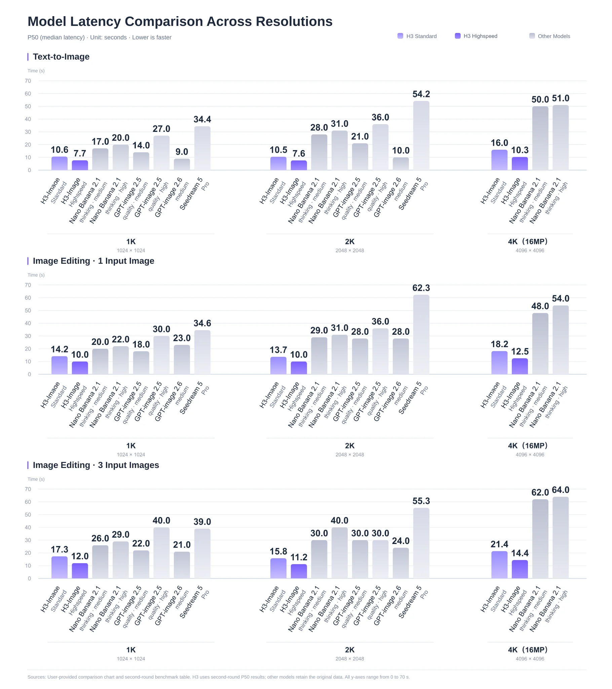
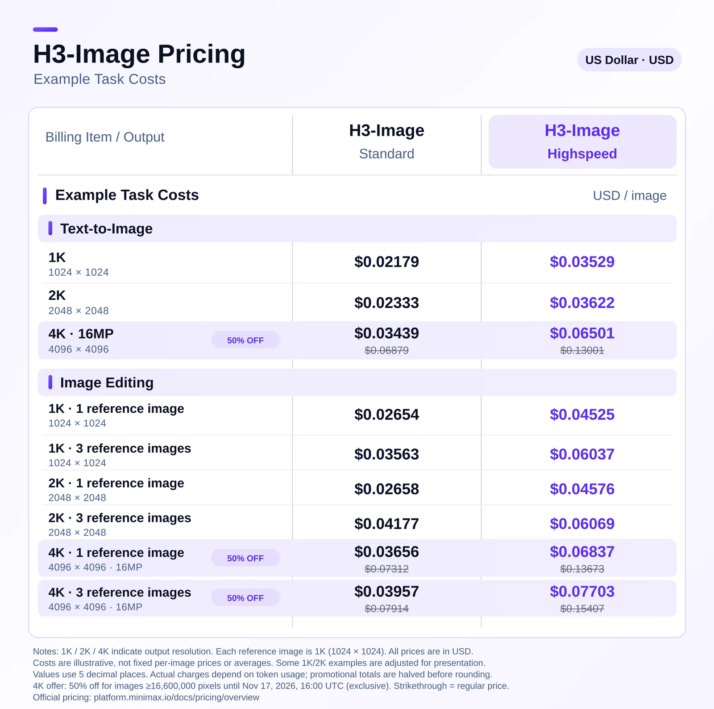
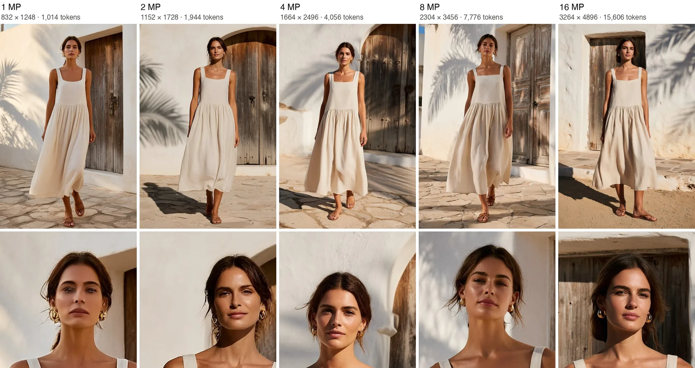

MiniMax H3 Image and Pruna's P-H3-Image start from the same place: the 33.1B diffusion transformer inside MiniMax-H3, MiniMax's video model, with the audio removed. MiniMax released MiniMax H3 Image as open weights on November 10, 2026, about a week after Pruna AI published P-H3-Image on that base. The two differ most in the text encoder they attach, and that choice sets the GPU you need: MiniMax keeps the full 33.4B Qwen3-VL encoder and targets 16 MP images in 6 steps, while Pruna swaps in a 4B encoder and targets 8 MP in 8 steps.

## MiniMax H3 Image vs P-H3-Image at a Glance {#minimax-h3-image-vs-p-h3-image}

MiniMax H3 Image is the larger, higher-resolution package; P-H3-Image is the lighter one that fits a single 80 GB GPU with offloading. The table lists what each model card states.

| | MiniMax H3 Image | P-H3-Image |
|---|---|---|
| Publisher | MiniMax | Pruna AI |
| Diffusion transformer | 33.1B, H3 without audio layers | 33.1B, fine-tuned from MiniMax-H3 |
| Text encoder | Full Qwen3-VL encoder of MiniMax-H3 (33.4B) | 4B |
| Prompt helper | Optional MiniMax-H3-Image-PE (NVFP4, 17.9 GB) or the API's Context-IR | Qwen3.5-9B upsampler, on by default |
| Sampling | 6 steps, no CFG | 8 steps, no CFG |
| Native output | About 16 MP, 4096x4096 up to 6272x2688 | 8 MP text-to-image, 4 or 8 MP edits |
| Reference images | Up to 16 | Up to 8 |
| Weights on disk | About 127 GB including the text encoder | About 100 GB in bf16 including upsampler |
| Smallest documented GPU path | 14.7 GiB per H200 with layerwise offload (vLLM-Omni) | 21 GB with int8 or 4-bit ComfyUI files |
| License | MiniMax-H3-Image Community License | MiniMax H3 Community License, plus Apache 2.0 for the Qwen parts |

Both model cards describe a single checkpoint that switches between text-to-image and editing based on whether you pass reference images; neither needs a task flag.

## MiniMax H3 Image Architecture: Where the 33B Text Encoder Fits {#minimax-h3-image-architecture}

MiniMax H3 Image has two large parts of almost equal size: a 33.1B diffusion transformer (DiT) and a 33.4B Qwen3-VL text encoder taken unchanged from MiniMax-H3. The prompt and any reference images go through that encoder, and the DiT reads the hidden states of its 50th layer. Reference images are also encoded by the image VAE, and all tokens form one packed sequence for a single-stream transformer that predicts the latent of the output image.

The DiT is dense, with 50 layers, a hidden size of 5,376 and 56 attention heads. The VAE downsamples 16x into 24 latent channels, and the DiT patchifies that latent 2x2, so each transformer token covers a 32x32-pixel patch. At 4096x4096 that is 16,384 image tokens per image before any reference images are added. MiniMax distilled the checkpoint to 6 sampling steps with guidance fixed at 1, so each image costs six transformer passes, and the serving API rejects other step counts and guidance values with HTTP 400.

The file sizes follow the same split. The DiT is 66.28 GB in BF16, the VAE 2.34 GB in FP32, and the text encoder another 66.7 GB that `model_index.json` pulls from the MiniMax-H3 repository rather than this one. The vLLM recipe tells you to plan for about 127 GB of disk.

P-H3-Image keeps the 33.1B transformer and replaces the encoder with a 4B one, which is where most of its memory saving comes from. Pruna also fine-tuned the transformer for 8-step sampling at 8 MP.

## MiniMax H3 Image VRAM Requirements by GPU Setup {#minimax-h3-image-vram}

MiniMax H3 Image runs on one H200 if the text encoder is offloaded, and on far less memory if you accept layerwise offload. The vLLM-Omni recipe, updated November 12, measured these profiles on NVIDIA H200 GPUs for a 2048x2048 text-to-image request:

| GPUs | Profile | Peak memory per GPU | Time per image |
|---|---|---|---|
| 1 | DiT resident, text encoder offloaded | 73.4 GiB | 3.2 s |
| 1 | Layerwise offload of DiT and text encoder | 14.7 GiB | 8.3 s |
| 2 | Tensor parallel 2, resident | 63.3 GiB | 1.5 s |
| 2 | Sequence parallel 2 plus layerwise offload | 12.0 GiB | 5.6 s |
| 2 | Sequence parallel 2, resident | 94.6 GiB | 1.5 s |
| 4 | Tensor parallel 4, resident | 36.2 GiB | 1.0 s |
| 4 | Sequence parallel 4, resident (default) | 81.3 GiB | 0.88 s |

Keeping everything on one GPU needs an estimated 135 GiB. The recipe did not measure that layout and names B200 and B300, NVIDIA's [Blackwell-generation GPUs](/tutorials/deepseek-nvidia-blackwell-training/), as its natural fit. On 80 GB H100s it recommends layerwise offload on one or two GPUs, or tensor parallel 4; the default sequence-parallel layout does not fit. On 96 GB RTX PRO 6000 cards every resident layout fits, with tensor parallel 2 peaking at 49.7 GiB.

A community report in the same recipe served 1024x1024 and 6272x2688 text-to-image on a single 24 GB RTX 4090 using layerwise offload of both the DiT and the text encoder. It ran in a private container and did not record peak memory, throughput or editing, so treat it as proof that the path exists. The recipe also lists CPU offload, quantization and cache acceleration as not yet qualified in vLLM-Omni.

### Running MiniMax H3 Image in ComfyUI

ComfyUI's official workflow uses compressed files: a pruned INT8 DiT of 21 GB, the Qwen3-VL-32B text encoder in INT8 at 25.28 GB and a 1.17 GB FP16 VAE. Instead of MiniMax's 17.9 GB prompt expander, the templates use a Qwen3.5 9B W4A8 build of 7.34 GB so it fits next to the diffusion model, and the text-to-image template ships with the expander switched off. The template also opens at 4 MP, below the model's native size, so that low-VRAM machines do not run out of memory; raise the resolution once you know your GPU has room. The ComfyUI page lists file sizes, not a minimum VRAM figure.

### P-H3-Image VRAM on a Single GPU

P-H3-Image needs about 101 GB at 8 MP in bf16 with its prompt upsampler and 83 GB without it, so one H200 or B200 runs it fully resident. With diffusers' automatic CPU offload it runs on a single 80 GB H100, peaking at about 76 GB. For smaller cards Pruna publishes int8 and 4-bit ComfyUI files that it says run in 21 GB of VRAM.

## MiniMax H3 Image Speed Benchmarks: Self-Hosted vs API {#minimax-h3-image-speed}

Self-hosted on four H200s, MiniMax H3 Image produced a 4736x3552 image (about 16.8 MP) in 3.84 seconds. That figure comes from the vLLM-Omni recipe: the median of three warm requests at concurrency 1, measured end to end at the client, with the default sequence-parallel-4 layout.

| Request on 4x H200 (vLLM-Omni) | Median latency |
|---|---|
| Text-to-image 1024x1024 | 0.77 s |
| Text-to-image 2048x2048 | 0.88 s |
| Text-to-image 4736x3552 | 3.84 s |
| Edit 2048x2048, one reference | 1.35 s |

MiniMax's hosted API is slower than that rig. Its launch post says H3-Image can make a 4096x4096 image "in under 10 seconds" and up to 5x faster than unnamed "mainstream alternatives", without naming the hardware. The latency chart in the same post reports median API times of 16.0 seconds on Standard and 10.3 seconds on Highspeed for 4K text-to-image, so only the pricier tier comes close to the headline. Tech Times pointed out the 0.3-second gap and noted that MiniMax has published neither a technical report nor benchmark scores.

*Median (P50) API latency by resolution and task. Image by MiniMax. The chart's footnote says H3-Image uses second-round measurements while the other models keep their original data.*

The chart's comparison is mixed at small sizes. At 1K, H3-Image Standard takes 10.6 seconds against 9.0 for GPT-image 2.6 at medium quality; at 4K, H3-Image Highspeed's 10.3 seconds compares with about 50 seconds for Nano Banana 2.1. Editing adds time: 4K edits with three reference images take 21.4 seconds on Standard and 14.4 on Highspeed.

For P-H3-Image, Pruna reports about 9 seconds per 8 MP text-to-image on one B200 in bf16, without compilation or offloading, plus 6 to 11 seconds when the prompt upsampler runs.

## MiniMax H3 Image API Pricing: Standard vs Highspeed {#minimax-h3-image-pricing}

On MiniMax's API a 1K text-to-image costs about $0.022 on Standard and $0.035 on Highspeed, and a 4K image lists at $0.069 and $0.130. Until November 17, 2026 at 16:00 UTC, MiniMax halves the price of images of 16.6 million pixels or more, which brings 4K to about $0.034 on Standard and $0.065 on Highspeed.

*Example task costs in USD. Image by MiniMax. MiniMax labels them illustrative: actual charges depend on token usage.*

Highspeed costs about 1.6x Standard at 1K and 1.9x at 4K, so the speed gain in the latency chart is paid for per image. Reference images raise the price as well: a 4K edit with three references lists at $0.079 on Standard. MiniMax says its prices are 50 to 70 percent of comparable mainstream offerings. If you route jobs between tiers or providers, a [model gateway](/tutorials/model-gateway-enterprise-ai-control-plane/) can make that choice per request.

## MiniMax H3 Image Resolution: 16 MP vs P-H3-Image's 8 MP {#minimax-h3-image-resolution}

MiniMax H3 Image works best at about 16 MP and has an effective range of roughly 4 to 20 MP; P-H3-Image works best at 8 MP. Both teams report more artifacts below their target size, so the native resolution is also the quality setting.

MiniMax's model card lists 16 MP sizes for each aspect ratio: 4096x4096 for 1:1, 5472x3072 for 16:9 and 6272x2688 for 21:9. Its server also has a `min_generation_area` parameter that defaults to 2048x2048: a smaller request is generated on a larger canvas at the same aspect ratio and resized back with LANCZOS. A 1024x1024 request therefore still runs as a 4 MP render unless you set the parameter to 1024.

Pruna's resolution ladder shows the effect on P-H3-Image with one prompt and seed from 1 to 16 MP. At 1 MP the face is smooth and waxy; from 8 MP on, skin texture, stray hairs and the earrings come through.

*The same prompt and seed rendered by P-H3-Image at 1 to 16 MP, with token counts per size. Image by Pruna AI. The composition shifts because the noise changes with image size.*

Pruna also lists the failure cases at lower resolution: faces, hands and small details break more often at 2 and 4 MP than at 8 MP, and dense text such as body copy still turns into pseudo-text at any size. Short quoted strings render well.

## MiniMax H3 Image Editing with 16 Reference Images {#minimax-h3-image-editing}

MiniMax H3 Image accepts up to 16 reference images in one edit request, twice P-H3-Image's limit of 8. In MiniMax's server API, references are uploaded as multipart form data, and their order defines `<Picture 1>`, `<Picture 2>` and so on, which the prompt can then name. P-H3-Image uses the same naming: Picture 1 is the image being edited and the rest are references.

*An edit with ten references: an empty room and nine pieces of furniture composed into one living room. Image by MiniMax.*

Both models expect long, explicit prompts. MiniMax's card says the model wants a detailed English description of the whole image; its API rewrites short prompts in any language with a step called H3-Image-Context-IR, and the local equivalent is the optional MiniMax-H3-Image-PE model. Pruna runs its upsampler on every request by default and recommends this form when writing edit prompts by hand: "Edit <Picture 1>. <The change, described as the finished result>. Keep <everything that must stay> exactly as it is." Without the list of what stays, P-H3-Image tends to redraw the whole image. Neither model supports a negative prompt.

## MiniMax H3 Image License: Excluded Regions and Commercial Use {#minimax-h3-image-license}

The MiniMax H3 Image license does not cover the United States, the European Union, the United Kingdom or South Korea. Its grant applies only to an "Applicable Territory" defined as the world minus those four, and it bars using the weights or their outputs outside that territory. People in the excluded regions can ask MiniMax for a separate license.

Inside the territory the license is royalty-free with three conditions that matter for products:

- **Attribution:** any product or service built with the model must display "Powered by MiniMax-H3-Image".
- **Revenue threshold:** if you and your affiliates have annualized revenue above $1 million, you need MiniMax's prior written authorization, requested through its console.
- **Hosting:** offering the model as a hosted service to third parties also needs that authorization, whatever your revenue.

P-H3-Image inherits the same four excluded regions from the MiniMax H3 Community License and requires a "Powered by MiniMax H3" notice. Its Qwen-based text encoder parts and prompt upsampler are under Apache 2.0, which does not lift the restrictions on the transformer.

## MiniMax H3 Image or P-H3-Image: Which Should You Run? {#which-to-run}

Choose by hardware first, then by the output you need.

- **You need 16 MP output or more than 8 references:** run MiniMax H3 Image. On H200-class GPUs, one card with the text encoder offloaded is the simple setup; four cards bring a 2048x2048 image under a second.
- **You have one 80 GB GPU and want everything on it:** P-H3-Image fits with offloading at about 76 GB, while MiniMax H3 Image on an H100 needs layerwise offload and runs slower per image.
- **You have a 24 GB consumer card:** start with ComfyUI. Pruna says its int8 and 4-bit P-H3-Image files run in 21 GB, ComfyUI's INT8 MiniMax H3 Image template opens at 4 MP for low-VRAM machines, and the vLLM path on an RTX 4090 is still a single community report.
- **You make a few images a day:** the API avoids roughly 127 GB of downloads, and a 1K image costs about two cents. Track cost per usable image rather than per request, the same way agent teams track [cost per successful task](/tutorials/coding-agents-finops-cost-per-successful-task/).

Teams weighing self-hosting against API spend can borrow the sizing approach from [Revolut's self-hosted GLM rollout](/tutorials/glm-for-coding/), which priced B200 capacity against per-token API costs. For a text model with a similar local-versus-hosted trade-off, see our [Qwen 3.8 27B local setup guide](/tutorials/qwen-3-8-27b/).

## MiniMax H3 Image FAQ {#minimax-h3-image-faq}

### Does MiniMax H3 do images?

Yes. MiniMax H3 is a video model, and MiniMax H3 Image is its image counterpart, released November 10, 2026: the H3 diffusion transformer without its audio layers, distilled to 6 steps. One checkpoint handles text-to-image and editing with up to 16 reference images at about 16 MP.

### Can I use MiniMax H3 Image for free?

The weights are free to download from Hugging Face and run on your own GPUs inside the license's territory. The hosted API is paid, from about $0.022 for a 1K image on Standard.

### Can MiniMax H3 Image be used commercially?

Yes, within the license. It is not licensed in the US, EU, UK or South Korea, products must show "Powered by MiniMax-H3-Image", and you need MiniMax's written authorization above $1 million in annual revenue or to offer a hosted service.

## References {#references}

1. MiniMax, [MiniMax-H3-Image model card](https://huggingface.co/MiniMaxAI/MiniMax-H3-Image) and [license](https://huggingface.co/MiniMaxAI/MiniMax-H3-Image/blob/main/LICENSE), Hugging Face, accessed November 14, 2026.
2. MiniMax, [MiniMax H3-Image: Bringing 4K Image Generation into the 10-Second Era](https://www.minimax.io/blog/minimax-h3-image), November 11, 2026.
3. vLLM project, [MiniMax-H3-Image recipe for vLLM-Omni](https://recipes.vllm.ai/MiniMaxAI/MiniMax-H3-Image), updated November 12, 2026.
4. Pruna AI, [P-H3-Image model card](https://huggingface.co/PrunaAI/P-H3-Image), Hugging Face, November 2026.
5. Comfy Org, [MiniMax-H3-Image: 16 MP text to image and image editing in ComfyUI](https://docs.comfy.org/tutorials/image/minimax/minimax-h3-image), accessed November 14, 2026.
