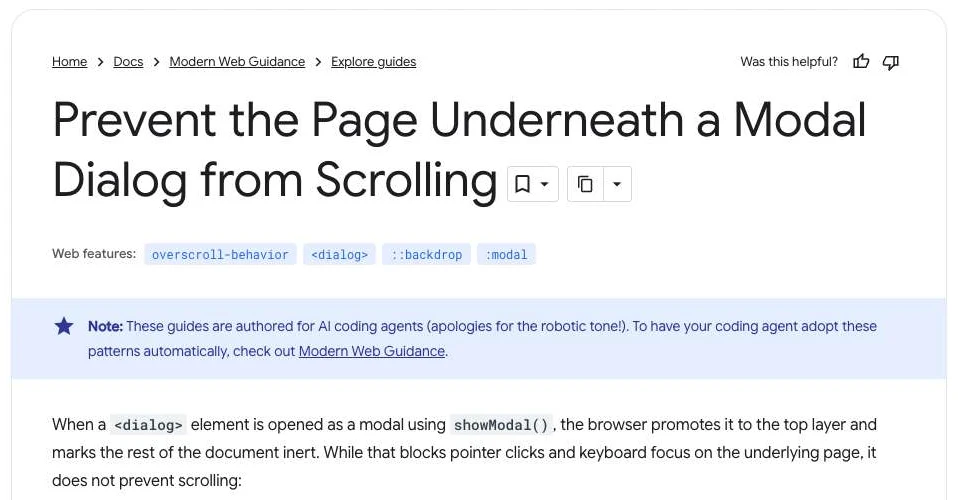

Modern Web Guidance, the agent skill Google Chrome released as version 1.0 on November 10, 2026, lifted every coding agent Google tested by roughly 30 percentage points on its own web-development checks. In the November 8 run published in the project's README, Claude Code with Opus 5.5 passed 57% of checks without the skill and 88% with it. Codex CLI with GPT-6.1 Sol went from 54% to 82%, and Antigravity CLI with Gemini 4 Argon from 58% to 94%.

Those numbers come from Google's own harness, and the checks are built around mistakes the guides were written to fix. This page lines up the per-agent results, explains what a "check" is and why the uplift reads high, and walks through installing the skill in Claude Code and Codex. We also ran the `modern-web-guidance` CLI ourselves to see what an agent gets back when it searches for a guide and what the new `legacy-scan` command finds.

## Modern Web Guidance Benchmark Results by Coding Agent {#modern-web-guidance-eval-results}

Across the three most recent full runs in the README, Modern Web Guidance added 27 to 36 percentage points to every agent's pass rate. Antigravity CLI gained the most and reached the highest guided score; Codex CLI gained the least and moved the most between runs.

| Run | Agent (model) | Checks | Without → with guidance |
|---|---|---|---|
| Nov 8 | Claude Code (Opus 5.5) | 1,801 | 57% → 88% (+31 pp) |
| Nov 8 | Codex CLI (GPT-6.1 Sol) | 1,795 | 54% → 82% (+28 pp) |
| Nov 8 | Antigravity CLI (Gemini 4 Argon) | 1,673 | 58% → 94% (+36 pp) |
| Nov 6 | Claude Code (Opus 5.5) | 1,773 | 56% → 90% (+34 pp) |
| Nov 6 | Codex CLI (GPT-6.1 Sol) | 1,773 | 53% → 86% (+33 pp) |
| Nov 6 | Antigravity CLI (Gemini 4 Argon) | 1,722 | 60% → 96% (+36 pp) |
| Nov 4 | Claude Code (Opus 5.5) | 1,743 | 57% → 90% (+33 pp) |
| Nov 4 | Codex CLI (GPT-6.1 Sol) | 1,743 | 52% → 85% (+33 pp) |
| Nov 4 | Antigravity CLI (Gemini 4 Argon) | 1,722 | 60% → 96% (+36 pp) |

*Pass rate is the share of automated checks passed; each run covered 207 to 215 tasks. Source: eval snapshot table in the GoogleChrome/modern-web-guidance-src README, read Nov 16, 2026. The Nov 2 run, which listed only Codex CLI (55% to 82%), is omitted.*

The unguided scores sit in a tight band. All three agents passed between 52% and 60% of checks on their own, so on this test set the frontier models start from similar knowledge of modern web APIs. The guided scores spread further apart: Antigravity CLI held at 94% to 96%, Claude Code at 88% to 90%, and Codex CLI swung between 82% and 86%. Codex's two-day drop from 86% to 82% happened while the task count grew by three, which is a reminder that each row is a single nightly job and a few points of movement can come from the test set changing.

Google's summary chart at the top of this page averages the agents: 52% of checks passed without the skill and 91% with it, as of November 9. The Show HN post from the Chrome team on launch day quoted 55% and 92% on "~1,700 playwright/AST-based assertions". The figures differ because each refers to a different day's run.

A few customers reported results on their own code in Google's launch post. Note inc., a Japanese publishing platform, ran 180 agent runs against its production Next.js codebase and saw modern-web check pass rates rise from 61% to 94%. MetaMask runs the skill as a pull-request review bot; in five weeks it reviewed about 480 PRs, commented on 64, and engineers fixed 43 of the findings. Both are company-reported numbers published by Google.

## How Modern Web Guidance Evals Work {#how-modern-web-guidance-evals-work}

Each eval gives the same developer prompt to an agent with Modern Web Guidance installed and to the same agent without it, then grades both results with automated browser checks. The prompts are written against two sample apps, `daily-grind` and `devtools-times`, and avoid naming the API the guide covers, so the agent has to find the right guide on its own.

A real example from the repository shows the shape. The task for the guide `prevent-page-scroll-under-modal-dialog` reads: "Add a seasonal patio notice to the Daily Grind homepage that opens as a modal dialog when the page loads, with a Close button, and make sure the page underneath can't scroll while the notice is open." Its expectations file then lists six checks: the dialog opens with `showModal()`, the dialog and its `::backdrop` both get `overscroll-behavior: contain` or `none`, both are scroll containers, and the `<html>` and `<body>` elements are not locked with `overflow: hidden` or `position: fixed`. An agent that stops background scrolling the familiar way, by setting `overflow: hidden` on the body, fails that last check even though the page works.

Google calibrates each grader before trusting it. A grader has to pass 100% of "golden" solutions and fail 100% of the time on the untouched starting app. The golden solutions are patches generated by Claude, Codex and Antigravity themselves, kept in each guide's `targets/` folder, so the graders are tuned against output from the same agents they later score.

Two design choices shape how far the headline uplift carries over to your own work:

- **The task set targets known gaps.** The README describes the goal as maximizing uplift: "if models already succeed without guidance, we prune redundant advice." Guides and tasks are kept where agents fail unguided, so the 50% to 60% unguided scores measure agents on the platform features the skill teaches, not on everyday web work.
- **The checks encode the guide's preferred implementation.** Many expectations test for a specific API or CSS property. They catch real accessibility and performance problems, and they also mark a working alternative as a failure when it uses an older technique.

The public [eval dashboard](https://googlechrome.github.io/modern-web-guidance-src/) promises per-guide and per-agent breakdowns with paired browser checks; when we opened it, the page asked for a Google sign-in before showing any figures. We did not find an independent rerun of these evals.

The same caution applies to any agent benchmark built by the tool's vendor. Our [HarnessDev benchmark analysis](/tutorials/harnessdev-agent-harness-benchmark/) looks at how much results move when only the harness around a model changes, and our piece on [cost per successful task for coding agents](/tutorials/coding-agents-finops-cost-per-successful-task/) covers why pass rates need to be read alongside cost.

## What Coding Agents Get Wrong Without Modern Web Guidance {#what-coding-agents-get-wrong}

Unguided agents usually produce code that works but reaches for JavaScript where HTML or CSS now does the job, and they miss accessibility details. Google's follow-up post, "Top 10 things AI gets wrong in web development," lists the patterns its evals catch most often:

- **Focus and modals.** Agents write their own JavaScript tab traps and put `aria-modal="true"` on a custom overlay instead of using a modal `<dialog>` or marking background content `inert`.
- **Reduced motion.** They set `scroll-behavior: smooth` globally, add scroll-driven animations with no reduced-motion check, or wipe every transition with a blanket `0.01ms` reset.
- **Forms.** They re-implement `:user-invalid` with blur handlers that flag untouched required fields, and use disappearing placeholder text as the only format hint.
- **Gestures.** Swipe-to-dismiss and swipe-to-reveal get built with `pointermove` or `touchmove` listeners rather than CSS scroll snap.
- **Dialogs and popovers.** Agents hand-roll `position: fixed` overlays with click-outside handlers, lock scrolling with `overflow: hidden` on `<html>`, and listen for `popstate` to catch the Android back gesture.
- **Passkeys.** They write their own `atob()`/`btoa()` Base64URL helpers instead of `parseCreationOptionsFromJSON()` and `credential.toJSON()`, and skip `PublicKeyCredential.signalUnknownCredential()`.

The guide an agent retrieves is direct about the fix. We fetched `prevent-page-scroll-under-modal-dialog` with the CLI and got 65 lines of Markdown, about 700 words. The same text is published for humans on Chrome for Developers, with a note that the guides are "authored for AI coding agents (apologies for the robotic tone!)":



*The scroll-lock guide as published on developer.chrome.com, captured Nov 16, 2026. Source: Google Chrome, Modern Web Guidance guides.*

The two CSS rules it marks "MANDATORY" are short:

```css
dialog:modal {
  overscroll-behavior: contain;
}

dialog::backdrop {
  overflow: hidden;
  overscroll-behavior: contain;
}
```

The same guide tells the agent not to put `overflow: hidden` or `position: fixed` on `<html>` or `<body>`, because that removes the scrollbar, shifts the layout and can break `position: sticky`. Its fallback section is just as specific: honoring `overscroll-behavior` on a non-scrollable container is listed as "Limited availability" (Chrome 144, Edge 144, Firefox 150, not Safari) and cannot be feature-detected, so the guide treats it as a progressive enhancement on top of `showModal()`, which already traps focus and makes the page behind it inert.

## How to Install Modern Web Guidance in Claude Code and Codex {#install-modern-web-guidance-claude-code-codex}

Run the interactive installer from your project, or add the plugin from your agent's marketplace. The README lists both routes:

```bash
# Any supported agent: interactive installer
npx modern-web-guidance@latest install

# Claude Code
/plugin marketplace add GoogleChrome/modern-web-guidance
/plugin install modern-web-guidance@googlechrome
/reload-plugins

# Codex CLI
codex plugin marketplace add GoogleChrome/modern-web-guidance
codex plugin add modern-web-guidance@googlechrome
```

In Claude Code, open `/plugin`, select the GoogleChrome marketplace and turn on auto-update. Check where an older install came from: Anthropic stopped updating third-party plugins in its built-in `claude-plugins-official` marketplace on October 12, so installs from there stay at v0.0.194. The README's fix is to uninstall `modern-web-guidance@claude-plugins-official` and reinstall from the `googlechrome` marketplace. The same guides also install through `npx skills add GoogleChrome/modern-web-guidance`, GitHub Copilot CLI, Cursor, Antigravity, Kimi Code and Grok Build.

The skill adds little standing context. Google sizes the `modern-web-guidance` skill description at about 205 tokens; the guides themselves load only when the agent asks for one. The agent runs `modern-web-guidance search "<query>"`, which matches the query against the guides locally with an embedding model and BM25 search, no network call or API key, then runs `retrieve <guide-id>` to pull the full guide into its context.

You can check that the CLI works before trusting the agent to call it. On our Mac, with the package cached, each command returned in about 1.5 seconds including `npx` start-up:

```bash
export DISABLE_TELEMETRY=1
npx modern-web-guidance@latest search "prevent page scroll behind a modal dialog"
npx modern-web-guidance@latest retrieve prevent-page-scroll-under-modal-dialog
```

The search returned the matching guide first, followed by nine related ones such as `dialog` and `light-dismiss-a-dialog`, as JSON with an ID and a one-line description each. The npm package reported version 0.0.205, even though Google calls the release 1.0, and `list` showed 203 guides.

The CLI sends usage data unless you opt out. Per the README, Google collects installation counts, the calling agent's name, retrieved guide IDs and the search queries the agent generates, not the user's raw prompts. Set `DISABLE_TELEMETRY=1` in your shell profile to turn it off.

Modern Web Guidance writes the code; it does not check it in a browser. Google recommends pairing it with Chrome DevTools for agents for that step, and our [comparison of agent-browser and Playwright](/tutorials/vercel-agent-browser-vs-playwright/) covers other browser tools a coding agent can use to verify a UI change. If you run Claude Code and Codex side by side, [T3 Code](/tutorials/t3-code/) is one way to manage both from a single control plane.

## Modern Web Guidance legacy-scan: Hands-on Test Results {#modern-web-guidance-legacy-scan}

`legacy-scan` finds a small, predictable set of outdated patterns, and it says so in its output. On our test page it reported one issue and skipped the modal problems that the guides themselves cover.

Version 1.0 added the command for existing codebases. It statically analyzes HTML, CSS, JavaScript and `package.json`, lists modernization opportunities with "keep when" and "drop when" criteria, and points the agent to the guide for each one. In the Show HN thread, the Chrome team said the rules were trained on 30,000 GitHub repositories and reach 92% average precision on held-out repos.

We gave it a single HTML file written the old way on purpose: a `div` overlay with `role="dialog"` and `aria-modal="true"`, scrolling locked by adding `overflow: hidden` to the body, a scroll listener driving a progress bar, untrusted text written with `innerHTML`, and jQuery loaded from a CDN. The scan's output, trimmed:

```text
Found 1 modernization opportunity across 1 guide (scanned 33 guides
with deterministic rules; ~20% of the guidance corpus)

* secure-external-subresources (1 finding)
  - index.html:9
    <script src="https://code.jquery.com/jquery-3.7.1.min.js"></script>
```

It flagged the missing Subresource Integrity hash on the CDN script and nothing else. The body scroll lock, the custom overlay and the `innerHTML` write all have guides, but no deterministic rule for them yet. This matches what users reported on Hacker News: one developer's scan found two issues and another's found three in a codebase with "far more." Paul Irish of the Chrome team replied that the scan is tuned to avoid false positives, covers about 20% of the guides, and should reach about 50% in another month.

Use `legacy-scan` as a starting list, then ask the agent to modernize a directory with the guides loaded. Google's suggested prompt is `/modern-web-guidance Modernize the code in this directory`, and the launch post says agentic audits that reason about code directly are planned. Generated apps benefit from the same review; our look at [why 7,403 Lovable apps leaked data](/tutorials/lovable-security/) shows how often AI-built front ends ship without one.

## Modern Web Guidance Browser Support and Baseline Settings {#modern-web-guidance-browser-support}

By default the guides target Baseline Widely Available, features that have worked across all major browsers for about two and a half years, according to a project contributor on Hacker News. Anything newer needs a fallback or must work as a progressive enhancement. Each guide carries Baseline and browser-support data so the agent can match your project's targets.

The most-discussed objection on Hacker News was Chrome's influence. One commenter listed features the guides teach that are stable in Chrome but missing in Firefox and Safari, including CSS `@function`, `calc-size()`, `corner-shape` and scroll-state container queries. Philip Walton of the Chrome team answered that the guides document these features with a support table and fallbacks, and the agent decides based on your requirements. Edge, Firefox and MDN are listed as co-stewards; Walton said Firefox joined only weeks before 1.0 and that talks with Safari are ongoing. The scroll-lock guide above is a fair example of the trade-off: its preferred fix does not work in Safari, and it relies on `showModal()` behavior to keep the page usable there.

Three CLI settings, stored in a `.mwgrc` file at the project root (or `~/.mwgrc`), control how far ahead the agent may go:

| Command | `.mwgrc` effect |
|---|---|
| `npx modern-web-guidance@latest set-baseline <widely\|newly\|limited\|YYYY>` | Sets the project's Baseline target |
| `npx modern-web-guidance@latest set-allow-origin-trials` | `"allowOriginTrials": true` unlocks guides for Origin Trial APIs |
| `npx modern-web-guidance@latest set-allow-volatile-features` | `"allowVolatileFeatures": true` unlocks guides for single-engine features shipped in the last three months |

Without those opt-ins, Origin Trial and volatile guides still appear in `search` results but `retrieve` refuses them, so an agent cannot adopt an unstable API without your consent. Commit `.mwgrc` to share the setting with your team. If you build agent tooling yourself, the same pattern of small skill description plus on-demand retrieval is worth comparing with how [Antigravity's /teamwork](/tutorials/antigravity-teamwork/) splits work across agents, and our [agent infrastructure section](/tutorials/category/agent-infrastructure/) collects related tooling.

## References {#references}

- Google Chrome, [GoogleChrome/modern-web-guidance-src README](https://github.com/GoogleChrome/modern-web-guidance-src), eval snapshot table (Nov 2–8, 2026), install, `.mwgrc` and telemetry sections, read Nov 16, 2026.
- Philip Walton, Google Chrome, ["Modern Web Guidance 1.0: The web platform expertise your coding agent is missing"](https://developer.chrome.com/blog/modern-web-guidance-v1), Nov 10, 2026.
- Philip Walton, Google Chrome, ["Top 10 things AI gets wrong in web development"](https://developer.chrome.com/blog/top-10-things-ai-gets-wrong-in-web-dev), Nov 11, 2026.
- Hacker News, ["Show HN: Get your coding agent off ~2019 JavaScript, onto modern web primitives"](https://news.ycombinator.com/item?id=50443812), Nov 10, 2026, including replies from the Chrome team.
- AgentsPulse test, Nov 16, 2026: `modern-web-guidance` CLI 0.0.205 (npm) `search`, `retrieve`, `list` and `legacy-scan` on macOS with Node 22 and `DISABLE_TELEMETRY=1`.
