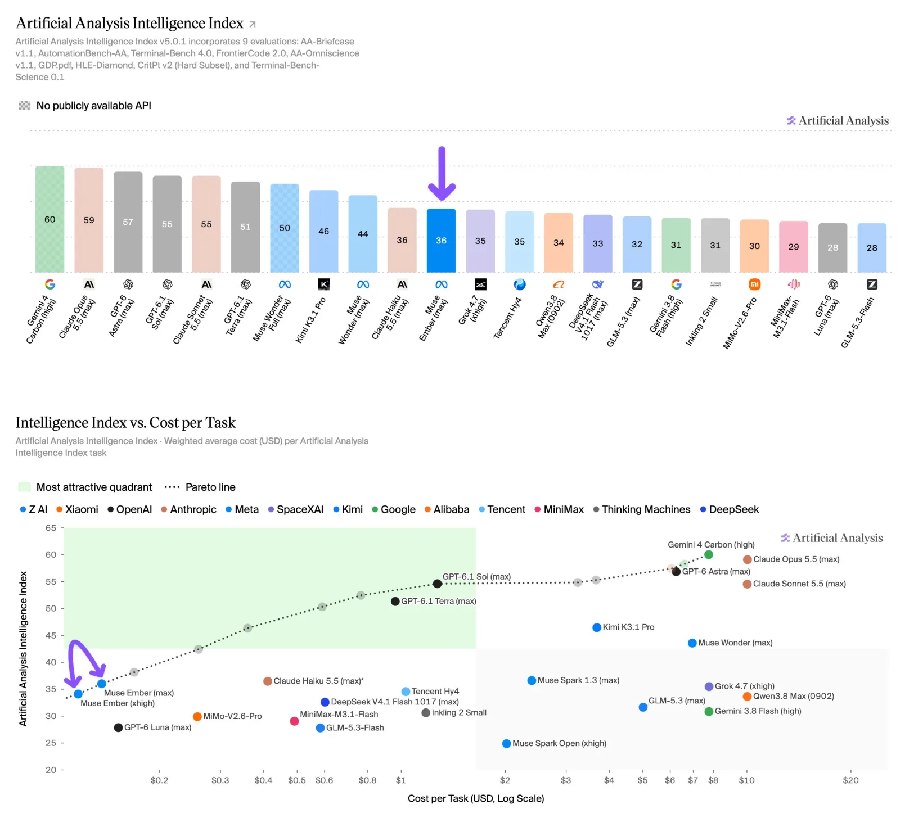
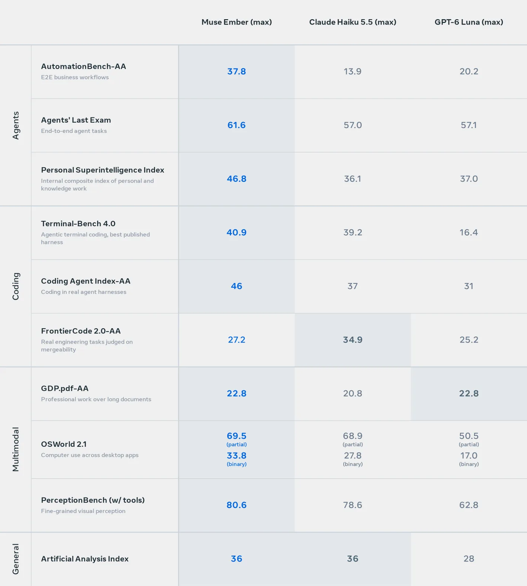

Muse Ember is Meta's smallest and cheapest Muse model, released on November 9, 2026 for the high-volume work inside agent systems: tool calls, coding subtasks, routing, data extraction and long-document parsing. It costs $0.10 per million input tokens and $0.50 per million output tokens. In Artificial Analysis's independent testing it matches Claude Haiku 5.5's Intelligence Index score at roughly a third of the cost per task.

| Question | Short answer |
|---|---|
| What is it? | Meta's smallest Muse model, API id `muse-ember-1.0`, proprietary. |
| Price | $0.10 input / $0.004 cached input / $0.50 output per million tokens. |
| Context | 1M tokens in, up to 512K tokens out. |
| Headline score | 36 on the Artificial Analysis Intelligence Index at max effort, $0.14 per task. |
| Main catch | Weak knowledge recall; behind Haiku 5.5 on mergeable-code tests. |

## What Is Muse Ember {#what-is-muse-ember}

Muse Ember is the volume tier of Meta's Muse family, meant to run the many small, repeatable steps an agent performs after a larger model has planned the work. Meta's summary is "Muse Wonder plans, Muse Ember handles the volume."

### What Meta built it for

Meta's launch post lists the jobs it targets: carrying a business workflow end to end, calling tools in sequence, reading files, running tests and making targeted code fixes as a coding subagent, routing requests, and pulling structured data out of long documents. Meta says it takes text, images, audio and video as input and can operate a computer from screenshots. Artificial Analysis's model listing currently shows text and image input, so check modality support for your account before relying on audio or video.

### Where it sits in the Muse line

Meta describes three tiers: Muse Wonder for the hardest problems, Muse Spark for coding and agentic work, and Muse Ember for repeatable tasks at scale. Meta says Ember is the first model it trained using Muse Wonder Full. Like Wonder and Spark 1.3, it is a closed model; the open-weights member of the family is Muse Spark Open, which appears in our [Ripple-65B Preview comparison](/tutorials/ripple-65b-preview/).

Simon Willison noted on Hacker News that the API exposes six reasoning effort levels: minimal, low, medium, high, xhigh and max. Benchmark numbers below are at max unless stated.

## How Much Does Muse Ember Cost? {#muse-ember-pricing}

Muse Ember costs $0.10 per million input tokens, $0.004 per million cached input tokens and $0.50 per million output tokens on Meta Model API. Artificial Analysis says those per-token prices are the same as Claude Haiku 5.5 and GPT-6 Luna, so the cost difference comes from how many tokens each model spends per task.

### Cost per task in independent testing

Artificial Analysis runs every model through the same set of evaluations and reports what the whole run costs per task. On that measure:

| Model (effort) | AA Intelligence Index | Cost per task |
|---|---|---|
| Muse Ember (max) | 36 | $0.14 |
| Muse Ember (xhigh) | 34 | $0.12 |
| Claude Haiku 5.5 (max) | 36 | $0.41 |
| DeepSeek V4.1 Flash 1017 (max) | 33 | $0.60 |
| GLM-5.3-Flash | 28 | $0.58 |
| Muse Wonder (max) | 44 | $6.95 |

*Source: Artificial Analysis launch thread, November 9, 2026. Index v5.0.1.*

Artificial Analysis calls Ember at max the cheapest model it has measured at a score of 36 or above, and places both the max and xhigh settings on its cost/intelligence Pareto frontier. Meta's own chart, which uses the same Artificial Analysis data at Meta's announced pricing, shows Haiku 5.5 needing its max setting ($0.41) to reach the score Ember reaches at $0.14. That is where the "about one-third of the cost" claim comes from. It is a measurement on one benchmark suite; your cost depends on how many tokens your own prompts make the model use. Our [cost per successful task](/tutorials/coding-agents-finops-cost-per-successful-task/) explainer covers why per-task cost is the number to track.

*Artificial Analysis Intelligence Index and Intelligence vs. cost per task. Image by Artificial Analysis.*

### Partner latency claims

Meta's post quotes early partners. Cloudflare says Ember was up to 30% faster at the tail than the comparable model it tested. You.com reports a p95 latency of 2.2 seconds, 4x to 13x faster than leading open-weight models, with 36% to 48% fewer output tokens. These are customer quotes; Meta does not publish their test setups.

## Muse Ember Benchmarks: What Meta's Table Measures {#muse-ember-benchmarks}

Meta's launch table puts Muse Ember ahead of Claude Haiku 5.5 and GPT-6 Luna on most rows at max effort, with its largest lead on business-workflow automation. Some rows are Artificial Analysis runs, some are Meta's internal runs, and some compare models inside different agent harnesses, so read each row with its source.

*Muse Ember vs Claude Haiku 5.5 vs GPT-6 Luna, all at max reasoning effort. Image by Meta.*

### Agent benchmarks

**AutomationBench-AA** is Artificial Analysis's run of a private Zapier set: 657 business-workflow tasks across simulated SaaS apps such as Gmail, Salesforce and Slack. Meta reports the strict pass rate, where a task counts only if every objective is met and no guardrail is broken: Ember 37.8%, Haiku 5.5 13.9%, Luna 20.2%. Artificial Analysis's own post quotes 68.1% for Ember, which is the partial-credit score on the same benchmark (Haiku 5.5 scores 35.4% and Luna 53.2% on that measure). Both measures put Ember well ahead. When you see 68% in one place and 38% in another, they are the partial and strict scores of the same run.

**Agents' Last Exam** (61.6 vs 57.0 vs 57.1) and Meta's **Personal Superintelligence Index** (46.8 vs 36.1 vs 37.0) are Meta's internal runs. The first uses 100 of the 105 Linux tasks in a common agent loop; the second is Meta's own composite of personal and knowledge-work tests, with no outside reference point.

### Coding benchmarks

Ember leads on terminal coding and trails on mergeable code:

| Benchmark | Muse Ember | Claude Haiku 5.5 | GPT-6 Luna | How it was run |
|---|---|---|---|---|
| Terminal-Bench 4.0 | 40.9 | 39.2 | 16.4 | Ember: AA in mini-swe-agent. Haiku: Anthropic's self-reported Claude Code result. Luna: Codex leaderboard. |
| Coding Agent Index-AA | 46 | 37 | 31 | Each model in its vendor's agent: Muse Code, Claude Code, Codex. |
| FrontierCode 2.0-AA | 27.2 | 34.9 | 25.2 | 132 private tasks graded on whether a maintainer would merge the change. |

*Scores from Meta's launch table; harness details from Meta's evaluation report.*

The Terminal-Bench row mixes harnesses. When Artificial Analysis ran Haiku 5.5 itself, it scored 32.8%, so Ember's lead depends on which Haiku number you use. The Coding Agent Index measures model plus agent product together. Our [HarnessDev write-up](/tutorials/harnessdev-agent-harness-benchmark/) shows how much the harness alone can move these scores.

### Multimodal benchmarks

On OSWorld 2.1 computer use, Ember scores 69.5 partial credit and 33.8% strict pass, against Haiku 5.5's 68.9 and 27.8%. Meta ran all 108 tasks in its own framework rather than the official runner. On GDP.pdf long-document work Ember ties Luna at 22.8 (Haiku 20.8), and on PerceptionBench with tools it scores 80.6 (Haiku 78.6, Luna 62.8).

Meta's report also says competitor runs are best-effort and may not be optimally tuned, and that refusals count as zero. One Hacker News commenter argued that scoring refusals as zero hides the difference between a model that cannot do a task and one that will not.

## Muse Ember vs Claude Haiku 5.5: Where Each Wins {#muse-ember-vs-claude-haiku-5-5}

Muse Ember and Claude Haiku 5.5 tie at 36 on the Artificial Analysis Intelligence Index, and Ember gets there for about a third of the cost per task. Below the tie, they are good at different things.

| Area | Better choice | Evidence |
|---|---|---|
| Multi-step business workflows | Muse Ember | AutomationBench-AA strict 37.8% vs 13.9% |
| Cost per task at equal score | Muse Ember | $0.14 vs $0.41 (Artificial Analysis) |
| Mergeable code changes | Claude Haiku 5.5 | FrontierCode 2.0: 34.9 vs 27.2 |
| Agentic knowledge work | Claude Haiku 5.5 | AA-Briefcase Elo 1574 vs 1521 |
| Factual recall | Claude Haiku 5.5 | AA-Omniscience accuracy 34.7% vs 21.1% |
| Avoiding made-up answers | Muse Ember | Hallucination rate 17.4%, about half of Haiku 5.5's |

### The knowledge trade-off

Ember's weakest result is AA-Omniscience, Artificial Analysis's knowledge test. It answers 21.1% correctly, the lowest among models of similar overall intelligence; Haiku 5.5 scores 34.7% and Gemini 3.8 Flash (high) 50.5%. Ember declines 64% of the questions, which is also why its hallucination rate is low. In practice that suits a subagent that works from supplied documents, tool results or code, and it is a poor fit for answering factual questions from memory. Give it the context it needs.

GPT-6 Luna, the third model in Meta's table, scores 28 on the same index. As one Hacker News commenter pointed out, Luna is about two months old, so a newer small model beating it is expected. Our [Inkling 2 Small explainer](/tutorials/inkling-2-small/) covers another recent small model on the same cost chart.

## Muse Ember vs Muse Spark and Muse Wonder {#muse-ember-vs-muse-spark}

Muse Ember scores one point below Muse Spark 1.3 on the Artificial Analysis Intelligence Index and costs about a seventeenth as much per task. Meta's comparison at max effort:

| Model | AA Intelligence Index | Cost per task | Price per M tokens (in / out) |
|---|---|---|---|
| Muse Ember | 36 | $0.14 | $0.10 / $0.50 |
| Muse Spark 1.3 | 37 | $2.39 | $1.25 / $4.25 |
| Muse Wonder | 44 | $6.95 | — |

*Ember and Spark figures from Meta's launch post; Wonder from Artificial Analysis.*

Muse Wonder remains the stronger model by eight index points, at roughly fifty times Ember's cost per task. On AutomationBench-AA, Artificial Analysis gives Ember the same 68.1% partial score as Wonder. Meta's intended split is to let Wonder or Spark plan and decompose a job, then hand the many repeated steps to Ember. A [model gateway](/tutorials/model-gateway-enterprise-ai-control-plane/) is the usual place to enforce that kind of routing.

## How to Use Muse Ember {#how-to-use-muse-ember}

Muse Ember is available now through Meta Model API under the model id `muse-ember-1.0`, including the Responses API, and inside Meta's Muse Code coding agent. There are no downloadable weights.

### Setup notes

- **Pick an effort level.** Six levels run from minimal to max. Artificial Analysis found xhigh gives 34 index points for $0.12 per task against 36 for $0.14 at max. Simon Willison's pelican-drawing test did not get clearly better with more reasoning.
- **Use caching for repeated context.** Cached input costs $0.004 per million tokens, so long shared system prompts or documents that a subagent rereads are cheap.
- **Supply facts.** Given its low knowledge-recall score, pass in documents or tool results rather than asking it to answer from memory.
- **Try it in an agent client.** Muse Code is also one of the agents that [T3 Code](/tutorials/t3-code/) can drive alongside Claude Code and Codex.

### Safety testing

Meta says it evaluated Ember under its Superintelligence Scaling Framework and found it below the high-risk thresholds. It also says it tested Ember against prompt injection and for asking a person before high-impact actions, which matters for a model meant to run unattended inside tool-calling loops.

## Muse Ember FAQ {#muse-ember-faq}

### How much does Muse Ember cost?

Meta lists Muse Ember at $0.10 per million input tokens, $0.004 per million cached input tokens and $0.50 per million output tokens. Artificial Analysis measured about $0.14 per task on its Intelligence Index at max reasoning effort, and about $0.12 at xhigh.

### Is Muse Ember open weights?

No. Muse Ember is a proprietary model available through Meta Model API and Muse Code. Meta's open-weights option in the Muse line is Muse Spark Open.

### Is Muse Ember better than Claude Haiku 5.5?

It depends on the task. Artificial Analysis gives both 36 on its Intelligence Index, with Muse Ember costing about a third as much per task, and Ember leads on business-workflow automation. Haiku 5.5 scores higher on FrontierCode 2.0 mergeable code and on knowledge recall.

## References {#references}

1. Meta, [Muse Ember launch post](https://research.meta.ai/blog/muse-ember), November 9, 2026.
2. Meta, [Muse Ember Evaluation Report (PDF)](https://research.meta.ai/static/muse-ember-evaluation-report), November 9, 2026.
3. Artificial Analysis, [Muse Ember model page](https://artificialanalysis.ai/models/muse-ember), accessed November 9, 2026.
4. Artificial Analysis, [Muse Ember launch thread on X](https://x.com/ArtificialAnlys/status/2119854348587123007), November 9, 2026.
5. Hacker News, [Muse Ember discussion](https://news.ycombinator.com/item?id=50429024), November 9, 2026.
