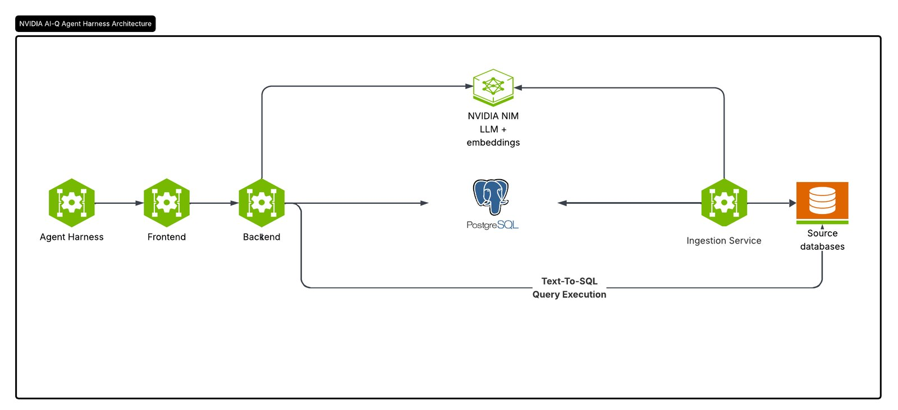
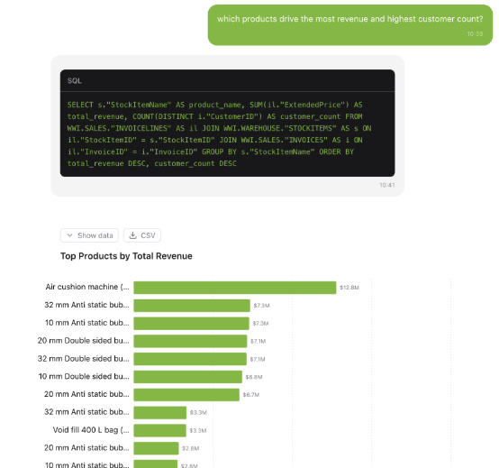

NVIDIA Auto Ontology is an open-source service, released under Apache-2.0, that builds a semantic layer from enterprise database metadata so AI agents can write SQL against reviewed business definitions. NVIDIA introduced it on October 21, 2026 as part of its Agent Knowledge Foundation, describing it as a library that "translates raw company data into familiar business concepts — like customers, products and orders — and maps how they relate." The GitHub repository reached the Hacker News front page on November 3 and had about 3,570 stars a day later.

The project's own pitch is short: a revenue figure delivered faster is worth nothing if it is wrong. Before an agent queries a warehouse, it needs to know where the data lives, what each column means, which tables join, and how a measure such as revenue or margin should be computed. Auto Ontology stores those answers in one place and lets people review them before agents rely on them.

## What Is NVIDIA Auto Ontology

NVIDIA Auto Ontology is a context layer that runs next to your databases. It reads their schemas, profiles columns and samples values, then compiles what it finds into an ontology with three kinds of definition:

- **Terms.** Business concepts such as *Customer* or *Invoice Line*, each with a description and synonyms, mapped to the columns that hold them.
- **SQL attributes.** Reviewed SQL expressions attached to a term, such as a margin or a rolling total. Agents reuse them, so every answer computes a measure the same way.
- **Relationships.** How tables join, including bridge tables, inferred from keys and from the data.

The README groups the features under five verbs. *Discover* generates an ontology from metadata or imports existing semantic models. *Ground* gives agents one definition per concept across tables and databases. *Certify* lets people review and approve definitions. *Validate* checks whether a question is answerable before querying and returns the SQL with each answer. *Expose* serves all of it through MCP, agent skills and a REST API.

In this setting, "ontology" means a machine-readable map of business terms and how they relate. It is stored in Postgres with pgvector embeddings for retrieval, and it does not use OWL, RDF or SPARQL. For exchange with other tools, Auto Ontology imports and exports models in Apache Ossie YAML, the open semantic-model format.

## Auto Ontology vs a Semantic Layer or Schema in the Prompt

Auto Ontology works as a generated semantic layer for AI agents. NVIDIA positions it as a complement to the semantic models a company already owns, and the Ossie converter is how those models move in and out.

The comparison the README makes is with the common shortcut of pasting the database schema into the agent's context window:

| | Schema in the context window | Auto Ontology tools |
|---|---|---|
| Tokens | Grow with every table and column | Only the terms and tables the question touches |
| Meaning | Column names; the agent infers the rest | Business terms mapped to columns and SQL |
| Joins and measures | Improvised per question | Resolved relationships and reviewed SQL expressions |
| Unanswerable questions | Often answered confidently and wrongly | Answerability check, so the agent asks to clarify |

The difference from a hand-built semantic layer is the starting point. A team writing dbt metrics or a Cube model defines each measure by hand. Auto Ontology drafts the terms, joins and measures with a language model and asks people to correct and certify the draft. Hacker News commenter IanCal summarized the trade: the LLM still does the error-prone conversion from raw data to structure, but that middle step becomes something people can inspect and fix once, instead of every agent reinterpreting the same tables on every question.

For agent platforms that already route tool calls through a gateway, Auto Ontology sits behind it as one more MCP server; our [stateless MCP and agent gateway guide](/tutorials/stateless-mcp-agent-gateway/) covers that layer.

## How Auto Ontology Builds the Ontology

Auto Ontology builds the ontology in three stages: it generates a draft, people certify it, and the agent answers questions from it.

*Auto Ontology's components: the ingestion service builds the ontology from source databases, and the backend answers agent questions with text-to-SQL. Diagram from the NVIDIA/auto-ontology repository.*

**Generate.** The ingestion service makes a first draft in four steps. It extracts schemas, column profiles and sample values into a catalog. It names entities table by table and maps each to columns. It infers joins and bridge tables and suggests SQL attributes from query history. Then it writes terms, relationships and SQL attributes to Postgres, with embeddings in pgvector.

The result is a semantic graph you can browse in the UI. On Wide World Importers, Microsoft's sample sales database, one compilation produced 31 terms. Selecting *Order* in the graph shows its description, 7 related terms, 10 mapped columns and 2 SQL attributes, as in the image at the top of this page.

**Certify.** People test the draft with real questions in Chat or through the MCP tools, edit terms, descriptions and SQL attributes in the UI or API, and mark them certified once they are correct. This review step is what turns a model's guess into a definition the organization stands behind.

## Auto Ontology Text-to-SQL: How an Agent Answers a Question

For each question, the Auto Ontology agent runs a fixed text-to-SQL pipeline:

1. Classify the intent and extract the entities the question names.
2. Retrieve candidate terms, columns and SQL attributes by embedding search.
3. Write SQL from those candidates.
4. Check filter values and the query against the database, repairing the SQL when a check fails.
5. Run the query and return the answer with its SQL and the steps taken.

The README's quickstart asks for revenue from one product, the "USB food flash drive - sushi roll", in Pennsylvania in June 2015. The agent resolves *revenue*, *product* and *state* to ontology terms, follows relationships from invoice line to invoice, customer, city and state province, validates the filter values, and returns $588.80 from three invoice lines along with the five-join SQL query it ran. Because the SQL comes back with the answer, a reviewer can rerun it against the source.

*In Chat, each answer shows its SQL, and the rows can be viewed, downloaded as CSV or charted. Screenshot from the NVIDIA/auto-ontology repository.*

Questions the data cannot support get a different path. In the README's second example, a user asks for return on ad spend; Wide World Importers has no advertising data, so `check_answerable` reports coverage of 0.5 with no term for "ad spend", and the agent offers revenue instead or asks which source holds ad spend. Predictive questions can be routed to KumoRFM when a Kumo key is configured.

## Auto Ontology MCP Server: Tools and Sign-In

The Auto Ontology MCP server gives any MCP client nine read-only tools over the ontology:

| Job | Tools |
|---|---|
| Readiness | `check_readiness` |
| Terms | `search_terms`, `get_term`, `get_term_columns`, `get_term_sql_attributes`, `get_sql_attribute`, `describe_table` |
| Answerability | `check_answerable` |
| Questions | `ask_question` (answer, SQL and rows) |

You run it with `uvx` against your deployment and point Cursor or Claude Desktop at `http://localhost:3003/mcp`; Claude Desktop goes through the `mcp-remote` bridge. After a restart, the client prompts for sign-in and the user logs in on Auto Ontology's own page, including through SSO.

Auto Ontology acts as its own OAuth authorization server. Clients register dynamically, so there is no client ID, secret or redirect URI to configure. Grants live in the database and survive restarts and replicas. Permissions are evaluated on every call, so a role change or a ban takes effect immediately, and the server deliberately has no shared server-wide token that could let one user act as the owner. If the Auto Ontology service is unreachable, calls fail with an error instead of prompting for a new login.

For coding agents, the repo also ships three skills: `nvidia-ontology-setup`, `nvidia-ontology-management` and `nvidia-ontology-query`. Applications that do not speak MCP can call `POST /api/chat/completions` with an API token and read a server-sent event stream.

## Auto Ontology Text-to-SQL Accuracy: The Eval Harness

NVIDIA has published no text-to-SQL accuracy numbers for Auto Ontology as of November 4, 2026. What it published on July 2 is [auto-ontology-eval](https://github.com/NVIDIA/auto-ontology-eval), a harness for measuring the gain yourself.

The harness asks every question twice with the same model. The control arm, `schema_only_sql`, gets the question and a schema dump in one prompt with no tools. The treatment arm, `auto_ontology_sql`, gets only the question and lets Auto Ontology's agent retrieve context from the ontology. A deterministic verifier executes both SQL outputs and the gold SQL against the same database, using BIRD's execution accuracy for most datasets and BEAVER's rule for BEAVER. There is no LLM judge. The report gives the accuracy difference and lists which questions the ontology fixed and which it broke.

| Dataset | Questions | Engine |
|---|---|---|
| BIRD | 1,534 (Dev), 500 (Mini-Dev) | SQLite |
| BEAVER | 100-question `dw` sample | MySQL |
| FDABench-Lite | 169 | SQLite |
| Wide World Importers | 41 | Postgres |
| BIRD-Interact | ~300 (Lite), 600 (Full) | Postgres |

A few design choices protect the number. The comparison withholds its headline result when more than 5% of questions get no model output, because a rate-limited run looks the same as a weak model. Two optional BIRD inputs, SQL exemplars and value anchors, help only the treatment arm, and the README notes that a difference measured with them covers those inputs as well as the ontology. You can also add your own `evaluation.json` of questions and gold SQL to test against your warehouse.

On Hacker News, one commenter suggested comparing it on Berkeley's DataAgentBench, which targets agents that query several sources. Until NVIDIA or users publish runs, the eval harness is the way to decide whether the ontology helps on your schema.

## Auto Ontology Setup: Models, Connectors and Ports

Auto Ontology runs with Docker Compose for a local stack or Helm on Kubernetes. The quickstart needs Docker Compose v2, `uv` and an NVIDIA API key from build.nvidia.com, then seeds Wide World Importers and turns on semantic compilation in Settings.

It uses four model roles. By default, reasoning and non-reasoning steps both use `nvidia/nemotron-3.5-lightning-30b-a3b`, embeddings use `nemotron-3.5-embed-1b`, and reranking uses `nemotron-3.5-rerank-8b`, all on NVIDIA's hosted endpoints. Each role can point to self-hosted NIM or any OpenAI-compatible endpoint, provided the model supports structured output and the same embedding model is used for ingestion and queries.

Ten database engines are supported: PostgreSQL, MySQL, Databricks, Snowflake, ClickHouse, Trino, Apache Kyuubi, HeavyDB, DuckDB and SQLite.

| Component | Role | Port |
|---|---|---|
| Frontend (Next.js, Better Auth) | Web UI, authentication, public API gateway | 3000 |
| Backend (FastAPI, LangChain) | Text-to-SQL agent, catalog, ontology APIs | 3001 |
| Ingestion service (FastAPI) | Ingestion and semantic compilation | 3002 |
| MCP server (FastMCP) | Read-only agent tools | 3003 |
| Postgres + pgvector | Catalog, ontology, vector store | 5432 |

Two security notes from the README matter before deployment. Ports 3001 and 3002 must stay on a private network: the backend trusts the user identity forwarded in the `x-auto-ontology-user-id` header, and the ingestion endpoints for ingest, delete, reset and compile have no authentication of their own. And enabling KumoRFM uploads connected tables to Kumo's hosted service, up to 20 tables by default, so it needs a data review first. Our piece on [agents with internal access](/tutorials/ai-agent-internal-access-security-boundary/) covers the wider identity and least-privilege questions.

The repository is maintained by NVIDIA and does not accept external pull requests; integration requests and bug reports go through GitHub issues.

## NVIDIA Auto Ontology FAQ

### Does Auto Ontology need an NVIDIA API key?

Only for the default setup. The defaults call Nemotron models on NVIDIA's hosted API, but every model role can be pointed at self-hosted NIM or another OpenAI-compatible endpoint through environment variables.

### How is it different from agent memory plus skills?

Memory and skills store what an agent learned or how to call a tool. Auto Ontology stores one reviewed definition per business concept, mapped to columns, joins and SQL, and shares it across every agent and user that connects. Definitions are certified by people, and answers carry the SQL that produced them.

### Why not OWL, RDF and SPARQL?

Auto Ontology targets SQL warehouses, so its terms resolve to columns and SQL expressions and queries stay in each engine's SQL dialect. For interchange it uses Apache Ossie YAML. The README does not mention RDF or OWL import.

### Does adding an LLM-built ontology just stack more unreliable agents?

That was the sharpest objection on Hacker News. The project's answer is the certify step and the eval harness: the draft is reviewed by people before agents depend on it, and the harness reports which questions the ontology fixed and which it broke on your own data.

## References

- NVIDIA, [Auto-Ontology repository and README](https://github.com/NVIDIA/auto-ontology), accessed Nov 4, 2026, including the [MCP server docs](https://github.com/NVIDIA/auto-ontology/blob/main/docs/mcp.md)
- NVIDIA, [auto-ontology-eval](https://github.com/NVIDIA/auto-ontology-eval), text-to-SQL evaluation harness
- NVIDIA Blog, ["NVIDIA Agent Toolkit Expands, Grounding Enterprise Agents in Company Data"](https://blogs.nvidia.com/blog/enterprise-platforms-agent-toolkit/), Oct 21, 2026
- Hacker News, ["Nvidia – open-source auto-ontology"](https://news.ycombinator.com/item?id=50348962), Nov 3, 2026
- [Apache Ossie](https://ossie.apache.org/), open standard for exchanging semantic models
