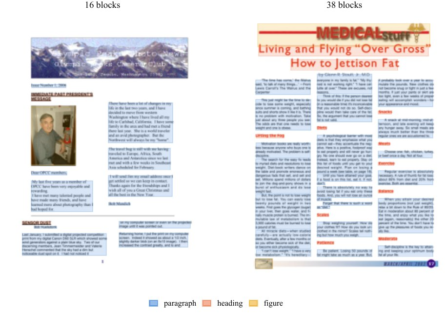

OCRia-nano-1, the 8.1-million-parameter document parser LlamaIndex released on November 23, 2026, gets most of its benchmark lead from tables. Plugged into LlamaIndex's open-source LiteParse as the OCR backend, it scores 59.2 on ParseBench-2 against 48.7 for LiteParse's default Tesseract setup, 52.5 for Marker and 55.1 for Indra, while parsing 27.8 pages a second on 16 CPU cores.

Those numbers come from LlamaIndex's technical report, run on its own hardware and partly on its own benchmark. They are still the only measurements available, so this page lines them up by task: where OCRia-nano-1 beats the other CPU parsers, where it only ties them, what it costs in speed, how to switch LiteParse to it, and when a GPU model or a different license is the better call.

## OCRia-nano-1 Benchmarks vs Tesseract, Marker and Indra {#ocria-nano-1-benchmarks}

OCRia-nano-1 beats the other CPU parsers LlamaIndex tested on four of five benchmarks and ties on the fifth. The table below is from the technical report; all four systems ran on the same 16-vCPU container, and higher is better except for character error rate (CER).

| System (CPU) | ParseBench-2 | OmniParseBench | ParseBench-1 | olmOCR-bench | BHL CER ↓ | Pages/s |
|---|---|---|---|---|---|---|
| LiteParse + Tesseract (default) | 48.7 | 42.3 | 40.5 | 45.7 | 0.275 | 14.2 |
| Marker 2.2.0 (fast) | 52.5 | 69.8 | 40.4 | 60.8 | 0.067 | 24.7 |
| Indra 1.1.2 | 55.1 | 70.9 | 42.6 | 60.8 | 0.062 | 29.6 |
| LiteParse + OCRia-nano-1 | **59.2** | **74.8** | **52.7** | **60.9** | **0.048** | 27.8 |

ParseBench-2 is the headline benchmark, and its authors include LlamaIndex researchers, so the other four columns matter as a cross-check. OmniParseBench comes from Datalab, the company behind Indra, and on it OCRia-nano-1 still leads, 74.8 to 70.9. olmOCR-bench is effectively a three-way tie at 60.8 to 60.9. BHL is 2,165 pages of historical print, where OCRia-nano-1's 0.048 character error rate compares with 0.062 for Indra; LiteParse's default Tesseract configuration scores 0.275 there in LlamaIndex's run, much worse than the 0.064 Tesseract 5 posts on the public leaderboard.


*Left: accuracy against CPU throughput for local parsers. Right: accuracy against parameter count, with GPU and cloud parsers for reference. Image: LlamaIndex, OCRia-nano-1 model card on Hugging Face, November 2026.*

### ParseBench-2 by category: tables and layout

The per-category scores show where the 4.1-point lead over Indra comes from:

| ParseBench-2 category | Tesseract default | Marker (fast) | Indra 1.1.2 | OCRia-nano-1 |
|---|---|---|---|---|
| Text | 58.8 | 62.5 | 68.4 | 68.5 |
| Formatting | 78.0 | 75.5 | 76.1 | 82.2 |
| Tables | 36.2 | 43.6 | 47.6 | 59.5 |
| Charts | 1.2 | 3.1 | 3.1 | 3.1 |
| Layout | 49.4 | 61.0 | 65.2 | 72.4 |
| Forms | 68.5 | 69.2 | 70.2 | 69.8 |

Text recognition is level with Indra and forms are slightly behind it. The 11.9-point gap on tables and the 7.2-point gap on layout grounding carry the result. If your documents are mostly running prose, Indra and OCRia-nano-1 will read the words about equally well; the difference shows up when the page has grids, multi-column layouts or headings that need to survive into Markdown.

## OCRia-nano-1 Speed on CPU: Pages per Second and Latency {#ocria-nano-1-speed-on-cpu}

OCRia-nano-1 parses 27.8 pages per second on 16 vCPUs and takes 426 ms for an average page on one core. LlamaIndex measured this on 300 random ParseBench-1 pages, mostly PDFs mixing born-digital pages and scans, with one worker per core and the mean taken over five hosts.

| Configuration | ParseBench-2 | Pages/s (16 vCPU) | One core, mean | One core, P90 |
|---|---|---|---|---|
| LiteParse + Tesseract (default) | 48.7 | 14.2 | 751 ms | 2,420 ms |
| LiteParse + Tesseract + LayoutNet | 56.9 | 12.8 | 859 ms | 2,626 ms |
| Marker 2.2.0 (fast) | 52.5 | 24.7 | 578 ms | 1,111 ms |
| Indra 1.1.2 | 55.1 | 29.6 | 440 ms | 871 ms |
| LiteParse + PP-OCRv6 tiny + LayoutNet | 58.9 | 14.7 | 773 ms | 1,568 ms |
| LiteParse + PP-OCRv6 small + LayoutNet | 59.9 | 5.7 | 1,963 ms | 4,988 ms |
| LiteParse + OCRia-nano-1, OCR only | 51.2 | 37.2 | 325 ms | 751 ms |
| LiteParse + OCRia-nano-1 (release) | 59.2 | 27.8 | 426 ms | 862 ms |

Against the default Tesseract setup, that is twice the throughput and a much shorter tail: 862 ms at P90 instead of 2.4 seconds. Indra runs at about the same speed, within the variation LlamaIndex saw between machines, so the case for switching from Indra rests on tables and layout, not speed. Swapping in Paddle's larger PP-OCRv6 small models gains 0.7 ParseBench-2 points and runs at about a fifth of the speed.

One reproduction detail matters if you benchmark Marker yourself: its bundled Indra predictor defaults to four ONNX threads, which oversubscribes the CPU when you run one worker per core. LlamaIndex set it to one thread to get the 24.7 pages per second above.

LiteParse's own README pitches its Markdown output for feeding LLMs and RAG pipelines, and that is where most parsed pages end up: an indexing job, an extraction prompt or an agent reading an uploaded file.

<p><strong>Parsing locally, generating remotely.</strong> Once OCRia-nano-1 has turned a scan into Markdown on your own CPUs, the next step is usually a hosted model call. If those calls go to models from more than one vendor, a shared gateway such as
<a href="https://www.packyapi.ai/register?aff=5W73&amp;utm_source=agentspulse&amp;utm_medium=affiliate&amp;utm_campaign=ocria-nano-1"
rel="sponsored nofollow noopener" target="_blank">PackyAPI</a> is one option for keeping them behind a single key.</p>

## How OCRia-nano-1 Works Inside LiteParse {#how-ocria-nano-1-works}

OCRia-nano-1 is a set of seven small ONNX models that LiteParse calls at two points in its pipeline, and it does not run on its own. LiteParse first reads the PDF's native text layer with PDFium and only sends pages without a usable text layer, such as scans and embedded images, to OCR. The recognized lines are merged with the native text, and LayoutNet then decides which text belongs to a table, a heading or a footer before LiteParse writes Markdown or JSON.


*Blue boxes are OCRia-nano-1's learned models; grey boxes are LiteParse processing stages. Image: Figure 2 of LlamaIndex's OCRia-nano-1 technical report, November 2026.*

| Component | File | Parameters | Job |
|---|---|---|---|
| Line detector | det.onnx | 0.08M | Finds text lines on the rendered page |
| Script router | router.onnx | 0.04M | Picks a recognizer per line and flags upside-down lines |
| Latin recognizer | rec_latin.onnx | 0.80M | 791 characters, int8 |
| World-script recognizer | rec_world.onnx | 0.98M | About 17 further scripts |
| Right-to-left recognizer | rec_rtl.onnx | 0.71M | Arabic and Hebrew |
| CJK recognizer | rec_cjk.onnx | 1.27M | Chinese, Japanese and Korean |
| LayoutNet | tablenet.onnx / .bin | 4.27M | Tables, rows, columns, cells and 13 layout classes |

The OCR stack totals 3.9M parameters and LayoutNet 4.3M. LayoutNet is a six-layer transformer over the text units LiteParse extracts, with a small CNN branch that looks at the page image. LlamaIndex trained all of it by distillation from OCRia-1, its 4-billion-parameter document VLM, which generated transcriptions, table annotations and layout labels for the training pages.

The ablations in the report explain why the table numbers moved so much more than the text numbers. Adding LayoutNet to plain Tesseract lifts ParseBench-2 from 48.7 to 56.9, and on OmniParseBench's tables category it takes the default configuration from 14.5 to 74.3. Scaling the parts up did little: an 11.6M-parameter LayoutNet scored the same 59.2, and detectors from 0.08M to 1.48M parameters all landed at 59.2 to 59.3. Only the Latin recognizer improves with size, and a 9.6M version adds 2.4 text points at seven times the CPU cost per line.



*LayoutNet's layout blocks on two multi-column pages, predicted from the PDF text layer alone. Image: LlamaIndex, OCRia-nano-1 model card on Hugging Face, November 2026.*

## How to Switch LiteParse OCR to OCRia-nano-1 {#liteparse-ocr-ocria-nano-1-setup}

Install a current LiteParse, pull the models once, and OCRia-nano-1 becomes LiteParse's default OCR backend. The model card gives the same two steps for every install route:

```bash
pip install liteparse            # or: npm i -g @llamaindex/liteparse / cargo install liteparse
lit models pull ocria-nano       # once: models + ONNX Runtime, 60-75 MB, sha256-checked
lit parse scan.pdf --format markdown
lit parse scan.pdf --ocr-backend tesseract   # force Tesseract for a single run
```

Check the version first. When we installed `@llamaindex/liteparse` from a package mirror on November 24, it resolved to 2.19.0, and `lit models` returned "unknown command"; the repository's latest release at the time was v2.21.2. If `lit models` is missing, upgrade before anything else. In Python, pass the backend explicitly:

```python
from liteparse import LiteParse, models

models.pull("ocria-nano")
result = LiteParse(ocr_backend="ocria-nano", output_format="markdown").parse("scan.pdf")
print(result.text)
```

Node.js uses `new LiteParse({ ocrBackend: "ocria-nano", outputFormat: "markdown" })` with the same `models.pull` call. In the browser, the `@llamaindex/liteparse-wasm` package loads the models with `OcriaNano.fromUrl()`; restricting it to `{ scripts: ["latin"], layout: false }` cuts the download to 1.5 MB, and the model card puts single-threaded WebAssembly speed at about 1 to 4 seconds per scanned page on a laptop.

A few defaults change what lands in your Markdown after the switch:

- **Page headers and footers are dropped.** Add `--keep-headers-footers` if you need running heads or page numbers.
- **Tables come out as Markdown,** or as HTML with `colspan` and `rowspan` when cells span.
- **OCR renders pages at 250 DPI.** Change it with `--dpi`.
- **Layout blocks are opt-in.** `--extract-blocks` adds JSON blocks (heading, paragraph, table, figure) with bounding boxes linked to their text items.

LiteParse only calls OCR on pages that need it, so born-digital PDFs still go through the fast native text path. Its `lit is-complex` command checks whether a document needs OCR at all before you commit to a full parse. To check the vendor numbers on your own documents, the model card says `parse-bench run liteparse_ocria_nano` reproduces the ParseBench-2 row; our [gBench walkthrough](/tutorials/gbench/) covers the same habit for model endpoints.

## OCRia-nano-1 Limitations: Charts, Handwriting and Scanned Math {#ocria-nano-1-limitations}

OCRia-nano-1 has no chart model, so charts stay images and the Charts category of ParseBench-2 sits at 3.1 out of 100. That is the largest single gap to GPU parsers: OCRia-1 scores 77.4 on charts, and Reducto 89.1. The technical report lists three more weak spots:

- **Handwriting and scripts with little training data** are the weakest recognition cases, and text recognition is the component LlamaIndex expects to improve next.
- **Equations on scanned pages are not recovered at all** on olmOCR-bench's old-scans math set.
- **Layout grounding** reaches 72.4, against 80 to 89 for the VLM parsers in the same table.

Overall, the CPU pipeline reaches about two-thirds of its teacher's score (59.2 against 87.0 for OCRia-1) with roughly 1/500th of the parameters. The other gap is evidence. Every CPU number on this page comes from LlamaIndex's runs; the Show HN thread had three comments and no measurements on the day after launch, and we found no independent reproduction yet.

## OCRia-nano-1 License: Who Needs a Commercial License {#ocria-nano-1-license}

The weights are free for research, personal use and small companies, and need a paid license above $2M in revenue or funding. The OCRia-nano-1 Model License is a modified Open RAIL-M, and the model card summarizes it this way:

- **Free for research:** academic and non-profit research, teaching, evaluation and publishing benchmark results, plus internal R&D that does not reach a product or production workflow.
- **Free commercial use:** personal use, and organizations under $2M in annual revenue and under $2M in total funding.
- **Commercial license required:** above either threshold, and for any document parsing, OCR or extraction product that competes with LlamaParse or LlamaCloud, whatever the company's size.

You own the outputs. LiteParse itself is Apache 2.0 and ONNX Runtime is MIT, so a company that cannot accept the model license can still run LiteParse with Tesseract or with its HTTP OCR interface for servers such as PaddleOCR or EasyOCR. For teams already comparing small task-specific models with general LLMs on cost, our look at [how Amazon replaced an LLM with a decision model for ticket labeling](/tutorials/decision-model-vs-llm/) makes a similar trade.

## OCRia-nano-1 vs OCRia-1, Indra and Marker: Which to Use {#ocria-nano-1-vs-ocria-1}

Use OCRia-nano-1 as the first pass over large document collections on CPU, and send the hard pages to a GPU model. Based on the report's numbers and LlamaIndex's own guidance:

1. **Born-digital reports, contracts and invoices with simple tables:** OCRia-nano-1. Most pages never touch OCR, and LayoutNet is what turns their tables and headings into usable Markdown.
2. **Mostly prose, with forms and no license budget:** Indra or Marker. Indra matches OCRia-nano-1 on text and speed and edges it on forms, under its own modified OpenRAIL-M weights license.
3. **Charts, handwriting, degraded scans or scanned math:** OCRia-1 or another VLM parser. OCRia-1 is a 4B fine-tune of Qwen3.5-4B that parses 2 to 10 pages per second on a single B200, so budget GPU time; our [cloud GPU price comparison](/tutorials/cloud-gpu-prices/) shows what that hour costs.
4. **Browser-side or edge parsing:** the WebAssembly build, Latin-only and without LayoutNet if download size matters.

For agents that read uploaded files, the useful pattern is routing: parse everything locally, then escalate only the pages whose tables or charts came back empty. That keeps GPU spend for the documents that need it. It is the same routing-by-difficulty idea our piece on [model gateways as the enterprise AI control plane](/tutorials/model-gateway-enterprise-ai-control-plane/) applies to model calls.

## References {#references}

- Logan Markewich and Simon Suo, [OCRia-nano-1: Fast, Accurate CPU Parsing with 8.1M Parameters](https://www.llamaindex.ai/ocria/ocria-nano-1-report.pdf), LlamaIndex technical report, November 2026.
- LlamaIndex, [Introducing OCRia-nano-1](https://www.llamaindex.ai/blog/introducing-ocria-nano-1), November 23, 2026.
- LlamaIndex, [llamaindex/OCRia-nano-1](https://huggingface.co/llamaindex/OCRia-nano-1) model card and license summary on Hugging Face, read November 24, 2026.
- run-llama, [LiteParse](https://github.com/run-llama/liteparse) README, v2.21.2.
- Hacker News, [Show HN: OCRia-nano-1, OCR at 8.1M parameters](https://news.ycombinator.com/item?id=50615375), November 23, 2026.
