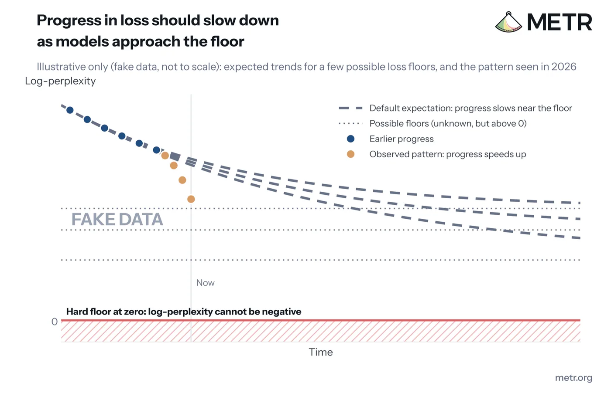

OpenAI has published the pretraining loss curve of its base models, and it bends sharply downward in 2026. In "Perplexity and Intelligence," posted on November 22, 2026, chief scientist Jakub Pachocki released the internal perplexity measurements OpenAI has tracked since GPT-3.5: the base-model log-perplexity of every frontier model through GPT-6.2 Astra plus one unreleased internal model, all measured on the same held-out dataset. Two days later METR fitted the numbers and found the loss falling about 7.1 times faster since February 2026 than in 2022 through 2025.

Pachocki's argument is that this one number tracks the "intelligence substrate" and, unlike benchmarks that saturate, stays informative across model generations, and he proposes that labs use it to compare models and to set shared limits on development. METR's researchers, by contrast, have no consensus on how much the curve should change capability forecasts, because benchmark scores of the same models have not accelerated the same way. Reading the curve correctly comes down to four things: what the y-axis measures, how the acceleration was calculated, why scores lag, and what the data leaves out.

## What OpenAI's pretraining loss curve measures {#what-it-measures}

The curve plots log-perplexity, the average cross-entropy loss a base model assigns to the next token of text it has never trained on; lower means better predictions. OpenAI measures every model on the same fixed snapshot of a held-out dataset sourced from its own internal codebase, the set it has used since GPT-3.5. The models are base models, before prompting, fine-tuning or reinforcement learning.

Pachocki's framing is that pretraining builds a compressor, or equivalently a predictor, of a huge corpus, and that most later techniques only draw out capabilities that compression has already created. He pins capability milestones to loss levels on this dataset:

| Log-perplexity (OpenAI's internal set) | Model or milestone OpenAI associates with it |
|---|---|
| ~0.99 | GPT-3.5: fluent conversation, the basis of the original ChatGPT |
| ~0.91 | GPT-4: chain-of-thought reasoning that works, which led to reasoning models |
| below 0.8 | "Transformative capabilities" in cybersecurity and mathematics |
| ~0.76 | The model that began producing "groundbreaking results" on open math problems |
| ~0.68–0.70 (projected) | Where OpenAI expects further transformative capabilities, which it says it cannot yet name |

These are OpenAI's own associations, drawn after the fact. Pachocki stresses that it was "not at all clear a priori" that the capabilities would appear at those thresholds. In OpenAI's chart the security and math labels sit on the 2026 models, the same period covered by our notes on [GPT-6 Cyber's exploit pipeline](/tutorials/gpt-6-cyber/) and on how the Claude-assisted [Riemann hypothesis Lean proof was checked](/tutorials/riemann-hypothesis-lean-proof/), part of the same wave of AI math results.

The post does not state the base of the logarithm. If it is the natural log, as is usual for cross-entropy, 0.99 corresponds to a per-token perplexity of about 2.7 and 0.76 to about 2.1. The absolute values belong to this one dataset and tokenizer, so they mean little next to a perplexity someone measures on other text.

## Pretraining loss curve since February 2026: the 7x acceleration {#seven-times-faster}

Since February 2026, OpenAI's pretraining loss has fallen about 0.156 per year, against about 0.022 per year from 2022 through 2025: 7.1 times steeper. The figure comes from METR, not OpenAI. METR fitted a continuous two-segment line to OpenAI's points by release date and let the fit choose the breakpoint, which landed in February 2026; the unreleased internal model was left out of the fit.

METR's own framing of the size: if the current pace holds, OpenAI would cover the drop from GPT-3.5 to GPT-4.1, which took three years, in about six and a half months. In the chart, GPT-5.3-Codex/5.4 sits at the breakpoint and GPT-5.5, GPT-5.6 Sol, GPT-6 Astra and GPT-6.2 Astra fall along the steep segment, with the internal model below them.

What makes the shape unusual is that pretraining loss should get harder to lower over time. Text is never perfectly predictable, so loss has a floor above zero: cross-entropy equals the entropy of the text itself plus the KL divergence between the text and the model's predictions (the quantity behind our [PyTorch KL divergence guide](/tutorials/pytorch-kl-divergence/)), and training can only shrink the KL part. Under standard scaling laws each tenfold increase in compute also buys a smaller drop than the last. The default expectation is a curve that flattens.

*Why a speed-up is surprising: near an unknown floor, progress in loss is expected to slow (dashed curves), but OpenAI's 2026 points fall faster (orange). Illustrative only, with fake data and no scale. Figure: METR.*

METR offers one way to translate the change into compute. If all OpenAI models sat on a single scaling law with an irreducible loss between 0.3 and 0.6, the implied "effective compute" would have grown roughly 8 to 10 times faster since early 2026 than in 2022–2025, measured in orders of magnitude per year. METR itself calls that assumption unrealistic, since newer training recipes likely follow different scaling laws.

On causes, OpenAI's post says the 2026 acceleration comes "mostly" from long-term research and compute investments and "only in a smaller part" from automation, while the most recent models already contain "meaningful design contributions coming from AI." Pachocki's larger worry is AI taking part in algorithmic research on pretraining itself; he writes that an "avalanche" of pretraining advances is conceivable as soon as 2027.

## Pretraining loss vs benchmarks: why scores have not jumped {#loss-vs-benchmarks}

Benchmark scores of OpenAI's models have not accelerated the way the loss curve has. METR points to Epoch's Capabilities Index (ECI), an aggregate of benchmark results, which shows no comparable break in 2026, and says its own staff are still debating how to reconcile the two.

Several mechanisms can open a gap between pretraining loss and measured capability, and both sources name some of them:

- **Reasoning does not show up in perplexity.** OpenAI lists this as a weakness of its own metric: chain-of-thought reasoning "does not reduce perplexity achieved by the model, even though it leads to a drastic increase in capabilities." Hacker News readers pointed to the same pattern in the chart, where GPT-4 and the GPT-4.1 / o3 point sit close together despite the jump that reasoning models brought.
- **Some architectures may move loss more than ability.** METR notes that changes spending more computation per token, such as looped transformers, could lower perplexity more than they improve downstream results, since a standard model can reach similar abilities by reasoning in a chain of thought after post-training.
- **The capability scales are fragile too.** METR adds that ECI, its own time-horizon measure and similar scales depend on delicate statistical assumptions or on a few benchmarks close to saturation, which is Pachocki's case for a metric that does not saturate.

That leaves three readings, which METR lays out without choosing. The released numbers might overstate pretraining progress, for example through overfitting. Benchmarks might be the better gauge of real-world ability, in which case the curve is one input and forecasts barely move. Or perplexity might be the deeper measure, in which case capability gains could follow within months. Our [GPT-6.2 benchmarks roundup](/tutorials/gpt-6-2-benchmarks/) shows where the newest model on the curve stands on today's tests, and task-based benchmarks, such as OpenAI's wet-lab [BioBasicsBench](/tutorials/biobasicsbench/), are the kind of downstream check that would register a real capability jump.

## Internal perplexity measurements: limits of a single codebase dataset {#data-limits}

OpenAI's internal perplexity measurements all come from one held-out corpus drawn from its own codebase, are plotted by release date, and run on a test set outsiders cannot use. Pachocki says he chose it because it holds "the numbers we rely on most today" to gauge pretraining progress.

**One code-heavy corpus.** The held-out set is drawn from OpenAI's internal codebase. METR notes that recent recipes or data mixes could help on code more than on other text, and that small parts of the codebase could have leaked into training data. OpenAI concedes the dataset choice is a weakness for older models: how well GPT-2 or GPT-3 predicts code is a poor proxy for their general ability.

**Release dates, not training dates.** The chart places each model at its public release, but log-perplexity is a property of the base model, which can be finished months earlier. If the gap between the end of pretraining and release shrank over time, the true acceleration is smaller than the chart suggests, and the reverse if it grew. The timing also decides how much of the gain can be credited to AI agents, since gains from runs that finished before researchers relied on agents cannot be.

**What gets plotted.** Commenters on Hacker News raised two further issues that the post does not address. A checkpoint with worse loss is unlikely to ship, so a curve of released models will tend to fall; and if more pretraining data is model-generated, its lower entropy could make held-out text easier to predict without a matching gain in ability. Others asked whether every release really had a new base model, since many upgrades are assumed to be post-training on a shared base. The post plots each release as a base-model measurement and does not discuss either point.

None of these rules out a real acceleration. They mean the chart alone cannot separate faster underlying progress from changes in data, timing or release decisions.

## Perplexity as a shared metric: Microsoft's MAI-2 and cross-lab limits {#shared-metric}

Pachocki wants perplexity to become a common yardstick across labs and the basis for agreed pacing limits: developers would commit not to cross a first limit, measured on perplexity and other metrics, until the ability to understand and monitor model behavior reaches a concrete milestone, such as a successor to chain-of-thought monitors. He also asks for shared evaluation norms, red-teamed safety cases before first use, and common transparency standards. The post names no numeric limit and no outside verifier.

Microsoft AI responded within hours. According to reports of an X post by Microsoft AI CEO Mustafa Suleyman, Microsoft measured its MAI-2 Base model on OpenAI's held-out set, with OpenAI's permission, at a log-perplexity of 0.819, which Suleyman described as in the same ballpark as the GPT-5.6 Sol base model. METR confirms that Microsoft has since published results for its own models on OpenAI's dataset. It is the first number from outside OpenAI on this scale; until now, Microsoft's models have been compared with OpenAI's only on downstream tests, as in our [MAI Code 2 Flash cost-per-task comparison with GPT-6 Luna](/tutorials/mai-code-2-flash/).

Microsoft's case also shows the practical limit. It could compare because it had access to OpenAI's private test set; other labs do not. Different developers train on different data mixtures and use different tokenizers, and loss per token depends on how text is split into tokens. Suleyman suggested the industry may need to switch to bits per byte, a tokenizer-independent unit, along with new shared test sets. OpenAI's own list of challenges starts with the same problem: "Different developers use different evaluation datasets."

For a limit to be enforceable, someone other than the lab being limited has to run the measurement. METR proposes that held-out corpora could eventually be maintained by a third party so that pretraining loss trends become comparable across developers.

## What would confirm the pretraining loss acceleration {#what-to-watch}

Three kinds of data would confirm or shrink the acceleration: loss on other held-out datasets, the date each pretraining run ended, and how training resources grew. METR expects labs already collect these numbers and asks them to share them; each addresses a specific doubt above:

| Missing data | Which doubt it settles |
|---|---|
| Log-perplexity on other held-out datasets dated before 2022, covering code, scientific writing and prose | Whether the trend is specific to code or to OpenAI's codebase, including possible leakage |
| The rough date each model's pretraining run ended | How large the acceleration is once release lag is removed, and how much of it AI agents could have contributed |
| Pretraining compute, labor spending and experiment compute over time | Whether the speed-up is a one-off from more resources or a compounding effect of AI assistance |

The next marker is already on OpenAI's scale. Pachocki expects new capabilities in the ~0.68–0.70 window; at METR's post-February slope of about 0.156 per year, getting from GPT-6.2 Astra's roughly 0.76 in METR's chart to 0.70 would take under five months. Until outside datasets and training dates are published, treat the curve as strong evidence that OpenAI's base models improved quickly on its own held-out corpus in 2026, and as an open question how much of that will show up in what the models can do.

## References {#references}

1. Jakub Pachocki, ["Perplexity and Intelligence"](https://openai.com/index/perplexity-and-intelligence/), OpenAI, November 22, 2026.
2. Ajeya Cotra, Jean-Stanislas Denain and Tom Cunningham, ["Interpreting a recent acceleration in pretraining loss"](https://metr.org/blog/2026-11-24-interpreting-a-recent-acceleration-in-pretraining-loss/), METR, November 24, 2026.
3. Hacker News discussion of ["Perplexity and Intelligence"](https://news.ycombinator.com/item?id=50601525), November 22–24, 2026.
4. KnowFlowHub, ["Why 0.819 Is Hard to Compare: Microsoft Discloses Pretraining Perplexity and the Measurement Problem"](https://www.knowflowhub.com/en/content/article/2026-11-23/pretraining-perplexity-transparency-disclosure), November 23, 2026, reporting Mustafa Suleyman's X post on MAI-2 Base.
