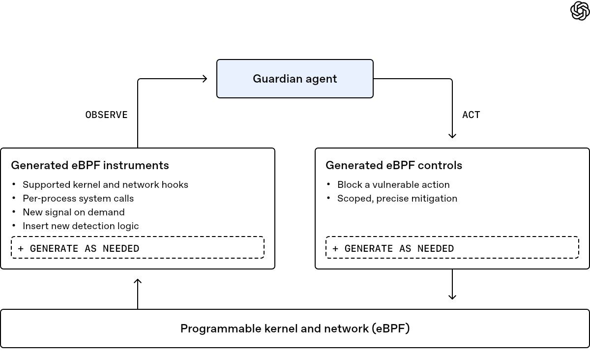

OpenAI Shirudo is an open-source Linux runtime, released by OpenAI and Cisco on November 23, 2026, that lets an AI agent write a narrow "shield" against a known vulnerability and load it into a running system without a reboot. In a controlled test, a shield written by OpenAI's Codex stopped a Java4Shell exploit against a live Elasticsearch node while the service kept answering requests.

The interesting part is the path in between. Before any agent-written code touches a production kernel, Shirudo makes it pass through a human-held signing key, a keyring the kernel sealed at boot, a BPF LSM admission check and a TPM register that records every change. This guide follows that path step by step, using OpenAI's announcement, the architecture post from Cisco's Isovalent team, the project's own documentation and an independent hands-on run, then compares Shirudo with Tetragon, Falco and kernel live patching and lists what you need before you can try it.

## How OpenAI Shirudo works: the guardian agent loop {#how-openai-shirudo-works}

OpenAI Shirudo works as an observe-and-act loop: a "guardian agent" generates eBPF programs that watch kernel and network activity, then generates eBPF or application-level controls that block the one action a vulnerability needs. Each control is a small program, and an operator decides which ones get signed and deployed.



*The guardian agent observes through generated eBPF instruments and acts through generated eBPF controls, both produced on demand. Diagram from OpenAI's Shirudo announcement, November 23, 2026.*

eBPF fits this job because it runs small, verified programs at fixed points inside a live kernel. OpenAI's announcement frames the problem Shirudo targets: an exploit and a legitimate request often use the same Linux operation, so switching that operation off can take the service down with the attacker. A shield is meant to be narrower than that. Teams can watch how a proposed shield would affect the application before enforcing it, and the service keeps running when it goes live.

Isovalent's post walks through the loop with Codex acting as the control plane. It has four stages:

1. **Find the vulnerability.** The agent either hunts for new flaws itself or works from published disclosures, tracing each one to the affected hosts and attack paths.
2. **Write and validate the mitigation.** It builds a reproducer, confirms the exploit works, picks the best place to intervene (a kernel hook, or the Java runtime), writes the shield and re-tests until the exploit fails and normal traffic still passes.
3. **Roll it out.** The shield is signed and pushed to affected nodes while application health is watched. How much of this runs without a human is a setting, the same as in any agent workflow.
4. **Watch for hits.** Once deployed, each shield's hit count shows live exploitation attempts against the hole it covers.

The design choice behind all of this is the one Thomas Graf and Liz Rice spell out in the Isovalent post: Tetragon asked operators to express protections in a policy language written for humans, while Shirudo lets agents speak "their natural language: code." That widens what a mitigation can be. Isovalent lists three kinds: block the path a vulnerability needs, replace the vulnerable code with fixed code, or add the visibility needed to spot an attack. It is the defensive counterpart to the speed shown by offensive models such as [GPT-6 Cyber, which turned kernel leads into working root exploits](/tutorials/gpt-6-cyber/) in a ten-day run.

<p><strong>Trying the agent side yourself.</strong> The control plane in Isovalent's demo is Codex, and the shields it writes are ordinary BPF C and Java that any capable coding model can draft for review. If you want to compare Codex with Claude or Gemini models on that task behind one API key, a shared gateway such as
<a href="https://www.packyapi.ai/register?aff=5W73&amp;utm_source=agentspulse&amp;utm_medium=affiliate&amp;utm_campaign=openai-shirudo"
rel="sponsored nofollow noopener" target="_blank">PackyAPI</a> is one option.</p>
<p><small>Disclosure: this page contains an affiliate link. If you sign up through it, we may earn a commission at no extra cost to you.</small></p>

## Shirudo architecture: operator machine, registry and target {#shirudo-architecture}

Shirudo's architecture splits the work between an operator machine, which holds the only private signing key, and the target machines it protects, which hold just a public certificate. Shields travel between them as signed packages in an ordinary OCI registry, and Shirudo itself runs as one-shot commands on both sides, with no daemon and no listening port.


*Shirudo's trust split: the operator signs, the registry only carries, and the target's kernel verifies, admits and measures. Diagram from Isovalent's Shirudo post, shown here on a white background for legibility, November 23, 2026.*

Following one shield from source to a running kernel:

1. **Build and sign on the operator host.** A shield, which the project calls a upatch, is a small BPF C program. `shirudo build` compiles it with clang, wraps it in a libbpf loader and signs that loader. Shirudo signs only with ML-DSA-87, a post-quantum algorithm, and refuses any other key type.
2. **Package and publish.** One or more upatches plus a Beefile manifest become a `.bee` package, pushed to an OCI registry with a signed index. Shirudo keeps no fleet state and ships no transport of its own.
3. **Pull on the target.** systemd timers run `bpm repo update`, `bpm upgrade` and `bpm tree sync`. If the registry is unreachable, nothing changes: loaded upatches keep running and the next timer run retries.
4. **Admit in the kernel.** The kernel checks the loader's signature against a `.bpf` keyring that `shirudo init` filled and sealed from the initrd during boot. A BPF LSM hook on program loads rejects anything else, so unsigned BPF from userspace is denied.
5. **Measure and prove.** Every load and unload extends a per-boot TPM register. `shirudo attest` returns evidence signed by the TPM, which the operator can verify offline against what it expects the target to be running.

The split is what makes agent authorship tolerable. ComputingForGeeks, which ran the whole flow in a test VM, puts it this way: the signing key never leaves the operator, so a stolen root shell on the target is not enough to add or remove a shield, and an AI agent can write shields while a human still decides which ones get signed. The same boundary questions come up whenever [AI agents get internal access](/tutorials/ai-agent-internal-access-security-boundary/); Shirudo answers them by keeping the agent on the operator side of the key.

Java shields take a different route. Shirudo verifies Java upatches in userspace rather than in the kernel, and the README says configured JVMs load these agents at startup. In Isovalent's demo, by contrast, the shield was attached to an Elasticsearch process that was already running, which the next section covers.

## Shirudo Java4Shell test: what the Codex shield did {#shirudo-java4shell-test}

In the Shirudo Java4Shell test, Codex received the vulnerability details for Java4Shell, a recent OpenJDK flaw, and produced a shield written as Java bytecode rather than eBPF. The shield added validation to the input of Java's Base64 decoder, which closes the overwrite the exploit relies on, and it blocked the attack against a running Elasticsearch 9.5.5 node without a restart.

Isovalent published the Elasticsearch log lines from the run on November 18, 2026. The first shows the guard attaching to the live process through the JVM's attach listener:

```text
"message": "Base64 guard installed on java.util.Base64$Decoder.decode0 (classfile)"
"process.thread.name": "Attach Listener"
```

Twenty-two milliseconds later, a search thread logged the shield rejecting the malicious input:

```text
"message": "Base64 guard rejected candidate: length=65, padding=1, remainder=1, alphabet=standard"
"process.thread.name": "elasticsearch[base64-lab-node][search][T#11]"
```

The exploit failed and Elasticsearch kept serving. Because the check sits in OpenJDK's decoder rather than in Elasticsearch's code, Isovalent says the same shield protects any Java application on a vulnerable OpenJDK until the runtime itself is patched. Cisco's press release adds a second case, a recent PHP flaw, where Shirudo also wrote code that detected and blocked exploit attempts; neither company has published that shield or its logs.

Two caveats travel with these results. Both tests are the vendors' own, run in a lab cluster named `base64-compose-lab`, and as of November 25 we found no independent reproduction of either. And the Java case shows that "eBPF shields" is shorthand: when a vulnerability lives in application code that kernel hooks cannot see cleanly, the shield becomes a bytecode patch, with a different verification path from the kernel-side ones.


*A demo control plane built on Shirudo: shields per vulnerability with their hook type (uprobe or kprobe), rollout progress and exploit "hits", alongside an agent log. These are demo figures from Isovalent's post, not a public deployment. Screenshot from Isovalent, November 23, 2026.*

The dashboard shows what the loop looks like at fleet scale: shields mostly attach as uprobes on userspace binaries such as nginx, sudo or libc, a few as kprobes on the kernel, and rollouts move node by node while app health is tracked next to the security score.

## Shirudo vs Tetragon, Falco and kernel live patching {#shirudo-vs-tetragon-falco-live-patching}

Shirudo vs Tetragon comes down to who writes the protection and how far the platform trusts it. Tetragon and Falco take rules or policies written by people and enforce or alert on them; Shirudo takes signed code, usually written by an agent, and its core only guarantees that nothing unsigned runs and that every change is recorded. Kernel live patching fixes the bug itself, which Shirudo does not try to replace.

| | Shirudo | Tetragon | Falco | Kernel live patching |
|---|---|---|---|---|
| What you ship | Signed BPF C or Java bytecode "upatches" | TracingPolicy rules | Detection rules | A patched function from the vendor's fix |
| Designed for | Agents writing code | Humans writing policy | Humans writing rules | Kernel maintainers and distro vendors |
| Can block | Yes, at any hook a upatch attaches to | Yes, per policy | Detects and alerts; blocking needs extra tooling | Removes the bug |
| Covers userspace code | Yes, via uprobes and Java agents | Partly, via uprobes | Detection only | No, kernel only |
| Stops root from removing it | Yes, unless root holds the signing key or a kernel exploit | Not a design goal | Not a design goal | Not applicable |
| Runs on a stock distro kernel | No, needs patched bpf-next and TPM 2.0 | Yes | Yes | Yes, with vendor support |

Three points from the documentation shape that table. First, Shirudo replaces Tetragon's policy layer with code, and it locks the target down further than the others: the project FAQ says Cilium, Falco and bpftrace cannot run on a protected target as they are, because they load their own programs and fail at the first map or program. Their logic has to be repackaged as signed upatches.

Second, the self-protection is real but bounded. On an ordinary host, root can detach BPF programs, a security tool's included. Shirudo's boot-time guards stop that for anyone without the signing key, but its docs state that root with a way into the kernel itself, such as a kernel exploit or a module signed with a trusted key, goes around every check made in that kernel.

Third, Shirudo bridges the time to a fix. Its FAQ answers "Does shirudo replace kernel updates?" with a plain no: a upatch covers the time until the machine runs a kernel with the fix. The docs position it as a complement to traditional kernel live patching, with a faster rollout and the ability to cover userspace as well, which in security terms makes shields a form of compensating control.

## Shirudo Linux requirements and limits before you try it {#shirudo-linux-requirements-limits}

Shirudo on Linux needs more than a package install: every protected target must run a kernel with the bpf-next signed-loader ABI plus Shirudo's carried patches, and must have a TPM 2.0. The project is pre-release, with no stable release or supported branch, so the realistic first step is the VM quickstart, not a production server.

| Requirement or limit | What the project says |
|---|---|
| Kernel | bpf-next signed-loader ABI and the `tpm_command` patch from the Shirudo kernel build, plus a second patch on x86-64 |
| TPM | TPM 2.0 on every target; there is no mode without one (the test VM uses a software TPM) |
| Signing | ML-DSA-87 keys only, created with `shirudo genkey`; existing keys are refused |
| Architectures | x86-64 tested in CI; the test VM also boots on arm64; no riscv64 target has booted yet |
| macOS | Not supported directly; on an Apple M3 or later with macOS 15 or later, run the quickstart inside a Lima VM |
| Other eBPF tools | Cilium, Falco and bpftrace fail on a protected target unless repackaged as signed upatches |
| Network exposure | None on the target: one-shot commands, pull from OCI, push telemetry to an OpenTelemetry collector you configure |
| License | BSD-2-Clause; BPF programs dual-licensed BSD/GPL |

ComputingForGeeks' hands-on run confirms the practical meaning: it built Shirudo on an Ubuntu 26.04 LTS operator VM against commit `154afeea` and booted the project's CI test kernel as the target, because a stock Ubuntu or RHEL server does not qualify. If you want to try it, OpenAI points to three entry points: the VM quickstart in the docs, which signs, loads and verifies a test upatch; Isovalent's self-guided lab; and a technical deep dive on December 15.

The limits that matter for planning are the ones the project states itself. Shirudo trusts the kernel it runs on, so hardening the kernel and shrinking its attack surface still comes first. A shield is meant to cover the gap until the real patch lands, then come out. And the platform "does not understand what a upatch does," in the documentation's words: it guarantees provenance and a record, while whether a given shield is correct and harmless to legitimate traffic still rests on the testing step and the person who signs it.

Early reactions on Hacker News, where the launch drew 58 points and 16 comments in its first hours, split along the same line. Some readers expect security vendors to sell subscriptions of ready-made upatches, which matches OpenAI's stated goal of publishing tested shields alongside vulnerability disclosures. Others worry that a quick shield becomes an excuse to skip real hardening, and one commenter reported hitting OpenAI model guardrails while trying to generate purely defensive patches for a similar system. Both concerns are worth weighing before you plan around agent-written mitigations. Public evidence on agents doing security work is still thin; in the [Claude Code bug bounty skills benchmark](/tutorials/claude-code-bug-bounty/) we covered, extra tooling did not change the outcome on three test challenges, which is a reminder to measure each shield rather than trust the pipeline.

For most teams, the useful move today is to read the threat model, run the quickstart in a VM and write one upatch by hand for a vulnerability you already understand. That shows whether the signing and attestation workflow fits your patch process before any agent is in the loop. For a view of how attackers are using the same agent patterns, see our breakdown of [how ARTEX runs AI-driven intrusions](/tutorials/artex-ai/), and the rest of our [AI security coverage](/tutorials/category/ai-security/).

## References {#references}

1. OpenAI, [OpenAI and Cisco introduce Shirudo](https://openai.com/index/introducing-shirudo/), November 23, 2026.
2. Thomas Graf and Liz Rice, Isovalent at Cisco, [Cisco and OpenAI introduce Shirudo](https://isovalent.com/blog/post/cisco-openai-shirudo/), November 23, 2026.
3. Shirudo authors, [shirudo-dev/shirudo README](https://github.com/shirudo-dev/shirudo), BSD-2-Clause, accessed November 25, 2026.
4. Shirudo documentation, [FAQ](https://docs.shirudo.dev/start/faq.html) and [Threat model](https://docs.shirudo.dev/security/threat-model.html), accessed November 25, 2026.
5. Cisco, [Cisco and OpenAI Launch Shirudo, A New Project to Safeguard Agentic AI](https://newsroom.cisco.com/c/r/newsroom/en/us/a/y2026/m11/cisco-and-openai-launch-shirudo-a-new-project-to-safeguard-agentic-ai.html), November 23, 2026.
