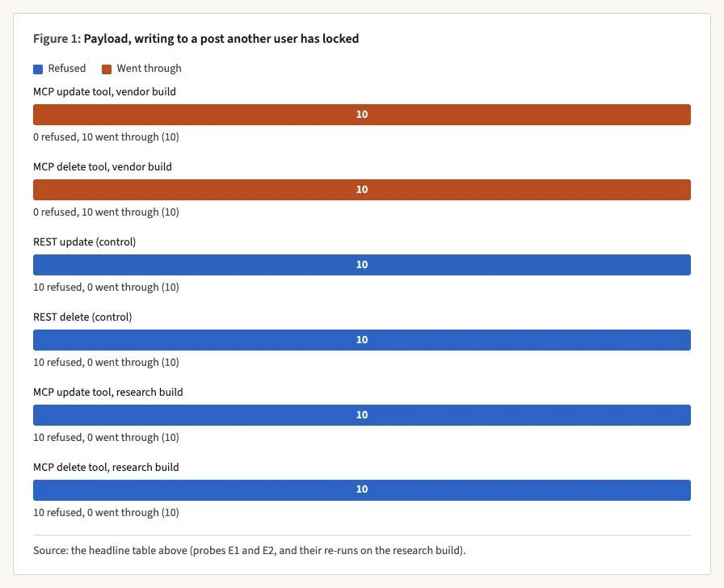

The Payload MCP plugin lets an AI agent edit a post that a human editor currently has open, even though Payload's own REST API refuses that edit. In a public audit of `@payloadcms/plugin-mcp` 3.93.0, IsoKron found that the plugin's update tool wrote through another user's document lock and deleted the lock in 10 of 10 trials, and its delete tool removed a locked post in 10 of 10. The same requests sent over REST came back with HTTP 423 every time. In the audit's agent session, the result was an editor's saved row silently replaced while the agent told the user the job was done.

Payload is an open-source headless CMS, and its official MCP plugin turns a Payload app into an MCP server at `/api/mcp`, so Claude Code, Cursor or VS Code can find, create, update and delete content. This guide is for teams that run or plan to run that plugin with agents. It explains why the lock is skipped, which related problems belong to the plugin and which to Payload itself, and the settings to change on 3.93.0 while the upstream fix is still under discussion.

## Payload MCP plugin lock bypass: what the 3.93.0 audit found {#payload-mcp-plugin-lock-bypass}

The Payload MCP plugin's `update` and `delete` tools do not respect document locks. When one user has a document open in the admin panel, Payload writes a lock row for them, and REST updates or deletes from anyone else fail with HTTP 423. Through the MCP tools, the same writes succeed, the lock row disappears and the answer reads like an ordinary success.

IsoKron, a firm that sells MCP server audits and is not affiliated with Payload, ran the audit on November 13, 2026 and published it the next day. The setup was a local Payload 3.93.0 app on Postgres with two users: `editor-a` owned the MCP API key, and `editor-b` held the locks. Each probe was a scripted call with no model involved, paired with the same operation sent over REST:

| Operation on a post `editor-b` has locked | Through the MCP plugin | Through REST |
|---|---|---|
| Update | Written 10 of 10, lock row deleted 10 of 10, success text, no `isError` | Refused with 423, 10 of 10, lock kept |
| Update with `overrideLock: false` | Refused 3 of 3, but as plain text without `isError` | — |
| Delete | Deleted 10 of 10 (the tool has no `overrideLock` argument) | Refused with 423, 10 of 10 |

The delete case is the harder one to undo. On a collection with versions enabled, the audit's delete also removed the post's version history, going from 2 versions to 0.

IsoKron's agent session shows what this does in practice. `editor-b` has a post open. The agent reads the post, she saves a new row in its list, and the agent then writes back the list it read plus its own row through `updatePosts`. The write goes through her lock, her row is gone, and the agent reports success. Her admin-panel session was simulated by the audit harness rather than driven in a browser, so what her open form would do next was not tested. On the unmodified plugin, that task failed in 5 of 5 benchmark runs.

## Payload MCP overrideLock default: why the tools ignore locks {#payload-mcp-overridelock-default}

The tools ignore locks because they call Payload's Local API, and the Local API's `overrideLock` option defaults to `true`. Payload's document-locking page says so directly: with the default, "document locks are ignored, and the operation will proceed even if the document is locked," and callers must pass `overrideLock: false` to enforce them. That default suits trusted server code. REST passes `false`, which is why an outside client gets 423.

The plugin's v3.93.0 source shows both halves. In `packages/plugin-mcp/src/mcp/tools/resource/update.ts`, the tool's signature declares `overrideLock: boolean = true` and passes it to `payload.update`. In `delete.ts`, `payload.delete` is called without the option at all, so the Local API default applies. Both calls do set `overrideAccess: false`, which means collection access rules still apply to the API key's user.

IsoKron's refuter step, a separate agent asked to break each finding, narrowed this one to "an unsafe default with an opt-out," since the update tool does accept `overrideLock: false`. In practice an agent acting for a signed-in user writes like trusted server code instead of like another user editing through REST. That is a small instance of a broader pattern we covered in [what changes when AI agents get internal access](/tutorials/ai-agent-internal-access-security-boundary/): the agent inherits more trust than the person it acts for.

## Payload MCP plugin vs REST API: which write problems are the plugin's {#payload-mcp-plugin-vs-rest-api}

Compared with Payload's REST API, the MCP plugin adds four write problems of its own: the lock bypass, deletes of locked documents, a match-all `where`, and bulk results that hide failures. Two other ways to lose an edit happen on REST too, so they belong to Payload's core and switching interfaces will not avoid them. IsoKron ran every probe against both surfaces to draw this line:

| Behavior | MCP plugin 3.93.0 | REST API | Whose problem |
|---|---|---|---|
| Update a post another user has locked | Written, lock deleted (10 of 10) | 423 (10 of 10) | Plugin default |
| Delete a locked post | Deleted (10 of 10) | 423 (10 of 10) | Plugin |
| Update or delete with `where: {}` | 17 of 20 changed; all 20 deleted | REST cannot send an empty `where`; a missing one gets 400 | Plugin guard |
| Bulk update with one document refused | Success headline, no `isError` (5 of 5) | 400 with errors | Plugin reporting |
| Write fields named `locale`, `draft` or `select` | Not stored, success text (5 of 5) | Stored | Plugin, 3.x only |
| Write from a stale read | Another editor's row lost, no signal | Same loss | Payload core: no version check |
| Two simultaneous partial updates to different fields | One field lost in 10 of 10 pairs | Same with two REST calls | Payload core |

The last two rows matter for agent design. Payload has no version check a client can send with an update, so any read-modify-write loop, agent or human script, can overwrite a change made between the read and the write. A plugin can add a best-effort check on top, but an atomic compare-and-set would need support in Payload itself.

Several things held up in the same audit. Collection access rules applied to the key's user, a key scoped to three tools listed exactly those three, bad or missing keys got 401, and a server killed mid-write rolled back with 0 of 3 writes landing. Read results matched REST totals. The plugin's access control is sound; the write defaults are the weak point.

## Payload MCP empty where filter: match-all updates and deletes {#payload-mcp-empty-where-filter}

An empty `where` filter makes the Payload MCP plugin's update and delete tools act on every document in the collection. The v3.93.0 tools only reject a call that has neither an `id` nor a `where` string, and they parse the filter into an object that defaults to `{}`. In Payload's Local API, `{}` is a valid "match everything" filter. In IsoKron's probes, an update with `where: {}` (an empty array did the same) changed 17 of 20 documents (the audit's own hook refused the other 3), and a delete with `where: {}` removed all 20, in 5 of 5 runs each. The test collection used Payload's defaults, with no trash and no versions, so the audit found no way to restore it. On IsoKron's own severity rubric this is the only Critical finding.

### Payload MCP bulk update errors reported as success

When a bulk call partly fails, the plugin still leads with success. With a hook refusing one of five documents, the bulk update answered "Multiple documents updated" with `isError` unset in 5 of 5 runs, while four documents were committed. The bulk delete returned success text containing "Errors: 1", again without `isError`. REST answered both with HTTP 400 and an errors list. The committed documents are identical either way; only the report differs, and an agent acts on the report.

On 3.x this extends to single calls too. A server-side refusal comes back as ordinary text with `isError` unset (9 of 9 calls with a missing id), and a validation error names the field but drops the reason REST gives.

## Payload CMS MCP security checklist for 3.93.0 {#payload-cms-mcp-security-checklist}

To run the Payload CMS MCP plugin safely on 3.93.0, force `overrideLock: false` on updates, keep delete off agent keys, block empty `where` filters, read every answer as text, and steer clear of fields named `locale`, `draft` or `select`. The details, from IsoKron's recommendations and Payload's plugin documentation:

1. **Send `overrideLock: false` on every update.** The update tool accepts it, and with it the audit's locked writes were refused 3 of 3. If you control a proxy or gateway in front of `/api/mcp`, set it there: a rule that forced `overrideLock: false` on updates stopped the write in the audit (0 of 10 written, lock kept). Check the answer text, because the refusal arrives without `isError`.
2. **Turn off `delete` for agent keys on collections where locks matter.** The delete tool has no lock argument, so a proxy cannot fix it. In the admin panel under **MCP → API Keys**, each key toggles find, create, update and delete per collection, and a key without the delete capability does not list the delete tool at all. You can also disable it in config with `collections: { posts: { enabled: { find: true, create: true, update: true, delete: false } } }`.
3. **Never let an agent send `where: {}` or `[]`.** Block it in your client, prompt or gateway, or keep bulk update and delete off keys that do not need them.
4. **Read every answer as text, not just `isError`.** On 3.x, refusals, partial bulk failures and validation errors can all arrive as plain text. Have the agent re-read the document after a write when the result matters.
5. **Avoid fields named `locale`, `draft` or `select` on 3.x,** or expect them not to be written through MCP. Localized array edits also lose other locales' row values, a known issue (#19435) with a proposed fix in PR #19436.

Retries need the same care. Neither MCP nor REST has an idempotency key, and in the audit a blind retry of a create after a client timeout made a second copy in 5 of 5 trials. The agents in the audit re-read state before retrying after 429, 401 and 503 errors and never duplicated, which is the behavior to require from yours. Teams that already route agent traffic through a [stateless MCP gateway](/tutorials/stateless-mcp-agent-gateway/) have a natural place to enforce items 1 and 3 centrally.

Upgrading alone does not cover this. Payload published four high-severity MCP advisories between September 22 and October 8, 2026, on API-key access control, hidden-field leaks, custom authentication and password recovery, with fixes in 3.88.0 and 3.90.0. Version 3.93.0 already includes those fixes, and the lock behavior is present in it and in the v4 beta.

## How to reproduce the Payload MCP lock bypass {#reproduce-payload-mcp-lock-bypass}

You can reproduce the lock bypass with IsoKron's public repository `isokron-ai/payload-mcp-repro`: Payload's blank template with one `posts` collection, two admin users and the MCP plugin, on SQLite. Install and start it with `pnpm i && pnpm seed && pnpm dev`, then run:

```bash
node scripts/repro-locks.mjs        # PAY-01 and PAY-02, update and delete through a lock
node scripts/repro-bulk-delete.mjs  # PAY-05, bulk delete partial failure
node scripts/repro-bulk-update.mjs  # PAY-05, bulk update partial failure
```

Each script runs the REST control alongside the MCP call. The `v4-beta/` folder holds the same app on Payload 4.0.0-beta.9. To check your own deployment by hand, the issue's steps are short: as user B, open a post in the admin panel; as user A, call `updatePosts` with `{"id": 1, "title": "changed"}` through MCP; then send `PATCH /api/posts/1` with the same body. MCP reports "Document updated successfully" and B's lock row is gone, while REST answers 423 "currently locked by another user."

## Payload MCP plugin fix status: v4 beta and upstream threads {#payload-mcp-plugin-fix-status}

As of November 16, 2026, the lock bypass is not fixed in any Payload release. IsoKron re-ran the first ten findings live on Payload's v4 main branch (4.0.0-beta): updates through a lock, deletes of locked documents and the empty `where` behaved the same. The v4 rewrite fixes the colliding field names, adds tool annotations and flags failed bulk updates with `isError`; failed bulk deletes are still reported without it.

The upstream threads, all filed on November 13:

| Thread | What it asks or changes | Status on November 16 |
|---|---|---|
| [Issue #19591](https://github.com/payloadcms/payload/issues/19591) | Update and delete write through locks; partial bulk failures report success; asks whether 3.x fixes are wanted | Open, labeled Bug and `plugin: mcp`, no comments |
| [PR #19592](https://github.com/payloadcms/payload/pull/19592) | Sets `isError` when `deleteDocuments` fails or partly fails | Open, awaiting review |
| [Discussion #19597](https://github.com/payloadcms/payload/discussions/19597) | Should MCP update and delete respect locks by default, like REST? | Open, no comments |

The fix proposed in the issue is narrow: default `overrideLock` to `false` in the remote MCP update and delete schemas and let delete pass it on, while the Local API and CLI keep `true`. Because it changes behavior for existing MCP clients, IsoKron put it to a Discussion before opening the pull request. A separate Discussion on guarding `where: {}` had not been filed yet.

IsoKron also built and benchmarked a research version of the plugin with these changes: locks respected by default with a conflict error naming the holder, a best-effort `ifUpdatedAt` version check, `where: {}` refused unless `all: true` is passed, and `isError` on every error. Re-run on that build, the lock probes wrote 0 of 10 and deleted 0 of 10, each answer an `isError` conflict naming `editor-b`.



*Figure 1 from IsoKron's audit: ten writes to a locked post per arm. The shipped ("vendor") plugin let every update and delete through; REST and the research build refused all of them. Screenshot of the figure on isokron.ai, November 14, 2026.*

On five tasks fixed before any change was designed, agents completed 11 of 29 runs on the shipped plugin and 28 of 29 on the research build. The research build's tool catalog is about 25% larger, so a typical run used more tokens, yet the tokens spent per verified success fell from 89,513 to 41,393 because far more runs succeeded, the same reason [cost per successful task](/tutorials/coding-agents-finops-cost-per-successful-task/) beats cost per run as a budget metric. These are small samples, five or six runs per task in one sandbox with both builds measured as wholes, and the research build is an experiment rather than an upstream release. IsoKron itself tells readers to use Payload's own plugin for real work.

For now, treat the Payload MCP plugin as a trusted-server client with an opt-out, not as another editor. Give agent keys the narrowest capabilities that do the job, force `overrideLock: false` on updates, keep deletes and empty filters away from agents, and check results against the database rather than the tool's headline. If you are deciding where those guardrails should live across many tools, the [agent harness](/tutorials/agent-framework-harness-runtime-production/) and [model gateway](/tutorials/model-gateway-enterprise-ai-control-plane/) layers are the usual places.

## References {#references}

- Joshua Bryan (IsoKron), ["Payload MCP plugin 3.93.0: updates and deletes write through another editor's document lock"](https://isokron.ai/research/payload-mcp-server-audit), November 14, 2026
- Payload, [`plugin-mcp` source at v3.93.0](https://github.com/payloadcms/payload/tree/v3.93.0/packages/plugin-mcp/src/mcp/tools/resource) (`update.ts`, `delete.ts`)
- Payload, [Document Locking documentation](https://payloadcms.com/docs/admin/locked-documents) and [MCP Plugin documentation](https://payloadcms.com/docs/plugins/mcp)
- rafe-walker, [Issue #19591: update and delete tools write through document locks](https://github.com/payloadcms/payload/issues/19591), payloadcms/payload, November 13, 2026
- IsoKron, [isokron-ai/payload-mcp-repro](https://github.com/isokron-ai/payload-mcp-repro), reproduction for 3.93.0 and 4.0.0-beta.9
