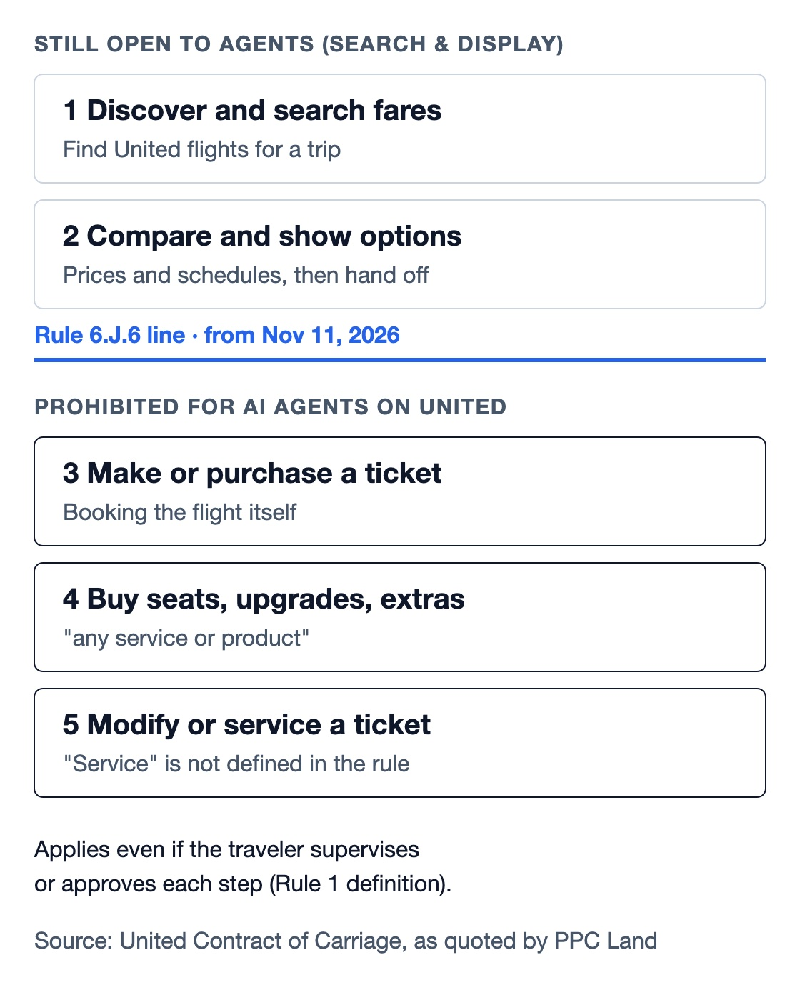

Personal AI agents moved from demos to consumer products this autumn. On November 11, 2026, United Airlines wrote a rule against them into its contract, the first U.S. airline to spell this out in writing, according to Skift. Agents may look, but they may not buy. This guide covers what the rule says, what is still allowed, and how to use an agent for travel without putting a booking at risk.

## What Are Personal AI Agents

Personal AI agents are software that acts on your behalf across apps and websites instead of only answering questions. That is the working definition used by venture firm SKY VC, which tested several of them on a flight search in October. The difference from a chatbot is the last step: an agent fills forms, holds carts and pays.

Three launches made the category mainstream in a few weeks:

- **Meta's Muse** launched in September 2026 and can handle email, forms, purchases and travel booking. Our [Muse Ember review](/tutorials/muse-ember/) covers the smallest model in the same Muse family.
- **OpenAI's dots** arrived about three weeks later: always-on background agents running on cloud computers, with access to more than 4,000 apps, according to World.
- **Instinct** works over text messages and is invite-only. SKY VC reports it raised $1 billion at a $10 billion valuation.

Specialist travel agents such as Miso, Odessia, Soar and Mindtrip sit next to these generalists. Many generalist agents operate websites the way a person would, which is the technique explained in our piece on [how browser agents act on the DOM](/tutorials/jev-ultrafast-browser-agent/). That is exactly the behaviour airlines and retailers are now starting to restrict.

## United Rule 6.J.6: What Personal AI Agents Can No Longer Do

United's Contract of Carriage, revised November 11, 2026, adds a sixth item to Rule 6.J, "Prohibited Practices", next to hidden-city and throwaway ticketing. Rule 6.J.6 bans "the use of AI Agents to make, modify or service a Ticket, and/or to purchase any service or product." Seats, upgrades and other extras count as products.

*Where Rule 6.J.6 draws the line. Diagram: AgentsPulse, based on the contract text quoted by PPC Land.*

The definition in Rule 1 is broad. An AI agent is "any software or service, including but not limited to an AI assistant, AI agent or AI-enabled browser that takes autonomous or semi-autonomous action, whether or not Passenger or another individual supervises or approves its actions." PPC Land notes that it names three groups: assistants built into social, messaging, search and consumer platforms; AI browsers and standalone agents; and third-party assistants used through a travel agency.

Two other changes give the rule teeth:

- **Rule 5.H** adds "reservations made, modified or serviced by AI Agents" to the list of bookings United may cancel without notice, and Rule 5.F says United is not liable when it does.
- **Rule 6.K**, the general remedies section, lets United invalidate tickets, charge the full fare, remove miles or end a MileagePlus membership for prohibited practices. Whether United would use those remedies against agent bookings is PPC Land's reading of general wording; United has not said so.

This is a contract term for United tickets, not a law or a federal rule, and it does not bind other airlines. Coverage of United's statement says bookings made by agents before November 11 will not be canceled.

## Can AI Agents Book Flights on United: Search Yes, Purchase No

AI agents can still search United flights and show you fares, but they cannot complete the booking. The definition mentions discovering and searching, yet the prohibition in 6.J.6 lists only making, modifying, servicing and purchasing. View from the Wing, InsideFlyer and The Wall Street Journal all read that gap the same way: search and display remain allowed.

Three questions are still open:

1. **What "service a Ticket" covers.** The rule does not define it. Seat changes, check-in and refund requests are all plausible readings.
2. **How United will detect agents.** The contract does not say. Bot-defence firm Arkose Labs reported on October 20 that 97.7% of legitimate agent sessions it saw carried no verified identity, so many agents look like ordinary browsers.
3. **Whether any agent is approved.** There is no carve-out or list of permitted tools.

Detection also has a blind spot that coverage of the WSJ report points out: when a booking arrives through an online travel agency, United may see only the agency, not the assistant behind it. The rule still applies, because it names agents used through travel agencies.

## Why United Banned AI Agents: Security, Rules and Distribution Cost

United gives security and regulation as its reasons. "Sharing account credentials with personal, third-party, AI assistants can expose sensitive information, and actions taken by these tools may result in unintended purchases, account changes, or use of MileagePlus miles," the airline told CBS News. It also said an agent doing check-in could breach federal rules, because passengers must personally confirm the hazardous-materials notice.

The credential point is real for any agent that logs in as you. Our article on [what happens when AI agents get internal access](/tutorials/ai-agent-internal-access-security-boundary/) explains why a stored login turns an agent into a broad security boundary.

Commercial motives are part of the story too. CEO Scott Kirby said on November 10 in Chicago, according to the WSJ, "To be honest, I don't want to create another middleman." United spent $2.1 billion on distribution in 2025, the same reporting says. Analyst Henry Harteveldt of Atmosphere Research told CBS that "flight searches cost airlines money" and that United does not want another intermediary beyond Google, metasearch sites and online travel agencies. United fares remain on Kayak, Hopper and Google Flights.

United also said it will "restrict access — directly within our digital platforms and indirectly via travel agencies and aggregators — to prohibit use by unauthorized, third-party personal AI agents or assistants." The word "unauthorized" leaves room for agents United approves later.

## Personal AI Agents Compared on a Flight Search

SKY VC put four personal AI agents through the same New York to San Francisco request on October 19 and stopped each one before payment. The specialists were fastest: Miso and Odessia showed first results in under 90 seconds, against about 4 minutes for Instinct and 7.5 minutes for Muse. The authors call it "a snapshot rather than a benchmark."

| Agent | Type | Ready to pay or confirm | How it finished |
|---|---|---|---|
| Miso | Travel specialist | 5 min 53 s | Confirmed in the app; one pick plus three alternatives |
| Odessia | Travel specialist | About 6 min 25 s | Handed off to an external site |
| Instinct | Generalist, over text | 8 min 42 s | Six options sent as screenshots |
| Muse | Generalist (Meta) | About 13.5 min | Four options |

*Source: SKY VC, "Who Owns the Booking Moment?", Nov 5, 2026. One trip, one run each.*

SKY VC reports that both Muse and Instinct book through Duffel's flight inventory and pay with Stripe, while specialists connect to airline and distribution systems and keep human advisers as backup. Under Rule 6.J.6, the last column is the part that matters for a United fare: any agent that completes the purchase or confirms in-app is doing what the contract now prohibits.

Demand is not hypothetical. Adobe data cited by SKY VC shows AI-referred traffic to U.S. travel sites up 119% year on year in July, converting only 1% below other traffic, compared with 47% below a year earlier.

## United Airlines AI Agents vs Southwest and Delta

United is the strictest U.S. carrier so far, but not the only one setting terms. The others are choosing who runs the agent rather than banning the category.

- **Southwest** launched a plugin inside ChatGPT in October, built with OpenAI and AWS. You can search and compare fares in the chat, and the booking is completed on Southwest.com.
- **Delta** runs its own assistant, Delta Concierge, in the Fly Delta app for SkyMiles members. Since August it can cancel eligible flights, submit refund requests and handle eCredits in chat.
- **American** told Forbes it "continues to evaluate" the issue.

Retail shows the same split. Amazon blocked Muse from shopping on September 20. Walmart published agent terms on October 21 that let outside agents buy within spending limits. Amazon's case against Perplexity reached a preliminary injunction in March. The pattern is a gateway: a site decides which agents may act and under what identity, which is the same control point described in our piece on [stateless MCP and the agent gateway](/tutorials/stateless-mcp-agent-gateway/).

## How to Use Personal AI Agents for Travel Now

The safe pattern today is "agent searches, human buys." Let the agent compare dates, fares and routes, then make the purchase yourself on the airline's site or app. For United tickets that is the only route the new contract clearly allows.

A practical checklist:

1. **Use the agent for research.** Ask for options with fare class, baggage rules and total price, and keep the links.
2. **Buy on the airline's own channel.** For United, book on united.com or the United app, not through an agent's in-app checkout.
3. **Do not give an agent your MileagePlus login or saved card.** United's stated risk is exactly that: unintended purchases and miles use.
4. **Change and check in yourself.** Until United defines "service a Ticket," treat seat changes, check-in and refunds as human-only.
5. **Prefer airline-run assistants for changes.** Delta's own assistant is not a third-party agent; the same task through an outside agent on United is a different case.

SKY VC proposes a six-rung trust ladder for travel agents: read your email and calendar, suggest, hold a fare or build a cart, pay after your approval, act alone within spending caps, and full autonomy with your logins and cards. It recommends "pay after approval" as the default. On United, even that rung is now out of bounds, because the definition ignores approval. The broader design lesson, keeping humans at the commit step and logging every action, is covered in our guide to [agent harnesses in production](/tutorials/agent-framework-harness-runtime-production/), and companies running agents for staff face the same choices in an [enterprise AI control plane](/tutorials/model-gateway-enterprise-ai-control-plane/).

The fight is about who owns the booking moment. If agents complete purchases, airlines lose the direct customer relationship they need for messages, rebooking and loyalty. United has chosen to keep that moment for itself. Whether others follow will depend on how quickly agent identity and payment standards such as OpenAI's Agentic Commerce Protocol, Google's AP2, Visa Intelligent Commerce and Mastercard Agent Pay give airlines a way to approve the agents they trust.

For more agent news and reviews, see the [AgentsPulse homepage](/).

## References

- Luis Rijo, [United bans AI agents from buying its tickets, seats and upgrades](https://ppc.land/united-bans-ai-agents-from-buying-its-tickets-seats-and-upgrades/), PPC Land, Nov 11, 2026
- [United Airlines bans AI agents from booking flights](https://www.cbsnews.com/news/united-airlines-bans-ai-agents-booking-flights/), CBS News, Nov 11, 2026
- [United Airlines is banning AI bots from booking flights](https://www.wsj.com/tech/ai/united-airlines-is-banning-ai-bots-from-booking-flights-5b514b38), The Wall Street Journal, Nov 2026 (paywalled)
- United Airlines, [Contract of Carriage](https://www.united.com/en/us/fly/contract-of-carriage.html), revised Nov 11, 2026
- Stefan Sandoval Yepes and Eliza Dragomir, [Who Owns the Booking Moment? We Put Personal AI Agents to the Test](https://www.sky-vc.com/blog/who-owns-the-booking-moment-we-put-personal-ai-agents-to-the-test), SKY VC, Nov 5, 2026
- World (world.org), "Muse, dots, Instinct, and the question every agent will be asked", Oct 2, 2026
- Hacker News, [discussion of United's AI agent ban](https://news.ycombinator.com/item?id=50458900), Nov 2026
