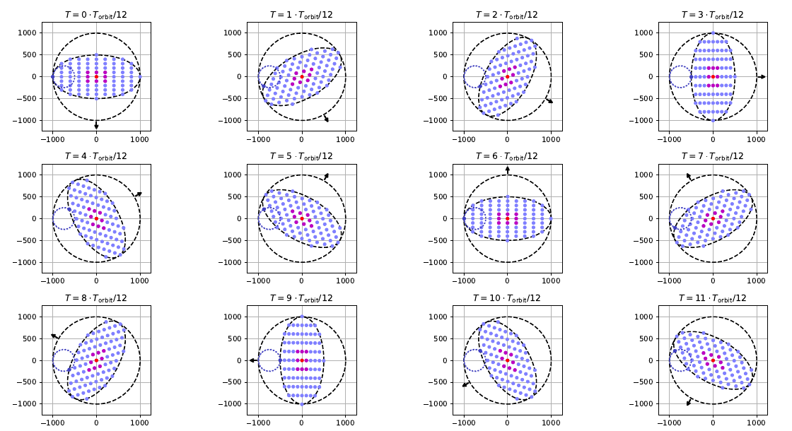
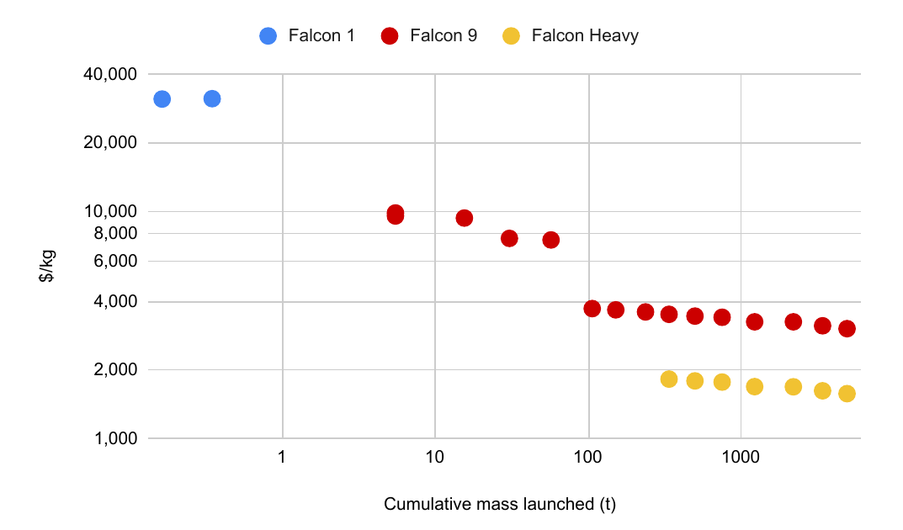

Project Suncatcher is Google's research moonshot to put AI data centers in space: fleets of solar-powered satellites carrying Google's TPU chips, flown a few hundred meters apart so they can work as one machine learning cluster. Its first prototype satellite launched on October 1, 2026, and on October 30 Google said it had received "the first-ever AI response from a data center class TPU in orbit," a haiku written by the open Gemma 4 model.

## What Is Project Suncatcher?

Google Research announced Project Suncatcher in November 2025 with a paper, "Towards a future space-based, highly scalable AI infrastructure system design," by Blaise Agüera y Arcas, Travis Beals, James Manyika and colleagues. The argument starts from energy. AI demand for compute and electricity keeps growing, and the paper notes that solar panels in some orbits get nearly continuous sunlight and up to 8 times more solar energy per year than a panel at mid-latitude on Earth.

Earlier space solar proposals tried to beam power down to the ground, which has never worked well. Suncatcher flips that: keep the power in orbit, run the computation there, and send only results down.

The paper also rejects the "monolithic" space data center, a single structure bigger than any rocket can carry. Those would need assembly in orbit by humans or robots. Suncatcher uses many smaller satellites instead, which can be added one launch at a time.

## The First AI Response from Orbit

*The Suncatcher team at the first response. Image: Google, thumbnail of the video "Our first response from the Project Suncatcher prototype satellite."*

The prototype was built with Planet and launched on SpaceX's Transporter-18 rideshare. In his October 1 post, Travis Beals, Senior Director of Paradigms of Intelligence at Google, said the team had confirmed contact and the satellite was "operating as expected."

According to Beals's October 30 post, the team spent several weeks on commissioning: powering up the host computer and TPU trays and running early machine learning tests. Then, during a ground-station pass, they uplinked a prompt asking the onboard Gemma 4 model for a haiku about being in space. The answer came down as the satellite passed Svalbard, Norway:

> Blue marble below 
> Data streams in silent grace 
> Starlight feeds my core.

Google says it then tried space-themed limericks and telemetry prompts in which the model reported the technical status of the payload.

The hardware details come from press reports, not Google's posts. TechCrunch reported that the satellite carries four TPUs and generates up to 1 kW, but power limits mean only one TPU can run at a time, for about 20 minutes. DCD reported that Google calls the craft "MVP." A haiku is a small workload; the point of this mission is to see whether a data-center chip boots, runs and keeps running in orbit.

## How the Space Data Center Design Works

The paper's reference design is an 81-satellite cluster with a 1 km radius, in a dawn-dusk sun-synchronous orbit at a mean altitude of about 650 km. That orbit keeps the panels in sunlight almost all the time.

*The 81-satellite cluster over one orbit, in twelve steps. The grid stretches and rotates but stays within 1 km. Figure 2 from the Suncatcher paper (Google).*

**Close formation.** In the model, neighboring satellites move between about 100 and 200 m apart over each orbit. The figure shows the cluster in free fall; the paper describes high-precision ML-based models to control formations at larger scale.

**Optical links fast enough for training.** This is the hardest networking problem. Inside a TPU pod on Earth, chips talk over optical links at hundreds of gigabits per second each. Commercial optical inter-satellite links offer 1 to 100 Gbps. The paper estimates each link between Suncatcher satellites needs about 10 Tbps, and argues off-the-shelf dense wavelength division multiplexing (DWDM) transceivers from terrestrial data centers can provide it, if the satellites are close enough. Those transceivers need hundreds of microwatts of received power, versus about 1 µW for long-range links, and received power falls with the square of distance. At very short range, one 10 cm aperture can be split into parallel beams: 2×2 at 1.25 km, 4×4 at 0.32 km. A bench-scale demonstrator built from off-the-shelf parts reached 800 Gbps one way, or 1.6 Tbps bidirectional.

**Ground links and cooling.** For a pilot, the paper says radio is enough to talk to the ground. At scale, it needs optical ground links, which still struggle with atmospheric turbulence and tracking; the paper's benchmark is NASA's TBIRD, which showed 200 Gbps from low Earth orbit in 2023. Heat leaves through heat pipes and radiators, and the authors want passive systems for reliability.

## Can TPUs Survive Radiation in Space?

Before launch, the team put Trillium TPUs in a 67 MeV proton beam. The paper estimates an orbital dose of about 150 rad(Si) per year, so a 5-year mission needs to survive about 750 rad(Si).

- **Total dose.** High-bandwidth memory (HBM) was most sensitive, showing irregularities after about 2 krad(Si), nearly 3 times the requirement. Other tests ran correctly up to 15 krad(Si) on a single chip, with no hard failures from total dose.
- **Bit flips.** Core logic and on-chip SRAM showed silent data corruption at about one event per 17 rad. At one inference per second, the paper puts that at roughly one corrupted inference in 3 million. The authors call that likely acceptable for inference; the effect on training needs more study.

TechCrunch notes that radiation-driven bit flips can corrupt data without triggering normal monitoring. Testing this in real orbit, not a particle accelerator, is one goal of the current mission.

## What Would a Space Data Center Cost?

*SpaceX's lowest price per kilogram against cumulative mass launched, inflation-adjusted. Figure 4 from the Suncatcher paper (Google).*

Launch cost decides whether this makes sense. The paper finds SpaceX prices have fallen about 20% for every doubling of mass launched. If that continues, which would take about 180 Starship launches a year, prices could fall below $200/kg around 2035.

At $200/kg, the paper estimates the "launched power price" of a Starlink v2-type satellite at about $810 per kW per year. US data centers pay about $570 to $3,000 per kW per year for power. So the paper's claim is that launch could become roughly comparable to Earth's energy costs, not that it already is. A separate estimate from Starship 4's public specifications suggests costs below $60/kg with 10× reuse.

Google's own people are clear about today's numbers. DCD reported that Amanda Peterson Corio, Google's global head of energy and power, called space data centers "incredibly, incredibly expensive, up to 100 times more expensive than building on Earth." TechCrunch also notes that Google, like SpaceX, needs a fully reusable Starship for this to work.

## Open Problems and Criticism

The paper lists its own gaps:

- **Repair.** On Earth, technicians swap failed TPUs. In orbit that is impossible, so the paper's simplest answer is to fly spare capacity.
- **Thermal management.** Moving heat from dense chips to radiators in a vacuum is still an open engineering problem, which is why heat tests come next.
- **Satellite design.** The authors expect that at scale, compute, radiators and power will merge into an integrated design, the way phones moved to systems-on-chip.
- **Competition.** TechCrunch notes that Suncatcher is unusual in planning tightly linked satellites for shared workloads; Starcloud and Cowboy Space plan inference on single satellites.

Community reaction has focused on scale. In a Hacker News thread on the October launch, one commenter used Epoch AI figures for a large Google site (about 100,000 TPUs and 370 MW) to estimate roughly 1.2 km of panels and radiators per site. That would appear about 6.6 arcminutes wide from the ground at 650 km, and he worried about a bright "second moon" in the night sky. That is a commenter's estimate, not a Google figure.

**What happens next.** Beals says the current satellite will now go through thermal-stress and radiation tests. If the TPUs hold up, Google plans two interconnected satellites in 2027; TechCrunch says those will have more power and demonstrate optical links between satellites. A full 81-satellite cluster is still a design on paper. If you are tracking AI compute costs on the ground, our piece on [coding agents and cost per successful task](/tutorials/coding-agents-finops-cost-per-successful-task/) covers the other end of the same pressure.

## References

- Travis Beals, ["We've received our first response from the Project Suncatcher prototype satellite."](https://blog.google/innovation-and-ai/models-and-research/google-research/project-suncatcher-satellite-response/), Google, Oct 30, 2026
- Travis Beals, ["Our Project Suncatcher prototype satellite is in orbit"](https://blog.google/innovation-and-ai/models-and-research/google-research/project-suncatcher-prototype/), Google, Oct 1, 2026
- Google Research, ["Exploring a space-based, scalable AI infrastructure system design"](https://research.google/blog/exploring-a-space-based-scalable-ai-infrastructure-system-design/), Nov 2025
- B. Agüera y Arcas, T. Beals, M. Biggs, J. V. Bloom, T. Fischbacher, K. Gromov, U. Köster, R. Pravahan, J. Manyika, ["Towards a future space-based, highly scalable AI infrastructure system design"](https://arxiv.org/abs/2511.19468), arXiv 2511.19468; published in [Joule](https://goo.gle/suncatcher-joule)
- Tim Fernholz, ["Google's first data center satellite is online and writing poetry"](https://techcrunch.com/2026/10/30/googles-first-data-center-satellite-is-online-and-writing-poetry/), TechCrunch, Oct 30, 2026
- Sebastian Moss, ["Google's Project Suncatcher runs first workload on orbital TPU, but company admits space data centers cost 100x more than terrestrial"](https://www.datacenterdynamics.com/en/news/googles-project-suncatcher-runs-first-workload-on-orbital-tpu-but-company-admits-space-data-centers-cost-100x-more-than-terrestrial/), DCD, Nov 2, 2026
- Hacker News, ["Our Project Suncatcher prototype satellite is in orbit"](https://news.ycombinator.com/item?id=49932191), discussion, Oct 2, 2026
