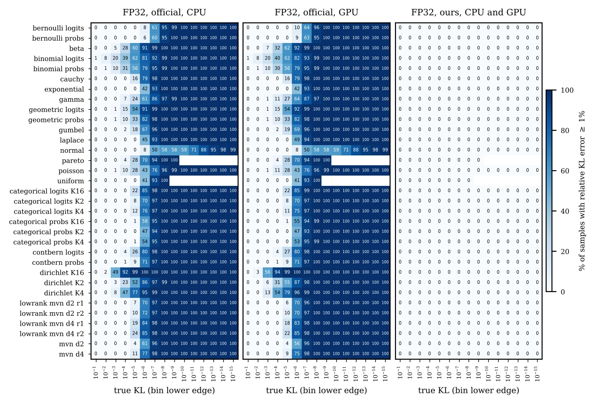

A KL divergence can never be negative, yet the PyTorch KL divergence functions return negative values, and a paper posted to arXiv on November 23, 2026 shows the sign is the least of the problem. When two distributions are nearly equal, both PyTorch KL functions, `torch.distributions.kl_divergence` and `torch.nn.functional.kl_div` (the loss behind `nn.KLDivLoss`), return values that are mostly rounding noise: negative, zero for distributions that differ, non-zero for identical ones, and with gradients that can point the wrong way.

That regime is common in practice. Knowledge distillation compares a student with its teacher, PPO-style training compares a policy with its previous version, and quantization work compares a model with its compressed copy. Zhen Yang and six co-authors tested 8.5 million inputs against reference values certified with interval arithmetic, traced the errors into training and evaluation results, and published repaired implementations in a package called stablekl.

## Why PyTorch KL divergence goes negative {#why-negative}

PyTorch KL divergence goes negative because the textbook formulas subtract quantities that are almost equal. If two distributions differ by a small relative amount δ, their true KL is roughly δ², but the closed forms compute it as a sum of terms of size 1 or δ with mixed signs. Each term carries a rounding error close to the format's unit roundoff, about 6×10⁻⁸ in FP32 and 5×10⁻⁴ in FP16, so once the true KL falls to that size the result is mostly noise.

The paper's smallest example uses two Exponential distributions with rates 1 and 1.0001 in FP32. The true KL is 5.0013×10⁻⁹. The formula `r - 1 - log(r)` evaluates `r - log(r)` as 1.000000005…, which rounds to exactly 1, and PyTorch returns 0: two different distributions reported as identical. The stablekl README shows the same failure for two Normal distributions whose means differ by 1e-4:

```python
>>> import torch, stablekl
>>> from torch.distributions import Normal, kl_divergence
>>> p, q = Normal(torch.tensor(0.0), torch.tensor(1.0)), Normal(torch.tensor(1e-4), torch.tensor(1.0))
>>> kl_divergence(p, q)            # exact value: 5.0e-09
tensor(0.)
>>> stablekl.kl_divergence(p, q)
tensor(5.0000e-09)
```

Across the 16 scalar-family configurations in ordinary parameter ranges, the official FP32 values are accurate when the true KL is between 0.1 and 1 (0.1% are off by 1% or more). Near 10⁻⁷, 86% are off by at least 1%. Below 10⁻¹⁰, nearly all are wrong and about three in ten are negative. FP16 follows the same curve about four orders of magnitude earlier. Gradients hold up longer but fail worse: at a true KL of 10⁻¹³, a fifth of the gradient vectors have a cosine below 0.99 with the true gradient, and at 10⁻¹⁵, 6.8% point into the opposite half-space.

Users have reported this since at least 2019. The paper lists five PyTorch forum threads and GitHub issues between 2019 and 2023; one 2022 forum report found negative Categorical KL in more than 40% of cases under automatic mixed precision. The standard reply, given again in [pytorch/pytorch#80488](https://github.com/pytorch/pytorch/issues/80488) in 2022, was that the errors are small floating-point effects, that fixing them in core would cost performance, and that users can post-process with `torch.clamp(x, min=0)`.

Clamping fixes the sign and nothing else. Wherever the result was negative, the clamp sets both the value and its gradient to zero; every wrong positive value keeps its error and its wrong gradient. The authors also checked whether more precision solves it. Evaluating the official formulas one format higher (FP64 for FP32 inputs) shifts the failure about nine orders of magnitude down but still leaves 7–51% of FP32 values significantly wrong in 22 of 23 configurations, because FP32 inputs can differ by a single unit in the last place, and that difference still cancels in FP64. Uniform was the only exception.

## When KL divergence errors change training and evaluation results {#when-it-matters}

KL divergence errors change results when the code compares two distributions that are nearly equal by construction and then acts on small KL values: an optimizer step from an identical start, a ranking of tiny divergences, or a threshold on them. The paper ran four downstream experiments that isolate this; nothing else changed between the official and repaired runs.

**Identical-start distillation.** A student MLP that starts as an exact copy of its teacher should not move when trained on the KL loss alone, because the true loss and gradient are zero. With the official losses it moved in all 2,160 runs; with the repaired logits path it moved in none of 720. The drift depends on the optimizer. SGD scales its step by the spurious gradient (about 5×10⁻⁸ in FP32) and barely moves, but Adam normalizes it into a full-size step, so with Adam at a learning rate of 1e-2 the student disagreed with the teacher's top-1 prediction on 31–47% of inputs in FP32 and up to 97.4% in FP16 with a 151,936-token vocabulary (the right-hand chart at the top). A quarter of the official runs showed a negative loss at step 0, the symptom users report. Replacing `F.kl_div` alone did not help: the spurious gradient comes from the backward pass of `log_softmax`.

The same thing happened with a real model. Copying the loss from TRL's generalized knowledge distillation trainer and training a Qwen2.5-1.5B student from an exact copy of its teacher, both official variants ended at an evaluation KL of about 0.10 with 13% top-1 disagreement, while the logits path left every weight unchanged.

**Quantized LLM checks.** For Qwen2.5-1.5B-Instruct with an FP16 forward pass, the official `F.kl_div` misreported the mean KL between the original and its 8-bit GPTQ and round-to-nearest copies by −19.0% and −4.4%, with 30.2% and 12.3% of tokens negative. With the default `reduction="mean"` it reported exactly 0, and `Categorical(logits=...)` returned infinity for almost every token because about 38% of FP16 softmax probabilities underflowed to zero. KL against a quantized copy is a common quality metric, used the same way in our [Hy4 Flash GGUF comparison](/tutorials/hy4-flash-gguf/) to rank quantized builds; near-lossless 8-bit copies are where it is least reliable in PyTorch.

Ranking layers by sensitivity broke more visibly. Single-layer 8-bit divergences were only 3.6×10⁻⁵ to 2.6×10⁻⁴; the official FP16 `F.kl_div` reported a negative mean for 24 of 28 layers and swapped the order of 19 of 378 layer pairs. When the ranking chose 8 layers to keep in FP16, a BF16 Categorical KL protected four wrong layers and raised the true KL of the mixed-precision model by 9.8%. The most common official configuration still picked the right layers.

**Execution gaps and interpretability.** Comparing cached decoding with a full forward pass of the same model, the kind of rollout-versus-training gap checked in RL fine-tuning, the official `F.kl_div` was off by more than 600% in FP32 and FP16 and by 19% in BF16; the logits path stayed within 0.05%. In circuit discovery with the auto-circuit library, which scores each edge by the KL after ablating it, 19%, 46% and 59% of FP32 edge scores were wrong in three GPT-2 settings, and in FP16 only 38% of GPT-2 medium's top 1,000 edges were correct, against 99.9% with the logits path. Work that reads or edits model internals, like the [weight-space programming experiments](/tutorials/weight-space-programming/) we covered, relies on exactly these small differences.

**Where no effect showed up.** The paper also reports settings where the implementation made no measurable difference, and they cover a lot of everyday training:

| Setting | What the authors measured |
|---|---|
| TRL GKD distillation from a nearby start (8-bit or 4-bit copy of Qwen2.5-1.5B) | Final eval KL differed by +1.4% and −0.3%, inside the 2.8% and 1.9% seed-to-seed spread |
| LoRA with a KL anchor to the base model | Differences below the seed spread, no consistent sign |
| PPO KL thresholds on synthetic categorical policies | 0 of 960 decisions changed |
| PPO adaptive learning rate in rsl-rl-lib with a Beta policy | 0 decisions differed from FP64 |
| Sampled k1/k3 KL estimators on LLM log-probabilities | Batch mean within 7.8×10⁻⁶ relative error |

Those rows cover common RL fine-tuning setups, the kind of TRL-based training behind the [Qwen3.8 pi adapter](/tutorials/qwen3-8-27b-pi-adapted/); exposure is highest when a test starts two models from the same weights or ranks divergences near zero. The Hacker News discussion of the paper pressed the same point: one commenter called near-identical distributions contrived for real training, and another asked whether casting to float64 would be enough. The tables above answer both: the measured damage concentrates in identical starts, tiny-divergence rankings and evaluation metrics, and FP64 fixes `F.kl_div`'s operator error but not the closed forms or the rounded inputs. All of these numbers come from one preprint with no independent reproduction yet. Its sampling deliberately oversamples small divergences, so the error rates describe that regime rather than a typical training run; three of the four downstream experiments are synthetic or simulated, the training effect is shown only for identical starts, and the tests used PyTorch 2.15.0 on CPU and 2.4.0 on the GPU.

<p><strong>Comparing teacher candidates first.</strong> Distillation and quantization checks start with choosing which model to compare against. If you want to send the same prompts to several hosted models before committing to a teacher, a shared gateway such as
<a href="https://www.packyapi.ai/register?aff=5W73&amp;utm_source=agentspulse&amp;utm_medium=affiliate&amp;utm_campaign=pytorch-kl-divergence"
rel="sponsored nofollow noopener" target="_blank">PackyAPI</a> is one option for reaching them through one OpenAI-style API.</p>
<p><small>Disclosure: this page contains an affiliate link. If you sign up through it, we may earn a commission at no extra cost to you.</small></p>

## torch.distributions.kl_divergence vs F.kl_div: where each one fails {#kl-divergence-vs-kl-div}

`torch.distributions.kl_divergence` and `F.kl_div` fail for different reasons, so they need different fixes. `kl_divergence(p, q)` dispatches on two distribution objects to a closed-form formula in their parameters; the paper tested its 18 same-family closed forms, from Normal and Categorical to Beta, Dirichlet and the multivariate normal. Every family degrades as the distributions approach each other, on CPU and on an A100 GPU, where error rates differ from the CPU by at most 1.5 percentage points.



*Share of FP32 samples with at least 1% relative KL error, per distribution family and true-KL interval. Left and middle: official PyTorch on CPU and GPU. Right: the stablekl repair on both. Blank cells cannot be constructed on the FP32 grid. Figure: Zhen Yang et al., stablekl README.*

`F.kl_div(input, target)` works element-wise on tensors: it expects `input` as log-probabilities and `target` as probabilities (or log-probabilities with `log_target=True`), computes `target * (log(target) - input)`, and reduces. Its argument order is the reverse of the math notation KL(P‖Q): `input` is the model distribution Q and `target` is P. The element term cancels whenever the two are close, and for probability targets 35–70% of FP32 summed outputs were off by at least 1%. In FP16 with `reduction="mean"` over 256 classes, 95.4% of target-gradient rows contained a component with the wrong sign.

The paper separates two errors inside `F.kl_div`, and the difference decides the fix:

| Error | Where it comes from | Does FP64 inside `F.kl_div` fix it? | Fix |
|---|---|---|---|
| Operator error | Cancellation in `F.kl_div`'s own arithmetic and reduction | Mostly yes | Repaired `kl_div`, or compute in FP64 |
| Input-representation error | `softmax` and `log_softmax` outputs were already rounded before `F.kl_div` saw them | No: 40–99% of batches stayed off by 1% or more at any operator precision | Compute KL from the raw logits |

`reduction` matters separately. PyTorch's documentation warns that the default `reduction="mean"` divides by the number of elements and does not return the true KL; use `"batchmean"`. In the paper's FP16 tests, `"mean"` also underflowed: against an 8-bit copy it reported anywhere between 0 and 58% of the true KL depending on how many rows went into each call.

## How to fix negative KL divergence in PyTorch {#how-to-fix}

To fix negative KL divergence in PyTorch, stop clamping, compute the divergence between two models from their logits, and replace the closed forms with versions that avoid cancellation. The order below goes from cheapest check to most invasive change.

**1. Check the call before suspecting numerics.** Use `reduction="batchmean"`, pass log-probabilities as `input`, and remember that `input` is Q and `target` is P. With `torch.distributions`, `kl_divergence(p, q)` follows the math order. A negative KL from a wrong argument or a probability vector that does not sum to one is a different bug; a 2022 comment from a PyTorch developer on #80488 noted that KL is only guaranteed non-negative for proper probability distributions.

**2. Decide whether you are in the failing range.** The errors matter when the true KL is near the format's roundoff: around 10⁻⁷ and below in FP32, around 10⁻³ and below in FP16. Identical initializations, consecutive checkpoints, near-lossless quantized copies, ablations of single edges and cached-versus-full forward passes all land there. If your divergences sit well above that, as in most of the settings with no measured effect, the official functions are accurate.

**3. Compute the KL between two models from logits.** For a teacher and a student, or a model and its quantized copy, pass the raw logits instead of `softmax`/`log_softmax` outputs. stablekl's `logits_kl(t, s)` computes KL(softmax(t)‖softmax(s)) directly, returns exactly zero (value and gradient) when the logits match, and averages over rows. The README's example uses two FP16 logit vectors over 32,000 classes that differ by small noise:

```python
>>> from torch.distributions import Categorical, kl_divergence
>>> torch.manual_seed(0)
>>> t = torch.randn(1, 32000); s = t + 1e-2 * torch.randn(1, 32000)
>>> t, s = t.half(), s.half()
>>> kl_divergence(Categorical(logits=t), Categorical(logits=s))   # exact KL of these inputs: 4.9277e-05
tensor([-0.0001], dtype=torch.float16)
>>> stablekl.logits_kl(t, s)
tensor(4.9293e-05, dtype=torch.float16)
```

**4. Swap in the repaired functions where you need the closed forms.** stablekl mirrors the two PyTorch interfaces:

| Official call | Repaired call | Notes |
|---|---|---|
| `torch.distributions.kl_divergence(p, q)` | `stablekl.kl_divergence(p, q)` | 18 same-family pairs; different families raise `NotImplementedError` |
| `F.kl_div(input, target, reduction=..., log_target=...)` | `stablekl.kl_div(input, target, ...)` | Same arguments; exact KL of the tensors it is given |
| `kl_divergence(Categorical(logits=t), Categorical(logits=s)).mean()` | `stablekl.logits_kl(t, s)` | From raw logits; FP16, BF16 and FP32 |

The default `mode="ours"` evaluates the repaired formula in FP64 and rounds once to the input type; `mode="rewrite"` stays in the input precision and, in the paper's tests, still removed more than 97% of significant errors. The package needs Python 3.10 or later and PyTorch 2.1 or later, runs on CPU and CUDA, is BSD-3 licensed, and installs from a clone of the repository with `pip install .`; the README does not mention a PyPI release. Two caveats from the README: `stablekl.kl_div` cannot undo rounding already present in its inputs, and `Categorical` normalizes its parameters in working precision when constructed, so for logits use `logits_kl`.

The repairs share four ideas that you can apply in hand-written KL code too: rewrite the divergence as a sum of non-negative terms (the building block is x − log1p(x)), compute differences of nearby inputs exactly instead of subtracting large intermediate values, write the gradient analytically rather than differentiating a cancelling formula, and round once from a wider type. The paper's appendix gives the derivation for each family. A related preprint by Brandon Amos of Reflection AI, posted November 13, covers the same problem for divergences between categorical distributions and Monte Carlo KL estimators.

## stablekl performance cost vs PyTorch's built-in KL {#stablekl-cost}

stablekl is slower than PyTorch's built-in KL because it is written as unfused Python tensor operations, and the authors call the repairs unoptimized reference implementations. Their A100 timings, forward plus backward and relative to the official call:

| Function | Slowdown on an A100 GPU |
|---|---|
| Closed forms, `mode="rewrite"` (Exponential, Laplace, Poisson, Normal, Bernoulli) | 2.4–5.9x |
| Same closed forms, default strict mode | 3.4–12x |
| Gamma / Beta (repairs evaluate a quadrature) | about 30x / about 320x |
| Repaired `kl_div` | 27–59x (28–222x on CPU, growing with the number of classes) |
| `logits_kl` | 3–22x; one call on 512 × 151,936 BF16 logits took 72 ms against 3.2 ms |

Precision is not what costs time: the official formulas run at 1.0–1.1x when evaluated in FP64 on the GPU. The overhead is extra arithmetic, such as series in place of a single logarithm and double-length sums, plus many small unfused tensor operations, the kind of launch overhead that [Together AI's megakernel vs CUDA Graphs comparison](/tutorials/megakernel-vs-cuda-graphs/) is about. The package ships no fused kernels.

That makes the repair a targeted tool. A KL term inside a large-vocabulary training loop pays the `logits_kl` cost on every step, while an evaluation script that compares a quantized copy, ranks layers or scores circuit edges runs once and needs the accurate number. For the cases the paper found unaffected, such as PPO thresholds or distillation from a student that already differs from its teacher, the built-in functions remain a reasonable default. When a KL value near zero will decide something, such as which layers to keep at higher precision in a [low-precision deployment like GLM-5.3 NVFP4](/tutorials/glm-5-3-nvfp4/), compute it from logits.

## References {#references}

1. Zhen Yang, Wei Tang, Chu Chen, Rui Qian, Yixuan Chen, Fan Yang and Kangning Cui, ["The KL Divergence Is Never Negative, Except in PyTorch"](https://arxiv.org/abs/2611.30835), arXiv:2611.30835, November 23, 2026.
2. stablekl repository and README, [github.com/xi-xiaoran/stablekl](https://github.com/xi-xiaoran/stablekl), accessed November 25, 2026; benchmark data on [Hugging Face](https://huggingface.co/datasets/xi-xiaoran/stablekl-benchmark).
3. PyTorch, ["KLDivLoss"](https://docs.pytorch.org/docs/2.15/generated/torch.nn.KLDivLoss.html), PyTorch 2.15 documentation.
4. PyTorch GitHub issue [#80488](https://github.com/pytorch/pytorch/issues/80488) on negative `F.kl_div` values, developer discussion July–August 2022.
5. Brandon Amos, ["On numerical issues of divergences between nearly equal distributions"](https://arxiv.org/abs/2611.18511), arXiv:2611.18511, November 13, 2026.
