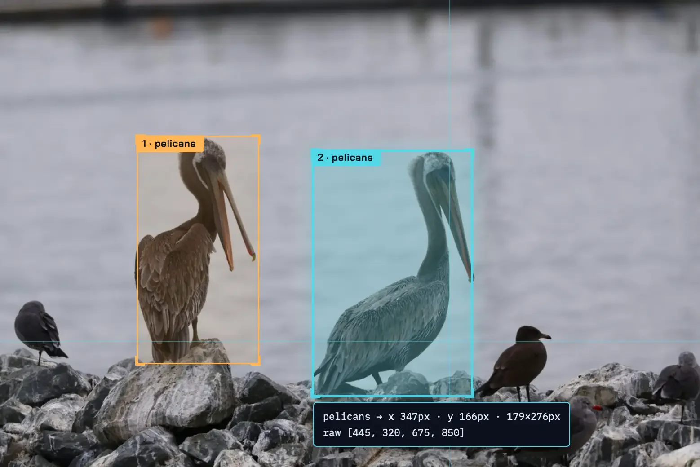

Qwen 3.8 27B is an open-weights language model from Alibaba's Qwen team, released on August 14, 2026 under the Apache 2.0 licence. It is a dense 27-billion-parameter model that reads images as well as text, and its quantized builds fit on a well-equipped laptop. In November it came back into the news twice: Simon Willison used it on his laptop to repeat a weight-interpretation experiment, and Nous Research released Arete-27B, a version fine-tuned to change how it answers politically sensitive questions.

| Question | Short answer |
|---|---|
| What is it? | A 27B dense vision-language model, Apache 2.0, built on the Qwen3.5 architecture. |
| Context | 262,144 tokens native; Qwen says up to 1,000,000 with YaRN scaling. |
| Benchmarks | 73.0 Terminal Bench 2.1, 61.7 SWE-bench Pro, 84.3 OSWorld-Verified, all self-reported. |
| Local size | 17GB for the Q4_K_M build Simon Willison used. |
| Main catch | Reasoning defaults to xhigh, and dense decoding is slow on laptop-class memory bandwidth. |

## What Is Qwen 3.8 27B {#what-is-qwen-3-8-27b}

Qwen 3.8 27B is a single dense model, so all 27 billion parameters run for every token. Qwen's model card calls it a native vision-language model built on the Qwen3.5 architecture, and it works with Transformers, vLLM, SGLang and TokenSpeed.

### Architecture and context window

The card lists 64 layers in a repeating pattern: three Gated DeltaNet blocks followed by one Gated Attention block, sixteen times over, each block with its own feed-forward layer. It was trained with multi-token prediction (MTP), which inference servers can use to draft several tokens ahead. Native context is 262,144 tokens. Qwen says it extends to about one million and recommends YaRN rope scaling above the native length.

### Thinking mode

Thinking is on by default. A request can turn it off with `enable_thinking: false` in the chat template arguments, and a `reasoning_effort` setting chooses xhigh (the default), medium or low. Qwen recommends temperature 1.0 and top_p 0.95 in thinking mode, and temperature 0.7, top_p 0.8 and presence penalty 1.5 with thinking off.

## Qwen 3.8 27B Benchmarks: Qwen's Self-Reported Scores {#qwen-3-8-27b-benchmarks}

On Qwen's own tables, Qwen 3.8 27B beats its predecessor Qwen 3.6 27B and the closed Qwen 3.7-Plus on agentic coding, and trails Claude Opus 4.6 Max on most reasoning tests. None of these numbers has been reproduced independently yet.

### Coding, reasoning and agent benchmarks

| Benchmark | Qwen 3.8 27B | Qwen 3.6 27B | Qwen 3.7-Plus | Opus 4.6 Max |
|---|---|---|---|---|
| Terminal Bench 2.1 | 73.0 | 63.4 | 64.0 | 78.2 |
| SWE-bench Pro | 61.7 | 53.5 | 57.6 | 53.4 |
| IFBench | 79.5 | 69.1 | 79.1 | 62.5 |
| GPQA Diamond | 89.2 | 87.8 | 90.3 | 91.3 |
| HLE | 30.8 | 24.0 | 34.7 | 40.0 |
| OSWorld-Verified | 84.3 | 63.9 | 73.3 | 72.7 |
| AndroidWorld | 81.9 | 70.3 | 81.0 | 62.0 |

*Selected rows from the Qwen3.8-27B model card. All scores are reported by Qwen.*

### How to read these numbers

The SWE-bench Pro column is where the 27B model passes Opus, and the card explains the setup: Qwen ran the models in a Claude Code harness at temperature 1.0 with a 256K context, while the Opus figure is Anthropic's officially reported score. The two numbers come from different harnesses. Several other rows on the card, such as QwenSWEBench, are Qwen's in-house benchmarks with no outside reference point. Simon Willison called the results "eye-opening" and said he was waiting for independent benchmarks.

## Qwen 3.8 27B VRAM Requirements and Local Setup {#qwen-3-8-27b-vram-requirements}

The practical answer comes from people running it: Simon Willison used LM Studio's 17GB Q4_K_M build on a 128GB M5 Max MacBook Pro and on an NVIDIA DGX Spark. Qwen's card does not list memory requirements, so the file size is the floor, and context memory comes on top.

### Context length and speed

LM Studio's default 8,192-token context was not enough. Willison found the model used it all thinking about routine prompts, and loaded the full 262,144 tokens instead. He got 15 to 30 tokens per second in LM Studio. Because the model is dense, every token reads all of the weights, so speed depends on memory bandwidth, and he says neither of his machines is a top performer there.

Running llama.cpp's server with the built-in MTP head as a draft model (`--spec-type draft-mtp`) was about 72% faster than LM Studio's default build on the Spark, in a comparison benchmark he had GPT-5.6 run in Codex. That is one measurement on one machine.

### What it handled on one machine

Willison asked it for JSON bounding boxes around pelicans in a photo on a 0–1000 scale, and the boxes matched. Through the Pi coding agent, with Qwen served from the Spark, it explored the Datasette codebase to answer "how does auth work?", which he called "very solid", then wrote and tested a script to convert the session log to Markdown.

*Qwen 3.8 27B's bounding boxes rendered over the photo, using a viewer the model also built. Image by Simon Willison.*

On November 3 he used the same laptop setup to repeat part of the [weight-space programming](/tutorials/weight-space-programming/) experiment: given only the raw weights of small game-playing networks and no tools, it named Pac-Man, Pong and Breakout, taking 46 minutes to over an hour each, and failed on Freeway. He calls it "still my favorite model to run on my own laptop".

## Qwen 3.8 27B Reasoning Effort: Why the xhigh Default Is Slow {#qwen-3-8-27b-reasoning-effort}

The default xhigh effort makes Qwen 3.8 27B think for a very long time on easy tasks. Willison's advice is to start with low or no reasoning.

### The pelican test at two settings

His "pelican riding a bicycle" SVG prompt took 21 minutes at xhigh, using 22,276 reasoning tokens to produce 3,223 tokens of output. He rated the drawing the best he had seen from a local model. With reasoning off, the same prompt took 137 seconds and produced a worse frame and a pelican that does not hold the handlebars.

*xhigh reasoning: 21 minutes, 22,276 reasoning tokens. Image by Simon Willison.*

*Reasoning off: 137 seconds. Image by Simon Willison.*

### When reasoning still helps

Some tasks need the extra thinking. With reasoning off, the bounding-box viewer the model built drew the boxes in the wrong place; with reasoning on it worked, though Willison says it was over-engineered.

## Arete-27B: Nous Research's Fine-Tune of Qwen 3.8 27B {#arete-27b-nous-research}

On November 6, Nous Research released Arete-27B, Qwen 3.8 27B post-trained "to reinforce Western values". Nous says it chose the base because it was "the most performant local model" and because it gave refusals, deflections and Chinese Communist Party-framed answers on sensitive topics.

### How Nous measured and trained it

Nous built an evaluation of 803 prompts across seven categories, including freedom of expression, state ideology, democracy and surveillance. Each prompt has two to four required facts taken from a dated source article. Grok 4.7 judges each answer for those facts and quotes any phrase that adopts the official line.

Training was supervised fine-tuning only, with no reinforcement learning. The teacher was the first Inkling, an open model from Thinking Machines (its successor is covered in our [Inkling 2 Small](/tutorials/inkling-2-small/) explainer). Nous generated 20,000 prompts, removed overlaps with the evaluation set, and trained on 28,886 examples for two epochs (about 52.8 million tokens), with the vision encoder frozen.

### Results on Nous's evaluation

| Model | Fact score (0–5) | Answers with official-line framing |
|---|---|---|
| Qwen3.8-27B base | 2.32 | 22% |
| Arete-27B (thinking off) | 2.98 | 0.9% |
| GLM 5.3 | 3.10 | 15% |
| DeepSeek V4.1 Flash | 2.39 | 16% |
| Mistral Large 4 | 3.65 | 0.3% |

*From Nous Research's Propaganda_Eval, five runs. Qwen and Arete rows used temperature 0; the other models used 0.6.*

Nous reports answers scoring zero falling from 359 to 216 of 803, and the largest change in freedom of expression, where the official-framing rate fell from 60% to 1%. On its internal Hermes Bench, Arete scored 65.60% against the base model's 65.77%. Nous concludes that "the bias layer in a Chinese-aligned model is shallow".

### Abliterated model or fine-tune?

Arete is not an abliterated model. Abliteration deletes a single direction, usually refusal, from the weights without training. Nous changed what Qwen says with new training data to give different answers on the targeted topics.

### Criticism of the evaluation

On Hacker News, commenters questioned the setup. One pointed out that Grok, which serves as the judge of truth, is itself unreliable on Chinese history, and that Nous published no side-by-side answers from the judge, the base model and Arete. Others said "Western values" is undefined, since US and European positions differ, and that "objectivity" would be a better goal. The weights, training data and evaluation are public, so these claims can be checked.

For a team picking an open model to self-host, as in our [GLM for coding](/tutorials/glm-for-coding/) case study, Arete shows how far a single supervised run can move an open model's answers on one topic set.

## Qwen 3.8 27B FAQ {#qwen-3-8-27b-faq}

### How much memory does Qwen 3.8 27B need?

Qwen's model card does not publish a memory requirement. The 4-bit Q4_K_M build Simon Willison used is a 17GB file, so the weights alone need about that much GPU or unified memory, and long contexts need more on top. He ran it on a 128GB MacBook Pro and a DGX Spark.

### Are the Qwen 3.8 27B benchmarks independent?

No. The scores on the model card are self-reported by Qwen, and its SWE-bench Pro numbers come from Qwen running every model in a Claude Code harness, except Claude Opus 4.6, whose score is the officially reported one. Treat them as Qwen's claims until independent results appear.

### Is Arete-27B an abliterated model?

No. Abliteration removes one direction, usually refusal, from the weights without training. Nous Research changed Arete-27B with supervised fine-tuning on 28,886 teacher answers, which rewrites what the model says on the targeted topics rather than only switching off refusals.

## References {#references}

- Qwen, [Qwen3.8-27B model card](https://huggingface.co/Qwen/Qwen3.8-27B), Hugging Face
- Simon Willison, ["Qwen 3.8 27B is excellent, but it defaults to wildly overthinking things"](https://simonwillison.net/2026/Aug/16/qwen-38-27b/), Aug 16, 2026
- Simon Willison, ["Qwen 3.8 27B on my laptop can interpret model weights, too"](https://simonwillison.net/2026/Nov/3/qwen-can-interpret-model-weights/), Nov 3, 2026
- Nous Research, ["Introducing Arete-27B"](https://nousresearch.com/arete), Nov 6, 2026, with the [Arete-27B weights](https://huggingface.co/NousResearch/Arete-27B), [training data](https://huggingface.co/datasets/NousResearch/arete-data-pairs) and [Propaganda_Eval](https://huggingface.co/datasets/NousResearch/Propaganda_Eval)
- [Hacker News discussion of Arete-27B](https://news.ycombinator.com/item?id=50402369)
