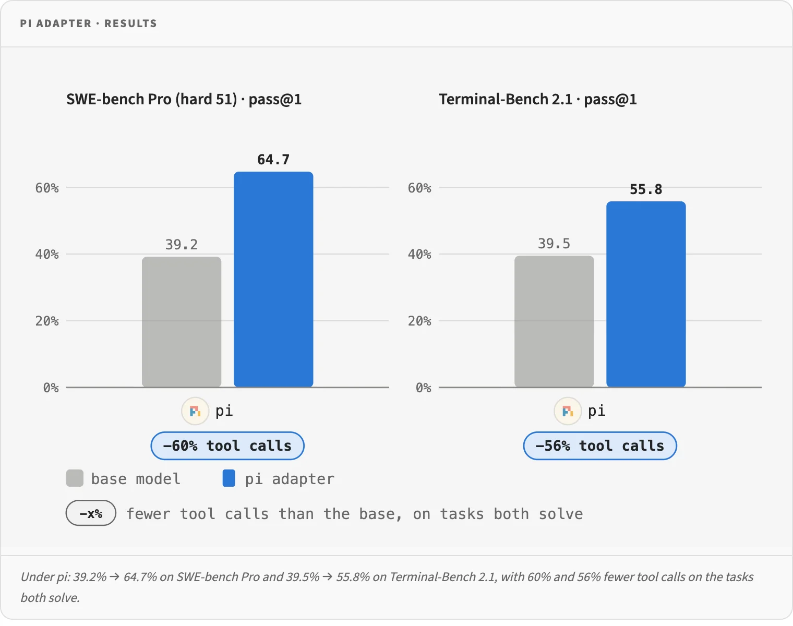
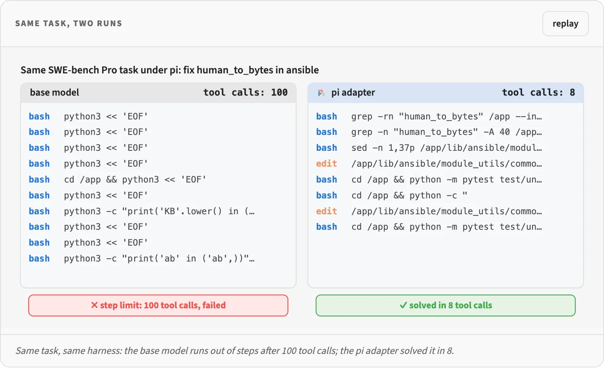
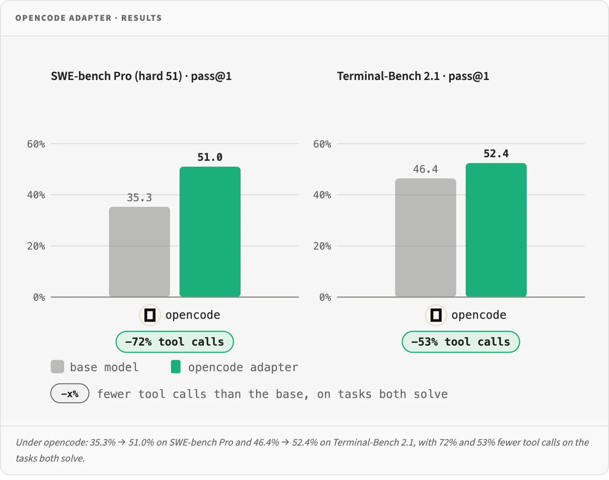

The Qwen3.8 27B pi adapter, published by Hugging Face's harness-hub team as Qwen3.8-27B-pi-adapted, is a 638 MB LoRA that retrains Qwen3.8-27B for one job: being the model behind the pi coding agent. Under pi, with thinking switched off, harness-hub reports SWE-bench Pro (hard 51) rising from 39.2% to 64.7% and Terminal-Bench 2.1 from 39.5% to 55.8%. The more useful result for anyone running a local agent is the cost: the adapter reaches roughly what the base model gets with xhigh thinking while generating about a quarter of the tokens and needing fewer than half the turns.

The adapter appeared on the Hub on November 16, 2026 and was announced two days later. This page compares its numbers with the base model, with thinking mode and with its sibling adapter for OpenCode, explains the reinforcement-learning recipe behind it, and shows how to wire it into pi on a GPU server or a Mac.

## Qwen3.8 27B pi adapter benchmarks: SWE-bench Pro and Terminal-Bench 2.1 {#qwen3-8-27b-pi-benchmarks}

On harness-hub's own runs, the Qwen3.8 27B pi adapter solves 64.7% of the 51 hardest SWE-bench Pro tasks, against 39.2% for the base model, and 55.8% of Terminal-Bench 2.1, against 39.5%. Both runs use pi, one attempt per task, a 100-step budget, thinking off and the training sampling settings (temperature 0.8, top-p 1.0), with base and adapter under identical conditions.



*Pi adapter vs base Qwen3.8-27B, pass@1 under the pi harness with thinking off. Image by Hugging Face harness-hub, from the Qwen3.8-27B-pi-adapted model card.*

The card reports the comparison as paired results with 95% intervals and an exact sign test on the tasks whose outcome changed:

| Benchmark | Tasks | Base Qwen3.8-27B | Pi adapter (step 160) | Difference | Newly solved / lost |
|---|---|---|---|---|---|
| SWE-bench Pro (hard 51) | 51 | 39.2% | 64.7% | +25.5 ± 14.2 pts (p = 0.0023) | 15 / 2 |
| Terminal-Bench 2.1 | 86 | 39.5% | 55.8% | +16.3 ± 9.1 pts (p = 0.0013) | 16 / 2 |
| Terminal-Bench 2.1, 68 tasks not used to pick the checkpoint | 68 | 39.7% | 55.9% | +16.2 ± 10.6 pts (p = 0.0074) | 13 / 2 |

*Source: Qwen3.8-27B-pi-adapted model card, Hugging Face, accessed November 20, 2026.*

The last row matters because of how the checkpoint was chosen. Harness-hub picked step 160 by watching scores on SWE-bench Pro and on an 18-task slice of Terminal-Bench 2.1 during training, so SWE-bench Pro is not a held-out test here. The 68 Terminal-Bench tasks outside that slice show almost the same gain, which is the cleanest evidence in the card that the improvement carries beyond the tasks used for selection. The intervals are still wide: with 51 tasks, the SWE-bench Pro gain could plausibly sit anywhere from about 11 to 40 points.

Two other caveats change how the numbers read. They are not comparable with the Qwen3.8-27B model card, which uses different harnesses (Terminus, Claude Code), maximum-effort thinking, bigger budgets and the full SWE-bench Pro. And the launch post on X quoted an earlier SWE-bench Pro figure of 29.4% to 62.7%; the model card now reads 39.2% to 64.7%, and MarkTechPost noted that the tweet's baseline had been corrected. Use the card's numbers.

The efficiency change is larger than the accuracy change. On the 18 SWE-bench Pro tasks both models solved, the adapter needed a median of 23 turns against the base model's 59; on 32 shared Terminal-Bench tasks, 8 against 18. Its generated tokens per solved task also dropped, from 9.6k to 6.9k on SWE-bench Pro and from 2.9k to 1.5k on Terminal-Bench 2.1. The adapter writes more visible reasoning between tool calls, about 160 tokens per turn against roughly 10 for the base model, and spends far fewer turns.



*One SWE-bench Pro task (fix `human_to_bytes` in Ansible) under pi: the base model hits the 100-step limit, the adapter solves it in 8 tool calls. Image by Hugging Face harness-hub, from the model card.*

## Qwen3.8 27B pi adapter vs thinking mode: accuracy and token cost {#qwen3-8-27b-pi-vs-thinking}

With thinking off, the Qwen3.8 27B pi adapter roughly matches the base model running xhigh thinking on Terminal-Bench 2.1 and recovers 25 of thinking's 35-point gain on SWE-bench Pro, at about 4.5 times fewer generated tokens. The four-way table below uses the 83 Terminal-Bench tasks all four runs graded, which is why the base score differs slightly from the paired table above.

| Configuration (under pi) | SWE-bench Pro (hard 51) | Terminal-Bench 2.1 (83 tasks) |
|---|---|---|
| Qwen3.8-27B, thinking off | 39.2% | 41.0% |
| Qwen3.8-27B, xhigh thinking | 74.5% | 54.2% |
| Pi adapter, thinking off | 64.7% | 56.6% |
| Pi adapter, xhigh thinking | 74.5% | 56.6% |

*Source: Qwen3.8-27B-pi-adapted model card. "xhigh" is the chat template's default reasoning effort.*

The cost side, as medians per task:

| Against base + xhigh thinking | SWE-bench Pro | Terminal-Bench 2.1 |
|---|---|---|
| Generated tokens per task (base thinking / adapter) | 48.8k / 9.4k | 16.5k / 3.7k |
| Model calls per task (base thinking / adapter) | 61 / 21 | 19 / 9 |
| Tasks only one of them solves (adapter / base thinking) | 6 / 11 (p = 0.33) | 12 / 10 |

On SWE-bench Pro the base model with thinking still leads by about 10 points, though on 51 tasks the gap is not statistically significant. Turning thinking on for the adapter brings it to the same 74.5%, but harness-hub says that costs about four times the tokens for at most a few more solved tasks, and the adapter was trained and evaluated with thinking off. For a local agent where each token is seconds of wall-clock time, the practical choice is the adapter with thinking off, keeping base-model thinking for the hardest repository work where the extra 10 points justify roughly five times the output. Our piece on [cost per successful task for coding agents](/tutorials/coding-agents-finops-cost-per-successful-task/) explains why that trade is measured per solved task rather than per call.

## Qwen3.8 27B pi adapter training: RL with LoRA inside the pi harness {#qwen3-8-27b-pi-training}

The adapter was trained with reinforcement learning inside the unmodified pi harness, using TRL's experimental AsyncGRPO trainer and a rank-32 LoRA, on verifiable software-engineering and terminal tasks. Hugging Face calls the result a "harness adapter": one small LoRA per base model and per agent harness, so you can swap the model behind your local agent for one trained in that same agent.

The model card lists the run's settings:

| Setting | Value |
|---|---|
| Algorithm | AsyncGRPO (TRL, experimental) with LoRA |
| LoRA | r = 32, alpha = 64, on the q, k, v, o, gate, up and down projections |
| Tasks | 750 scale800 tasks interleaved with 300 TermGrade tasks; 1,919 task groups trained by this checkpoint |
| Rollouts | 8 per task, temperature 0.8, thinking off, up to 50 agent steps and 1,800 s each |
| Reward | the task verifier's correctness plus a tool-efficiency bonus with weight 0.1 |
| Checkpoint | step 160; the run was stopped at step 191 of 1,000 planned |
| Learning rate | 2e-5 |
| Hardware | 2× NVIDIA B200: vLLM on one, the trainer on the other |

*Source: Qwen3.8-27B-pi-adapted model card. The training script is `examples/async_grpo_harbor` in TRL.*

Three parts of the recipe explain the behavior in the benchmarks. First, pi runs as-is in its own sandbox for every rollout, through OpenEnv's Harbor integration, and the trainer learns from exactly the tokens pi saw, so the model is optimized for pi's system prompt, its four tools and its control flow. Hugging Face's [harness-adapters post](https://huggingface.co/blog/harness-hub/harness-adapters) from November 6 describes this setup for its earlier adapters. Second, the reward pays a small bonus for finishing with fewer tool calls; that post defines it as 0.1 × (1 − calls/15), granted only on correct rollouts, which is consistent with the adapter's shorter sessions. Third, every tool call passes through safeagents, a rule-based reverse proxy between the harness and the model that blocks attempts to edit tests, write the reward file, bypass the sandbox proxy or look up benchmark answers. A blocked rollout scores 0, so GRPO pushes those attempts down. In a 50-step ablation on an earlier model, turning the guard on changed held-out pass@1 by +0.0 ± 4.1 points.

LoRA is what makes the per-harness approach cheap. One vLLM server holds the base weights once and serves each adapter by name, both for training rollouts and for evaluation: in the November 6 post, nine checkpoints of an earlier model were evaluated as adapters in one H200 job in under an hour for about $5, against an estimated $90 to merge and serve each separately. The full write-up for the Qwen3.8 run is promised in a separate release post, which returned a 404 when we checked on November 20. Readers interested in how RL-trained models learn to game rewards can compare this guard with the methods in our piece on [measuring reward-seeking in RL-trained models](/tutorials/measuring-reward-seeking-contrastive-beliefs/).

## Qwen3.8 27B pi adapter vs OpenCode adapter: same recipe, different harness {#qwen3-8-27b-pi-vs-opencode}

Harness-hub trained a sibling adapter for the OpenCode agent with the same method on the same base model, and it improves less: SWE-bench Pro (hard 51) goes from 35.3% to 51.0% and Terminal-Bench 2.1 from 46.4% to 52.4% under OpenCode, against 39.2% to 64.7% and 39.5% to 55.8% for the pi adapter under pi.



*The OpenCode adapter on the same benchmarks, under the OpenCode harness. Image by Hugging Face harness-hub, from the Qwen3.8-27B-opencode-adapted model card.*

| Under its own harness, thinking off | Pi adapter (pi) | OpenCode adapter (OpenCode) |
|---|---|---|
| SWE-bench Pro, base → adapter | 39.2% → 64.7% | 35.3% → 51.0% |
| Terminal-Bench 2.1, base → adapter | 39.5% → 55.8% | 46.4% → 52.4% |
| Base model with xhigh thinking (SWE / TB) | 74.5% / 54.2% | 47.1% / 55.4% |
| Fewer tool calls on tasks both solve (SWE / TB) | 60% / 56% | 72% / 53% |
| Token saving vs base with thinking | about 4.5× | about 6–8× |

*Source: the two harness-hub model cards. Each column uses its own harness, so scores across columns are not a head-to-head comparison.*

The same base model scores differently in each harness before any training, which is the problem harness adapters are meant to address. The two cards point to the same conclusion: each adapter is tied to the harness it was trained in, and it only loads on Qwen3.8-27B. If you use pi, take the pi adapter; if you use OpenCode, take its own. Our comparison of [DeepSeek Harness and pi](/tutorials/deepseek-harness-vs-pi-agent/) shows how much pi's minimal four-tool design differs from heavier harnesses, and why a model tuned for it is unlikely to carry over.

## Qwen3.8 27B pi adapter on a Mac: merged vs unmerged speed {#qwen3-8-27b-pi-mac-speed}

Merged into the base weights, the adapter runs at the base model's speed on a Mac; loaded as a live LoRA, it slows prompt processing by about 40%. Developer Pratik Gandhi measured this on a 64 GB M5 Pro Mac mini with llama.cpp, a Q8_0 build of Qwen3.8-27B and thinking disabled, taking the median of three runs:

| llama.cpp, Q8_0, thinking off | Base | Base + LoRA | Merged adapter |
|---|---|---|---|
| Prompt processing, 4K context | 380 tok/s | 217 tok/s | 388 tok/s |
| Generation, 4K context | 9.82 tok/s | 9.42 tok/s | 9.97 tok/s |
| Time to first token, 32K context | 105 s | 170 s | 106 s |

*Source: Pratik Gandhi on X, November 19, 2026. One machine, one tester.*

The merged Q8_0 model is 28.6 GB and peaked at 37.3 GB of memory, so it fits a 64 GB machine with room for the agent's context. Gandhi also gave both models 12 small Python tasks in pi, twice each: both solved 22 of 24, with the adapter slightly faster at 313 s against 334 s per task. Those tasks are far easier than the hard SWE-bench Pro set, so they say more about speed than about accuracy. Generation at under 10 tokens per second is also why the adapter's shorter sessions matter on local hardware: a 48.8k-token thinking run is well over an hour of output at that rate, against about 16 minutes for a 9.4k-token run. If you are sizing a Mac for the base model, our [Qwen 3.8 27B guide](/tutorials/qwen-3-8-27b/) covers its quantized builds and memory needs.

## How to run the Qwen3.8 27B pi adapter with vLLM and pi {#run-qwen3-8-27b-pi-adapter}

To run the Qwen3.8 27B pi adapter, serve Qwen/Qwen3.8-27B with the LoRA loaded and thinking off, then register that endpoint in pi as an OpenAI chat-completions provider. This is the configuration harness-hub used for its evaluations:

```bash
vllm serve Qwen/Qwen3.8-27B \
    --enable-lora --max-lora-rank 32 \
    --lora-modules qwen3.8-pi=harness-hub/Qwen3.8-27B-pi-adapted \
    --language-model-only --enable-prefix-caching --mamba-cache-mode align \
    --enable-auto-tool-choice --tool-call-parser qwen3_xml --reasoning-parser qwen3 \
    --default-chat-template-kwargs '{"enable_thinking": false}' \
    --max-model-len 131072
```

Qwen3.8-27B is a hybrid model that mixes linear-attention and full-attention layers, and the card warns that prefix caching needs `--mamba-cache-mode align`; without it every agent turn re-reads the whole history. Next, install pi (Node.js 22.19 or newer) and add the server to `~/.pi/agent/models.json`:

```bash
npm install -g --ignore-scripts @earendil-works/pi-coding-agent
```

```json
{
  "providers": {
    "local": {
      "baseUrl": "http://localhost:8000/v1",
      "api": "openai-completions",
      "apiKey": "dummy",
      "models": [{ "id": "qwen3.8-pi" }]
    }
  }
}
```

Keep `"api": "openai-completions"`. Without it pi falls back to the Responses API, which the adapter was neither trained nor evaluated with. Then run a task:

```bash
pi --provider local --model qwen3.8-pi --print "Find out why the tests in tests/test_parser.py fail and fix the bug."
```

The card documents three other routes:

- **llama.cpp:** a GGUF version of the adapter (`harness-hub/Qwen3.8-27B-pi-adapted-GGUF`) loads with `--lora` on top of a GGUF of the base model, and pi connects through the `pi-llama` extension. The adapter was trained on BF16 weights, so harness-hub recommends a Q8_0 base; lower-bit quants drift further, and the GGUF route has not been re-evaluated.
- **Llama.app on macOS:** register the GGUF adapter against a Qwen3.8-27B GGUF in `~/.config/llama/models.user.ini`; the app downloads the base model on first use, about 17 GB for the Q4_K_XL example.
- **Merge with PEFT:** `merge_and_unload()` produces a regular Qwen3.8-27B checkpoint of about 54 GB in BF16 that any engine can serve without LoRA support, and that can be converted to GGUF. On the Mac test above, this is the route that kept full speed.

Whatever the route, the adapter only works on Qwen3.8-27B, and only the vision-free text path was evaluated. For the operational side of running pi with a local model, our explainer on [pi harness crash recovery](/tutorials/pi-agent-harness-v2-crash-recovery/) covers how pi persists and resumes sessions.

## Qwen3.8-27B-pi-adapted vs Qwen3.8-27B-pi: two different models {#qwen3-8-27b-pi-adapted-vs-bytkim}

Searches for "Qwen3.8 27B pi" also return bytkim's Qwen3.8-27B-pi, a separate model published on September 30, 2026. It is a full fine-tune rather than an adapter: supervised fine-tuning on successful pi sessions, then GRPO with a reward that keeps lower reasoning-effort levels from spending more tokens than higher ones. Its author reports that at medium effort it matches the base model's xhigh score on Terminal-Bench 2.1 (67 of 89 tasks) with about 41% fewer output tokens, and ships BF16, FP8 and GGUF builds.

The two target the same harness with different trade-offs. Harness-hub's adapter keeps the stock base model and adds a 638 MB file you can swap per harness, is tuned to run with thinking off, and publishes paired SWE-bench Pro and Terminal-Bench results with every evaluation trajectory. Bytkim's model replaces the weights entirely and is tuned to keep thinking efficient across effort levels. Their published numbers come from different setups, so neither page supports a direct score comparison.

## Should you use the Qwen3.8 27B pi adapter? {#should-you-use-it}

If you already run pi on Qwen3.8-27B with thinking off, the adapter is a low-cost upgrade: same base weights, a 638 MB download, and on harness-hub's tests about 25 more points on hard SWE-bench Pro tasks with fewer than half the turns. If you run with thinking on for the hardest tasks, it offers similar Terminal-Bench accuracy at roughly a fifth of the tokens, while base-model thinking still scores higher on SWE-bench Pro. If you use a different harness, use the adapter trained for it. Wider context on why harnesses now shape model behavior as much as the weights is in our piece on [why harnesses are taking over production](/tutorials/agent-framework-harness-runtime-production/), and [HarnessDev](/tutorials/harnessdev-agent-harness-benchmark/) shows a benchmark built around the same idea.

## References {#references}

1. Hugging Face harness-hub, [Qwen3.8-27B-pi-adapted model card](https://huggingface.co/harness-hub/Qwen3.8-27B-pi-adapted), Hugging Face, accessed November 20, 2026.
2. Hugging Face harness-hub, [Qwen3.8-27B-opencode-adapted model card](https://huggingface.co/harness-hub/Qwen3.8-27B-opencode-adapted), Hugging Face, accessed November 20, 2026.
3. Hugging Face harness-hub, [Harness adapters: Safe RL for efficient agentic development](https://huggingface.co/blog/harness-hub/harness-adapters), Hugging Face blog, November 6, 2026.
4. Pratik Gandhi, [Qwen3.8-27B-pi-adapted benchmark on a 64 GB M5 Pro Mac mini](https://x.com/pratikg/status/2123085869489987757), X, November 19, 2026.
5. Thomas Kim, [Qwen3.8-27B-pi: Effort-Ordered Reasoning for Agentic Coding](https://huggingface.co/blog/bytkim/qwen38-27b-pi), Hugging Face blog, September 30, 2026.
