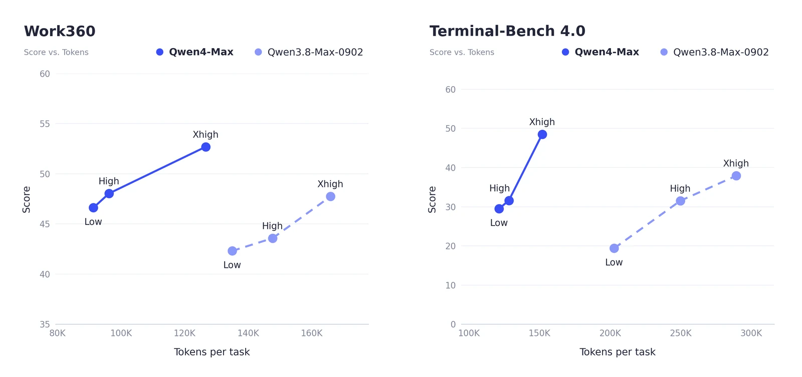
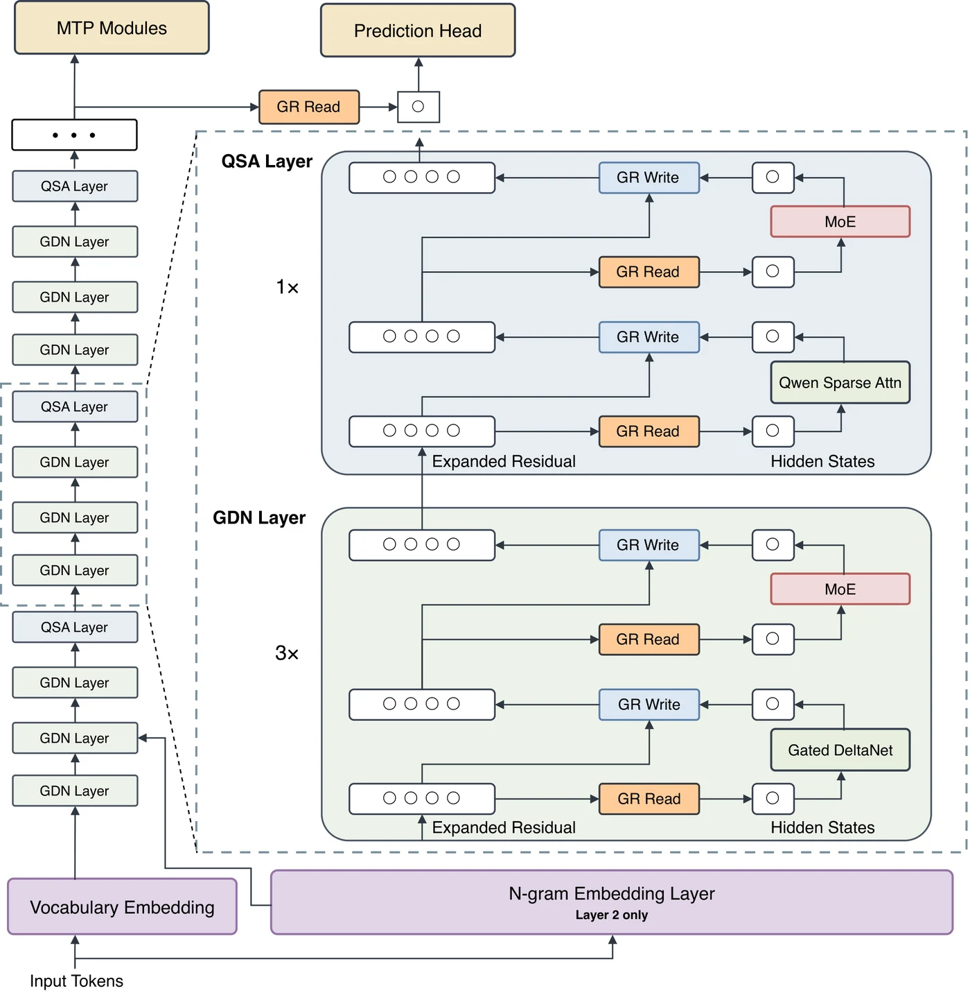

Qwen4-Max, the closed flagship that Alibaba's Qwen team released on November 16, 2026, lands level with Claude Opus 5.5 and GPT-6.1 Sol on agentic coding in Qwen's own benchmark chart, and well behind them on terminal work, software replication and vision. The independent Artificial Analysis Intelligence Index scores it 43, below Kimi K3.1 Pro. Where it stands out is cost: at $1.50 per million input tokens and $4.50 per million output, it had the second-lowest cost per task of the nine models in that index's cost chart.

Qwen first opened the model on November 11 as a Token Plan preview. The release adds pay-as-you-go API access and an OpenRouter listing, and the preview model ID stops working after November 25, so integrations built during the preview week need a model and settings change.

| Question | Short answer |
|---|---|
| Size | 2.4T-parameter MoE backbone, 71B active per token, plus 328B N-gram Embedding parameters (Qwen). |
| Context and input | 1M tokens; text, image and video in, text out. |
| Where it leads (Qwen's chart) | HLAB-Vals legal work 21.3; level on DeepSWE v1.1 at 75.7. |
| Where it trails (Qwen's chart) | Terminal-Bench 4.0 48.5, ProgramBench 31.5, chart and video understanding. |
| Independent score | 43 on the Artificial Analysis Intelligence Index v5.0.1, $3.27 per task. |
| Price | $1.50 in / $4.50 out per 1M tokens, $0.075 cached input. |
| Weights | Not released; smaller Qwen4 models are promised as open source. |

## Qwen4-Max Benchmarks vs Opus 5.5, GPT-6.1 Sol and Kimi K3.1 {#qwen4-max-benchmarks}

Qwen4-Max matches the frontier closed models on agentic coding and professional-services tasks in Qwen's launch chart, leads them on legal agent work, and trails them on terminal coding, software replication, hard reasoning and vision. The chart at the top of this page is Qwen's; it compares Qwen4-Max with its predecessor Qwen3.8-Max-0902, Opus 5.5, GPT-6.1-Sol, GPT-6-Astra and Kimi K3.1 across 16 tests.

Several scores are cited from outside leaderboards rather than run by Qwen: Artificial Analysis for AA-Briefcase and AutomationBench-AA, Arena for CodeArena and AgentArena, Mercor for APEX-Agents and Vals for HLAB-Vals, according to the post's footnotes. The rest come from Qwen's own runs.

| Benchmark (what it tests) | Qwen4-Max | Qwen3.8-Max | Opus 5.5 | GPT-6.1-Sol | GPT-6-Astra | Kimi K3.1 |
|---|---|---|---|---|---|---|
| DeepSWE v1.1 (agentic coding) | **75.7** | 69.3 | 74.2 | 75.2 | 74.1 | 75.5 |
| CodeArena Elo (web development) | 1750 | 1676 | **1816** | 1742 | 1763 | 1686 |
| Terminal-Bench 4.0 (terminal coding) | 48.5 | 38.9 | 59.6 | 56.1 | 59.1 | **67.2** |
| ProgramBench (software replication) | 31.5 | 28.0 | **65.0** | 52.5 | 55.0 | 25.0 |
| AA-Briefcase Elo (knowledge work) | 1686 | 1605 | **1801** | 1555 | 1569 | 1674 |
| APEX-Agents v1.1 (professional services) | 72.1 | 63.3 | **73.5** | 60.0 | 64.7 | 65.5 |
| HLAB-Vals-1.1 (legal agent work) | **21.3** | 15.4 | 9.2 | 6.3 | 7.1 | 11.7 |
| AutomationBench-AA (SaaS workflows) | 72.5 | 56.2 | 69.5 | 64.9 | 68.5 | **73.3** |
| HealthBench Professional | 60.0 | 39.6 | 59.9 | 65.1 | **66.0** | 57.2 |
| Humanity's Last Exam | 51.7 | 43.9 | **59.8** | 54.0 | 53.6 | 51.1 |
| Chartography (chart understanding) | 54.2 | 42.0 | 66.3 | 67.8 | **71.1** | 50.0 |
| Video-Index (video understanding) | 68.1 | 63.2 | 74.8 | 73.8 | **76.7** | 63.2 |

*Selected rows read from Qwen's benchmark chart in the Qwen4-Max launch post. Bold marks the top score in each row. Three further rows (JobBench, BioMysteryBench, Agents' Last Exam) and the AgentArena row are in the cover chart.*

### Where Qwen4-Max leads or ties

The coding headline is DeepSWE v1.1, where all five frontier entries sit within 1.6 points of each other and Qwen4-Max has the top number. Legal work is the one clear lead: on HLAB-Vals-1.1 it scores 21.3, more than double Opus 5.5's 9.2. On AutomationBench-AA it is 0.8 points behind Kimi K3.1 and ahead of all three closed models; on APEX-Agents it is 1.4 points behind Opus 5.5 and ahead of both GPT models.

### Where it trails the closed models

Terminal-Bench 4.0 and ProgramBench are the two coding tests with the widest gaps. On ProgramBench, which asks a model to replicate black-box software, Opus 5.5 scores more than twice as high (65.0 against 31.5). Vision is the other weak area: on chart and video understanding Qwen4-Max is 6 to 17 points behind the three closed models, despite native image and video input. On AgentArena's net-improvement measure it shows 7.5, against 18.2 for Opus 5.5.

Against its predecessor the chart shows a gain on every test where Qwen3.8-Max is plotted, the largest on HealthBench Professional (39.6 to 60.0) and Agents' Last Exam v1.1 (27.9 to 46.7). For a similar table built around Opus 5.5, see our [breakdown of Claude Fable 5.2's scores against Opus 5.5](/tutorials/claude-fable-5-2/).

## Qwen4-Max Independent Benchmarks: Artificial Analysis and Arena {#qwen4-max-independent-benchmarks}

Independent testers place Qwen4-Max a tier below the closed frontier. Artificial Analysis scores it 43 on Intelligence Index v5.0.1, ranked 38th of 81 models and above the class median of 41. On the index's headline chart the models above it include Claude Fable 5.2 at max effort (65), Gemini 4 Carbon (60), Claude Opus 5.5 (59), GPT-6 Astra (57), GPT-6.1 Sol (55) and Kimi K3.1 Pro (46).

The index combines nine evaluations, among them Terminal-Bench 4.0, FrontierCode-AA 2.0, HLE-Diamond and Terminal-Bench-Science 0.1. That mix leans toward the terminal and hard-reasoning work where Qwen's own chart already shows Qwen4-Max behind. Commenters in the [Hacker News launch thread](https://news.ycombinator.com/item?id=50513215) disputed the weighting, arguing that aggregates like this hide the breakdown that matters for a given workload.

Arena, which supplied two rows of Qwen's chart, published its own rankings on launch day. Qwen4-Max entered the Code Arena WebDev leaderboard at sixth place with a preliminary 1,750 points, 74 above Qwen3.8-Max (0902), and debuted 14th overall on Agent Arena with a +7.5% net improvement score. Arena described it as the top Chinese model on both leaderboards.

## Qwen4-Max Cost per Task and Token Use {#qwen4-max-cost-per-task}

Qwen4-Max is cheap to run per task even though it writes a lot of tokens. Artificial Analysis spent $3.27 per Intelligence Index task on it, the second-lowest of the nine models in its cost chart: GPT-6.1 Sol at max effort cost $1.27, Kimi K3.1 Pro $3.68, Opus 5.5 at max effort $10.04 and Claude Fable 5.2 at max effort $26.54.

The low bill comes from price rather than brevity. Artificial Analysis counted 127M output tokens across its index runs, against a median of 78.6M, and rates the model "very verbose." Qwen's token-efficiency claim is relative to Qwen3.8-Max-0902: at Xhigh and High effort, Qwen4-Max uses about 24% and 35% fewer tokens on Work360, and about 48% and 49% fewer on Terminal-Bench 4.0, while scoring higher.

*Score against tokens per task at Low, High and Xhigh effort, Qwen4-Max versus Qwen3.8-Max-0902. Chart by the Qwen Team, from the Qwen4-Max launch post.*

Qwen also reports that the average cost of one Work360 task fell from $4.43 to $1.67, a 62% cut, helped by lower API prices and especially cheaper cached input. Work360 is Qwen's own benchmark of industry tasks, spanning 26 top-level domains and 721 specialised fields, and Qwen4-Max scores 52.69 on it against 47.74 for Qwen3.8-Max. Both numbers are Qwen's, measured on its own benchmark.

Put together, the numbers suggest routing specific work to Qwen4-Max. Document-heavy agent work such as legal review, SaaS automation and professional-services tasks is where Qwen4-Max scores close to or above the closed models at roughly a third of Opus 5.5's per-task cost on the independent index. Terminal-heavy coding, black-box software replication and chart or video reading are where the same chart says to keep a closed model, and a trial on your own tasks will show whether its long outputs erase the price gap.

For agent workloads, the useful number is cost per completed task, not price per token. Our guide to [cost per successful task for coding agents](/tutorials/coding-agents-finops-cost-per-successful-task/) covers how to measure it, and the [Gemini 4 Hydrogen benchmark review](/tutorials/gemini-4-hydrogen-benchmarks/) shows how independent cost-per-task data can guide the choice of thinking level.

## Qwen4 Architecture: Gated DeltaNet, Qwen Sparse Attention and N-gram Embedding {#qwen4-architecture}

Qwen4 is a sparse mixture-of-experts design that changes three parts of the transformer: attention, the residual stream and the embeddings. Qwen4-Max has a 2.4-trillion-parameter backbone with 71 billion parameters active per token, plus 328 billion parameters in a separate N-gram Embedding table, according to Qwen's launch post.

*Qwen4-Max architecture. Diagram by the Qwen Team, from the Qwen4-Max launch post.*

### Attention: three Gated DeltaNet layers per Qwen Sparse Attention layer

For every Qwen Sparse Attention (QSA) layer there are three Gated DeltaNet (GDN) layers, which compress the history into a fixed-size state instead of attending over every past token. The QSA layer then uses a lightweight indexer to pick relevant context at micro-block granularity, which Qwen says cuts both attention and indexing cost on long sequences. The 3-to-1 ratio matches [Qwen 3.8 27B's hybrid layer layout](/tutorials/qwen-3-8-27b/), where the fourth block is gated attention; Qwen4 puts the sparse QSA layer in that slot.

### Gated Residual and N-gram Embedding

Gated Residual widens the residual stream into four parallel branches, with learned read and write gates deciding what each layer takes from and adds to them. Qwen says the 2.4T pre-training run had no loss spikes and attributes that mainly to the architecture and optimizer changes, with Gated Residual named as a stability fix. N-gram Embedding adds a lookup at the second layer that returns representations of local token patterns, adding capacity with little extra computation. The diagram also shows multi-token prediction (MTP) modules beside the prediction head.

Qwen reports that the resulting base model, Qwen4-Max-Base, has 5% to 13% lower bits per byte than Qwen3.8-Max-Base across knowledge, code, QA and STEM in its in-house evaluations, while activating 25% fewer parameters.

## Qwen4 Max API Pricing and Settings {#qwen4-max-api}

Qwen4-Max costs $1.50 per million input tokens, $4.50 per million output tokens and $0.075 per million cached input tokens, a 95% cache discount, in the Alibaba Cloud listings on OpenRouter and Artificial Analysis. It is available on QwenCloud through pay-as-you-go API access or a Token Plan subscription, in Qwen Studio, QwenWork and the Qoder IDE, and on OpenRouter as `qwen/qwen4-max`.

On OpenRouter it accepts text, image and video input with a 1M-token context window, supports tool calling and structured outputs, and offers reasoning effort of low, high or xhigh (default high) or reasoning turned off. Alibaba Cloud International was the only provider in its first days, with a median throughput of about 51 tokens per second, a 0.42% tool-call error rate and a 1.96% structured-output error rate. OpenRouter's weighted average input price was $0.277 per million tokens because 85.9% of input hit the cache.

### qwen4-max-preview vs qwen4-max

Anyone who started on the preview should move before it is retired. Alibaba Cloud's Model Studio documentation lists these preview details:

| Setting | qwen4-max-preview | qwen4-max (release) |
|---|---|---|
| Access | Token Plan only, dedicated base URL | Pay-as-you-go API or Token Plan; OpenRouter |
| Availability | Nov 11 10:00 to Nov 25 24:00, 2026 (UTC+8), then retired | From Nov 16, 2026 |
| Reasoning effort | low, medium, xhigh (default xhigh) | low, high, xhigh (default high) or off, per OpenRouter |
| Output limit | 393,216 tokens shared by thinking and answer | Check the QwenCloud model page |
| API formats | OpenAI Chat Completions, Responses, Anthropic Messages | OpenAI-compatible on OpenRouter; check QwenCloud docs for others |

The preview documentation also flags two behaviours that start with this model generation. From qwen4-max-preview onward, `max_tokens` in Chat Completions behaves like `max_completion_tokens`, so the limit covers thinking and the final answer together and an old answer-sized limit can truncate output. In multi-turn chats, earlier reasoning goes back in each assistant message's `reasoning_content` field, not concatenated into `content`. Setting `reasoning_effort` and `thinking_budget` together is not allowed.

For another 1M-context Chinese agent model with Anthropic-compatible access, see our [LongCat 2.5 API pricing and Claude Code setup guide](/tutorials/longcat-2-5/). If budget is the main constraint, [Meta's Muse Ember](/tutorials/muse-ember/) shows what a much cheaper agent model, at $0.10/$0.50 per million tokens, gives up.

## Qwen4-Max FAQ {#qwen4-max-faq}

### When was Qwen4-Max released?

Qwen opened Qwen4-Max as a Token Plan preview on November 11, 2026, and released the general-availability model on November 16, 2026. The preview model ID, `qwen4-max-preview`, is retired after 24:00 on November 25, 2026 (UTC+8).

### Is Qwen4-Max open source?

No. Qwen4-Max is a proprietary model served through QwenCloud, Qwen's own apps and OpenRouter, and no weights have been published. Qwen says smaller Qwen4 models will be released as open source, built with the same generation of techniques. Until then, [Qwen 3.8 27B](/tutorials/qwen-3-8-27b/) remains the current open-weights option from the family.

### What changes when moving from qwen4-max-preview to qwen4-max?

The preview ran on Token Plan only, with reasoning effort low, medium or xhigh and xhigh as the default. On OpenRouter the released model offers low, high or xhigh with high as the default, or reasoning turned off. Pay-as-you-go API pricing is $1.50 per million input tokens and $4.50 per million output tokens.

## References {#references}

1. Qwen Team, "[Qwen4-Max: Your New Teammate Has Arrived](https://qwen.ai/blog?id=qwen4-max)," launch post and benchmark charts, November 16, 2026.
2. Artificial Analysis, "[Qwen4 Max: Intelligence, Performance & Price Analysis](https://artificialanalysis.ai/models/qwen4-max)," Intelligence Index v5.0.1, read November 16, 2026.
3. Arena (@arena), [post on Qwen4-Max's Code Arena WebDev and Agent Arena debut](https://x.com/arena/status/2122153582384583156), November 16, 2026.
4. OpenRouter, "[Qwen: Qwen4 Max](https://openrouter.ai/qwen/qwen4-max)," pricing, providers and performance, read November 16, 2026.
5. Alibaba Cloud Model Studio, "[qwen4-max-preview](https://www.alibabacloud.com/help/en/model-studio/qwen4-max-preview)," model documentation updated November 16, 2026.
