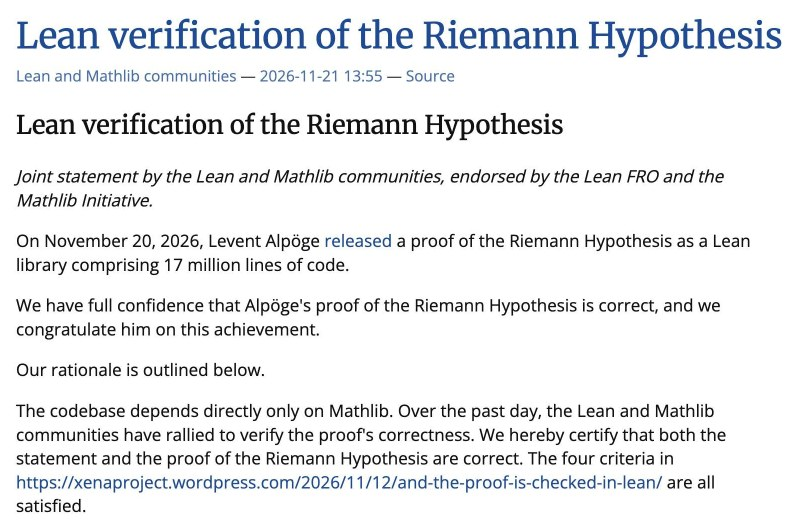
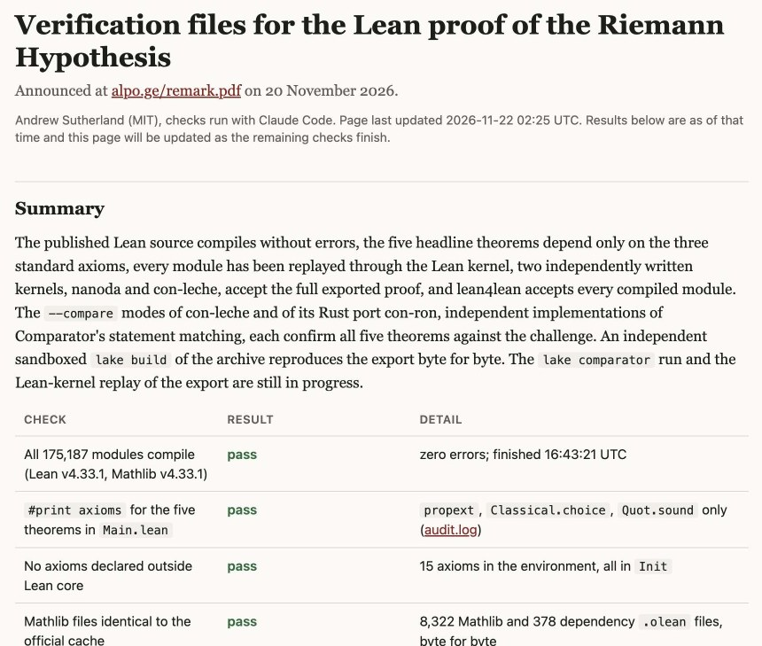

The Riemann hypothesis Lean proof that Anthropic mathematician Levent Alpöge released on November 20, 2026 has passed every check the Lean and Mathlib communities set for it: the theorem it proves is Mathlib's own statement of the Riemann Hypothesis, the 17-million-line library compiles, and several independently written proof checkers accept the exported proof. Alpöge says he found the proof working with Claude over roughly six weeks and published only the formal Lean code, with no human-readable paper. This page explains how each check works, what the proof covers, what was still running when we checked, and why the Clay Mathematics Institute still lists the problem as unsolved.

## Riemann Hypothesis Lean Proof at a Glance {#riemann-hypothesis-lean-proof-at-a-glance}

The Riemann hypothesis Lean proof is a formal proof, written for the Lean 4 proof assistant, that every nontrivial zero of the Riemann zeta function has real part 1/2. It was announced on November 20, 2026 and certified by the Lean and Mathlib communities on November 21.

| Question | Short answer |
|---|---|
| Who released it | Levent Alpöge, a member of technical staff at Anthropic, working with Claude |
| What was released | A four-page note and a Lean library split into 14 archive parts |
| Size | About 17 million lines of Lean in 175,187 modules; depends directly only on Mathlib |
| What is proved | The Riemann Hypothesis and the Generalized Riemann Hypothesis for Dirichlet L-functions |
| Who checked it | Lean and Mathlib communities (joint statement endorsed by the Lean FRO and the Mathlib Initiative); MIT mathematician Andrew Sutherland published a full verification log |
| Official status | Clay Mathematics Institute still lists the Riemann Hypothesis as unsolved |
| Human-readable proof | None yet; Alpöge says he intends to write one |

*Status as of Sutherland's log update at 02:25 UTC on November 22, 2026.*

## Anthropic Riemann Hypothesis Claim: What Alpöge and Claude Released {#anthropic-riemann-hypothesis-claim}

Alpöge's note opens with a direct claim: "I believe I have, working with Claude, discovered a proof of the Riemann Hypothesis." He writes that the method extends to the Generalized Riemann Hypothesis, that he expects the Extended Riemann Hypothesis "with more time," and that "Claude and I have also formalized the arguments without assumptions." Anthropic did not respond to the Associated Press when asked for comment on the claim.

The note describes a division of labor. Alpöge steered the approach from a toy setting modeled on Stepanov's argument for the Riemann Hypothesis over function fields, where a divisor with multiplicity does the work. Over the integers, multiplicity is hard to come by. Claude proposed chaining theta lifts to mimic it, and suggested that the chain should have length √X for a von Mangoldt sum of length X. "Claude far outpaced me near the finish line," he writes. A timeline on the last two pages runs from a first step on October 6 to "GRH" on November 16.

He chose to publish only Lean. A text version produced along the way ran past 250,000 pages, and he calls a conventional write-up at this stage an unreadable document he did not want to post. He also acknowledges that he is "presenting the world with a complete argument before having mastered a massive neighbourhood around its mathematics." The note went up the day after Anthropic's shares began trading on Nasdaq; Alpöge calls the timing "horrible" and says he found the proof late on a Sunday night and then asked Anthropic CEO Dario Amodei whether he could announce it.

## How Lean Proof Verification Works for the Riemann Hypothesis {#how-lean-proof-verification-works}

Lean proof verification works by checking four separate things, each of which can fail on its own: the formal statement must say what mathematicians mean, the code must compile, the theorem it proves must be exactly that statement, and the proof must survive a trusted kernel. Kevin Buzzard set out these four questions on his Xena blog on November 12, 2026, for judging AI-generated Lean code, and the Lean and Mathlib joint statement certifies Alpöge's library against all four.

*The joint statement on the Lean community blog, November 21, 2026. Screenshot of leanprover-community.github.io.*

| Check | Failure it rules out | How it was done here |
|---|---|---|
| 1. Statement is correct | A formal statement that looks like the theorem but means something else | The proof targets `RiemannHypothesis`, a definition already in Mathlib and vetted by Lean and number theory experts |
| 2. Code compiles | A proof that never actually builds | Dozens of people compiled the library and reproduced the same raw proof export |
| 3. Proof matches the statement | Hidden redefinitions or extra axioms buried in millions of lines | A challenge file importing only Mathlib was compared with the proved theorem by comparator and `con-leche --compare` |
| 4. Proof is valid | A proof that exploits a bug in Lean's kernel | The export was accepted by Lean's official kernel and by independent checkers, including con-leche and con-ron |

### Check 1: does the Lean statement mean the Riemann Hypothesis?

Formal statements can compile and still be wrong. Buzzard's example is a Lean version of Fermat's Last Theorem over the natural numbers: because Lean's ℕ includes 0, the statement is trivially false (take a = b = c = 0), yet it compiles. Alpöge's library avoids this problem by proving Mathlib's existing definition. Sutherland's log quotes it: every zero of ζ other than the trivial zeros −2, −4, −6, … has real part 1/2. The extra condition s ≠ 1 is there because Mathlib assigns ζ a conventional value at its pole.

### Check 2: does the library compile?

Sutherland reports that all 175,187 modules compile on Lean v4.33.1 with Mathlib v4.33.1 with zero errors. A separate rebuild in a sandbox with no network access and read-only sources, on a different machine, reproduced the published proof export byte for byte. One of the 175,187 compiled files differs between builds because that module compiles non-deterministically; the exported proof itself matched.

### Check 3: is the proved theorem exactly the stated one?

This check guards against a trick that a reviewer could never spot by reading: somewhere in 17 million lines, a definition gets quietly changed or a new axiom declares the result true. The community wrote a challenge file that contains only the statement and imports only Mathlib, then compared it against Alpöge's theorem with two independent tools. Sutherland's log shows `#print axioms` for the five headline theorems returning only `propext`, `Classical.choice` and `Quot.sound`, Lean's three standard axioms, and no axioms declared outside Lean's core.

### Check 4: could a Lean kernel bug have let a false proof through?

Lean has had a soundness bug before; Buzzard notes one that was fixed four hours after it was found. So the exported proof was replayed through checkers written independently of Lean's own kernel. Sutherland's log lists nanoda, a Rust kernel, accepting the full export, con-leche accepting 1,468,418 declarations in its verified mode, and lean4lean accepting every compiled module. The joint statement adds that con-leche and con-ron come with a formal proof, relative to set theory, that they cannot accept a false proof. All of these checks ran on an inert export of the proof, so malicious code in the Lean sources could not interfere with them.

*Summary and first checks from Andrew Sutherland's verification files at math.mit.edu/~drew/grh/, version of 02:25 UTC, November 22, 2026.*

Sutherland ran his checks with Claude Code. At his 02:25 UTC update on November 22, two runs were still going: the Lean default and paranoid kernels on the full export, and an end-to-end `lake comparator` run whose statement comparison and axiom check had already passed.

## Riemann Hypothesis Lean Proof Size and Compute {#riemann-hypothesis-lean-proof-size}

The Riemann hypothesis Lean proof is about 17 million lines of code in 175,187 modules, and its raw proof export is 61,570,595,788 bytes, roughly 61.6 GB. Nobody can read that line by line, which is why every check above is mechanical. Alpöge distributed the library as 14 compressed archive parts on his website.

| Measurement | Value (Sutherland's log) |
|---|---|
| Modules compiled | 175,187, zero errors |
| Mathlib and dependency files | 8,322 Mathlib and 378 dependency `.olean` files, identical to the official cache |
| Raw proof export | 61,570,595,788 bytes |
| Declarations in the export | 1,468,418 (accepted by con-leche) |
| nanoda full-export check | 27 min 42 s on 80 threads |
| con-leche full-export check | 3 min 15 s on 64 threads |
| con-ron statement comparison | 7 min 6 s on 64 threads |

Scale is now a practical barrier to independent checking. Buzzard wrote that when he was asked to review an earlier 13-million-line Anthropic formalization of Fermat's Last Theorem, his own machine ran out of memory and he needed temporary access to a 96-core machine with 500 GB of RAM to compile it. Checking a proof like this one is open to anyone in principle, but in practice it takes server-class hardware.

## What the Lean Proof Covers: RH and GRH for Dirichlet L-Functions {#what-the-lean-proof-covers}

The Lean proof covers the classical Riemann Hypothesis and the Generalized Riemann Hypothesis for Dirichlet L-functions, stated as five theorems in the submission's `Main.lean`. Sutherland's log reproduces them as they appear in the challenge file, using only Mathlib's definitions:

1. **The Riemann Hypothesis** in Mathlib's own form (`riemannHypothesis : RiemannHypothesis`).
2. **The same statement** written out in the submission's own words, which Lean accepts as equal by definition.
3. **No zeros right of the critical line** for any Dirichlet L-function: for every modulus N ≥ 1 and every character χ mod N, L(χ, s) ≠ 0 when Re s > 1/2, except the trivial character at its pole s = 1.
4. **Zeros in the critical strip lie on Re s = 1/2** for every Dirichlet L-function.
5. **The same for primitive characters**, the form in which GRH for Dirichlet L-functions is usually stated.

The scope stops there. Sutherland's log states that Dedekind zeta functions, Hecke L-functions and automorphic L-functions in general were not among the statements checked. Alpöge's note says only that he expects the Extended Riemann Hypothesis "with more time."

As a cross-check that does not rely on Mathlib's definition of ζ, Sutherland combined the proof with an independent Lean formalization of Robin's and Lagarias's criteria. The combined library proves two inequalities about the divisor sum σ(n) with no mention of the zeta function: Robin's inequality for every n > 5040, and Lagarias's inequality for every n > 0. Both are known to be equivalent to the Riemann Hypothesis, and both pass the same comparison checks.

## Has the Riemann Hypothesis Been Proven? Clay Status and Prize Rules {#has-the-riemann-hypothesis-been-proven}

The Riemann Hypothesis has a formal proof that the Lean and Mathlib communities certify as correct, but it has not been officially recognized as solved. On November 22, 2026, the Clay Mathematics Institute's problem page still marked it "Unsolved," noting that the hypothesis has been checked for the first 10 trillion zeros.

Clay's Millennium Prize rules set three conditions before the institute will even consider a solution: publication in a qualifying outlet, at least two years since that publication, and general acceptance in the global mathematics community. A Lean library on a personal website meets none of them yet. Clay president Martin Bridson told the AP that the announcement is "of historic significance" and that "the journey from today's announcement to a place of real understanding will be long and difficult."

The Lean certification and Clay's position answer different questions. The joint statement certifies the formal argument, and its authors say they "look forward to all the activity in the mathematical community that will help explain the new ideas in this proof." Recognition by Clay waits on that explanation and on time.

## Riemann Hypothesis Proof Write-Up: What Lean Does Not Explain {#riemann-hypothesis-proof-write-up}

A Lean proof establishes that the theorem is true; it does not tell mathematicians why. Alpöge's note sketches the ideas in compressed form, with theta lifts between unitary groups, Iwasawa towers and a relative trace formula, and warns in a footnote that where Claude is the expert he is paraphrasing a "slop" summary that "might make zero sense." He writes that he intends "to understand and impart understanding of this argument and its certain simplifications" and to write it properly.

Buzzard's post adds a caution for when that write-up arrives: a correct Lean proof does not make an accompanying paper correct. He cites OpenAI's earlier Navier–Stokes work, where the PDF write-up and the Lean proof diverged in places, and notes that some experts now use AI to turn Lean proofs back into English rather than reading the PDF. For the Riemann Hypothesis, the Lean library is the reference text, and any paper will need to be checked against it.

## Verifying AI-Generated Lean Proofs: A Pattern for AI Builders {#verifying-ai-generated-lean-proofs}

The Riemann checks follow a verification pattern that also applies to AI agents outside mathematics: trust a small, human-checked specification, treat everything the model produced as untrusted, and let several independent checkers decide. The challenge file plays the role of the specification, and the kernels play the role of tests the model cannot influence.

Three parts of that pattern carry over directly to agent work:

- **Pin the specification outside the model's reach.** The statement lived in Mathlib, written and reviewed before the proof existed. Agent tests work the same way when the agent cannot edit them, a setup we walk through in [our guide to Claude Code verification](/tutorials/claude-code-verification/).
- **Assume the model may optimize for passing.** Buzzard frames checks 3 and 4 around reward hacking: hidden axioms, redefinitions, or kernel exploits. Research on [reward-seeking in RL-trained models](/tutorials/measuring-reward-seeking-contrastive-beliefs/) is why verifiers now take that threat seriously.
- **Run checks on inert artifacts with diverse tools.** The proof was exported and checked by kernels written in different languages, so a single bug or a malicious build script could not decide the outcome.

AI-assisted results in mathematics are arriving quickly. A month earlier, OpenAI and Anthropic each posted preprints claiming to [refute the Exponential Time Hypothesis](/tutorials/exponential-time-hypothesis-ai/), and OpenAI's study of 1,819 scientists showed how much everyday research work already runs through AI, as we covered in [ChatGPT for academic researchers](/tutorials/chatgpt-for-academic-researchers/). The Riemann proof shows that formal verification can certify such a result within a day, while human understanding of it may take years. For teams choosing which Claude model to run long agentic work on, our [Claude Fable 5.2 review](/tutorials/claude-fable-5-2/) compares the current top models.

## References {#references}

1. Levent Alpöge, [untitled announcement note (remark.pdf)](https://alpo.ge/remark.pdf), November 20, 2026.
2. Lean and Mathlib communities, [Lean verification of the Riemann Hypothesis](https://leanprover-community.github.io/blog/posts/riemann-hypothesis/), joint statement endorsed by the Lean FRO and the Mathlib Initiative, November 21, 2026.
3. Andrew Sutherland (MIT), [Verification files for the Lean proof of the Riemann Hypothesis](https://math.mit.edu/~drew/grh/), page version of 02:25 UTC, November 22, 2026.
4. Kevin Buzzard, Xena Project, ["…and the proof is checked in Lean"](https://xenaproject.wordpress.com/2026/11/12/and-the-proof-is-checked-in-lean/), November 12, 2026.
5. Clay Mathematics Institute, [Riemann Hypothesis](https://www.claymath.org/millennium/riemann-hypothesis/) and [Rules for the Millennium Prize Problems](https://www.claymath.org/millennium-problems/rules/), accessed November 22, 2026.
