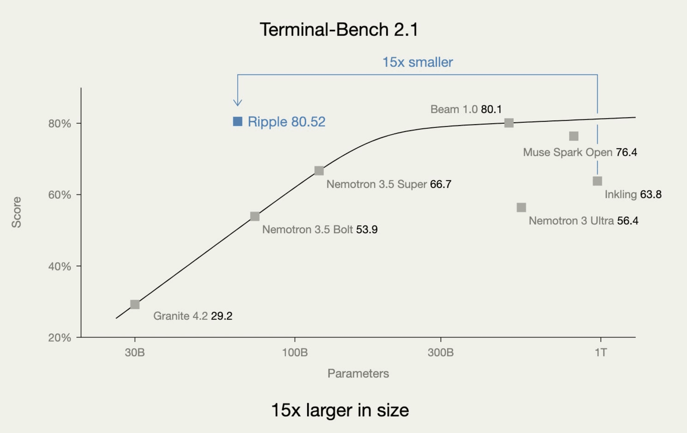
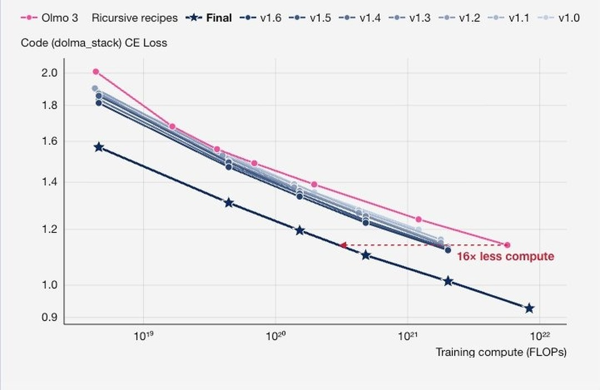

Ricursive Intelligence has released **Ripple-65B Preview**, a 65B-parameter dense open-weight model built for agentic coding, under the Apache 2.0 license. The company reports a score of 80.52 on Terminal-Bench 2.1, which it calls the best result among U.S. open-weight models, beating MoE models with 501B to 975B total parameters. The release, published on November 4, 2026, includes an instruction-tuned model in BF16 and NVFP4, a base model, and a speculative-decoding drafter. The NVFP4 version is small enough to serve on one NVIDIA DGX Spark.

This guide covers what Ricursive has shown, what the benchmark table also shows when you read past the headline, and what it takes to run the model.

## What Is Ripple-65B Preview

Ripple-65B Preview is a general-purpose version of the language model Ricursive Intelligence trained from scratch for its own chip-design platform. According to the launch post, an internal variant still powers that platform; the open release is tuned mainly for agentic coding, with "relatively light posttraining," as the model card puts it.

The release has four Hugging Face repositories:

| Repository | What it is |
|---|---|
| Ripple-65B-Preview | Instruction-tuned model, BF16 (about 130 GB of weights) |
| Ripple-65B-Preview-NVFP4 | Same model with NVFP4 MLP weights, marked experimental (about 57 GB) |
| Ripple-65B-Base-Preview | Pretrain-only checkpoint, no midtraining or synthetic QA data |
| Ripple-65B-Preview-DFlash2 | 4.04B-parameter draft model for speculative decoding |

The model takes text in and produces text out, and it supports native tool calling. "Preview" is Ricursive's own label; the company describes this as its first model.

## Who Is Ricursive Intelligence

Ricursive Intelligence describes itself as "a full-stack artificial intelligence lab building self-improving systems by co-optimizing hardware, software, and model." Its core product is an AI chip-design platform, and Ripple was trained to power it. The model card says the team grew from one to five people during development.

The name is easy to confuse with "recursive"; several Hacker News readers mixed it up with an unrelated company at recursive.com.

## Ripple-65B Preview Specs and Architecture

Ripple-65B Preview is a dense Transformer: all 65B parameters are active for every token. The model card says Ricursive chose dense over mixture-of-experts to keep training and serving infrastructure simple, and reports 40% model FLOPs utilization through pretraining and post-training with "no custom kernels, and no quantization."

| Spec | Value | Source |
|---|---|---|
| Parameters | 65B, dense | Model card |
| Layers / hidden size | 80 / 5,120 ("thin-and-deep") | config.json |
| Attention heads | 80 query, 8 key-value | config.json |
| Sliding-window size | 1,024 tokens | config.json |
| Vocabulary | 100,352 | config.json |
| Pretraining data | 12T tokens, text-only, mostly English and code, 8K sequence length | Model card |
| Max context | Up to 1M tokens supported; config allows 2,097,152 positions | Model card, config.json |
| License | Apache 2.0 | LICENSE file |

Ricursive says it switched from the Olmo 3 Llama-like layout to a Gemma 3N-like one for training stability, added extra attention heads, a higher ratio of sliding-window to global layers, gated attention, global NoPE, FFN activation clipping and value residuals.

Post-training ran in five stages, per the model card:

| Stage | Tokens | Sequence length |
|---|---|---|
| Midtrain | 200B | 64K |
| Long context | 6.5B | 2M |
| SFT | 183B | 128K |
| Long-context SFT | 13.5B | 2M |
| RL | 700 steps | 128K |

## Ripple-65B Terminal-Bench 2.1 Score

Ripple-65B Preview scored 80.52 on Terminal-Bench 2.1 in Ricursive's testing, the headline number of the launch. Terminal-Bench measures whether a model can complete real tasks in a command-line environment. Ricursive compares Ripple only with U.S. open-weight models:

| Model | Total params | Terminal-Bench 2.1 (each vendor's reported score) | Terminal-Bench 2.1 (Terminus 2 harness) |
|---|---|---|---|
| Ripple-65B Preview | 65B dense | **80.5** | **80.5** |
| Reflection Beam | 501B MoE (23B active) | 80.1 | 70.8* |
| Meta Muse Spark Open | 816B MoE (42B active) | 76.4 | 78.7* |
| Thinking Machines Inkling | 975B MoE (41B active) | 63.8 | 56.2* |
| NVIDIA Nemotron 3 Ultra | 550B MoE (55B active) | 56.4 | 55.1* |

*Scores marked with an asterisk are Ricursive's own runs, not the other labs' published numbers. Source: Ripple-65B Preview model card.*

Two details matter for reading this table:

- **The margin over Beam is 0.4 points** on the vendor-reported row. Ricursive itself notes that "replicating benchmark scores has been challenging" and calls its table "a best-effort attempt at a fair comparison."
- **"15x smaller" refers to total parameters.** Ripple activates 65B parameters per token, more than any MoE model in the table; Beam activates 23B. The smaller total footprint is what helps memory and local deployment, not per-token compute.

*Ricursive's chart of Terminal-Bench 2.1 score against total parameter count. The fitted curve is Ricursive's. Image: Ricursive Intelligence.*

## Ripple-65B Preview Benchmarks: Where It Trails

The full model card table shows that Ripple-65B Preview does not lead most benchmarks. All numbers below come from that table; italic entries in the original are Ricursive's own evaluations of the other models.

| Benchmark | Ripple-65B | Best in table |
|---|---|---|
| SWE-bench Verified | 76.5 | 81.6 (Beam) |
| SWE-bench Pro v1.0 | 61.42 | 66.1 (Beam) |
| SWE-bench Pro v2.0 Hard | **79.1** | Ripple leads; Beam 76.5 |
| DeepSWE 1.1 | 44.3 | 60.0 (Muse Spark Open) |
| SciCode | 39.4 (lowest in table) | 58.5 (Muse Spark Open) |
| MCP Atlas | 71.67 | 89.2 (Muse Spark Open) |
| AutomationBench (public) | 36.4 | 42.4 (Muse Spark Open) |
| MMLU-Pro | 84.2 | 87.9 (Muse Spark Open) |
| GPQA Diamond | 85.2 (lowest in table) | 90.6 (Beam) |
| HMMT Feb 2026 | 90.5 | 93.9 (Muse Spark Open, Beam) |
| AA-LCR (long context) | 75.0 | 80.7 (Muse Spark Open) |

On SWE-bench Pro v2.0 Hard and DeepSWE, Ripple ran in the Terminus 2 harness; other unspecified runs used OpenCode. Several competitor scores in those rows are Ricursive's own runs, including Inkling's 2.0 on SWE-bench Pro v2.0 Hard, so the large gaps there depend on Ricursive's harness setup.

The fair summary is that Ripple is strongest on terminal-style agent tasks and competitive on harder SWE-bench Pro problems, while larger U.S. models still lead on general knowledge, scientific coding and tool-use breadth. For how to weigh benchmark wins against what a coding agent costs to run, see our piece on [cost per successful task](/tutorials/coding-agents-finops-cost-per-successful-task/).

## Ripple-65B Preview Training Cost and Recipe

Ricursive says it developed and trained Ripple-65B Preview for $32M, and that this figure covers its full R&D from scratch: pretraining ladder work, data mixing, evaluations, debugging, synthetic data, post-training development and the final runs. The company estimates this is "one-tenth the cost of the previous open-weight SOTA on agentic coding," based on press reports of Reflection's compute commitments. That comparison is Ricursive's estimate; Reflection has not published a matching figure.

Other efficiency claims from the launch post:

- **RL rollouts**: Ricursive says it reached 80.5 on Terminal-Bench 2.1 with 1.4M rollouts, "roughly 70x fewer" than Reflection Beam.
- **Model laddering**: starting from Olmo 3's small-scale model ladder, Ricursive tested changes one at a time. It reports that the final recipe reached the same code loss as the Olmo 3 ladder with 16x less compute at 4B scale, and says the gap grew to 55x for the full run.
- **No bought data**: the company says it did not buy post-training data and built its own synthetic pipelines.

*Ricursive's model-ladder chart: code loss against training compute for the Olmo 3 baseline and each recipe version. Image: Ricursive Intelligence, via a screenshot shared on X.*

The 16x number measures loss on one code dataset at small scale. It describes how efficiently the recipe learns code, not how much faster or better the finished model is at coding.

## Running Ripple-65B on DGX Spark

Ripple-65B Preview runs on a single NVIDIA DGX Spark using the NVFP4 checkpoint and the `spark.py` script in that repository. The script serves the model through SGLang with a 131,072-token context and a BF16 key-value cache. Ricursive says the dense design suits the Spark, which has high compute relative to its memory bandwidth.

What fits where, based on the published files and scripts:

| Setup | Weights | Context in the published recipe |
|---|---|---|
| 1× DGX Spark, NVFP4 | ~57 GB (MLP in NVFP4, attention in BF16; marked experimental) | 128K |
| 2× B200, BF16 + DFlash2 drafter | ~130 GB | 1M by default; the checkpoint supports up to 2M positions |

The two-B200 recipe uses SGLang 0.5.19 with tensor parallelism 2, Linux, CUDA 13 and `uv`, and serves an OpenAI-compatible endpoint. With four GPUs, the README runs two independent copies. The DFlash2 drafter is a 4.04B model that proposes 16 tokens at a time; it was trained on 16K-token sequences, so its window is shorter than the target model's. Ricursive reports 250 tokens per second on 2×B200 at batch size 8, before quantization or custom kernels.

For hobbyists, 65B dense is still large. One Hacker News commenter expected inference to be "prohibitively slow on consumer grade hardware" compared with smaller or MoE models; another replied that people with enough RAM will trade speed for a strong local model. As a local LLM for coding, the published recipe targets the DGX Spark, and even the NVFP4 weights alone are about 57 GB. Our [DeepInfer guide](/tutorials/deepseek-deepinfer/) and [DeepInfer benchmarks](/tutorials/deepinfer-benchmarks/) cover another open serving stack for comparison.

## Ripple-65B Preview API Pricing and License

Ripple-65B Preview is released under Apache 2.0, which allows commercial use, modification and redistribution without extra revenue or user thresholds. The license file in each repository is the standard Apache 2.0 text.

Hosted access, as listed at launch:

- **Platforms**: Hugging Face, Together AI, GMI Cloud and OpenRouter; Ricursive said Fireworks would follow the same day.
- **OpenRouter price**: $0.20 per million input tokens, $0.60 per million output tokens and $0.05 per million cached input tokens, with 1,048,576 tokens of context and up to 131,072 output tokens. On November 5 the only OpenRouter provider was GMI Cloud, serving BF16.

Prices at launch tend to move; check the provider page before you budget. If you route several models through one endpoint, our guide to the [model gateway as enterprise control plane](/tutorials/model-gateway-enterprise-ai-control-plane/) covers the policy side.

## Ripple-65B Preview Early Reception

Early reaction has been strong in volume and mixed in substance. The Hugging Face BF16 repository had 939 downloads and 180 likes by November 5, and the main Hacker News thread reached about 295 points and more than 100 comments. These numbers show interest, not adoption or performance.

Points raised on Hacker News, as commenters' opinions:

- **Narrow comparison set.** Commenters noted that the table leaves out non-U.S. open-weight models such as Qwen, so "SOTA" applies only within the U.S. category Ricursive chose.
- **Why "U.S." matters to some buyers.** One commenter said U.S. government infrastructure does not allow Chinese models to be hosted, so there is a market for U.S.-made open models.
- **Benchmark choice.** Another called the benchmark set odd, saying Terminal-Bench 2.1 is old and SWE-bench has been disavowed by OpenAI.

We found no independent evaluation of Ripple-65B Preview as of November 5, 2026; media coverage so far restates the model card. Compare with [DeepSeek V4.1 Flash 1017](/tutorials/deepseek-v4-1-flash-1017/) for another recent open-weight release, and with [HarnessDev](/tutorials/harnessdev-agent-harness-benchmark/) for how agent harness choice can move benchmark results.

## References

- Ricursive Intelligence, ["Introducing Ripple-65B Preview, a Frontier Open-Weight Model"](https://www.ricursive.com/ripple), Nov 4, 2026
- Ricursive Intelligence, [Ripple-65B-Preview model card](https://huggingface.co/ricursiveAI/Ripple-65B-Preview), Hugging Face
- Ricursive Intelligence, [Ripple-65B-Preview-NVFP4](https://huggingface.co/ricursiveAI/Ripple-65B-Preview-NVFP4), Hugging Face
- Ricursive Intelligence, [Ripple-65B-Base-Preview](https://huggingface.co/ricursiveAI/Ripple-65B-Base-Preview), Hugging Face
- Ricursive Intelligence, [Ripple-65B-Preview-DFlash2](https://huggingface.co/ricursiveAI/Ripple-65B-Preview-DFlash2), Hugging Face
- OpenRouter, [Ripple-65B-Preview](https://openrouter.ai/ricursiveai/ripple-65b-preview), accessed Nov 5, 2026
- Hacker News, [discussion thread](https://news.ycombinator.com/item?id=50369925), Nov 4, 2026
