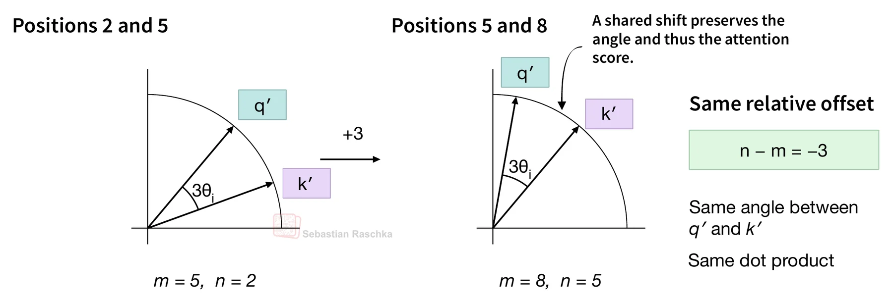
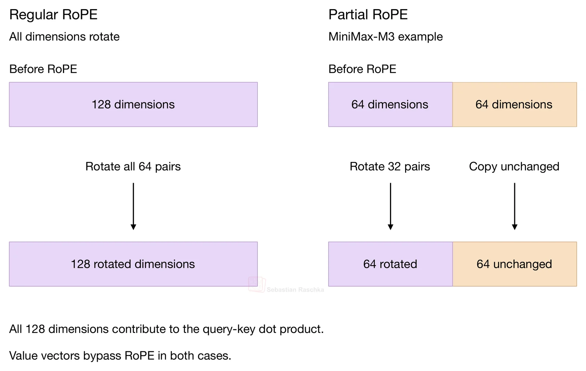
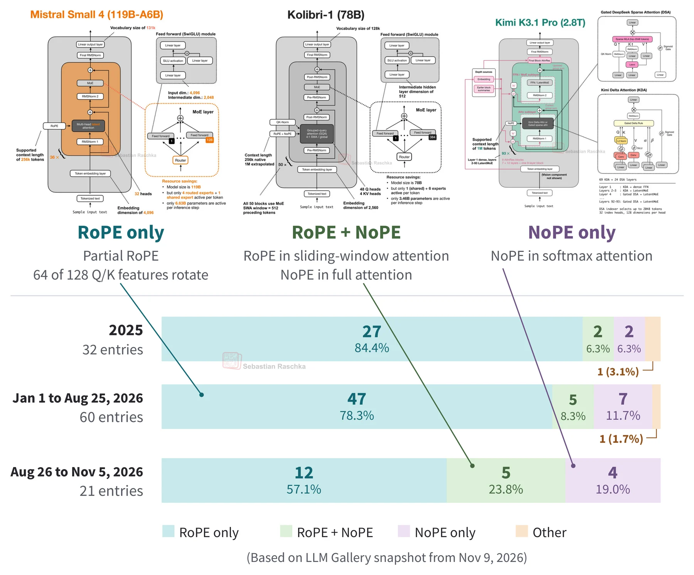

Rotary position embedding (RoPE) is how most open-weight LLMs have tracked word order since Meta's first LLaMA, and it is quietly losing its monopoly. In Sebastian Raschka's gallery of model architectures, 84.4% of 2025 entries applied RoPE in full to every softmax attention layer; among entries released between August 26 and November 5, 2026, that share was 57.1%. The rest rotate only part of each attention head (partial RoPE), skip positional encoding in some layers (NoPE), or drop it from attention altogether.

This guide explains how rotary position embedding encodes position inside attention, then compares the three designs now in use: what each one saves, what the evidence says about accuracy and long context, which recent models use which, and how to check that a checkpoint's position settings were actually applied when you load it. The last point is practical: in August 2026 a mismatch between a config field and the transformers library made MiniMax-M2 checkpoints load cleanly while computing attention with the wrong rotation.

## How rotary position embedding works inside attention {#how-rotary-position-embedding-works}

Rotary position embedding rotates the query and key vectors by an angle that grows with each token's position, just before attention takes their dot product. Because both vectors are turned by their own position, the angle between them reflects only the distance between the two tokens. The value vectors are left alone.

Jianlin Su and colleagues introduced the method in the 2021 RoFormer paper. Older designs worked differently. GPT-2 learns a vector for each absolute position and adds it to the token embedding once, before the first transformer block; the original Transformer added fixed sine and cosine vectors at the same point. RoPE adds nothing to the embeddings. It acts inside every attention layer, on the two vectors whose dot product decides how much one token attends to another.

The rotation works on pairs of features. Each attention head splits its query and key into two-number pairs and treats each pair as an arrow in a plane. A token at position *m* has each pair rotated by *m* × θ, where θ is that pair's frequency. Rotation changes an arrow's direction but not its length, so it carries position without distorting the content stored in the vector.

Raschka's worked example shows why this gives relative position. Take one pair with values (1, 5) in both the query and the key, and θ = 20° per position. A key at position 2 turns 40°, and a query at position 5 turns 100°. The arrows end up 60° apart, and this pair contributes 26 × cos 60° = 13 to the dot product. Move both tokens three places to the right, to positions 5 and 8, and each arrow gains another 60°. The gap is still 60° and the contribution is still 13. Move only the key one place closer and the gap shrinks to 40°, raising the contribution to about 19.92.

*Shifting both tokens by the same amount leaves the angle between the rotated query and key, and so their dot product, unchanged. Figure: Sebastian Raschka, "Understanding Positional Embeddings in Modern LLMs" (Figure 20).*

This property matters for chat models. Put a 100-token system prompt in front of a sentence and every token in it moves 100 places, but the rotations between any two of those tokens stay the same. One caveat from the same article: this holds for fixed query and key vectors. In a real model the prefix also changes what the tokens attend to in earlier layers, which changes the vectors themselves. The RoFormer authors also list a gradual decay of attention between tokens as their distance grows, and compatibility with linear attention, among the method's properties.

## Rotary position embedding frequencies and pairing conventions {#rope-frequencies-and-pairing}

Rotary position embedding gives each feature pair its own rotation speed, set by θ*ᵢ* = *b*−2*i*/*d*, where *d* is the head dimension, *i* is the pair index from 0 to *d*/2 − 1, and *b* is a base hyperparameter. RoFormer used *b* = 10,000. With an 8-feature head that gives frequencies of 1, 0.1, 0.01 and 0.001 radians per position: the first pair spins quickly and distinguishes nearby tokens, the last barely moves and changes meaningfully only over long distances.

Long-context models raise the base so the slow pairs stay distinguishable across more tokens. Both configs examined for this guide use 5,000,000: MiniMax-M3, which lists a 1,048,576-token maximum, and SmolLM3. Methods such as YaRN go further and rescale the frequencies to stretch a model past its trained length; Qwen, for example, [recommends YaRN rope scaling to run Qwen 3.8 27B beyond its native 262K context](/tutorials/qwen-3-8-27b/).

The second convention is how features are paired. The RoFormer paper and Meta's original LLaMA code pair adjacent features: (1, 2), (3, 4) and so on. Most current implementations pair each feature in the first half of the head with its counterpart in the second half, (1, 5), (2, 6), (3, 7), (4, 8) for an 8-feature head, because the rotation can then be applied to the whole head with element-wise sine and cosine operations. The two layouts give identical attention scores once the features are reordered to match. Code that applies one layout to weights trained with the other gets different scores, which matters when converting checkpoints between frameworks.

## Full RoPE vs partial RoPE vs NoPE {#full-rope-vs-partial-rope-vs-nope}

Full RoPE rotates every query and key dimension in every attention layer. Partial RoPE rotates only a fraction of each head and passes the rest through unchanged. NoPE layers apply no explicit position encoding at all. Models now mix these choices layer by layer, and one newer design replaces rotation with a learned bias on the attention scores.

| Design | What happens in attention | Example | What it changes |
|---|---|---|---|
| Full RoPE | All query/key pairs rotated in every attention layer | Most 2025 open-weight models | The long-standing default |
| Partial RoPE | A subset of each head rotated, the rest copied unchanged | MiniMax-M3: 64 of 128 dimensions | Halves the cosine/sine tables at 50%; KV cache unchanged |
| RoPE + NoPE layers | Some layers rotate, others use no explicit position | SmolLM3: RoPE in 3 of every 4 layers | Aimed at long-context behavior |
| NoPE only | No explicit position in the softmax attention layers | Recurrent hybrids such as Kimi K3.1 Pro | Position comes from the causal mask and the recurrent layers |
| Learned relative bias | A learned, distance-dependent number added to each attention score before softmax | Thinking Machines' Inkling | Position depends on distance and the query's content |

Two points apply across the rows. A layer that skips rotation still receives hidden states from earlier layers that did use position, so it is not position-blind. And the learned-bias approach is an old idea revisited: Google's T5 used a simpler version in 2019, and Raschka describes Inkling's bias as computed from the gap between query and key plus the query token's hidden state. (The [Inkling 2 Small](/tutorials/inkling-2-small/) release is a later member of that family; the description above comes from the original Inkling architecture.)

## Partial RoPE: memory savings and accuracy trade-offs {#partial-rope-memory-and-accuracy}

Partial RoPE rotates only some dimensions of each attention head; MiniMax-M3's config sets `rotary_dim: 64` and `partial_rotary_factor: 0.5` on a 128-dimension head, so 32 feature pairs rotate and 64 dimensions pass through untouched. The direct saving is in the precomputed sine and cosine tables, which shrink in proportion.

*Full RoPE versus MiniMax-M3's partial RoPE in a 128-dimension head. Figure: Sebastian Raschka, "Understanding Positional Embeddings in Modern LLMs" (Figure 29).*

That saving is smaller than it sounds for most deployments. At MiniMax-M3's 1M-token context, rotating half the features saves 128 MiB (0.134 GB) when the tables are stored in BF16, or about 36 MiB if they were stored in NVFP4. The KV cache, usually the larger memory cost at long context, still stores full keys and values for every token. Raschka concludes that partial RoPE is "hardly worth it" for memory alone.

The accuracy evidence is more favorable. In "Fractional Rotation, Full Potential?" (Khan, Gummadi, Gupta and Ravichander; accepted to EMNLP 2026), rotating about 10% of each head's dimensions matched the convergence of full RoPE, with comparable final loss and up to 10× less memory than a standard RoPE cache. The authors report the trend held across architectures, model sizes, sequence lengths and datasets; Raschka's reading of the paper puts those experiments at 1B to 8B parameters and notes that full RoPE still did better on some evaluations. The same paper found that models with no positional encoding can hit loss spikes, which a small amount of RoPE or QK-Norm (normalizing queries and keys before attention, as MiniMax-M3 does) smoothed out. That stability effect is a better argument for partial RoPE than the table savings.

## NoPE layers: SmolLM3's pattern and long-context results {#nope-layers-long-context}

NoPE layers use no explicit positional encoding and let the causal mask carry order. In a decoder, each token can attend only to itself and earlier tokens, so the size of its visible prefix already encodes where it sits. Raschka's toy case: if one value feature is 1 for the first token and 0 elsewhere, and attention spreads evenly, the third token computes 1/3 and the fourth 1/4, a number later layers can read as position.

The idea comes from Kazemnejad and co-authors' 2023 paper "The Impact of Positional Encoding on Length Generalization in Transformers." They compared absolute embeddings, T5's relative bias, ALiBi, rotary and no encoding in decoder-only models on reasoning and math tasks, and found that NoPE generalized to longer inputs than seen in training better than any explicit method. According to Raschka's summary, the main experiments used a 107M-parameter model on ten tasks, where NoPE ranked first overall ahead of RoPE; in a 1.3B-parameter code model, NoPE kept working past the training length, but its next-token predictions degraded at the longest lengths tested.

Production models mostly mix the two rather than go all-NoPE in standard transformers. SmolLM3, Hugging Face's 3B model, follows "RoPE to NoRoPE and Back Again" (Yang et al., 2025) and removes RoPE from every fourth of its 36 layers. In the published config this appears as `no_rope_layer_interval: 4` and a `no_rope_layers` list of 1, 1, 1, 0 repeated nine times, where 0 marks a layer without rotation. Hugging Face says its ablations, on a 3B model trained with 100B tokens, showed the pattern improved long-context performance without affecting short-context results; SmolLM3 reaches 128K tokens using NoPE together with YaRN.

## Positional encoding in LLMs released in 2025 and 2026 {#positional-encoding-in-llms-2026}

Positional encoding in open LLMs is still dominated by RoPE, but less so each period. Raschka sorted the architectures in his LLM Architecture Gallery (snapshot of November 9, 2026) by release date and counted how each handles position in its softmax attention layers:

| Release window | Entries | RoPE only | RoPE + NoPE | NoPE only | Other |
|---|---|---|---|---|---|
| 2025 | 32 | 27 (84.4%) | 2 (6.3%) | 2 (6.3%) | 1 (3.1%) |
| Jan 1 – Aug 25, 2026 | 60 | 47 (78.3%) | 5 (8.3%) | 7 (11.7%) | 1 (1.7%) |
| Aug 26 – Nov 5, 2026 | 21 | 12 (57.1%) | 5 (23.8%) | 4 (19.0%) | 0 |

*Positional encoding by release window, with one example architecture per category. Based on the LLM Architecture Gallery snapshot from November 9, 2026. Figure: Sebastian Raschka (Figure 35).*

The examples show how the categories look in practice. Mistral Small 4 is a RoPE-only model that rotates 64 of 128 query and key features. Kolibri-1 applies RoPE in its sliding-window attention layers and none in its full-attention layers, so the layers that see the whole context are the ones without explicit position. [Kimi K3.1 Pro](/tutorials/kimi-k3-1-pro/) runs its softmax attention layers without position encoding; every NoPE-only entry in the gallery is a hybrid that pairs softmax attention with recurrent layers, such as Kimi Delta Attention, that process tokens in order. "Other" covers xLSTM 7B, which has no softmax attention, and Inkling with its learned bias.

Within the models that still use RoPE, partial rotation went from a minority of 2025 entries to a majority in both 2026 windows. Each gallery card counts once, so several variants of one architecture can weigh on the totals, and the most recent window has only 21 entries; Raschka says it is too early to call the RoPE+NoPE rise a lasting trend, and expects RoPE to remain the predominant method into 2027.

## How to check partial RoPE and NoPE settings in a model config {#check-rope-config}

To check a model's position encoding, read the RoPE fields in its `config.json`, load the config with the library you will serve it with, and confirm the library computed the same rotation. Partial-rotation and NoPE settings are spelled differently across model families, and a field the library does not recognize can be ignored without an error.

That is what happened with MiniMax-M2. Its checkpoints were trained with partial RoPE, 64 of 128 head dimensions, and express it through a legacy `rotary_dim` field; MiniMax's original remote-code config derived `partial_rotary_factor = rotary_dim / head_dim` itself. The config class built into transformers kept `rotary_dim` as an unused attribute, so the model loaded cleanly and rotated all 128 dimensions, with the wrong frequency spacing and wrong pairing in every attention layer. The reporter, who found it in NVIDIA NeMo AutoModel's checkpoint-parity tests on MiniMax-M2.7, measured a mean KL divergence of 13.1 and a cosine similarity of 0.02 between the library's logits and a faithful implementation on a 2,048-token document. The issue (#48241) reproduced on transformers v5.12.1 and on the 5.16 development branch; a fix that maps `rotary_dim` to `partial_rotary_factor`, following the existing `rotary_pct` handling for GPT-NeoX, was merged on September 17, 2026.

A short check catches this class of bug:

1. **Read the raw config.** Look for `partial_rotary_factor`, `rotary_dim`, `rotary_pct`, `head_dim`, `rope_theta`, `rope_scaling` and, for mixed models, per-layer fields such as SmolLM3's `no_rope_layers` or `no_rope_layer_interval`. For multimodal checkpoints these may sit under `text_config`, as in MiniMax-M3.
2. **Compare with what the library parsed.** After `AutoConfig.from_pretrained(...)`, print `config.rope_parameters` (or the equivalent in your serving stack). For MiniMax-M2 before the fix this printed `{'rope_theta': 5000000, 'rope_type': 'default'}` with no partial factor, while `config.rotary_dim` still read 64.
3. **Check the frequency count.** The rotary embedding's inverse-frequency tensor should have one entry per rotated pair: 32 for 64 rotated dimensions. The broken MiniMax-M2 load produced 64.
4. **Compare logits on a fixed input.** Run a few hundred tokens through your stack and through the model's reference code (often its `trust_remote_code` implementation) and compare outputs. A cosine similarity far below 1 points to a position or attention mismatch rather than ordinary numerical drift.

The same checks apply after converting weights between frameworks, where the split-half versus adjacent pairing convention can also differ. If you serve quantized checkpoints such as [GLM-5.3 NVFP4](/tutorials/glm-5-3-nvfp4/), run the logit comparison against the unquantized reference first, so a position bug is not mistaken for quantization loss.

For anyone choosing an architecture rather than loading one, the evidence so far points the same way the recent models do. Full RoPE remains a safe default. Rotating a fraction of each head costs little accuracy in the 1B–8B experiments and may stabilize training, though it saves less memory than the headline suggests. Dropping rotation from some layers, as SmolLM3 does, is the change with the most direct long-context evidence behind it.

## References {#references}

1. Sebastian Raschka, "[Understanding Positional Embeddings in Modern LLMs](https://magazine.sebastianraschka.com/p/understanding-positional-embeddings)," Ahead of AI, November 15, 2026.
2. Jianlin Su et al., "[RoFormer: Enhanced Transformer with Rotary Position Embedding](https://arxiv.org/abs/2104.09864)," arXiv:2104.09864, 2021.
3. Mohammad Aflah Khan, Krishna P. Gummadi, Manish Gupta and Abhilasha Ravichander, "[Fractional Rotation, Full Potential? Investigating Performance and Convergence of Partial RoPE](https://arxiv.org/abs/2603.11611)," arXiv:2603.11611, v2 October 15, 2026.
4. Amirhossein Kazemnejad et al., "[The Impact of Positional Encoding on Length Generalization in Transformers](https://arxiv.org/abs/2305.19466)," arXiv:2305.19466, 2023.
5. Hugging Face transformers, "[MiniMaxM2 silently applies full-head RoPE: config drops the checkpoints' legacy rotary_dim field](https://github.com/huggingface/transformers/issues/48241)," issue #48241, August 2026.
