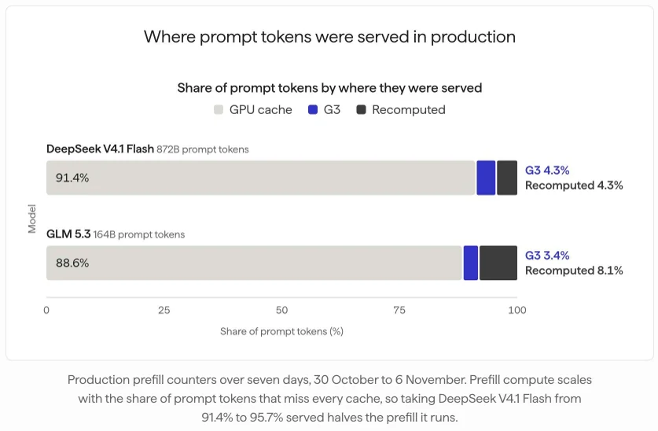
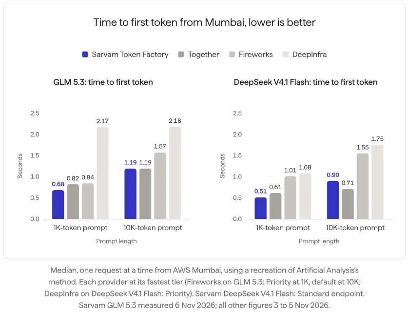

Sarvam AI opened **Sarvam Token Factory** to all developers on November 16, 2026. It is an OpenAI-compatible API that serves Sarvam's own Sarvam 105B alongside open-weight models such as GLM 5.3, GLM 5.3 Flash, DeepSeek V4.1 Flash 1017, DeepSeek V4 Pro, Kimi K3.1 Pro and Gemma 4 31B, all running on B200 clusters in India. Sarvam's launch post claims it matches or beats the leading inference providers on speed and cost for most of these models, and publishes its own measurements against Together, Fireworks, DeepInfra and stock open-source serving stacks.

Those measurements are worth reading closely, because they are not uniformly favourable. Gemma 4 31B and long agent sessions show large leads. DeepSeek V4.1 Flash, one of the most used models on OpenRouter, comes out cheaper but slower than Together. The difference comes from where Sarvam put its engineering effort: prefill, caching and request routing, rather than raw token generation.

## Sarvam Token Factory architecture: three layers around a shared cache {#sarvam-token-factory-architecture}

Sarvam Token Factory runs AI inference in three layers. A control plane decides which GPU gets each request and when; an inference engine runs prefill and decode on separate GPU pools; and a two-tier cache sits underneath, with GPU memory for the next few seconds and a shared store, called G3, for hours or days.


*Token Factory's three layers, from Sarvam's launch post. Prefill and decode run on separate pools; every prefill server reads the shared G3 store. Source: [Sarvam](https://www.sarvam.ai/blogs/sarvam-token-factory).*

Each layer exists because of how agent traffic behaves:

- **Prefill and decode pools.** Prefill reads the whole prompt in one compute-heavy pass; decode then produces tokens one at a time and is limited by memory bandwidth. On a shared GPU, every new 100K-token coding prompt stalls the sessions already decoding there. Sarvam separates the two and passes the KV cache and any extra model state across at aligned checkpoints. Real-time voice traffic, with its short inputs, stays on single GPUs without the split.
- **Shared cache.** Agent prompts on GLM 5.3 average 131K tokens, and an agent returns after a tool call, tens of seconds or minutes later, with almost the same prompt. GPU memory kept that context for about 4 seconds, and about 2 seconds under load. G3, built on Moonshot's Mooncake store, is readable by every prefill server and keeps it far longer.
- **Control plane.** The router sends each turn to the worker that already holds its prompt. Admission counts only the tokens that still need computing, and the planner scales on rejections and backpressure rather than queue length.

The engine layer also carries per-model work: MXFP8 and NVFP4 weights, tuned all-to-all communication for mixture-of-experts models, and kernel fixes. Moving GLM 5.3 from FP8 on SGLang to MXFP8 on vLLM doubled uncached prefill per GPU, from about 3,700 to 7,600 tokens per second, and halved p95 time to first token on real chat, from 19.6 s to 9.2 s, in Sarvam's measurement. Our [GLM-5.3 NVFP4 serving guide](/tutorials/glm-5-3-nvfp4/) covers what the same model needs when you host it yourself.

## Sarvam Token Factory prefix caching for coding agents {#sarvam-token-factory-prefix-caching}

Sarvam Token Factory serves most prompt tokens from cache, which is where its cost and latency advantage on agent workloads comes from. Over seven days of production traffic, from October 30 to November 6, 2026, 95.7% of DeepSeek V4.1 Flash prompt tokens and 92% of GLM 5.3 prompt tokens came from the GPU cache or G3 rather than being recomputed.



*Share of prompt tokens served from each cache tier, October 30 to November 6, 2026. Source: [Sarvam](https://www.sarvam.ai/blogs/sarvam-token-factory).*

Since prefill compute scales with the tokens that miss every cache, adding G3 on top of the GPU cache for DeepSeek V4.1 Flash, from 91.4% to 95.7% served, halved the prefill work. During peak traffic on GLM 5.3, G3 cut the prefill nodes required from 58 to 34. Sarvam says Token Factory already serves more than 450 billion DeepSeek V4.1 Flash tokens a day.

Getting there took fixes in places a stock stack does not look. On DeepSeek V4.1 Flash, sliding-window cache lookups and writes used different positions, so 74% of prompt lengths missed G3 even though the context was stored. Aligning them raised the cold hit rate from 37.1% to 99.8% and cut latency from 2.80 s to 0.64 s. In the router, stock accounting ignored shared-cache hits and sent 17.6% of requests to the wrong worker at 128 sessions; after the fix it was 3.5%, and p95 time to first token fell from 24 s to 9 s.

For buyers, the practical point is cached input pricing. DeepSeek V4.1 Flash bills cached input at ₹0.25 per million tokens against ₹14 for uncached input, so a coding agent that resends long, stable prompts pays mostly the cached rate.

## Sarvam Token Factory vs Together, Fireworks and DeepInfra: time to first token {#sarvam-token-factory-vs-together-fireworks}

In Sarvam's own tests from India, Sarvam Token Factory returns the first token fastest on GLM 5.3 and on short DeepSeek V4.1 Flash prompts, ties Together on GLM 5.3 with a 10K-token prompt, and trails Together on DeepSeek V4.1 Flash with a 10K-token prompt. Sarvam ran every provider from a client in AWS Mumbai, one request at a time, using a recreation of Artificial Analysis's method, and reports the median over 72 hours.



*Median time to first token from AWS Mumbai, each provider at its fastest tier. Sarvam's GLM 5.3 run is from November 6, 2026; the others from November 3 to 5. Source: [Sarvam](https://www.sarvam.ai/blogs/sarvam-token-factory).*

| Model and prompt | Sarvam Token Factory | Together | Fireworks | DeepInfra |
|---|---|---|---|---|
| GLM 5.3, 1K tokens | **0.68 s** | 0.82 s | 0.84 s | 2.17 s |
| GLM 5.3, 10K tokens | **1.19 s** | **1.19 s** | 1.57 s | 2.18 s |
| DeepSeek V4.1 Flash, 1K tokens | **0.51 s** | 0.61 s | 1.01 s | 1.08 s |
| DeepSeek V4.1 Flash, 10K tokens | 0.90 s | **0.71 s** | 1.55 s | 1.75 s |

The client location matters for reading this table. Measured from Mumbai, Sarvam's GPUs are close and US-hosted providers carry extra network round trips, which helps Sarvam on short prompts in particular. A team serving users in the US or Europe should rerun the comparison from its own region before switching.

Gemma 4 31B shows the widest gap. With a 10K-token prompt, Sarvam measured a 0.40 s first token and 308 tokens per second, against 2.00 s and 193 tokens per second for the only other provider serving the model, which the post does not name. The other provider's figures are the best of its tiers on each metric. Sarvam also lists its own Sarvam 105B at a 0.2 s first token and 330 tokens per second for a single user.

Output speed is where Sarvam's DeepSeek V4.1 Flash endpoints lag. Sarvam's own price-and-speed chart shows Together streaming DeepSeek V4.1 Flash at 278 tokens per second and Fireworks at 193, against 130 for Sarvam's Standard endpoint and about 200 for its Interactive endpoint. The pricing section below puts those speeds next to the prices.

## Sarvam Token Factory vs stock vLLM and Dynamo on agent traces {#sarvam-token-factory-vs-vllm-dynamo}

Against the open-source stack it builds on, Sarvam reports the same output speed per user and a much faster first token under concurrency. On GLM 5.3 Flash, both stacks ran disaggregated on the same two B200 nodes and replayed SemiAnalysis's AgentX coding-agent traces; the stock side used vLLM 0.31.0, Dynamo 1.6.0, NIXL 1.4.1 and Mooncake 0.3.13.


*GLM 5.3 Flash, Sarvam's stack against stock vLLM and Dynamo on the same nodes. Source: [Sarvam](https://www.sarvam.ai/blogs/sarvam-token-factory).*

At 64 concurrent sessions, median time to first token dropped from 1,428 ms to 667 ms and the slowest 1% from 14.1 s to 3.2 s, at about the same tokens per GPU (10,768 against 10,193). Output per user barely moved, 192 against 190 tokens per second, because the gain comes from prefill rather than decode.

Kimi K3.1 Pro, a 1,454 GiB model that Sarvam spreads across two nodes (see how it [scores against Qwen4-Max](/tutorials/qwen4-max-benchmarks/)), tells a similar story under heavier load. On 16 B200s with the same agent traces, Sarvam measured 6,177 tokens per second per GPU at about 70 tokens per second per user, against 3,213 on InferenceX's published B200 vLLM curve. This comparison sets Sarvam's run against another team's published results, not a run on the same hardware. At 72 sessions, InferenceX's KV cache was 89% full and evicting prefixes, so its p95 first token reached 76.6 s; Sarvam's G3 kept evicted prefixes and held p95 at 3.1 s. At 96 sessions the median flipped slightly, 1.1 s for Sarvam against 0.9 s for InferenceX.

Some of the stack's work is correctness rather than speed. vLLM's fused decode kernel for GLM 5.3 Flash skipped the model's activation clamp, which showed up as stray characters in 32 of 299 long code responses; Sarvam's fused kernel removed them. A DeepSeek V4.1 Flash tool-call grammar cut tool calls leaked as raw text from 7.7% to 0.08% across 31 replayed production conversations. Problems like these are worth testing on any provider, because they show up as broken agent runs rather than slow ones.

## Sarvam Token Factory pricing in USD {#sarvam-token-factory-pricing-usd}

Sarvam Token Factory bills in Indian rupees per million tokens, excluding GST, and its pricing page converts to dollars at ₹94 per US dollar. At that rate, DeepSeek V4.1 Flash Standard costs about $0.15 per million input tokens and $0.59 per million output tokens, and Sarvam 105B about $0.11 and $0.27. Reasoning tokens are billed at the output rate.

| Model (model ID) | Input ₹ / USD | Cached input ₹ | Output ₹ / USD | Access |
|---|---|---|---|---|
| Sarvam 105B (`sarvam-105b`) | ₹10 / $0.11 | ₹0.25 | ₹25 / $0.27 | Serverless, introductory |
| DeepSeek V4.1 Flash 1017 Standard (`deepseekv4.1-flash-1017`) | ₹14 / $0.15 | ₹0.25 | ₹55 / $0.59 | Serverless, introductory |
| DeepSeek V4.1 Flash 1017 Interactive | ₹25 / $0.27 | ₹0.50 | ₹105 / $1.12 | Serverless |
| GLM-5.3 Flash (`glm5.3-flash`) | ₹13.5 / $0.14 | ₹2.50 | ₹45 / $0.48 | Serverless |
| Gemma 4 31B (`gemma4`) | ₹35 / $0.37 | ₹10 | ₹90 / $0.96 | Serverless |
| GLM-5.3 (`glm5.3`) | ₹126 / $1.34 | ₹20 | ₹390 / $4.15 | Serverless |
| DeepSeek V4 Pro (`deepseekv4-pro`) | ₹115 / $1.22 | ₹4 | ₹350 / $3.72 | Provisioned Throughput |
| Kimi K3.1 Pro (`kimi-k3.1-pro`) | ₹200 / $2.13 | ₹20 | ₹950 / $10.11 | Provisioned Throughput |
| Qwen 3.8 27B (`qwen38-27b`) | ₹18 / $0.19 | ₹5 | ₹230 / $2.45 | Provisioned Throughput |

*List prices from Sarvam's pricing page and API docs, read November 17, 2026. USD values are our conversion at Sarvam's ₹94 rate. Introductory prices run through the end of 2026. On the same day, Sarvam's models page still showed Sarvam 105B at ₹15 and ₹60, so confirm the rate in your dashboard.*

List prices alone do not show where Token Factory sits against other providers, because coding agents send mostly cached input. Sarvam's chart for DeepSeek V4.1 Flash uses a blended price for a coding token mix, and on that basis the Standard endpoint costs about the same as DeepSeek's own API and about half of what Together, Baseten and Fireworks charge, while streaming slower than all three.


*DeepSeek V4.1 Flash price against output speed, blended for a coding mix; Sarvam Standard uses introductory pricing. Source: [Sarvam](https://www.sarvam.ai/blogs/sarvam-token-factory).*

| Endpoint | Blended USD per million tokens | Output tokens per second |
|---|---|---|
| Sarvam Standard | $0.092 | 130 |
| Sarvam Interactive | $0.168 | 200 |
| DeepSeek API | $0.092 | 60 |
| Together | $0.184 | 278 |
| Baseten | $0.185 | 165 |
| Fireworks | $0.184 | 193 |
| Fireworks US | $0.276 | 169 |
| GPT-6 Luna (OpenAI, for reference) | $0.077 | 67 |

The trade-off is straightforward: for background and batch agent work, Standard matches the cheapest DeepSeek V4.1 Flash option at twice its speed. For interactive coding, Together is faster at roughly the price of Sarvam Interactive. The blended price depends on the cached-input share Sarvam assumed, which the post does not spell out, so plug your own token mix into each provider's rates. Our note on [cost per successful task for coding agents](/tutorials/coding-agents-finops-cost-per-successful-task/) explains why that number matters more than the per-token rate, and our [cloud GPU price tracker](/tutorials/cloud-gpu-prices/) covers the self-hosting side of the comparison.

## How to migrate from OpenRouter to Sarvam Token Factory {#migrate-openrouter-to-sarvam-token-factory}

Moving open-weight traffic from OpenRouter to Sarvam Token Factory takes three changes: the base URL becomes `https://api.sarvam.ai/v2`, the key becomes a Sarvam API key, and the model ID drops OpenRouter's provider prefix. Both APIs speak the OpenAI Chat Completions format, and Sarvam accepts the `Authorization: Bearer` header the `openai` package sends.

```python
from openai import OpenAI

client = OpenAI(
    api_key="YOUR_SARVAM_API_KEY",
    base_url="https://api.sarvam.ai/v2",   # was https://openrouter.ai/api/v1
)

response = client.chat.completions.create(
    model="glm5.3-flash",                  # was z-ai/glm-5.3-flash
    messages=[{"role": "user", "content": "Explain UPI in two sentences."}],
    max_tokens=1000,
)
print(response.choices[0].message.content)
```

If your app creates the client without arguments and reads the model from configuration, setting `OPENAI_BASE_URL=https://api.sarvam.ai/v2` and `OPENAI_API_KEY` is enough. The model IDs map as follows in Sarvam's migration guide:

| OpenRouter `model` | Sarvam `model` | Access on Sarvam |
|---|---|---|
| `z-ai/glm-5.3` | `glm5.3` | Serverless |
| `z-ai/glm-5.3-flash` | `glm5.3-flash` | Serverless |
| `google/gemma-4-31b-it` | `gemma4` | Serverless |
| `deepseek/deepseek-v4.1-flash-1017` | `deepseekv4.1-flash-1017` | Serverless |
| `deepseek/deepseek-v4-pro-0813` | `deepseekv4-pro` | Provisioned Throughput |
| `moonshotai/kimi-k3` | `kimi-k3.1-pro` | Provisioned Throughput |

Four details change behaviour after the switch:

1. **Snapshots.** Sarvam's `deepseekv4-pro` is the 0813 snapshot, while OpenRouter's plain `deepseek/deepseek-v4-pro` is the earlier 0423 snapshot, so outputs can differ.
2. **Error codes.** A bad key returns `403` on Sarvam instead of OpenRouter's `401`. An empty credit balance returns `402` on both and is separate from a `429` rate limit.
3. **Access-gated models.** Without Provisioned Throughput access for your organisation, `deepseekv4-pro` returns `400` and the other gated models return `404`; `GET /v2/models` lists only what you can call.
4. **OpenRouter-only fields.** Routing suffixes such as `:free`, `:nitro` and `:floor` have no equivalent and should be removed; Sarvam has separate guides for chat completions and the Responses API.

Sarvam publishes matching guides for Fireworks AI and Together AI. Run your own prompts, tool calls and output checks before moving live traffic, since the correctness fixes described above show that two providers serving the same weights can still behave differently.

## Sarvam Token Factory rate limits and access tiers {#sarvam-token-factory-rate-limits}

Sarvam Token Factory's default rate limits are 50 requests per minute on pay-as-you-go, 200 on Pro and 1,000 on Growth for `gemma4`, `glm5.3` and `deepseekv4.1-flash-1017`. Sarvam 105B has its own limits of 60, 200 and 300 requests per minute. Limits apply per account across all keys, and new verified users get ₹100 in free credits.

Plans run from pay-as-you-go with no monthly fee to Pro at ₹9,999, Growth at ₹49,999 and Business at ₹1,99,999 a month; token prices are the same on every plan. DeepSeek V4 Pro, Kimi K3.1 Pro, [Qwen 3.8 27B](/tutorials/qwen-3-8-27b/), the Clef decision model and EmbeddingGemma 2 sit on Provisioned Throughput and must be enabled for your organisation. Sarvam offers shared or dedicated capacity, a 99.95% uptime SLA, zero data retention on request, and the same serving stack on-premise for enterprises.

Inference runs on Sarvam-operated GPUs in India, and requests are not forwarded to the original model developer's API. That makes Token Factory most relevant to three groups: teams serving users in India, where Sarvam's own latency tests apply most directly; teams that need Indian data residency for open-weight models such as GLM 5.3 or Kimi K3.1 Pro; and agent workloads that resend long, stable prompts, where the cached-input rate and G3 cache do most of the work. Teams already on [self-hosted GLM for coding](/tutorials/glm-for-coding/) can use the same benchmark method, a fixed client location and one request at a time, to compare their own cluster with the hosted option.

## References {#references}

1. Sarvam AI. "Introducing Sarvam Token Factory." November 16, 2026. [sarvam.ai/blogs/sarvam-token-factory](https://www.sarvam.ai/blogs/sarvam-token-factory)
2. Sarvam AI. "Token Factory," Model APIs documentation. Read November 17, 2026. [docs.sarvam.ai/api/token-factory](https://docs.sarvam.ai/api/token-factory)
3. Sarvam AI. "Pricing, Credits & Rate Limits," Model APIs documentation. Read November 17, 2026. [docs.sarvam.ai/api/getting-started/pricing](https://docs.sarvam.ai/api/getting-started/pricing)
4. Sarvam AI. "Migrating from OpenRouter: Overview." Last updated October 23, 2026. [docs.sarvam.ai/api/token-factory/migrations/from-openrouter/overview](https://docs.sarvam.ai/api/token-factory/migrations/from-openrouter/overview)
5. Sarvam AI. "Pricing | Sarvam Token Factory." Read November 17, 2026. [sarvam.ai/token-factory/pricing](https://www.sarvam.ai/token-factory/pricing)
