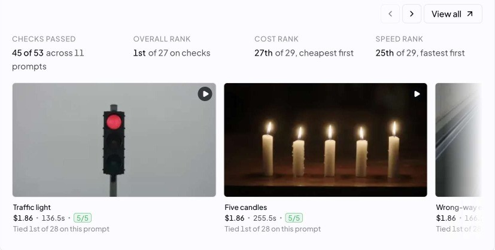

The Seedance 2.5 API charges by video token rather than by second, and once you run ByteDance's formula the numbers are simple: a 30-second 720p clip from `dreamina-seedance-2-5-260628` costs about $6.93 at BytePlus ModelArk's list price, and the same clip from Seedance 2.5 Flash, the faster tier that reached OpenRouter on November 17, 2026, costs about $4.54. This guide works out the price for every resolution, compares Seedance 2.5 with Flash and Seedance 2.0, summarizes what OpenRouter's and Arena's tests found, and walks through a request that avoids the task-type errors new integrations hit most often.

Seedance 2.5 is ByteDance Seed's audio-and-video model, launched on July 31, 2026. One request can produce up to 30 seconds with synchronized sound, take as many as 30 images, 10 video clips and 10 audio clips as references, and edit or extend an existing video. Developers reach it through BytePlus ModelArk, through OpenRouter, or through the partners ByteDance lists for API access: Atlas Cloud, fal and Higgsfield.

## Seedance 2.5 API Price per Second and per Clip {#seedance-2-5-api-price}

Seedance 2.5 API pricing on BytePlus ModelArk is $10.70 per million tokens at 480p and 720p, $11.70 at 1080p and $4.70 at 4K, for requests without an input video. That works out to about $0.10 a second at 480p, $0.23 at 720p, $0.57 at 1080p and $0.91 at 4K.

The token count comes from one formula on the [BytePlus pricing page](https://ai.byteplus.com/ark/region:ap-southeast-1/docs/model-pricing): (input video seconds + output video seconds) × width × height × frame rate ÷ 1024. Output runs at 24 frames per second, so a five-second 1280×720 clip is 108,000 tokens, or $1.156, which is exactly BytePlus's own example. Scaling the same formula to the lengths people actually budget for gives this table (16:9, no input video):

| Model and resolution | $ per 1M tokens | Per second | 10-second clip | 30-second clip |
|---|---|---|---|---|
| Seedance 2.5, 480p (854×480) | $10.70 | $0.103 | $1.03 | $3.08 |
| Seedance 2.5, 720p (1280×720) | $10.70 | $0.231 | $2.31 | $6.93 |
| Seedance 2.5, 1080p (1920×1080) | $11.70 | $0.569 | $5.69 | $17.06 |
| Seedance 2.5, 4K (3840×2160) | $4.70 | $0.914 | $9.14 | $27.41 |
| Seedance 2.5 Flash, 480p | $7.00 | $0.067 | $0.67 | $2.02 |
| Seedance 2.5 Flash, 720p | $7.00 | $0.151 | $1.51 | $4.54 |
| Seedance 2.0, 720p | $7.00 | $0.151 | $1.51 | 15 s maximum |

A few billing rules change the result:

- **Reference videos are billed as length.** When you send a video to edit, extend or imitate, its duration is added to the output duration before the token count, a lower per-token rate applies, and BytePlus sets a minimum token charge for these jobs. Images and audio references do not add to the count.
- **Failures are free.** BytePlus charges only for videos that finish; a job blocked by content moderation costs nothing. The final bill uses `usage.completion_tokens` from the response, so treat the formula as an estimate.
- **Aspect ratio barely matters.** At 720p, 9:16 (720×1280) and 1:1 (960×960) have the same 921,600 pixels as 16:9, so they cost the same.
- **The price depends on where you buy.** ByteDance Seed's own [Seedance API page](https://seed.bytedance.com/en/seedance-enterprise/api) lists $12.84 per million tokens for 480p and 720p and $14.04 for 1080p, exactly 20% above the ModelArk figures, while OpenRouter passes through $10.70 with Seed as its only provider. Check the rate card of the account you will be billed on.

For comparison, Google's [Genie 4 API](/tutorials/genie-4-api/) bills video output at about $0.10 a second, the same as Seedance 2.5 at 480p.

## Seedance 2.5 vs Seedance 2.5 Flash: Which Model to Call {#seedance-2-5-vs-seedance-2-5-flash}

Seedance 2.5 Flash costs about 35% less per token than Seedance 2.5 and finishes jobs roughly three times faster, but it stops at 720p, accepts 20 reference files instead of 50 and has no Draft mode. Both generate 4 to 30 seconds with sound and support editing and extension.

| | Seedance 2.5 | Seedance 2.5 Flash | Seedance 2.0 |
|---|---|---|---|
| Model ID | `dreamina-seedance-2-5-260628` | `dreamina-seedance-2-5-flash-261115` | `dreamina-seedance-2-0-260128` |
| Length per request | 4–30 s | 4–30 s | 4–15 s |
| Resolutions | 480p, 720p, 1080p, 4K | 480p, 720p | 480p, 720p, 1080p, 4K |
| References (images + videos + audio) | 30 + 10 + 10 | 10 + 5 + 5 | 9 + 3 + 3 |
| Draft mode | Yes | No | No |
| Output format | mp4, mov | mp4, mov | mp4 |
| 720p price per second | $0.231 | $0.151 | $0.151 |
| Median job time on OpenRouter | 166.3 s | 53.0 s | — |

BytePlus describes Flash as "2× faster than Seedance 2.5 at approximately 34% lower cost." OpenRouter's provider data, measured on its own traffic, shows a median end-to-end time of 53 seconds for Flash and 166 seconds for Seedance 2.5, which is closer to three times.

Flash also costs exactly what Seedance 2.0 costs at 480p and 720p, while doubling the maximum length and raising the reference limit. For new 720p work there is little reason to call Seedance 2.0 unless you depend on its tested behavior.

Pick by job type:

- **Previews, social clips and high-volume drafts:** Flash at 480p or 720p.
- **1080p or 4K delivery, or more than 10 reference images:** Seedance 2.5, ideally through Draft mode (below).
- **Long reference packs, such as a character sheet plus several motion clips and a voice track:** Seedance 2.5, since Flash caps videos at five and audio at five.

## Seedance 2.5 Benchmarks: OpenRouter Checks and Arena Votes {#seedance-2-5-benchmarks}

Seedance 2.5 leads OpenRouter's rubric-based video benchmark but only ties Seedance 2.0 in Arena's blind preference votes. The two tests measure different things, and together they show what the higher price buys.

OpenRouter runs every video model on the same short prompts and scores each output against written checks. Seedance 2.5 passed 45 of 53 checks across 11 prompts, which ranks it first of 27 models. Each of those clips cost $1.86 and took between 136 and 316 seconds to return, which puts it 27th of 29 on cost and 25th of 29 on speed. It scored perfectly on prompts that test ordered events and object persistence, such as a traffic light changing red, green, amber in sequence, five candles going out left to right, and a woman passing behind a pillar and reappearing in the same clothes. It was weakest on a slow single orbit around a statue (4 of 6 checks, tied 20th of 29) and on a man's mirror reflection staying in sync (2 of 4).



*OpenRouter's benchmark summary for Seedance 2.5, with the first two test clips. Screenshot of openrouter.ai, November 24, 2026.*

Flash's OpenRouter page lists outputs for the same prompts but no rubric scores yet. Its clips cost $1.22 and took 68 to 179 seconds each.

Arena (arena.ai) ranks models by anonymous head-to-head votes. In its leaderboard for November 16–22, 2026, [as reported by IT Home](https://www.ithome.com/1/030/935.htm), Dreamina Seedance 2.0 720p placed fifth with 1483 ±8 points over 72,137 votes and Seedance 2.5 720p placed sixth with 1479 ±8 over 25,421 votes. The four-point gap is inside both error margins, so voters rate the two equally. Google's Gemini Omni 1.2 Flash led at 1540.

Arena votes compare short clips made from a text prompt. They do not exercise what Seedance 2.5 adds: 30-second takes, 50 references and targeted edits. For short text-to-video clips, voters liked Seedance 2.0 as much as 2.5 at two-thirds of the per-token price, and Flash has not been rated yet. Seedance 2.5 earns its price on long, reference-heavy or edit-driven work.

## How to Call the Seedance 2.5 API on BytePlus ModelArk {#how-to-call-the-seedance-2-5-api}

To call the Seedance 2.5 API, activate the model in BytePlus ModelArk, create an API key, send a POST request that creates a generation task, then poll the task until it reports `succeeded` and download the video within 24 hours. Generation is asynchronous; the first response only gives you a task ID.

1. **Activate the model.** BytePlus will not enable the Seedance 2.5 series until the account meets one condition: a balance above $30, an AI Savings Plan of $30 or more, or a purchased Seedance 2.5 resource pack. Then create a key on the API Key page and export it as `ARK_API_KEY`.
2. **Create the task.** The smallest useful request is text-to-video:

```bash
curl -X POST https://ark.ap-southeast.bytepluses.com/api/v3/contents/generations/tasks \
  -H "Content-Type: application/json" \
  -H "Authorization: Bearer $ARK_API_KEY" \
  -d '{
    "model": "dreamina-seedance-2-5-260628",
    "content": [
      {
        "type": "text",
        "text": "A barista in a small coffee shop pours latte art, slow push-in, warm morning light, <espresso machine hiss>"
      }
    ],
    "resolution": "720p",
    "ratio": "16:9",
    "duration": 10,
    "generate_audio": true,
    "watermark": false
  }'
```

   Reference files go into the same `content` array as extra items, for example `{"type": "image_url", "role": "reference_image", "image_url": {"url": "https://..."}}`, with `reference_video` and `reference_audio` roles for the other media. URLs must be publicly readable; BytePlus suggests its TOS object storage with public read.
3. **Poll for the result.** Call `GET https://ark.ap-southeast.bytepluses.com/api/v3/contents/generations/tasks/{id}` with the same key. BytePlus's sample script checks every 30 seconds; a `callback_url` parameter is also available if you would rather be notified. When the status is `succeeded`, the file is at `content.video_url`.
4. **Save the file right away.** The video URL lives for 24 hours and allows at most 100 downloads. Task IDs stay valid for seven days.

At 720p the request above should cost about $2.31. If the API will sit behind a product, the same pattern of storing the task ID, polling with a stop rule and copying the file to your own storage applies to every async media API, including [Genie 4](/tutorials/genie-4-api/).

## Seedance 2.5 Draft Mode for 1080p and 4K {#seedance-2-5-draft-mode}

Seedance 2.5 Draft mode lets you check a 480p preview before paying for a 1080p or 4K render. Set `"draft": true` with `"resolution": "480p"` to get the preview, then send a second request that points at the draft task and asks for `1080p` or `4k`.

```bash
curl -X POST https://ark.ap-southeast.bytepluses.com/api/v3/contents/generations/tasks \
  -H "Content-Type: application/json" \
  -H "Authorization: Bearer $ARK_API_KEY" \
  -d '{
    "model": "dreamina-seedance-2-5-260628",
    "content": [
      { "type": "draft_task", "draft_task": { "id": "<DRAFT_TASK_ID>" } }
    ],
    "resolution": "4k",
    "output_format": "mov"
  }'
```

The final render reuses the draft's prompt, references, duration, aspect ratio, seed, audio setting and task type. Do not send any of those again: BytePlus returns an error even if the values match. Draft task IDs created since October 28, 2026 stay usable for 14 days, and only Seedance 2.5 supports the mode; Flash does not.

The two steps are billed separately. For a 30-second 16:9 clip, the 480p draft costs about $3.08 and the 4K final about $27.41, so one rejected draft saves you roughly $24 compared with a 4K render you throw away. Expect a queue at 4K: each account can submit 15 4K jobs a minute and run one at a time. The 1080p and 4K files are 10-bit H.265, which some players cannot open; BytePlus suggests VLC, mpv or QuickTime Player, and an FFmpeg step like the one in our [Claude Code video editing test](/tutorials/claude-code-video-editing/) can re-encode them.

## Seedance 2.5 API Errors and Limits {#seedance-2-5-api-errors-and-limits}

Most Seedance 2.5 API errors come from task-type rules. The model decides from your inputs and prompt whether a job is text-to-video, first-frame animation, reference-to-video, an edit or an extension, and edits and extensions only accept certain settings.

| Task type | Triggered by | Required settings |
|---|---|---|
| Text-to-video | Text only | None |
| First frame or first and last frame | An image with role `first_frame` or `last_frame` | `ratio: "adaptive"` |
| Reference-to-video | Any `reference_image`, `reference_video` or `reference_audio` | None |
| Video edit | A reference video plus a prompt asking for a change | `ratio: "adaptive"`, `duration: -1`, video 4–30 s |
| Video extension | A reference video plus a prompt asking to continue it | `ratio: "adaptive"` |

If you leave the task type implicit, a mismatch shows up later as an asynchronous failure with the code `InvalidParameter.TaskTypeConstraint`. Setting `omni_reference_task_type` to `edit` or `extend` moves that check to submission time, so the request fails immediately instead. If the model still reads the prompt as a different kind of job, the task fails with `InvalidParameter.TaskTypeMismatch`. When you do not want to choose, BytePlus recommends `omni_reference_task_type: "auto"` with `ratio: "adaptive"` and `duration: -1`, which satisfies every subtype.

Other limits worth building into your validation:

- **No real faces in references.** Seedance 2.5 rejects uploaded images or videos that contain real human faces. BytePlus offers three workarounds: reuse face-containing outputs your account generated with trusted models, use its preset digital characters, or go through its authorized real-person asset process.
- **Reference sizes.** Images must be under 30 MB with sides between 300 and 6,000 pixels. Each reference video must run 2 to 30 seconds (4 to 30 for edits), stay under 200 MB and play at 24 to 60 fps, and all reference videos together cannot exceed 30 seconds. The whole request body is capped at 64 MB, so large files should go in as URLs, not Base64.
- **Rate limits.** Below 4K, enterprise accounts get 600 task creations a minute and 10 concurrent jobs, and individual accounts get 180 and 3. Extra jobs wait in a queue; extra requests return HTTP 429.
- **Status polling.** The task-retrieval endpoint allows 20 queries a second per account, and listing tasks only one, so poll specific IDs rather than the list.
- **Billing stops in arrears.** If the account balance stays negative for two hours, ModelArk suspends the model service until it is topped up.

## Seedance 2.5 Prompt Structure {#seedance-2-5-prompt-structure}

The Seedance 2.5 prompt structure BytePlus recommends is subject, then action or event, scene and environment, visual style, camera movement or shot cuts, and sound, leaving out any part you do not need. Reference files are named in the prompt as `@Image 1`, `@Video 1` and `@Audio 1`, with a note on what each one supplies, such as appearance, motion or voice.

Sound has its own markup: parentheses for music, angle brackets for sound effects, curly braces for dialogue and 【】 for on-screen subtitles. For dialogue that is not in Chinese, BytePlus suggests naming the language before the line. The model generates speech natively in 11 languages, including English, Spanish, Japanese, Korean, Arabic and Portuguese.

A prompt in that shape looks like this:

```text
@Image 1 is the main character's appearance. A courier in a yellow raincoat
runs across a wet rooftop at night, jumps a gap and lands in a roll. Neon city
skyline, light rain, cinematic and slightly desaturated. Handheld tracking
shot, then a low-angle cut on the landing. (tense synth score) <rain, footsteps
splashing> {English: "Almost there."}
```

BytePlus also publishes a prompt-rewriting skill for coding agents, installable with `npx --yes skills@latest add "https://arkdocs-en.tos-ap-southeast-1.volces.com/skills/" --skill sd25-pe --yes` and invoked as `/sd25-pe` followed by your draft prompt.

## Seedance 2.5 API vs Dreamina Credits {#seedance-2-5-api-vs-dreamina}

The Seedance 2.5 API suits pipelines; Dreamina, ByteDance's consumer app, suits people making a handful of clips by hand. Dreamina charges 37 credits per second for Seedance 2.5 at 720p, with or without references. Its US Basic plan, on offer since October 21, 2026, costs $0.29 for the first month with 1,575 credits and then renews at $15 a month. Those 1,575 credits cover about 42 seconds of 720p Seedance 2.5, which would cost about $9.70 through the API.

Dreamina's own pricing page states that the Basic offer is credit-based and "does not mean unlimited generations." Prices and credit amounts differ by region. Other creative platforms also sell Seedance inside their own credit systems, among them [Higgsfield](/tutorials/higgsfield-gpu-harness/), one of ByteDance's listed API partners, and tools such as the [Arcade AI video generator](/tutorials/arcade-ai-video-generator/), which offers Seedance as an optional clip model. Credits are convenient for occasional use but harder to budget than a per-token API bill.

If you are choosing between routes for a product, compare the cost of an accepted clip rather than the cost of a render, the same way we compare [coding agents by cost per successful task](/tutorials/coding-agents-finops-cost-per-successful-task/). A 480p draft that catches a bad take before a 4K render is the cheapest retry you can buy.

## Seedance 2.5 API FAQ {#seedance-2-5-api-faq}

### When was the Seedance 2.5 API released?

ByteDance Seed launched Seedance 2.5 on July 31, 2026 in its own apps, Jimeng AI and Doubao Pro, and said API access would follow on BytePlus ModelArk. OpenRouter lists the API model as released on August 7, 2026. The cheaper Seedance 2.5 Flash tier appeared on OpenRouter on November 17, 2026.

### Does the Seedance 2.5 API support 4K?

Yes. Seedance 2.5 accepts resolution values of 480p, 720p, 1080p and 4k. The 1080p and 4K outputs use 10-bit color and H.265 encoding, 4K jobs are limited to 15 requests per minute and one at a time, and a 30-second 4K clip costs about $27.41 at the BytePlus list price. Seedance 2.5 Flash stops at 720p.

## References {#references}

1. BytePlus, [Dreamina Seedance 2.5 series tutorial](https://ai.byteplus.com/ark/region:ap-southeast-1/docs/seedance-2-5), ModelArk documentation, accessed November 24, 2026.
2. BytePlus, [ModelArk pricing: video generation models](https://ai.byteplus.com/ark/region:ap-southeast-1/docs/model-pricing), accessed November 24, 2026.
3. ByteDance Seed, [Seedance API: official pricing and partners](https://seed.bytedance.com/en/seedance-enterprise/api) and [Seedance 2.5 model page](https://seed.bytedance.com/en/seedance2_5), accessed November 24, 2026.
4. OpenRouter, [ByteDance: Seedance 2.5](https://openrouter.ai/bytedance/seedance-2.5) and [Seedance 2.5 Flash](https://openrouter.ai/bytedance/seedance-2.5-flash) model pages with benchmark and provider data, accessed November 24, 2026.
5. IT Home, [Arena weekly leaderboard for November 16–22, 2026](https://www.ithome.com/1/030/935.htm), November 23, 2026.
