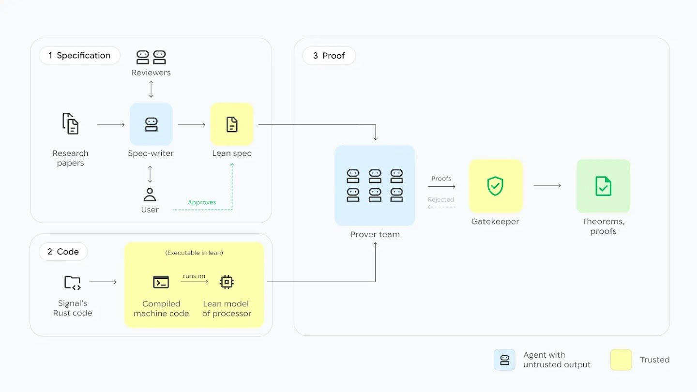
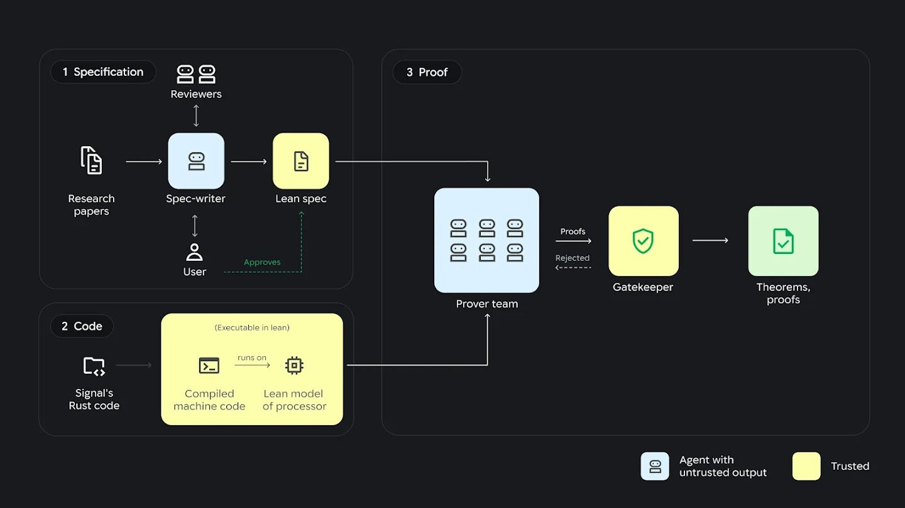

The Signal messaging protocol now has a machine-checked proof that reaches the compiled binary. Google DeepMind and Google researchers had AI agents produce about 6.5 million lines of Lean proof showing that libsignal, as it runs on an AArch64 processor, keeps messages confidential and authentic, with forward secrecy and post-compromise security. The authors say no one has verified a widely deployed protocol implementation this way before, with or without AI. The proof also has edges. It covers one-to-one sessions, a single build and classical attackers in its main computational theorem, and it still asks a reader to trust about 26,000 lines of specification and processor model.

The work comes from a paper dated November 10, 2026 that introduces AlphaProof Code, DeepMind's multi-agent framework for formal verification. Signal's CTO, Ehren Kret, is quoted in DeepMind's announcement saying the result "gives us even greater confidence in our code's privacy guarantees." Here is what the Signal protocol does, what the proof establishes and where it stops.

## How the Signal Messaging Protocol Works: PQXDH and the Triple Ratchet {#how-signal-messaging-protocol-works}

The Signal messaging protocol lets Alice start an encrypted conversation with Bob while he is offline, through a server that is trusted for neither secrecy nor authenticity. DeepMind notes that the protocol protects conversations in apps such as Signal and Google Messages. The paper describes the version implemented in libsignal v0.105.4 and splits a session into two phases.

The first phase is the **PQXDH handshake**. Bob uploads a prekey bundle to the server: his long-term X25519 identity key, a signed prekey, a Kyber1024 prekey and a one-time prekey. Alice fetches the bundle, mixes several Diffie-Hellman values with a post-quantum key encapsulation, and derives a shared secret on her own. Someone who records the handshake today should not be able to recover that secret later, even with a quantum computer.

The second phase is the **Triple Ratchet**, which derives a fresh key for every message. It combines the classical Double Ratchet with the Sparse Post-Quantum Ratchet (SPQR), which runs its own ML-KEM-768 exchange. This is where Signal protocol encryption gets its two headline properties:

- **Forward secrecy**: if an attacker steals a device's current state, earlier messages stay protected.
- **Post-compromise security**: after a theft, a fresh Diffie-Hellman exchange locks a passive thief out of later messages.

Earlier work, including the game-based analysis by Cohn-Gordon and colleagues, established these properties for models of the design. According to the new paper, every earlier effort targeted abstract models, reimplementations written for verification, modified code or narrower properties such as crash-freedom.

## Signal Protocol Implementation Proofs: What AlphaProof Code Verified {#signal-protocol-implementation-proof}

AlphaProof Code verified the compiled Signal protocol implementation itself. The team linked unmodified libsignal v0.105.4, including SPQR, into a small command-line harness, built it with the stock rustc 1.98.1 compiler as a static AArch64 Linux binary, and loaded that machine code into Lean together with a formal semantics of the processor. About 140,000 instructions, roughly 560 KB of code, sit under the proof.

The paper proves security in the two standard models of protocol analysis:

- **Symbolic (Dolev–Yao) model**, which treats cryptographic primitives as ideal black boxes: 10 theorems covering forward secrecy and post-compromise security of message keys, handshake authentication, resistance to key-compromise impersonation, handshake secrecy even if a future quantum attacker breaks Diffie-Hellman, and that runs never fault or diverge.
- **Computational model**, which bounds an efficient attacker's success by the hardness of the primitives: message confidentiality and authenticity with forward secrecy and post-compromise security for PQXDH plus the Triple Ratchet, with a concrete probability bound, against classical attackers.

Proving against the binary matters because a design can be sound while its code is not. DeepMind's post puts it this way: real vulnerabilities often sit in the gap between design and implementation. In this setup the Rust compiler is outside the trusted base. If a compiler or Rust bug broke one of these properties, the proof would fail to go through.

The proof is large. The authors report about 6.5 million lines of Lean in total: 5.3 million for the binary-level work, about 860,000 for the computational proof and about 350,000 for the symbolic one.

## Signal Protocol Security Limitations: What the Proof Does Not Cover {#signal-protocol-security-limitations}

The proof covers one-to-one sessions of one build, under stated assumptions. Readers who want to know whether "Signal is proven secure" should check these boundaries:

- **Group chats and multi-device.** The paper restricts itself to two-party sessions and leaves group messaging to future work. Multi-device state is not modeled.
- **Quantum attackers.** The computational theorem is against classical attackers. The symbolic proof covers a future quantum attacker only for handshake secrecy, and does not prove SPQR's post-quantum healing. Signal protocol post-quantum security is therefore only partly covered.
- **Identity checks.** Identity keys are trusted on first use, so verifying safety numbers is outside the model.
- **Side channels.** Timing and other side channels are explicitly out of scope.
- **Processor and OS model.** The AArch64 model has 467 instructions and 31 system calls, with no threads or signals. One harness on one architecture is verified, not every Signal client.
- **Assumed components.** Low-level cryptographic primitives, two output functions and a few routines are specified by contracts instead of being proved from their code.
- **Scale of the bound.** If nearly every message starts a new ratchet epoch, the computational bound becomes vacuous for a single session of about 25,000 messages.

Everything else rests on a trusted computing base: the AArch64 semantics, the Linux process model, the contracts, the primitive assumptions, the build scripts and Lean's kernel. To accept the result a reader must check about 18,000 lines of specification and about 8,000 lines of AArch64 semantics. That is far smaller than the proof, but it is the part where a human error would go unnoticed.

## Formal Verification in Lean with AI Agents: How AlphaProof Code Works {#formal-verification-lean-ai-agents}

In AlphaProof Code, AI agents write all of the Lean proofs and humans approve what gets proved. The paper describes three steps:

1. A specification-writer agent works with a human to turn models and security properties from the research literature into a Lean specification. Reviewer agents critique each draft and the human approves it.
2. The unmodified Rust code is compiled with the standard compiler, and the executable is loaded into Lean together with the AArch64 semantics.
3. A team of prover agents proves the specification about that executable. A gatekeeper agent accepts a proof only if Lean's kernel checks it and a comparator confirms it proves exactly a held-out copy of the approved specification.

*The three-step AlphaProof Code workflow. Image: Google DeepMind*

The design treats the prover agents as untrusted. A wrong proof step is rejected by Lean's kernel, so errors in the agents' output cannot reach an accepted theorem. What can still go wrong is the specification, which is why humans reviewed every one.

*Untrusted prover agents, a trusted gatekeeper. Image: Google DeepMind*

The split of labor is the most useful part of the paper for anyone planning formal verification with Lean and AI. Specifications were written through back-and-forth between the researchers and agents running Gemini 4 Carbon and Claude Opus 5.5 (Anthropic's model, compared in our [Claude Fable 5.2 review](/tutorials/claude-fable-5-2/)). The proofs were produced entirely by Gemini 4 Carbon agent teams, and none of the authors wrote proof code. DeepMind's post adds that the agents flagged about one percent of the codebase for a second human look. A team of five did the work in four weeks, running agents nonstop on their own workstations. A clean build of the proofs could still take several hours.

The authors' main lesson is about specifications: "once proofs become cheap, the hard question is what to prove." Most of their effort went into specs. Writing them against real code also exposed problems in the published literature. The team catalogued more than 200 places where the computational formalization departs from its reference papers or from libsignal, and about 35 for the symbolic one. Most were routine, but 15 were gaps or bugs in a published computational analysis of the Double Ratchet, such as missing hypotheses. On the symbolic side, previously published ProVerif queries looked up skipped message keys at the wrong ratchet index, which made receiver-side forward secrecy false as printed. These were errors in the analyses, and the paper does not report them as flaws in libsignal.

Running agents for days needed its own engineering. The agents share a bulletin file, team leads try to refute goals before assigning work, and every new invariant must come with a witness that it holds on some reachable state, so agents cannot make progress by proving vacuous lemmas. Readers who build long-running agent systems will recognize the pattern from [agent harnesses in production](/tutorials/agent-framework-harness-runtime-production/): the orchestration layer decides as much as the model whether the work converges. The authors also expect agent teams like this one to start improving their own processes, a direction surveyed in [self-evolving agents](/tutorials/self-evolving-agents-review-en/).

## Do the Signal Protocol Proofs Catch Bugs? The Reintroduced-Bug Test {#signal-protocol-bugs-proof}

The proofs fail on buggy Signal protocol code. To check that the method can tell correct code from broken code, the team reverse-applied the upstream fixes for two libsignal bugs that an earlier analysis had found, recompiled, and tried again:

- **Weak state** (fix `cd36118`): a prekey message that fails to decrypt on a new session is trial-decrypted with older sessions, and on success the new session's unconfirmed state, which holds a copy of the signed prekey secret, is stored.
- **Small subgroup** (fix `5293caa`): the PQXDH responder does not check that the initiator's X25519 base key is torsion-free and in range, so a replayed handshake with a mangled key can create a second session with the same shared secret.

For both binaries, the agents produced complete Lean proofs that the symbolic security theorem does not hold. That is stronger than a failed proof attempt, since a failed attempt could mean the agents simply got stuck. The bug proofs added about 140,000 lines of Lean. Both bugs had already been fixed in libsignal, and the paper does not report any new vulnerability in current Signal code.

## What the Signal Protocol Proof Means for Users and Security Teams {#signal-protocol-proof-impact}

For Signal users nothing changes in the app. The result is evidence about the code they already run: on the verified build, the core cryptographic code meets the security properties the experts specified, assuming the trusted base is right. It says nothing about group chats, linked devices or whether a phone is compromised.

For security teams the result is about cost. If agents can push a 140,000-instruction binary through a full proof in weeks, the bottleneck moves to writing specifications that say the right thing. DeepMind positions the method alongside its automated defense work as a counter to faster, AI-driven attacks; for the attack side, see how [GPT-6 Cyber reports exploit results](/tutorials/gpt-6-cyber/) on Linux targets. The same pressure shows up when agents get access inside an organization, as covered in [the security boundary for AI agents with internal access](/tutorials/ai-agent-internal-access-security-boundary/). A proof does not remove the risk that agents game their objective, which is why the gatekeeper checks proofs against a held-out specification. [Research on reward-seeking in RL-trained models](/tutorials/measuring-reward-seeking-contrastive-beliefs/) shows why that separation matters. The artifacts are open source, so the claims can be checked: the [code-verification repository](https://github.com/google-deepmind/code-verification) holds the specifications and proofs.

## Signal Messaging Protocol FAQ {#signal-messaging-protocol-faq}

### What protocol does Signal use?

Signal uses the Signal Protocol, implemented in the libsignal library. In libsignal v0.105.4 a session starts with the PQXDH handshake, which combines X25519 Diffie-Hellman with a Kyber1024 key encapsulation, and continues with the Triple Ratchet, which pairs the Double Ratchet with the ML-KEM-768 Sparse Post-Quantum Ratchet.

### Is the Signal protocol post-quantum secure?

Partly, according to DeepMind's proofs. The symbolic proof shows handshake secrecy holds even if a future quantum attacker breaks Diffie-Hellman. The computational proof only covers classical attackers, and the post-quantum healing of the SPQR ratchet was not proved in the symbolic model.

### Does the proof mean the Signal app is unbreakable?

No. It covers one-to-one sessions of libsignal compiled for AArch64 Linux inside a test harness. Group chats, multi-device state, side channels, the apps' user interfaces and identity-key checks are outside the proof, and the results trust about 26,000 lines of specification and processor semantics plus Lean itself.

## References {#references}

- S. Chaudhuri, A. Ferraiuolo, A. Kovsharov, T. Chajed, S. Schlesinger, K. Seth, J. Katz, C. Sutton and P. Kohli, [AlphaProof Code: Verifying Signal's Security at the Machine-Code Level](https://deepmind.google/documents/36/Formal_Verification_of_Signal_4.pdf), Google DeepMind and Google, Nov 10, 2026
- Google DeepMind, [Introducing AlphaProof Code](https://deepmind.google/blog/introducing-alphaproof-code/), Nov 2026
- Google DeepMind, [code-verification artifacts](https://google-deepmind.github.io/code-verification) and [GitHub repository](https://github.com/google-deepmind/code-verification)
- Signal, [Signal protocol specifications](https://signal.org/docs/)
- [signalapp/libsignal](https://github.com/signalapp/libsignal) on GitHub
