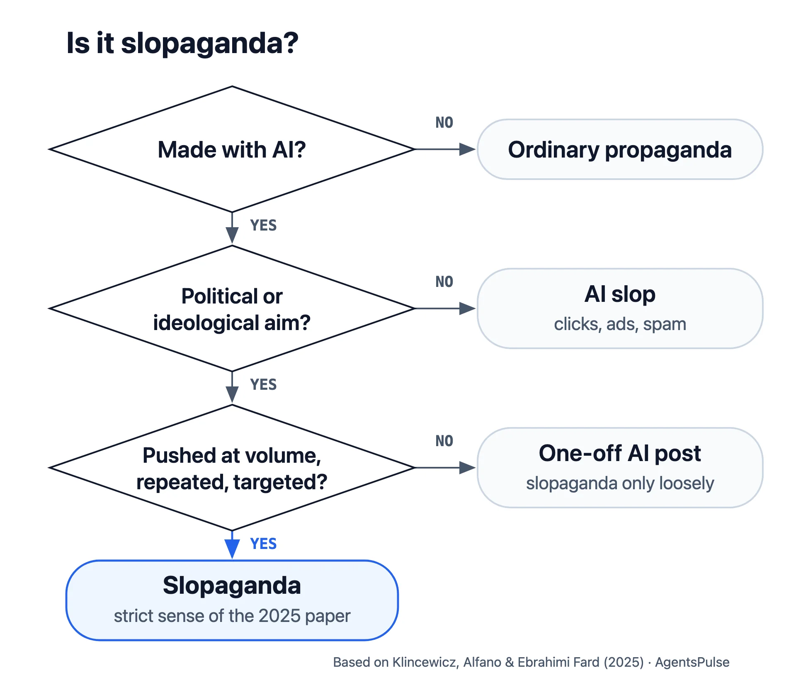

Slopaganda is propaganda made partly or entirely with generative AI, usually cheap, repetitive and pushed through social feeds. On November 17, 2026, Oxford Languages added the word to its shortlist for the 2026 Oxford Word of the Year, saying its relative frequency had grown by more than 1,300% over the past year and that it most often appears as "AI slopaganda" and "slopaganda videos". Public voting closes on November 24 and Oxford names the winner on December 1.

| Question | Short answer |
|---|---|
| What does it mean? | Propaganda made with generative AI and spread online at volume. |
| Where is it from? | *Slop* + *propaganda*; coined for AI in a 2025 philosophy paper. |
| Who defines it? | Oxford (2026 shortlist) and Merriam-Webster (slang entry, June 2026). |
| What makes it different? | Scale, scope, speed and the ability to target narrow audiences. |
| Is every AI political meme slopaganda? | Loosely, many people say so; the coiners' stricter test asks for volume and targeted distribution. |

*Cover image: the slopaganda entry on Oxford's Word of the Year 2026 page. Source: Oxford University Press.*

## Slopaganda Meaning and Origin {#slopaganda-meaning}

Slopaganda means AI-generated propaganda. Oxford's shortlist entry defines it as "low-quality propaganda produced using generative artificial intelligence and widely distributed online, esp. via social media." Merriam-Webster's slang entry, published on June 11, 2026, is shorter: "propaganda made partially or entirely with AI." Both treat it as a disapproving word.

The two halves already had dictionary histories. Merriam-Webster chose *slop* as its 2025 Word of the Year, in the sense of low-quality digital content produced in quantity with AI, and *slop* made Oxford's 2024 shortlist. *Propaganda* covers the systematic spread of biased or misleading information to promote a cause.

The AI sense comes from a 2025 paper in the philosophy journal *Filosofiska Notiser*, "Slopaganda: The interaction between propaganda and generative AI" by Michał Klincewicz (Tilburg University), Mark Alfano (Macquarie University) and Amir Ebrahimi Fard. Its abstract cites a scale example from *The Guardian*: News Corp Australia was producing 3,000 "local" AI-written stories a week. Merriam-Webster also found an unrelated 1925 use in the table of contents of *The Pathfinder*, a Washington weekly, attached to a page of Hollywood gossip.

## What Counts as Slopaganda? {#what-counts-as-slopaganda}

Slopaganda counts when AI-made content serves a political or ideological goal and is pushed at volume, repeated or targeted at particular audiences. The 2025 paper sets that bar. It argues the new thing is what generative AI adds to the bots and recommendation algorithms of earlier computational propaganda: personalization at mass scale.

The authors list three measurable differences from older propaganda, each "by orders of magnitude":

- **Scale.** Fabricated content becomes cheap and fast enough to outproduce any human content farm.
- **Scope.** Messages can be tailored to many audiences and contexts at once.
- **Speed.** Social networks and ranking algorithms carry it further and faster than broadcast media.

They add targeting. A newspaper looks the same to every reader; AI-made messages can be fitted to a person's social graph, engagement history, personality profile, location or the hours they are online. The paper also points to the illusory truth effect, the finding that repeated exposure makes a claim feel truer, while noting that more empirical work is needed on how it interacts with other drivers of persuasion.

*A three-question test for slopaganda. Based on Klincewicz, Alfano and Ebrahimi Fard (2025); diagram by AgentsPulse.*

The strict reading leaves some famous cases out. The paper discusses Donald Trump's 2024 post of AI images suggesting Taylor Swift endorsed him, and Elon Musk sharing an AI clone of Kamala Harris's voice. "None of these counts as slopaganda, as we define it," the authors write, because each was a one-off that relied on a huge audience rather than on many items produced and distributed to targeted groups. In practice the word has widened. Oxford's definition stresses low quality and wide distribution, and in an April 2026 article Alfano and Klincewicz themselves cite Trump's AI videos as slopaganda. Read the term loosely in news coverage and strictly when someone is making a claim about a coordinated campaign.

## Slopaganda vs AI Slop vs Deepfakes {#slopaganda-vs-ai-slop}

Slopaganda is the political subset of AI slop, and it overlaps with deepfakes without being the same thing. The difference lies in purpose and realism:

| Term | What it is | Purpose | Needs to look real? |
|---|---|---|---|
| AI slop | Low-quality AI content made in bulk | Clicks, ad revenue, engagement | No |
| Deepfake | AI imitation of a real person's face or voice | Varies: fraud, satire, smears | Yes |
| Computational propaganda | Bots and algorithms amplifying political messages | Political influence | Not necessarily |
| Slopaganda | AI-made content produced and pushed at volume | Political or ideological influence | No |

A deepfake of a candidate's voice can be part of a slopaganda campaign, as the 2026 midterm ads below show. Much slopaganda is openly fake, though. Alfano and Klincewicz point out that nobody believes a Lego figurine of a world leader is real; the content works on emotion and association instead of on belief. Impersonation is where AI products draw the firmest lines: the [rules reported for Grok's phone-calling bot](/tutorials/grok-bot-phone-calls/), for example, require it to say it is a virtual assistant and ban impersonation outright.

## Slopaganda Examples from 2026 {#slopaganda-examples}

The clearest slopaganda examples of 2026 came from the US–Iran conflict and the US midterm elections.

### US–Iran war videos

In early March 2026, a week after the first US–Israeli strikes on Iran, the White House posted a video of real American attacks cut together with clips from films, TV series, video games and anime. Iran and its supporters answered with outdated war footage passed off as current and with AI-generated scenes of attacks on Tel Aviv and US bases in the Persian Gulf. A team of Iranians later released viral videos casting Donald Trump, Jeffrey Epstein, Benjamin Netanyahu, Pete Hegseth, Ayatollah Khamenei and Satan as Lego figures. *The New York Times* reported on May 2 that experts saw Iran's tactics as "a new era of meme warfare," one that "has been called slopaganda." Earlier, in October 2025, Trump had posted an AI video of himself wearing a crown and flying a fighter jet that dumps excrement on protesters.

### AI ads in the 2026 midterms

CNBC reported on election day, November 3, that the midterm cycle "has been dominated by slopaganda." A Wesleyan Media Project analysis it cited counted nearly 300 ads generated or enhanced by AI, with more than $187 million spent on them. Over 90% of that spending came from Republican candidates, party committees or Republican-leaning groups, and most of the ads carried no AI disclaimer. The project called its count an undercount, since many ads lack disclaimers and AI use is hard to detect.

Two cases CNBC found running online: a fake video of New York Governor Kathy Hochul posted by her Republican challenger Bruce Blakeman, and an AI video from Texas Senate candidate Ken Paxton showing his Democratic opponent James Talarico making controversial statements, with a disclosure that flashes for three seconds mid-video.

## Why Slopaganda Works {#why-slopaganda-works}

Slopaganda works through repetition and association more than through persuasion by argument. In their April 2026 article for The Conversation, Alfano and Klincewicz describe four effects:

1. **It slips past defenses.** Repeated, attention-grabbing, usually negative content reaches people while they scroll or switch tabs, when they are least likely to scrutinize it.
2. **It dilutes what people think they know.** A flood of half-truths and falsehoods makes the information environment noisier for everyone.
3. **It builds associations.** Content that no one takes literally can still pair a leader with a villain or a country with evil. Some of it also misleads outright, by design or when a joke loses its context and is shared as fact.
4. **It erodes trust in real content.** As people get better at spotting slop, they also start dismissing authentic material as fake, which lowers trust in reliable sources and institutions.

The economics favor the producer. The paper cites Brandolini's law, the observation that refuting nonsense takes an order of magnitude more effort than producing it. Cheap generation widens that gap.

## How to Spot Slopaganda {#how-to-spot-slopaganda}

To spot slopaganda, look at the pattern and the source before judging the single post. These checks come from the paper's authors and from the disclosure tools platforms describe:

- **Look for telltale signs of AI** in text, images and video, as the authors advise, and treat them as one clue among several.
- **Check the source, not the headline.** Who posted it first, and do they post the same narrative across many accounts or formats? Volume and repetition are the signature of slopaganda.
- **Block repeat spreaders.** The authors suggest filtering out accounts that routinely push it instead of evaluating each piece in isolation.
- **Read the labels.** YouTube says it applies prominent labels to realistic AI content and requires election advertisers to disclose synthetic people or events. Meta requires "paid for by" labels, keeps a political ad library and in June added an "about this ad" tool for ads it detects were made with third-party AI tools. X's ad policy puts responsibility for legal compliance on the advertiser.
- **Watch for buried disclosures**, like a notice that flashes for a few seconds in the middle of a video.
- **Ask what feeling it is selling.** Content that is obviously unreal but sticks a strong emotion to a person or group is doing association work.

## How to Counter Slopaganda {#how-to-counter-slopaganda}

Countering slopaganda takes action at three levels, according to the 2025 paper: individual psychology, technology and the political economy behind the tools.

**Psychological and educational measures.** Prebunking, warning people in advance about misleading messages and the tactics behind them, has evidence of working better than debunking after the fact. Accuracy nudges ask users to consider whether something is true before sharing it. Inoculation games such as *Bad News*, *Harmony Square*, *Go Viral!* and *Cranky Uncle* let players try misinformation tactics themselves; the authors call the early results supportive but preliminary. They also stress digital literacy over the long term, while conceding that these interventions tend to produce small effects at high cost.

**Technical measures.** Platforms combine automated moderation, human reviewers and crowd-sourced notes; the paper notes that research on how well moderation works is inconclusive. Alfano and Klincewicz also call for watermarking AI-generated content and, in some cases, removing it from the places people get news. Model makers are part of this layer too: the Brennan Center for Justice tested ChatGPT, Gemini, Grok, Claude, Perplexity and DeepSeek in August 2026 and found that most avoided familiar conspiracies but could be manipulated into producing misleading election content; an October retest found ChatGPT had improved, turning such requests into comic-style illustrations or refusing them. Outside tests like this are one of the few ways to check those safeguards; OpenAI's [embedded assessments](/tutorials/embedded-assessments-openai/) go further by giving external researchers deeper access to models and systems.

**Political and economic measures.** The paper's boldest proposal is a global wealth tax that would reduce the power of the oligarchs the authors see behind much of it and fund the other interventions. In their 2026 article, Alfano and Klincewicz put the same idea as holding large tech companies such as OpenAI, Google and X accountable, through taxation among other means. Regulation is moving slowly: CNBC reported that there is no federal US law on AI disclosure in political ads, about 30 state laws with differing rules, and that the bipartisan Protect Elections from Deceptive AI Act and the AI Ads Act had not advanced out of committee. Local governments are also writing their own AI rules, as Bloomington, Indiana did with its [superintelligence ordinance](/tutorials/bloomington-superintelligence-ban/), and courts are still settling other basic questions about AI output, such as [who owns AI-generated code](/tutorials/ai-generated-code-copyright/).

## Oxford Word of the Year 2026 Shortlist {#oxford-word-of-the-year-2026}

The Oxford Word of the Year 2026 shortlist has four words: doomerism, microdrama, post-literate and slopaganda. Oxford says its experts chose them from a 32-billion-word corpus and describes 2026 as a year of public debate over how AI is changing communication and creativity. Doomerism, extreme pessimism about threats such as AI or climate change, is the other AI-linked entry. Voting closes on Tuesday, November 24 at 11:59 pm GMT, and Oxford will announce the winner on December 1 after combining the vote with its corpus analysis. The 2025 winner was *rage bait*.

For readers, the useful part of the word is the test behind it: AI, a political goal and volume. When all three show up together, treat the content as a campaign, check who is behind it and do not reshare it.

## References {#references}

- Oxford Languages, ["Oxford Word of the Year 2026" shortlist and slopaganda entry](https://corp.oup.com/word-of-the-year/), Nov 17, 2026
- Merriam-Webster, ["Slopaganda" slang meaning](https://www.merriam-webster.com/slang/slopaganda), Jun 11, 2026
- Michał Klincewicz, Mark Alfano and Amir Ebrahimi Fard, ["Slopaganda: The interaction between propaganda and generative AI"](https://arxiv.org/abs/2503.01560), *Filosofiska Notiser* 12(1), 2025 (arXiv:2503.01560v2)
- Mark Alfano and Michał Klincewicz, ["Slopaganda wars: how (and why) the US and Iran are flooding the zone with viral AI-generated noise"](https://theconversation.com/slopaganda-wars-how-and-why-the-us-and-iran-are-flooding-the-zone-with-viral-ai-generated-noise-280024), The Conversation, Apr 7, 2026
- Julia Boorstin, ["AI-generated 'slopaganda' in political ads puts internet platforms on alert"](https://www.cnbc.com/2026/11/03/ai-generated-slopaganda-in-political-ads-puts-platforms-on-alert.html), CNBC, Nov 3, 2026
