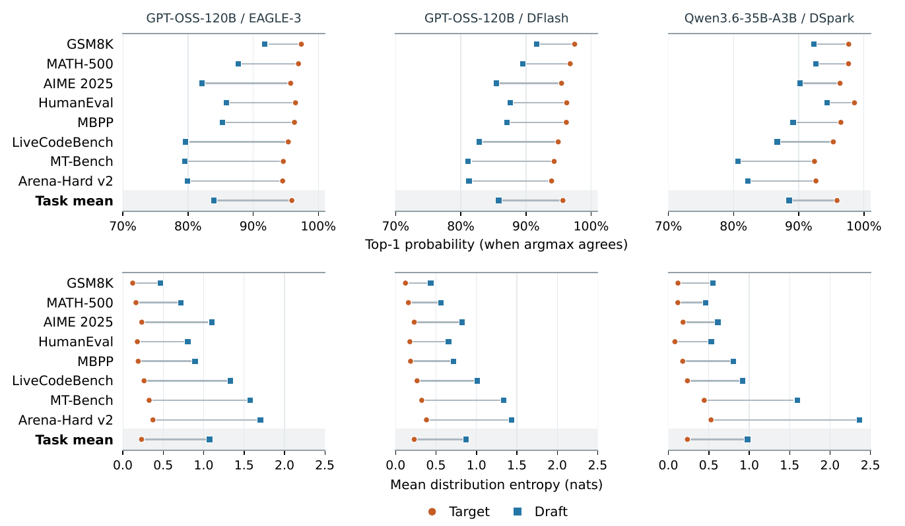

A speculative decoding draft model can predict the right next token and still waste verification work, because it is not confident enough about it. That is the main finding of a November 24, 2026 preprint from researchers at UIUC and Microsoft, who measured nine community draft models for EAGLE-3, DFlash and DSpark and found the same pattern in all of them: the draft's top choice matches the target model's most of the time, but the draft spreads too much probability across other tokens. Lowering only the draft model's sampling temperature, with the target model's output distribution unchanged, raised accepted tokens per verification round by up to about 11% and served throughput by up to 22%.

The authors, Yuxing Liu, Wei Zuo, Walid Krichene, Tong Zhang and Li Zhang, call this draft calibration: treat the target model's distribution as ground truth and correct the draft's probabilities after training, the way confidence calibration corrects a classifier. Because speculative decoding verifies every draft token with rejection sampling, the change keeps the output distribution exactly as the target would produce it. Only the speed changes.

## Speculative decoding draft model acceptance: why the draft's confidence matters {#speculative-decoding-draft-model-acceptance}

A speculative decoding draft model speeds up serving only as far as its tokens get accepted, and the acceptance probability of each draft token is fixed by how close the draft's distribution is to the target's. With target distribution *p* and draft distribution *q*, the standard rejection sampler from Leviathan et al. and Chen et al. (2023) accepts a draft token with probability Σ min(*p*, *q*) = 1 − ½‖*p* − *q*‖₁.

The paper builds on that formula. A draft can rank tokens in exactly the right order and still lose acceptance if its probabilities are too flat: when the target puts 95% on a token and the draft puts 80% on it, the 15-point gap shows up directly as rejections. In a chain of *K* draft tokens, the first rejection discards everything after it, so small per-token losses compound into fewer tokens committed per verification round.

The paper measures that as **accepted length**: output tokens committed per target verification round, including the bonus token the target adds itself. A verification round costs roughly the same whatever the draft temperature, so a longer accepted length translates into more output tokens per second as long as the time per draft–verify round stays the same.

Most serving stacks draft with the same sampling settings as the target, so a request at temperature 1 also drafts at temperature 1. The paper keeps the target at *T*t = 1 and treats the draft temperature *T*d as a separate knob. Lowering *T*d sharpens the draft distribution without changing the order of its candidates, and as long as the same calibrated *q* is used for both drafting and the rejection test, the output still follows the target distribution exactly.

<strong>Choosing what to self-host.</strong> Draft calibration only pays off when you run the target and draft models on your own GPUs. If you are still comparing hosted open-weight models against self-hosting, a shared gateway such as
<a href="https://www.packyapi.ai/register?aff=5W73&amp;utm_source=agentspulse&amp;utm_medium=affiliate&amp;utm_campaign=speculative-decoding-draft-model" rel="sponsored nofollow noopener" target="_blank">PackyAPI</a> is one option for trying several providers through one API before you commit hardware.

<small>Disclosure: this page contains an affiliate link. If you sign up through it, we may earn a commission at no extra cost to you.</small>

## Underconfident draft models: what the measurements show {#underconfident-draft-models}

Community draft models get the top token right most of the time but are underconfident about it. The authors evaluated nine target–draft pairs built from public checkpoints, including `lmsys/EAGLE3-gpt-oss-120b-bf16`, `z-lab/gpt-oss-120b-DFlash` and `RedHatAI/Qwen3.6-35B-A3B-speculator.dspark`, on eight prompt sets: GSM8K, MATH-500, AIME 2025, HumanEval, MBPP, LiveCodeBench, MT-Bench and Arena-Hard v2. Runs used the SpecForge/SGLang stack with chain drafting, target temperature 1, low-reasoning or no-thinking chat templates and a 2,048-token output cap.

The rankings largely agree: averaged over the eight tasks, the draft's top-1 token is also the target's top-1 token 71.4% of the time for GPT-OSS-120B with EAGLE-3, 77.3% with DFlash, and 79.8% for Qwen3.6-35B-A3B with DSpark. Even across the top 16 candidates, more than 40% overlap.

The probabilities do not. When draft and target agree on the top token, the draft gives it a lower probability on every task and for all three drafter families, and the draft's entropy is consistently higher. The gap widens on open-ended chat (MT-Bench, Arena-Hard v2) and narrows on GSM8K.

*Figure: When draft and target agree on the top token, the draft (blue) assigns it less probability (top row) and spreads more entropy (bottom row) than the target (orange). Source: Liu et al., arXiv 2611.33111, Figure 2.*

The authors call the gap surprising, since drafters are trained to match the target. They suggest three possible causes without testing them: a small draft model may lack the capacity to produce a distribution as sharp as the target's; training recipes differ; and the KL-divergence loss used in standard draft training does not directly minimize the ℓ1 gap that sets acceptance. (Our [PyTorch KL divergence guide](/tutorials/pytorch-kl-divergence/) covers how that loss behaves in practice.)

## Draft temperature benchmark: accepted length and throughput gains {#draft-temperature-benchmark}

A lower draft temperature increased accepted length for every one of the nine target–draft pairs. The authors swept *T*d over 0, 0.2, 0.4, 0.6, 0.8, 1 and 1.2 with the target held at 1. Accepted length peaked somewhere between 0 and 0.8 in every setting, the curves had a single peak and were flat near it, and any value from 0.4 to 0.6 beat the default *T*d = 1 on all models and tasks.

| Drafter | Target | Accepted length at *T*d = 1 | Best shared *T*d | Gain |
|---|---|---:|---:|---:|
| EAGLE-3 | Gemma-4-31B-IT | 3.100 | 3.338 | +7.69% |
| EAGLE-3 | Qwen3-30B-A3B-Instruct-2507 | 2.656 | 2.808 | +5.71% |
| EAGLE-3 | GPT-OSS-120B | 3.104 | 3.460 | +11.47% |
| DFlash | Qwen3.5-27B | 4.585 | 4.830 | +5.33% |
| DFlash | Qwen3.6-35B-A3B | 5.275 | 5.773 | +9.45% |
| DFlash | GPT-OSS-120B | 3.680 | 4.051 | +10.11% |
| DSpark | Gemma-4-31B-IT | 3.404 | 3.533 | +3.80% |
| DSpark | Qwen3.6-35B-A3B | 4.130 | 4.495 | +8.82% |
| DSpark | Qwen3.8-27B-FP8 | 3.511 | 3.630 | +3.39% |

*Task-mean accepted length over eight benchmarks, one draft temperature shared across tasks. Picking the best temperature per task adds at most about 1.5 percentage points (for example 5.853 instead of 5.773 for Qwen3.6-35B-A3B with DFlash). Source: Liu et al., Figure 3, which is the chart at the top of this page.*

The gains held up in live serving when the authors froze one draft temperature per pair (0.4 for both GPT-OSS-120B drafters, 0.6 for Qwen3.6-35B-A3B with DSpark) and then served 2,082 held-out requests on two NVIDIA GH200 GPUs, one tensor-parallel-size-1 server per GPU, at total client concurrency of 16, 64 and 128, three seeds each.

| Target / drafter | Concurrency | Accepted length gain | Throughput (output tok/s) |
|---|---:|---:|---|
| GPT-OSS-120B / EAGLE-3 | 16 | +10.64% | 760.9 → 836.2 (+9.92%) |
| GPT-OSS-120B / EAGLE-3 | 128 | +10.89% | 2,141.6 → 2,249.7 (+5.13%) |
| GPT-OSS-120B / DFlash | 64 | +9.25% | 2,765.9 → 3,034.3 (+9.68%) |
| Qwen3.6-35B-A3B / DSpark | 64 | +8.82% | 1,858.6 → 2,265.8 (+22.08%) |

*Selected rows from the paper's Table 1; all nine settings improved, with accepted length up 8.82–10.89% and throughput up 5.13–22.08%.*

Median and 95th-percentile request latency fell in all nine settings, and 26 of the 27 individual seed comparisons improved throughput; the exception was EAGLE-3 at concurrency 128, down 0.56% in one seed. Throughput gains do not track accepted length exactly, because continuous batching changes how many requests, and how long a context, each verification round processes. At high concurrency with EAGLE-3, a 10.9% longer accepted length turned into only 5.1% more throughput. If you plan capacity, measure throughput at your own concurrency rather than scaling it from accepted length.

Reasoning settings also move the numbers: switching between completion mode and low, medium or high reasoning effort changed accepted length substantially, and the best draft temperature rose slightly with higher reasoning effort, which the authors attribute to the target's own distribution being flatter in long reasoning. Lower temperatures still won in every template they tried; the gain was largest at low reasoning effort.

## Draft calibration in vLLM and SGLang: what you can set today {#draft-calibration-vllm-sglang}

In vLLM, the setting closest to draft calibration is `draft_sample_method` in `--speculative-config`. Its default, `greedy`, drafts the draft model's top token and, for sampled requests, accepts it based on the target's probability alone; `probabilistic` keeps the full draft distribution and uses the probability-ratio test described above. vLLM's documentation notes that `temperature` and `top_p` are request sampling parameters, not speculative-config fields, and it lists no separate draft temperature.

Greedy drafting corresponds to the *T*d = 0 end of the paper's sweep, where the draft becomes a point mass on its top token. In the authors' Figure 3, the task-mean accepted length at *T*d = 0 is higher than at *T*d = 1 in every panel and a little below the peak at 0.2–0.6. Reading the plot, vLLM's default already captures much of the benefit for sampled requests, while drafting probabilistically at the request's own temperature of 1 matches the paper's baseline. We have not run vLLM to confirm this; the paper's experiments did not use vLLM.

The paper's runs used the authors' own SpecForge/SGLang integration, which adds independent draft-temperature control and applies the calibrated draft probabilities in the rejection step. The paper does not say whether that control will ship upstream, and we found no public code for it. The [vLLM documentation](https://docs.vllm.ai/en/stable/features/speculative_decoding/) also offers a lossy verifier, FLy, which deliberately relaxes verification and does not preserve the target distribution; draft calibration as studied here keeps verification exact.

For serving teams this means two practical cases. If your engine already drafts greedily, Figure 3 suggests a temperature knob would add only the gap between the *T*d = 0 point and the peak. If your engine drafts by sampling at the request temperature, scaling the draft logits by 1/*T*d before both drafting and verification is the change the paper tested, and it adds no model computation. For other parts of the decode path, our pieces on [disaggregated prefill and decode](/tutorials/cerebras-disaggregated-inference/) and on [megakernels versus CUDA graphs](/tutorials/megakernel-vs-cuda-graphs/) cover what else limits tokens per second.

## When draft calibration does not help {#when-draft-calibration-does-not-help}

Draft calibration helps only when the draft is underconfident, and some drafters already are not. Draft models trained by DeepSeek for Qwen3-14B showed a much smaller top-1 probability gap, and temperature scaling barely moved them:

| DeepSeek-trained drafter | Best *T*d | Accepted length gain | Top-1 gap at *T*d = 1 |
|---|---:|---:|---:|
| EAGLE-3 | 0.6 | +2.05% | 5.65 pp |
| DFlash | 0.8 | +0.10% | 0.93 pp |
| DSpark | 1.0 | 0% | 0.18 pp |

*Top-1 gap is target minus draft probability on tokens where both pick the same top token, averaged over eight tasks. Source: Liu et al., Table 2.*

The size of that gap is a quick predictor. If your drafter's top-1 probability is within a point or two of the target's, a temperature sweep will not find much.

Three further limits shape where the results apply. All experiments used a target temperature of 1 with no top-p or top-k truncation, so they say nothing direct about greedy target decoding. They also used chain drafting only; the authors cite work showing that a 21-token draft tree became slower than plain autoregressive decoding at batch size 64, and they focus on chains for large-batch serving. Finally, every method tested is post-hoc. Training the drafter to be calibrated in the first place is left to future work.

## Dirichlet scaling vs temperature scaling for draft calibration {#dirichlet-scaling-vs-temperature-scaling}

More flexible calibration did not beat a single temperature. To test alternatives cheaply, the authors built a trajectory replay: they cached final hidden states from reference generations, rebuilt draft and target logits, and computed expected acceptance directly. This proxy tracked online temperature trends with a mean absolute relative error of 1.83–2.64%, and it let them score more than a million calibration candidates in GPU minutes.

- **Diagonal Dirichlet scaling**, a separate temperature for each of the top seven draft tokens plus one for the tail, searched exhaustively over 1,679,616 combinations, came within 0.001 replay accepted length of scalar temperature scaling on all three pairs.
- **Full-matrix Dirichlet scaling**, trained with Adam on a total-variation surrogate, did slightly worse (3.4824 versus 3.5085 replay accepted length for GPT-OSS-120B with EAGLE-3).
- **Learned per-token temperature heads**, using the draft's hidden state alone or combined with the target's last state, stayed near or below the global temperature.

There is headroom that none of these methods reach. An oracle that picks the best temperature for each draft position, using the target distribution it would not have at serving time, reached a replay accepted length of 4.06 against 3.51 for the best global temperature on GPT-OSS-120B with EAGLE-3. Choosing only between greedy and *T*d = 1 per token recovered 70–76% of that oracle gain, which suggests a simple per-token switch could be learnable. The heads the authors trained did not learn it.

## How to tune draft temperature for your own speculative decoding setup {#how-to-tune-draft-temperature}

The paper's protocol translates into a short tuning loop for any deployment that can set the draft temperature separately from the target.

1. **Log accepted length.** Record output tokens and verification rounds per request, and compute accepted length per task as tokens divided by rounds. vLLM's documentation has a page on per-request acceptance metrics.
2. **Check the gap first.** On a sample of prompts, compare draft and target top-1 probabilities where they agree. A gap of several points, as in the community drafters above, is the signal that calibration can help; under one point, as with the DeepSeek-trained drafters, skip it.
3. **Sweep a coarse grid.** Try *T*d in 0, 0.2, 0.4, 0.6, 0.8 and 1 with your production target temperature and templates. The authors found a single peak and a flat top, so this grid is enough, and one shared value across workloads came within about 1.5 percentage points of per-task tuning.
4. **Split by reasoning mode.** Run thinking and non-thinking templates separately, since acceptance and the best temperature both shift with reasoning effort.
5. **Confirm with throughput.** Replay real traffic at your production concurrency and compare output tokens per second and p50/p95 latency, not accepted length alone. Our [gBench tutorial](/tutorials/gbench/) shows one way to load-test a vLLM endpoint before and after a configuration change.

Keep the calibrated draft distribution in both the drafting step and the rejection test. Using a sharpened *q* to propose tokens but the original *q* to verify them would break the guarantee that outputs follow the target model. Model-specific serving notes, such as our [GLM-5.3 NVFP4 serving guide](/tutorials/glm-5-3-nvfp4/) with multi-token prediction and the [Qwen 3.8 27B setup](/tutorials/qwen-3-8-27b/), show how those models use their multi-token-prediction heads as drafters.

## References {#references}

1. Yuxing Liu, Wei Zuo, Walid Krichene, Tong Zhang and Li Zhang, “[Draft Calibration for Speculative Decoding: Accelerating LLM Serving by Matching Draft and Target Distributions](https://arxiv.org/abs/2611.33111),” arXiv 2611.33111v1, November 24, 2026.
2. vLLM project, “[Speculative Decoding](https://docs.vllm.ai/en/stable/features/speculative_decoding/),” vLLM stable documentation, read November 26, 2026.
3. Yaniv Leviathan, Matan Kalman and Yossi Matias, “[Fast Inference from Transformers via Speculative Decoding](https://arxiv.org/abs/2211.17192),” ICML 2023.
4. Charlie Chen et al., “[Accelerating Large Language Model Decoding with Speculative Sampling](https://arxiv.org/abs/2302.01318),” arXiv 2302.01318, 2023.
