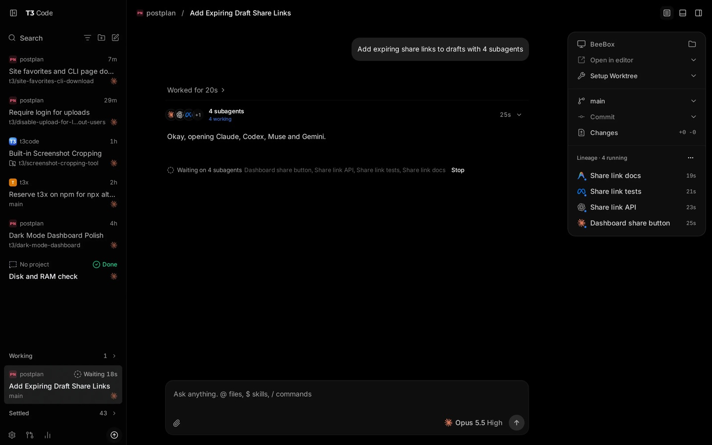
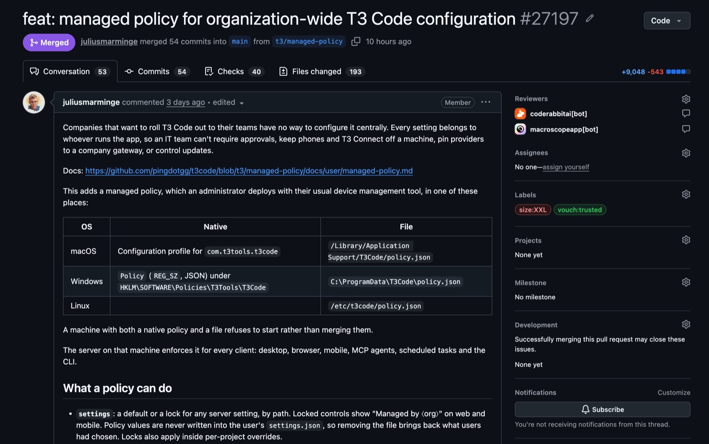
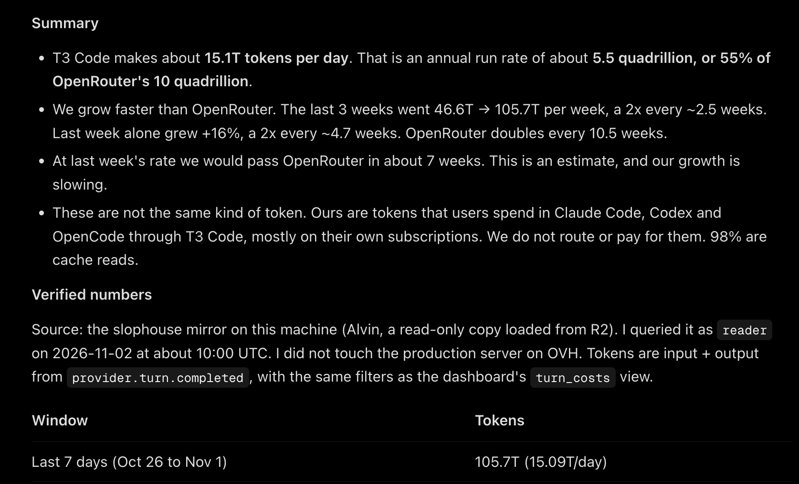

**T3 Code** is an open-source app that runs the coding agents you already use, such as Claude Code and Codex, from one desktop, web and mobile interface. It is built by Theo Browne's Ping team (pingdotgg), licensed MIT, and free: you bring your own subscriptions. On November 2, 2026 the team merged a managed policy so company IT teams can set and lock T3 Code settings on every machine, the first feature aimed at organizations rather than individual developers.

This guide explains what T3 Code is, how it differs from Claude Code and the Codex app, how its remote and mobile setup works, and what the new policy controls.

## What Is T3 Code

T3 Code is a control surface for coding agents. The project's own site calls it "the open-source control plane for coding agents." It does not contain a model or an agent loop. It launches agent CLIs that are installed and signed in on your machine, then shows their threads, diffs, terminals and approvals in one place.

The project FAQ makes the split explicit. Claude Code is an interface on top of a harness, the Anthropic Agent SDK; Codex is an app on top of the Codex App Server. "T3 Code uses those harnesses. It is not a harness, and it does not work without one." The FAQ's analogy: the LLM is the chef, the harness is the kitchen, and T3 Code is the restaurant that lets you bring whichever kitchen you want. For background on that layer, see our explainer on [why harnesses, not agent frameworks, run production agents](/tutorials/agent-framework-harness-runtime-production/).



*The T3 Code desktop app: one thread fans out to four subagents on different providers, with branch, worktree and commit controls on the right. Image: t3.codes.*

## T3 Code vs Claude Code and Codex

T3 Code does not replace Claude Code or Codex; it runs them. You still install and log in to each CLI, and the provider still does the work and bills you. What T3 Code changes is the window in front of the agent, which matters when you use more than one provider or more than one machine.

| | Claude Code / Codex app | T3 Code |
|---|---|---|
| What it is | Vendor interface plus the vendor's harness | Interface only; drives other vendors' harnesses |
| Providers | One vendor | Eight providers in one app |
| Cost | Your subscription or API usage | Free; you still pay each provider |
| Source | Closed apps (CLIs vary) | MIT, forkable |
| Remote and phone | Vendor-specific | `t3 up` on any machine, web, iOS and Android clients |
| Cloud tasks | Codex has a cloud lane | Local and self-hosted machines only |

The FAQ lists four reasons to use it instead of the official apps: bring your own subscriptions, remote access from anywhere, a mobile app, and a fully open-source codebase you can fork. It names the Codex desktop app, Conductor, Claude Desktop and Cursor Glass as inspirations that "none met our bar."

There is a trade-off for Claude users. The FAQ says T3 Code drives Claude through the Anthropic Agent SDK, and that all Agent SDK usage currently drains Claude's 5-hour limit faster than Claude Code itself. The team calls it a bug on Anthropic's side; it does not affect weekly limits. If you compare costs across agent surfaces, our guide to [cost per successful task for coding agents](/tutorials/coding-agents-finops-cost-per-successful-task/) shows why the interface is rarely the main cost driver.

## T3 Code Supported Providers

The FAQ lists eight providers: Claude Code, Codex, Cursor, Grok Build, OpenCode, Google Antigravity, Pi and Muse Code. The docs also cover fx, Kiro and generic ACP agents.

Each provider must be installed and authenticated on the machine that runs the T3 Code server, not on your phone. The FAQ says a missing provider is "almost always" a CLI that is not on that machine's `PATH`. You can add extra provider instances with their own API keys or endpoints, including an OpenRouter setup for Claude. T3 Code does not support local models; the FAQ states that locally runnable models "are not capable of meaningful engineering work." If you work with lighter harnesses, compare [Pi's crash-recovery design](/tutorials/pi-agent-harness-v2-crash-recovery/), one of the agents T3 Code can drive.

## T3 Code Remote Access and Mobile App

Remote access lets you run agents on a desktop, server or VPS and control them from another device. Run `t3 up` on the host and choose how other devices reach it: T3 Connect, the local network, or both. Then open app.t3.codes, the desktop app or the iOS or Android app and pick that environment.

- **T3 Connect** needs no router forwarding. Traffic rides a Cloudflare tunnel (`cloudflared`) on your machine; the FAQ says the relay sets up the link but does not proxy your HTTP or WebSocket sessions.
- **Limits:** each T3 Connect account links up to 3 machines; phones and browsers do not count. A paid T3 Chat plan raises this to 10 (Pro) or 100 (Premier).
- **The phone is a remote.** The computer does the work and must stay on. Voice input works on iPhone with iOS 26 or later.
- **Fallbacks:** LAN pairing and Tailscale also work. Theo writes in the FAQ that less than 5% of his own prompts run on his laptop.

One developer described a setup on November 4 that runs a T3 Code server inside each dev container on a home server and pairs devices directly, replacing a set of SSH scripts. He singled out the in-app git diff and merge, the built-in browser running inside the container, and the mobile UI.

Agents that T3 Code did not start can also use it. Each environment exposes an MCP server at its address plus `/mcp`, so Claude Code or Codex in your own terminal, ChatGPT or another MCP client can read projects, start threads and send messages after a one-time sign-in. Sign-in works only over `https` or `localhost`. For the security side of giving agents that kind of reach, see [when AI agents get internal access](/tutorials/ai-agent-internal-access-security-boundary/).

## T3 Code Managed Policy for IT Teams

A managed policy is a JSON file that an administrator deploys to set T3 Code defaults and limits for every user on a machine. The T3 Code server enforces it for every client that connects: desktop, browser, mobile, MCP agents, scheduled tasks and the CLI. Theo announced it on November 2 as "Day 32," adding: "Sorry unemployed folks, this one's not for you."



*Pull request #27197 added the managed policy: 54 commits, +9,048/−543 lines across 193 files. Image: Theo Browne on X.*

The pull request says companies had "no way to configure it centrally": an IT team could not require approvals, keep phones and T3 Connect off a machine, pin providers to a company gateway or control updates. The docs show this shape:

```json
{
  "schemaVersion": 1,
  "organization": "Example Corp",
  "supportUrl": "https://it.example.com/t3",
  "settings": {
    "defaultRuntimeMode": { "value": "approval-required", "locked": false },
    "enableAgentBrowserAccess": { "value": false, "locked": true }
  },
  "limits": {
    "maxRuntimeMode": "auto-accept-edits",
    "clients": ["desktop", "local-browser"],
    "telemetry": false
  }
}
```

- `schemaVersion` and `organization` are required. Locked controls show the organization's name, with a link to `supportUrl`.
- `settings` sets a default or a lock for any server setting. Policy values are never written into the user's `settings.json`, so removing the policy restores the user's own choices.
- `limits` caps the broadest permission mode, which clients may connect and whether telemetry is sent.
- **Where it goes:** a configuration profile for `com.t3tools.t3code` or `/Library/Application Support/T3Code/policy.json` on macOS; a registry value under `HKLM\SOFTWARE\Policies\T3Tools\T3Code` or `C:\ProgramData\T3Code\policy.json` on Windows; `/etc/t3code/policy.json` on Linux. A machine with both a native policy and a file refuses to start.
- **Rollout:** validate with `t3 policy check policy.json`, deploy with your device-management tool, restart T3 Code (the server reads the policy only at startup) and confirm with `t3 policy show`.

Every user on the machine can read the policy, so it should not hold credentials. Teams that already route model traffic centrally may want to pair this with a [model gateway as the enterprise AI control plane](/tutorials/model-gateway-enterprise-ai-control-plane/).

## T3 Code Permission Modes

T3 Code has four permission modes that decide how much an agent can do without asking:

| Mode | Behavior |
|---|---|
| Supervised | Asks before commands and file changes |
| Auto-accept edits | Approves file edits; other actions may still ask |
| Auto | Uses the provider's automatic review to approve routine actions |
| Full access | Runs commands and edits without prompts |

Providers enforce these differently. Auto uses automatic review on Codex, Claude, Cursor, Grok and fx; OpenCode and Antigravity fall back to asking. Muse Code offers only Supervised and Full access. Subagent approval requests appear in the parent thread with the subagent's name, and a managed policy can cap the highest mode on a machine.

## How to Install T3 Code

Install T3 Code on the machine where the agents will run, then add providers. On macOS and Linux:

```bash
curl -fsSL https://t3.codes/install.sh | sh
```

On Windows PowerShell, run `irm https://t3.codes/install.ps1 | iex`. This installs the `t3` command to `~/.local/bin`. To try it once without installing, run `npx t3@latest` (needs Node.js).

| Task | Command |
|---|---|
| Start the server and open the web app | `t3` |
| Start without a browser | `t3 serve` |
| Use it from other devices | `t3 up` |
| Run as a background service (macOS, Linux) | `t3 service install` |
| Update | `t3 update` |

The desktop app is available from GitHub Releases, `brew install --cask t3-code`, `winget install T3Tools.T3Code`, the AUR (`t3code-bin`) and nixpkgs. Intel Macs have no `t3` binary; use the desktop app there.

## T3 Code Open-Source Project and Team

T3 Code is MIT-licensed TypeScript in the `pingdotgg/t3code` repository, created on February 8, 2026. On November 5 it had about 47,400 stars, 9,500 forks and 5,250 open issues. The latest release, v0.1.7, shipped on November 4. The GitHub API lists roughly 895 contributors; Julius Marminge leads with about 3,900 commits and Theo Browne follows with about 1,050.

The team also published usage numbers on November 2. Theo's summary says T3 Code generates about 15.1 trillion tokens a day, an annual run rate of about 5.5 quadrillion, which he puts at 55% of OpenRouter's 10 quadrillion. These are tokens users spend in Claude Code, Codex and OpenCode through T3 Code, mostly on their own subscriptions; T3 Code does not route or pay for them, and 98% are cache reads.



*T3 Code's token summary, queried from its own analytics on Nov 2, 2026. These are the team's figures and count tokens users spend through the app. Image: Theo Browne on X.*

The same summary notes weekly volume grew from 46.6T to 105.7T over three weeks, and says growth is slowing. Because 98% of the volume is cache reads, the comparison with OpenRouter compares different kinds of tokens, as the summary itself says.

## T3 Code Limits and Open Questions

- **Early software.** The README calls the project "very very early" and warns of bugs; versions are still 0.1.x.
- **No local models,** by design.
- **Claude limits drain faster** through the Agent SDK until Anthropic fixes the bug the team reported.
- **Telemetry is on by default.** It sends usage events such as provider, model and token totals, not prompts or file contents. Set `T3CODE_TELEMETRY_ENABLED=false` to turn it off.
- **No cost view.** One competing tool's comparison notes that neither T3 Code nor the Codex CLI shows what a session cost.
- **T3 Connect may not stay free.** The FAQ says the team may "have to change course" if the bill grows.
- **Worktrees use disk.** The FAQ mentions one user who cleared 500 GB; automatic cleanup is in Settings → Storage.

Independent reviews are still scarce; most public praise so far comes from developers quoted on the project's own site. For another way to coordinate many agents, see [DeepSeek's router-and-worker super-agent design](/tutorials/deepseek-super-agent-architecture/).

## T3 Code FAQ

### Is T3 Code free?

Yes. There is no way to pay for T3 Code itself, and it is MIT-licensed. You pay your providers as before. T3 Connect is free for now, for up to 3 machines.

### Can I use T3 Code with my Claude Code subscription?

Yes. T3 Code drives Claude through the Anthropic Agent SDK with your own login. The FAQ says it stays within the terms of service of Claude Code, Codex and Google Antigravity.

### Does my code go to T3 servers?

No. Code and prompts go from your machine to your provider. T3 Connect uses a Cloudflare tunnel, and the relay does not proxy your sessions.

## References

- Ping (pingdotgg), [t3code repository and README](https://github.com/pingdotgg/t3code), v0.1.7, Nov 4, 2026
- T3 Code docs, [FAQ](https://github.com/pingdotgg/t3code/blob/main/docs/user/faq.md), checked Nov 5, 2026
- T3 Code docs, [Managed policy](https://github.com/pingdotgg/t3code/blob/main/docs/user/managed-policy.md), checked Nov 5, 2026
- T3 Code docs, [Remote access](https://github.com/pingdotgg/t3code/blob/main/docs/user/remote-access.md), checked Nov 5, 2026
- Theo Browne, [post announcing managed policies](https://x.com/theo/status/2117142182415257643), X, Nov 2, 2026
