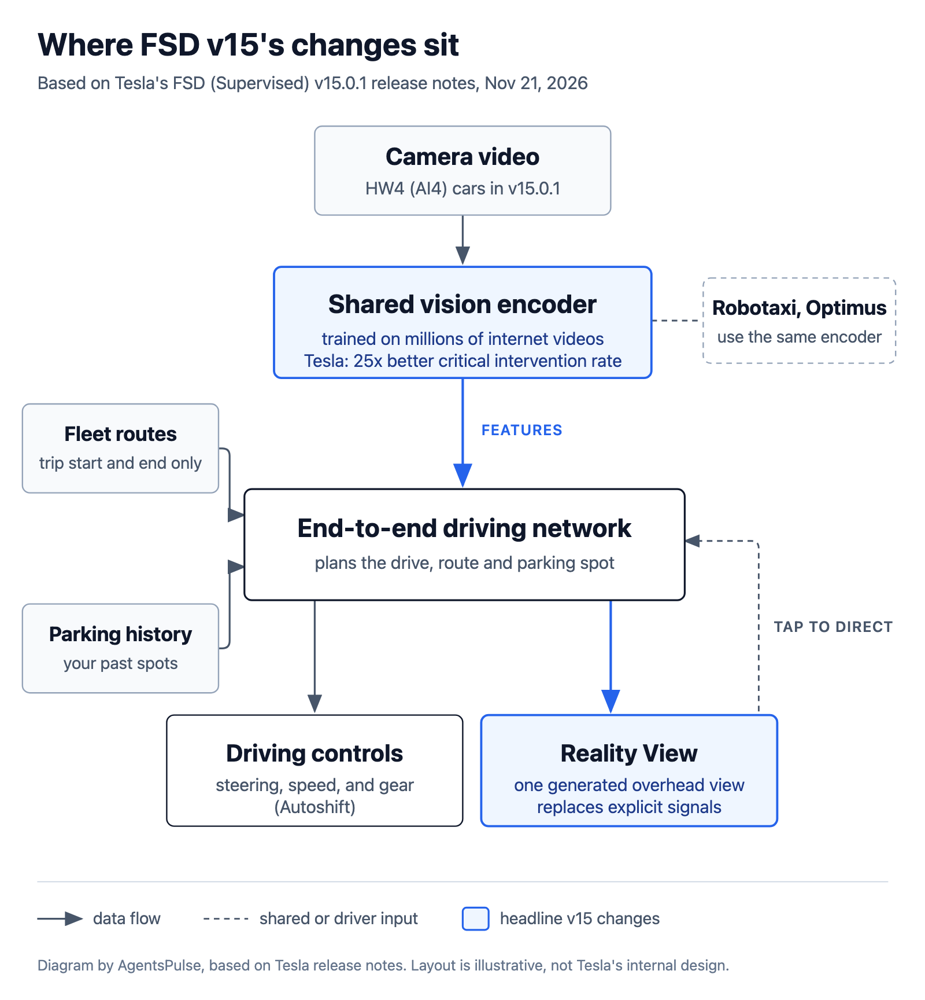

In Tesla FSD v15, the vision encoder that turns camera video into what the car understands is shared with Tesla's Robotaxi service and its Optimus robot. Tesla began sending FSD (Supervised) v15.0.1 to Early Access owners on November 21, 2026, inside software 2026.38.6.11, for HW4 cars in the US. The company says the new encoder, trained on millions of internet videos, improves its critical intervention rate by 25x. Navigation and the on-screen visualization also move into learned models, and HW3 cars stay on a separate v14.3 Lite branch.

This page is for owners and followers who want more than the bullet list. It maps each release-note item to the part of the driving stack it changes, explains what the 25x figure measures, and sets out which cars can run v15 and when the wide release is due.

## Tesla FSD v15 Release Notes: What Changed in v15.0.1 {#release-notes}

Tesla's notes for FSD (Supervised) v15.0.1 open with one line: "v15 upgrades every part of the end-to-end driving network." The build ships in software 2026.38.6.11, is listed for HW4 vehicles in the US, and went first to members of Tesla's Early Access Program. Here is the full list, grouped by what it affects.

| Area | What Tesla's v15.0.1 notes say |
|---|---|
| Perception | Upgraded vision encoder shared between FSD, Robotaxi and Optimus, trained on millions of internet videos; Tesla credits it with a 25x better critical intervention rate |
| Detection | Better detection of road signs, small animals, road debris and chains, plus potholes, road details and avoidance of deep standing water |
| Navigation | An end-to-end learned model based on route preference data from the fleet, used for the start and end of a trip for now |
| Parking | Spot selection uses your personal parking history; the map shows several parking options at the destination |
| Speed | Better speed handling per driver profile, in school zones, at speed limits and in bad weather |
| Gear selection | Autoshift now uses FSD's own gear predictions |
| Driver monitoring | The cabin camera works more often with hats and sunglasses, and attention checks are less strict in higher-speed profiles |
| Visualization | Tesla Reality View, a single generated view that replaces the old explicit model signals and uses less total compute |

Three smaller features ride in the same update. Speed Camera Slowdown lets FSD ease off when it sees a speed camera; pressing the accelerator or picking a faster speed profile cancels it, and cancelling twice at the same camera saves that spot so the car stops slowing there (saved cameras can be cleared under Controls > Service > Manage Saved Locations). Bike Rack Mode allows FSD with a bike rack or similar hitch accessory: the car pulls over near the destination without reversing, and Autopark, Summon and the backup chimes and warnings are switched off. The update also adds FSD Streaks.

## Tesla FSD v15 Architecture: One Vision Encoder for FSD, Robotaxi and Optimus {#architecture}

The architecture change in v15 is that more of the pipeline is learned and more of it is shared. A vision encoder is the part of the network that turns raw camera frames into features the rest of the model plans with. In v15 that encoder is the same one Tesla uses for Robotaxi and the Optimus humanoid robot, and Tesla says it was trained on millions of internet videos "for improved generalization and data efficiency."

*Where each v15 change sits. Based on Tesla's FSD (Supervised) v15.0.1 release notes; the layout is our illustration, not Tesla's internal design.*

Internet video adds variety beyond what Tesla's cars record on their own routes. The same release notes list better detection of small animals, chains, debris and deep standing water, the uncommon objects where that extra variety should matter most. Sharing the encoder also means an improvement made for one product can carry to the others. The same idea runs through recent robotics work, where one perception backbone feeds different action heads; our piece on [world action models for physical agents](/tutorials/physical-agents-world-action-models/) covers that research line.

Two other parts of the stack now come from learned models:

- **Navigation.** Route choice at the start and end of a trip now comes from an end-to-end model trained on which routes Tesla drivers actually prefer. Tesla says later v15 releases will extend this to the whole route.
- **Gear selection.** Autoshift now uses the gear predictions the FSD network already makes, so the gear and the driving plan come from the same model.

## Tesla FSD v15 Reality View: How the Generated View and Tap-to-Direct Work {#reality-view}

Tesla Reality View is a live, generated picture of the drive seen from a virtual camera above the car. Tesla's notes say it replaces "all of the explicit model signals" (the separate overlays the old visualization drew from individual model outputs) with "a single end-to-end visualization using less total compute," and that it lets you "see and control what FSD is planning to do."

The image at the top of this page is a frame from Tesla's v15 launch video, as published by Electrek on November 21, 2026: Reality View on a center screen during a night drive, with the street, parked cars and pedestrians rendered in real time.

Tesla AI software chief Ashok Elluswamy said the same model that drives also renders the scene, with arrows for planned turns and pins for where it intends to park, and that the view takes less computing power than the old one. Elon Musk described it as real-time AI video generation without a game engine, running on half of one AI4 TRIP accelerator. Because the picture comes from the driving model itself, the turn arrows and parking pins should reflect what the car actually plans to do rather than a separate layer drawn on top. For a developer-facing example of a real-time generated world, see our guide to the [Genie 4 API](/tutorials/genie-4-api/).

What you can do with it:

- **Choose the layout.** Fullscreen visualization, map, split view, or a quiet mode with less on screen. Upcoming navigation turns appear inside the driving view, and turn-signal clicks get quieter and fade out after a few.
- **Pick a parking spot.** At the destination the map offers several parking options, ranked using where you have parked before. Musk said you can tap any point on the view to send the car there.
- **Read the plan.** Floating chevrons mark the next turn or roundabout exit before the car commits to it.

Early owner reports on spot picking differ. Tesla commentator Sawyer Merritt posted that "lots of arrows pop up and you just select your spot," while another early write-up found parking lots highlighted but fine-grained spot choice not yet user-controllable. Expect that behavior to vary by build and location until the wide release.

## Tesla FSD v15 25x Claim: What the Critical Intervention Rate Measures {#fsd-v15-25x-claim}

The 25x figure refers to Tesla's critical intervention rate, an internal metric. The name points to how often a driver has to take over in a safety-critical situation; Tesla has not published its exact definition. Tesla's X announcement words it as "25x better handling of safety critical cases," and the full notes tie it to the new vision encoder: "improving the critical intervention rate by 25x." It is not a crash rate and not a comparison with human drivers.

What Tesla has not published is the baseline. There is no figure for how many miles v14 drove between critical interventions, which roads and conditions the comparison covered, or how "critical" was defined. InsideEVs put the question plainly: how many miles did the previous version go between critical interventions, and under what conditions? Tesla does not say. Without those numbers, 25x tells you the direction and rough size of an internal improvement, and nothing you can compare against another system.

As of November 22, 2026 we found no independent measurement of v15. The main launch thread on r/teslamotors quotes the release notes, and early owner clips show single moments, such as a pothole avoided or a car parking in its usual spot, rather than rates.

Two things are worth watching once v15 spreads:

- **Whether the detection items hold up.** Chains, debris and standing water are specific, checkable claims. InsideEVs notes that chains have been linked to crashes that drew federal scrutiny.
- **How the looser driver monitoring plays out.** v15 relaxes attention checks in higher-speed profiles and lets the camera monitor drivers in hats and sunglasses. It is still FSD (Supervised), so the driver remains responsible.

## Tesla FSD v15 HW3 vs HW4: Which Cars Get It {#hw3-vs-hw4}

Only HW4 (AI4) cars get Tesla FSD v15. The v15.0.1 release notes list HW4 as the only supported hardware, and Tesla had already told investors that the AI4 computer is enough to run v15. Tesla has not announced a v15 build for HW3.

HW3 cars are on their own branch. Software update 2026.44.1, which began rolling out on November 17, 2026, carries FSD (Supervised) v14.3.13 for HW4 cars and FSD v14.3 Lite for HW3. Tesla's notes for v14.3 Lite say it "distilled the intelligence from HW4 V14 into HW3" and added parking, unparking and reversing. Earlier in 2026, on Tesla's first-quarter earnings call, Musk said HW3 does not have the capability for unsupervised FSD.

| Your car | FSD build available now | v15 status |
|---|---|---|
| HW4 / AI4 | v14.3.13 (2026.44.1); v15.0.1 for Early Access | Wide release expected in December 2026 |
| HW3 | v14.3 Lite (2026.44.1) | No v15 build announced |

To check which computer your car has, open **Controls > Software** and look at the computer type: HW3 cars show "Full Self-Driving Computer," HW4 cars show "AI4."

## Tesla FSD v15 Rollout and Release Date {#rollout}

Tesla FSD v15 reached Early Access owners on November 21, 2026, and the wide release is due in December 2026. Musk posted that morning that "FSD V15 goes to wide release next month. It will be something special," and answered "Yeah" when an owner asked whether it would arrive with the Holiday Update, Tesla's annual end-of-year software release. Tesla has not given a date or said which markets or vehicles follow the first wave. The current notes list v15.0.1 as available in the US.

If you own an HW4 car, the practical steps are simple: make sure the car is on the latest software, and expect Early Access builds first, then a wider push with the Holiday Update. Navigation learning covers only the start and end of trips in this first build, so route behavior mid-trip should not change much until later v15 releases. For a sense of how quickly general-purpose models are moving into machines that act in the physical world, our [GPT-6 Astra robotics analysis](/tutorials/gpt-6-astra-robotics/) looks at the same shift from the robotics side.

## References {#references}

1. Tesla, [FSD (Supervised) v15.0.1 release notes, software 2026.38.6.11](https://www.notateslaapp.com/software-updates/version/2026.38.6.11/release-notes), November 21, 2026 (in-car notes as archived by Not a Tesla App).
2. Tesla, [FSD v15 announcement on X](https://x.com/Tesla/status/2124222447855743019), November 21, 2026.
3. Tesla, [software 2026.44.1 release notes with FSD v14.3 Lite for HW3](https://www.notateslaapp.com/software-updates/version/2026.44.1/release-notes), November 17, 2026 (archived by Not a Tesla App).
4. Fred Lambert, ["Tesla launches FSD v15, targets its biggest weaknesses, from signs to potholes"](https://electrek.co/2026/11/21/tesla-fsd-v15-rollout-25x-safety-reality-view/), Electrek, November 21, 2026.
5. Joey Klender, ["Tesla Full Self-Driving v15 gets release date from Elon Musk"](https://www.teslarati.com/tesla-full-self-driving-v15-gets-release-date-elon-musk/), Teslarati, November 21, 2026.
