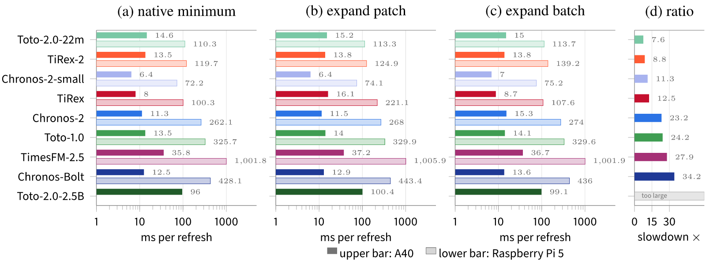
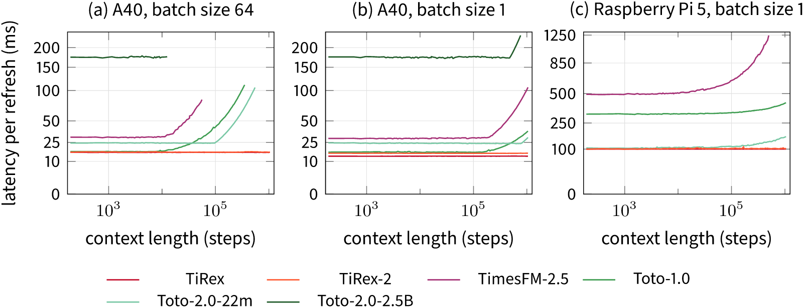

Time series foundation models can now forecast zero-shot on hardware as small as a Raspberry Pi 5, but a new benchmark of nine of them shows that fitting on the device is the easy part. Marco Pichler, Patrick Podest, Günter Klambauer and Sepp Hochreiter at JKU Linz and NXAI streamed up to one million time steps through each model and asked three questions an operations team would ask: does a forecast refresh fast enough, do latency and memory stay bounded as the history grows, and does accuracy hold up on that growing history. Their paper, posted November 23, 2026 and accepted at the NeurIPS 2026 TS-LIMITS workshop, finds that only one configuration passes all three, TiRex-2, which refreshes in about 120 ms on the Pi at every stream length.

The same group built TiRex and TiRex-2, so the result comes from the winner's own lab. The method is still useful well beyond that model: it explains, from architecture alone, why Chronos-2 has to recompute, why TimesFM-2.5 and Toto keep getting slower, and why a recurrent state stays flat. This guide walks through those mechanics, the measured latency, memory and accuracy for all nine configurations, and what you can actually reproduce with the open-source packages today.

## TSFM edge benchmark setup: models, hardware and the refresh test {#what-the-tsfm-edge-benchmark-tested}

The benchmark measures one operation: a new chunk of observations arrives, and the model must update whatever it keeps from the past and forecast the next chunk before the following one lands. Most time series foundation model (TSFM) leaderboards score accuracy on a fixed context window. fev-bench, the leaderboard the authors used to pick models, also reports median inference time per 100 evaluation windows, which says nothing about how a refresh behaves after the ten-thousandth chunk.

The nine configurations come from that leaderboard. The four on its accuracy-versus-speed frontier were TiRex, TiRex-2, Toto-2.0-22m and Chronos-2; the authors added the previous generation and the smallest or largest checkpoint of each family (Toto-1.0, Toto-2.0-2.5B, Chronos-Bolt-base, Chronos-2-small) and TimesFM-2.5, which has the longest trained context on the board. All runs are univariate.

Hardware covers both ends. The server reference is an NVIDIA A40 with 48 GB. The edge devices run on CPU only: a Raspberry Pi 5 with 8 GB, and two Beckhoff industrial PCs of the kind that sit next to production equipment, a C6015 with an Intel Atom x6416RE and a C6025 with a Core i5-1145G7E. Each causal model was modified so its state carries over between calls, and every incremental forecast was checked against a full recomputation at 2,048 steps; the largest absolute difference was below 10⁻⁶.

<strong>Forecast on the device, explain in the cloud.</strong> A forecast that refreshes every few hundred milliseconds usually feeds an alert or a dashboard, and many teams hand those alerts to a language model to summarize or triage. If that step calls more than one LLM provider, a shared gateway such as
<a href="https://www.packyapi.ai/register?aff=5W73&amp;utm_source=agentspulse&amp;utm_medium=affiliate&amp;utm_campaign=time-series-foundation-models-edge"
rel="sponsored nofollow noopener" target="_blank">PackyAPI</a> is one option for routing those calls through a single key.

## TSFM architecture and incremental updates: recompute, KV cache or recurrent state {#tsfm-architecture-incremental-updates}

A model can reuse yesterday's work only if new observations leave its earlier representations untouched, which is what the paper calls temporal causality. That single property sorts the nine configurations into three classes with very different costs per refresh, where *n* is the length of the history kept so far:

| Class | Models tested | Backbone | Refresh cost (time / memory) |
|---|---|---|---|
| Non-causal | Chronos-2, Chronos-2-small, Chronos-Bolt-base | T5 encoder | Recompute: O(n²) / O(n) |
| Causal attention | TimesFM-2.5, Toto-1.0, Toto-2.0-22m, Toto-2.0-2.5B | Decoder-only | KV cache: O(n) / O(n) |
| Causal recurrent | TiRex, TiRex-2 | xLSTM | Fixed state: O(1) / O(1) |

An encoder such as Chronos-2 attends in both directions, so each new chunk changes the representation of every earlier patch and the whole context has to be encoded again. A decoder such as TimesFM-2.5 never looks forward, so the keys and values of old patches can be stored and only the new chunk is projected; the cache still grows by a fixed amount per chunk, and attention over it costs more each time. It is the same KV cache that dominates LLM serving, where systems such as [Cerebras' split of prefill and decode](/tutorials/cerebras-disaggregated-inference/) are built around moving it between machines. TiRex and TiRex-2 carry an xLSTM cell state per block that has the same size after ten chunks or ten thousand.

Model size tracks none of this. Per the paper's Table 1, the nine range from Toto-2.0-22m at 22 million parameters to Toto-2.0-2.5B at 2.5 billion; TiRex-2 has 82.5 million, TimesFM-2.5 200 million and Chronos-2 120 million.

## TSFM benchmark results: refresh latency on an A40 and a Raspberry Pi 5 {#tsfm-refresh-latency-a40-raspberry-pi-5}

With one chunk of history, every model except Toto-2.0-2.5B refreshes in under 36 ms on the A40, and on the Raspberry Pi 5 the spread runs from 72 ms to about one second. These are median latencies at batch size 1, with each model fed one native patch and predicting the next one:

| Model | A40 (ms) | Raspberry Pi 5 (ms) | Pi / A40 slowdown |
|---|---:|---:|---:|
| Chronos-2-small | 6.4 | 72.2 | 11.3× |
| TiRex | 8.0 | 100.3 | 12.5× |
| Chronos-2 | 11.3 | 262.1 | 23.2× |
| Chronos-Bolt-base | 12.5 | 428.1 | 34.2× |
| TiRex-2 | 13.5 | 119.7 | 8.8× |
| Toto-1.0 | 13.5 | 325.7 | 24.2× |
| Toto-2.0-22m | 14.6 | 110.3 | 7.6× |
| TimesFM-2.5 | 35.8 | 1,001.8 | 27.9× |
| Toto-2.0-2.5B | 96.0 | does not fit | — |

*Figure 2 from Pichler et al., “Time Series Foundation Models on the Edge” (arXiv 2611.30404): one refresh at batch size 1 under the native, expanded-patch and expanded-batch protocols, and the Raspberry Pi 5 / A40 ratio. Converted from the paper's SVG.*

At this size a call does little arithmetic, so latency is mostly fixed per-call overhead. The authors checked by feeding every model the same 64-step chunk, either as several patches in sequence or spread across the batch: eight of the nine stayed within 1.35× of their native latency, even when that meant processing four times as many patches. TiRex was the exception, doubling along the sequence axis because it emits one output patch per forward pass. Toto-2.0-2.5B, at 9.36 GB of weights, does not fit in the 7.9 GiB the Pi leaves available.

The move to the Pi hurts some models far more than others. Toto-2.0-22m and TiRex-2 lose the least, 7.6× and 8.8×, while Chronos-Bolt slows by more than 30×. That ordering held under all three input protocols. Chronos-2-small is the fastest on both devices for a single short refresh, which matters for the next section, because a stream does not stay short.

## TSFM latency and memory at one million time steps {#tsfm-latency-memory-one-million-steps}

Grow the stream and the three architecture classes separate exactly as their complexity predicts. The authors fed every model the same synthetic stream up to one million steps, far past any trained context, and stopped a curve when a run ran out of memory or a single update took longer than 600 seconds.

- **Full recomputation** grew by three orders of magnitude across the grid on every device. On the edge devices a single refresh took minutes long before one million steps.
- **KV caches** kept latency well below recomputation, but latency and memory both rose linearly. At batch size 64, every causal attention configuration exhausted the A40's 48 GB before reaching one million steps, and TimesFM-2.5 also ran out of memory on the Raspberry Pi 5. Memory that grows with context is the same wall chip designers are attacking with more on-package memory, as in [Google's dual-chip TPU 8i Max](/tutorials/tpu-8i-max/).
- **Recurrent state** stayed flat. TiRex and TiRex-2 were the only models to reach one million steps on every device, and TiRex-2 refreshed in 14 ms on the A40 and about 120 ms on the Pi from the first grid point to the last.

*Figure 4 from Pichler et al. (arXiv 2611.30404): latency of one stateful incremental update as the context grows, for every causal configuration. A curve that ends early hit out-of-memory or the 600-second budget. Converted from the paper's SVG.*

Energy follows the same split. On the Raspberry Pi 5, a state-advancing refresh drew 4.40–5.03 W at the supply rails and a recompute pass 5.54–6.84 W. At the end of the grid, a fixed-size-state refresh cost under one joule, against 991 J to re-encode the same context; a single native TiRex-2 refresh measured 0.582 J. The Beckhoff controllers have no power sensor, so there are no energy numbers for them.

## TSFM accuracy beyond the trained context length {#tsfm-accuracy-beyond-trained-context}

Keeping the whole history is only worth it if the forecast gets better or at least stays as good, and for eight of the nine models it does not. The authors took the ten fev-bench tasks with series of at least 50,000 steps, longer than every model's trained context, and scored each model at growing context lengths against a Seasonal Naive baseline. The chart at the top of this page is the paper's Figure 1: solid lines stay within each model's trained context, dotted lines go beyond it.

No model scored better on aggregate past its trained context length than within it; individual tasks sometimes peaked later. Past that point the curves split:

- **TiRex** fell below the Seasonal Naive baseline fastest, shortly after its 2,048-step training context.
- **Chronos-2, Chronos-2-small and Chronos-Bolt** also dropped below the baseline.
- **Toto and TimesFM-2.5** degraded gradually. The Toto family declined most slowly among the attention models; the authors suggest the XPOS length-extrapolation scheme as a possible reason but did not isolate it.
- **TiRex-2** stayed flat out to the untruncated series, which ran 52,392 to 198,504 steps depending on the task.

The difference between TiRex and TiRex-2 is the most telling result. Both are xLSTM models with the same constant-cost state, yet one collapses and the other holds. The authors point to the mLSTM blocks added in TiRex-2 as the one architectural change visible in the univariate setting, while noting that trained context, size and training data changed too. A recurrent state makes an unbounded history affordable; it does not by itself make that history useful.

## Sliding window vs incremental state: the truncation trade-off {#sliding-window-vs-incremental-state}

The usual fix for a growing history is to keep only the last *W* steps, and the paper's appendix tests whether that rescues the other models. A window does bound latency and memory: a causal model's cache becomes a ring buffer, and an encoder re-encodes a fixed-size window. It also costs more per refresh than advancing a state, because the window has to be re-encoded on every arrival. At *W* = 2,048 on the Raspberry Pi 5 that re-encode took 1.3 to 18 times each model's native single-chunk refresh.

Here is each model at its best measured window. The reference point is TiRex-2's incremental refresh on the full history, which scored 45.3 at about 120 ms on the Pi.

| Model (best window) | Skill score | Pi 5 latency |
|---|---:|---:|
| Chronos-2 (W = 2,048) | 47.6 | 4,706 ms |
| Chronos-2-small | 45.3 | 831 ms |
| TiRex | 37.0 | 718 ms |
| Toto-2.0-22m | 36.9 | 177 ms |
| Toto-1.0 (256 paths) | 35.0 | 77,842 ms |
| TimesFM-2.5 | 34.8 | 8,075 ms |
| Chronos-Bolt-base | 34.8 | 658 ms |

Chronos-2 is the one model that scores higher, by 2.3 points, at 39 times the latency. Chronos-2-small matches TiRex-2's score at seven times the latency, and the rest trail on both counts. Peak memory did not separate them either: every windowed run used 0.86–1.86 GB, against 1.2 GB for TiRex-2's incremental refresh. When truncation is allowed, the conclusion adds, Toto-2.0-22m is the fastest model on most edge devices at a 2,048-step window, while TiRex-2 scores about nine skill points higher at two to three times that latency, and its full-history incremental refresh on the Pi (about 120 ms) still beats Toto's windowed one (141 ms).

## Open-source time series foundation models: what you can reproduce today {#open-source-time-series-foundation-models-reproduce}

The paper ran every model through its released package (tirex 1.0.0, toto-ts 0.1.3, toto-2 2.0.0, timesfm 2.0.2 and chronos-forecasting 2.2.2 on PyTorch 2.9.1), but the incremental paths were the authors' own changes to the execution code. They added per-layer KV caches to the decoder models, patched TiRex to return and accept its recurrent state, and threaded TiRex-2's per-block states through its forecasting stack. Weights, preprocessing and forecast heads were left as released.

That matters for TiRex-2 in particular. Its open-source release on GitHub is Apache-2.0, installs with `pip install tirex-2` on Python 3.11 or newer, ships an ONNX export, and activates 38.4 million parameters for univariate forecasting plus 44.1 million more for multivariate inputs. Its own documentation is explicit about streaming: every call to `ForecastModel.forecast` recomputes the forecast from scratch over the full context, `TiRex2.forward` starts with fresh block state on each call, and inputs are padded or truncated to a fixed context window. Incremental updates without recomputation are listed as a TiRex-2 PRO feature, alongside hardware-optimized edge inference.

So a team installing the public package today gets TiRex-2's accuracy and its small footprint, but each refresh re-encodes the window like any other model. The 120 ms constant-time refresh in the paper needs either the PRO tier or your own state-carrying wrapper around the recurrent blocks, and in the second case you should repeat the paper's check that incremental and full forecasts agree to within numerical precision.

Two newer releases fall outside the benchmark. Google's TimesFM-3, announced on August 31, 2026, adds multivariate forecasting in a single forward pass, and Mistral's Timestral family spans four sizes from 5 million to 209 million parameters. Neither was in the test set, so the numbers above do not describe them. The three-class analysis still tells you what to check first: whether the model is causal, and what it keeps between calls.

## Which time series foundation model to use for edge forecasting {#choosing-a-time-series-foundation-model-for-edge}

Start from how the model will be called. If you forecast a fixed, short window once in a while, the single-refresh numbers decide, and Chronos-2-small (72 ms on a Pi 5) or Toto-2.0-22m (110 ms) are the light options; Chronos-2 buys the best windowed skill score in the paper at 262 ms per short refresh and 4.7 seconds at a 2,048-step window.

If the forecast must refresh continuously on a growing stream, the architecture decides. Encoder models re-encode everything each time, and decoder models with a KV cache will eventually exhaust a fixed memory budget unless you cap the window, which in this benchmark also cost accuracy. A recurrent model with a carried state is the only class that keeps cost flat, and TiRex-2 is the only model here that also kept its accuracy on a full history; just budget for the fact that the open-source package does not carry that state for you.

Before trusting any of these numbers for a purchase or a deployment, run the paper's three measurements on your own series and device, with the same discipline as [benchmarking an inference endpoint with gBench](/tutorials/gbench/): accuracy as context grows, latency for one refresh, and latency and peak memory as the stream lengthens. For a single-chunk call, fixed per-call overhead dominates, the same effect behind [CUDA Graphs closing most of the gap to a hand-written megakernel](/tutorials/megakernel-vs-cuda-graphs/); for long streams, it is the memory curve that tells you when a model will stop, so read vendor memory figures the way we did for [Edge0-145B's hardware requirements](/tutorials/edge0-145b-hardware-requirements/).

## References {#references}

1. Marco Pichler, Patrick Podest, Günter Klambauer, Sepp Hochreiter, [“Time Series Foundation Models on the Edge”](https://arxiv.org/abs/2611.30404), arXiv 2611.30404v1, November 23, 2026 (NeurIPS 2026 Workshop TS-LIMITS).
2. NX-AI, [tirex-2 repository README](https://github.com/NX-AI/tirex-2), retrieved November 25, 2026.
3. NX-AI, [TiRex-2 documentation: Streaming](https://nx-ai.github.io/tirex-2/how-to/streaming/), retrieved November 25, 2026.
4. Google Research, [“TimesFM-3: A zero-shot foundation model for multivariate forecasting”](https://research.google/blog/timesfm-3-a-zero-shot-foundation-model-for-multivariate-forecasting/), August 31, 2026.
5. Mistral AI, [“Timestral: Mistral's time-series foundation models”](https://mistral.ai/news/timestral), retrieved November 25, 2026.
