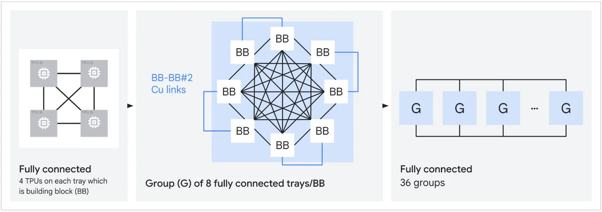
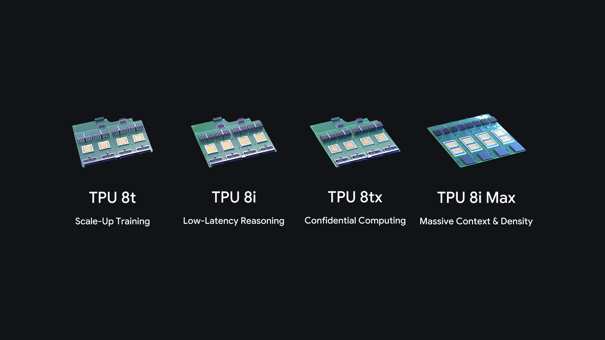

TPU 8i Max is Google's new dual-chip TPU package: two TPU 8i inference chips combined on one package, announced on November 9, 2026. Google says it delivers double the compute, double the on-chip SRAM and double the HBM bandwidth of a single TPU 8i, and fits twice the silicon into the same rack footprint. It is built for agents that hold very large contexts, where moving data, not doing math, sets the speed limit.

Google announced it alongside TPU 8tx, a confidential-computing version of its training chip. With TPU 8t and TPU 8i from April, that makes four eighth-generation TPU systems in one year, the first time Google has done so.

| Question | Short answer |
|---|---|
| What is it? | Two TPU 8i chips on one package. |
| Gain vs TPU 8i | 2x compute, 2x SRAM, 2x HBM bandwidth (Google). |
| Density | Twice the silicon in the existing rack footprint (Google). |
| Built for | Massive context windows, multi-agent work, highest compute per rack. |
| Sibling launched | TPU 8tx: TPU 8t silicon + AMD EPYC hosts, confidential inference. |
| Price / date | Not announced; Bloomberg reports next year. |

## What Is TPU 8i Max? {#what-is-tpu-8i-max}

TPU 8i Max is a packaging change, not a new chip design. Google took two of its low-latency TPU 8i chips and combined them on a single package, so one socket carries twice the compute and twice the memory bandwidth. Google itself calls TPU 8i Max and TPU 8tx "two new configurations" of its existing eighth-generation systems.

Google's launch post, written by Amin Vahdat, Google's chief technologist for AI and infrastructure, says the design "scales compute and memory in lockstep." Doubling the chips doubles the on-chip SRAM and HBM bandwidth along with the math units, so the extra compute is not left waiting for data.

The second claim is about the data center. Because TPU 8i Max fits twice the silicon within the existing rack footprint, Google says operators get significantly more compute per square foot and per watt. Google's one-line summary of the system is "massive context windows and the highest compute density per rack."

## TPU 8i Max vs TPU 8i: Specs {#tpu-8i-max-vs-tpu-8i}

TPU 8i Max doubles the three numbers that bound inference speed for a single TPU 8i: compute, SRAM and HBM bandwidth. Google published per-chip specs for TPU 8i in April but gave 8i Max only as multiples, so the 8i Max column below applies Google's 2x to the TPU 8i figures.

| Spec | TPU 8i (Google, per chip) | TPU 8i Max (derived, per package) |
|---|---|---|
| Chips per package | 1 | 2 |
| FP4 compute | 10.1 PFLOPS | ~20.2 PFLOPS |
| On-chip SRAM | 384 MB | ~768 MB |
| HBM bandwidth | 8,601 GB/s | ~17.2 TB/s |
| HBM capacity | 288 GB | Not disclosed |
| Network topology | Boardfly | Not disclosed |
| Host CPU | Arm Axion | Not disclosed |

Wccftech reached the same 768 MB SRAM figure and noted that Google has not confirmed how much HBM the package carries. If each die keeps its full 288 GB stack, the package would hold 576 GB, but that is an inference, not a spec.

### Why SRAM is the number to watch

TPU 8i already carries 3x the on-chip SRAM of Ironwood, the seventh-generation TPU. Google's April deep dive says that lets it hold a larger KV cache, the attention state a model keeps for every token in context, "entirely on silicon," cutting idle time during long-context decoding. Doubling that pool again per package means more of a long session's KV cache can stay next to the compute instead of being fetched from HBM.

### How TPU 8i chips connect

TPU 8i uses a network Google calls Boardfly instead of the 3D torus used by TPU 8t and earlier TPUs. Four fully connected chips form a board, eight boards form a fully connected group over copper, and up to 36 groups (1,024 active chips) link through optical circuit switches. Google says that keeps any chip-to-chip path to at most seven hops, versus 16 for a comparable 3D torus, which matters for the all-to-all traffic of mixture-of-experts and reasoning models.

*TPU 8i's Boardfly network, from board to group to pod. Google has not published how TPU 8i Max packages map onto it. Source: Google Cloud, TPU 8t and TPU 8i technical deep dive.*

Google has not said whether 8i Max keeps the same board, group and pod sizes, so per-pod chip counts for 8i Max are unknown.

## The Memory Wall in AI Inference {#memory-wall}

The memory wall is the gap between how fast a processor can compute and how fast memory can feed it data. Google frames TPU 8i Max as "built for a different problem: the memory wall," and gives a concrete trigger: "When dozens of AI agents work together across an entire software codebase or hours of video at once, memory bandwidth quickly becomes the bottleneck."

Long contexts make this worse. Every new token a model generates has to read the KV cache for every token already in context, so the data moved per step grows with context length while the math per step stays roughly flat. SiliconANGLE reports that Google developed 8i Max alongside pushing long context windows for Gemini, which supports one million tokens, about 750,000 words.

Google's answer has a hardware half and a software half. TPU 8i Max adds bandwidth and SRAM per package. TPU Sync, released the same week, moves KV cache and weights between chip HBM, host DRAM, shared storage and the network, so state that does not fit on chip can be parked and pulled back quickly. Rebuilding a KV cache from scratch is the same stall that [real-time voice agents hit when a session moves between model instances](/tutorials/real-time-voice-agents-distributed-systems/). Google reports that TPU Sync cut KV transfer overhead by more than 90%, to about 230 ms for Qwen3 235B, and lowered average time to first token by 60% on that model and 90% on a 480B model. These are Google's own measurements on its software, not tests of TPU 8i Max.

## TPU 8tx vs TPU 8i Max {#tpu-8tx-vs-tpu-8i-max}

TPU 8tx and TPU 8i Max launched together but solve different problems. TPU 8i Max is inference silicon doubled up for long contexts and density. TPU 8tx is the TPU 8t training chip paired with 5th Gen AMD EPYC CPU hosts to keep data and model weights protected while they are in use.

| | TPU 8tx | TPU 8i Max |
|---|---|---|
| Base silicon | TPU 8t | Two TPU 8i |
| Host CPU | 5th Gen AMD EPYC | Not disclosed |
| Network | Boardfly (from TPU 8i) | Not disclosed |
| Main job | Confidential inference, small-scale training | Massive context windows, rack density |
| Target buyers | Regulated enterprises, governments | Long-context and multi-agent serving |
| Key claim | Data and weights isolated even while in use | 2x compute, SRAM, HBM bandwidth vs 8i |

Google says normal systems encrypt data at rest and in transit but must decrypt it in memory to process it; TPU 8tx builds protection into the hardware layer so it stays isolated during processing. Because it has training-grade compute, Google pitches it for fine-tuning on private data, distillation and reinforcement learning on the same system that serves the model. It also adopts TPU 8i's low-latency Boardfly network rather than TPU 8t's torus, to keep multi-step agents responsive. TPU 8tx moves away from the Arm-based Axion hosts used by TPU 8t and TPU 8i; Bloomberg tied the AMD hosts to a partnership between the two companies.

## The Google TPU 8 Lineup: 8t, 8i, 8tx and 8i Max {#tpu-8-lineup}

Google's eighth-generation TPU family now has four systems, each tied to one stage of what Google calls the agentic lifecycle: "TPU 8t for scale-up training, TPU 8i for low-latency reasoning, TPU 8tx for confidential computing, and TPU 8i Max for massive context windows and the highest compute density per rack."

*The four eighth-generation TPU systems and the role Google assigns to each. Source: Google.*

| System | Silicon | Built for | Announced |
|---|---|---|---|
| TPU 8t | Training chip, 3D torus, up to 9,600 chips per superpod | Pre-training at scale | Apr 2026 |
| TPU 8i | Inference chip, Boardfly, 384 MB SRAM | Sampling, serving, reasoning | Apr 2026 |
| TPU 8tx | TPU 8t + AMD EPYC hosts | Confidential inference, small-scale training | Nov 9, 2026 |
| TPU 8i Max | Two TPU 8i per package | Long contexts, rack density | Nov 9, 2026 |

Google says each system is flexible across workloads, but the lineup asks customers to pick hardware by stage: train on 8t, serve on 8i, keep regulated data on 8tx, and move very long contexts to 8i Max.

## Google TPU Software Stack for Agents {#tpu-software-stack}

Google paired the hardware with software meant to lower the cost of moving to TPUs, which has long been the main barrier. The pieces named in the launch post:

- **TorchTPU**, open-sourced in October, runs PyTorch code and Hugging Face models natively on TPUs, with TPU backends for vLLM and SGLang.
- **TPU agent suite**, open source and in preview, plugs into coding tools such as Claude Code, Cursor and Google Antigravity to onboard workloads, find bottlenecks and tune kernels.
- **XLA Serving Engine**, open source, serves Python-trained models from a C++ runtime on TPUs, GPUs and CPUs.
- **Agent Compute Engine** suspends idle agent sessions, for example while an agent waits on a tool or a human, and resumes them later. That moves part of the [execution state usually held by the agent harness](/tutorials/agent-framework-harness-runtime-production/) into the platform.
- **TPU Sync**, open source, tiers KV cache and weights across HBM, DRAM, storage and network.
- **Cloud Pathways** and **GKE dynamic slicing** are now generally available for orchestrating and reshaping TPU slices.

### Independent benchmark evidence

The strongest outside evidence so far covers the previous generation, not 8i Max. SemiAnalysis, testing on the InferenceX and AgentX benchmarks, found that TPUv7 Ironwood delivered 1.2x to 2.7x the tokens per dollar of NVIDIA B200, B300 and AMD MI355X in FP8, and beat GB300 FP8 when served with llm-d disaggregated serving. It also noted that NVIDIA's NVFP4 still beats Ironwood FP8, with some accuracy loss. No third-party numbers exist yet for any eighth-generation TPU.

## TPU 8i Max Availability and Pricing {#tpu-8i-max-availability}

Google's announcement gives no release date, price, region or instance name for TPU 8i Max or TPU 8tx. Bloomberg reported, citing Vahdat, that both systems are due next year, meaning 2027. Google said in April that TPU 8t and TPU 8i would be available later in 2026.

The first reply on Hacker News made the same point: "Seems like a big deal, but there's nothing about availability." Until Google publishes a spec sheet, HBM capacity, per-pod scale and power draw for 8i Max remain open.

If you run long-context or multi-agent inference today, the practical options are TPU 8i or Ironwood, and the TorchTPU, vLLM and TPU Sync software above already runs on current TPUs, so porting work done now should carry forward. For a sense of how teams size accelerators and KV cache for coding agents, see how [Revolut sized GPUs for self-hosted GLM](/tutorials/glm-for-coding/). For why long-running agents keep so much state, see our [review of stateful long-horizon agent research](/tutorials/stateful-long-horizon-agents-review/).

TPU 8i Max is also not Google's only bet on new places to put TPUs; the company is testing them [in orbit with Project Suncatcher](/tutorials/project-suncatcher/).

## TPU 8i Max FAQ {#tpu-8i-max-faq}

### When is TPU 8i Max available?

Google's Nov 9, 2026 announcement gives no availability date or price. Bloomberg reported that TPU 8i Max and TPU 8tx are due next year, meaning 2027. TPU 8t and TPU 8i were announced in April 2026 for availability later that year.

### How much HBM does TPU 8i Max have?

Google has not said. It states that TPU 8i Max doubles TPU 8i's HBM bandwidth. A TPU 8i chip has 288 GB of HBM, so two chips would carry 576 GB if each keeps its full stack, but Google has not confirmed that figure.

## References {#references}

- Amin Vahdat, Google, ["Our newest TPUs: 8tx and 8i Max, built for the agentic era"](https://blog.google/innovation-and-ai/infrastructure-and-cloud/global-network/tpu-8i-max-and-8tx/), Nov 9, 2026
- Google Cloud, ["TPU 8t and TPU 8i technical deep dive"](https://cloud.google.com/blog/products/compute/tpu-8t-and-tpu-8i-technical-deep-dive), Apr 22, 2026
- Google Cloud, ["Introducing TPU Sync: Fast KV cache & weight transfer on TPU"](https://cloud.google.com/blog/topics/ai-infrastructure/introducing-tpu-sync-fast-kv-cache-and-weight-transfer-on-tpu), Nov 9, 2026
- SemiAnalysis, ["The Iron(wood) Throne: Google's TPU Stakes Its Claim on Inference"](https://newsletter.semianalysis.com/p/tpu-strikes-the-king), Nov 5, 2026
- SiliconANGLE, ["Google advances agentic AI custom silicon expanding TPU family with 8tx and 8i Max"](https://siliconangle.com/2026/11/09/google-advances-agentic-ai-custom-silicon-expanding-tpu-family-with-8tx-and-8i-max/), Nov 9, 2026
