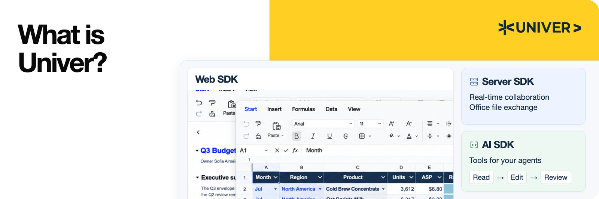
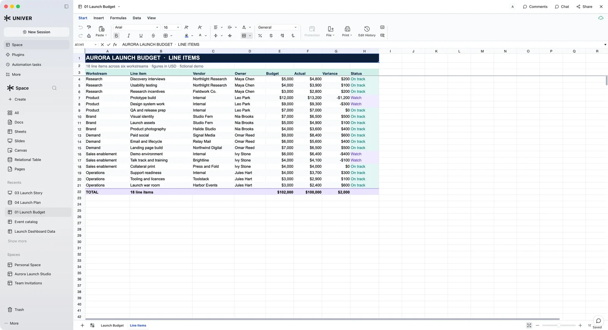

Univer Office SDK lets an AI agent edit a spreadsheet through the same engine its browser editor uses, but the agent loop DreamNum documents does not end when the edit runs. An agent inspects the workbook, looks up the Facade API it needs, executes code in read or write mode, commits, and then checks the result again. That last step matters: in our own headless test with the open-source packages, an agent's row insertion succeeded and left the sheet's total wrong.

DreamNum, the company behind Univer, positions the SDK as an embeddable spreadsheet editor SDK and an "Office harness" for agents, and released version 1.0 on September 24, 2026. This page maps each step of the documented agent loop to the package that provides it, separates what the Apache-2.0 core gives you from what the commercial AI SDK adds, and reports what happened when we ran the free headless packages against a small quotation sheet.

## Univer Office SDK Architecture for AI Agents: The Edit Loop {#univer-office-sdk-agent-edit-loop}

In Univer Office SDK's architecture, an agent edits a workbook in five steps: inspect the content, look up an unfamiliar Facade API, run a read query if inspection leaves a gap, run the edit in write mode and commit it, then review along the same boundary. Only the API lookup, the read query and the final review are conditional.

DreamNum's [content operations guide](https://docs.univer.ai/ai/content-operations) assigns each step to a package in the AI SDK, a TypeScript toolkit for building an Office CLI that agents call:

| Step | What the agent runs | Package that provides it |
|---|---|---|
| Understand the workbook | `inspect workbook`, `inspect range A1:B2` | `@univer-cli/content-inspection` |
| Find an API it has not used | `api find setValues`, `api show FRange.setValues` | `@univer-cli/api-reference` (ships with the SDK, works offline) |
| Read what inspection misses, such as conditional-format rules or chart config | `execute --mode read` | `@univer-cli/content-execution` |
| Edit and commit | `execute --mode write`, then `commit()` | `@univer-cli/univer-collaboration-runtime` |
| Review | `inspect` again, or a read query | Same as above |

The Facade code itself is ordinary JavaScript against objects such as `FWorkbook`, `FWorksheet` and `FRange`. The documented example updates `Data!A2:B2` with `sheet.getRange("A2:B2").setValues([["East", 128000]])` and then reads the range back.

Two runtime rules shape how an agent should report success. Read mode blocks mutations entirely, so a model can explore a workbook without side effects. In write mode, the guide states that "a successful run means the code ran. It does not mean a changeset reached the Server." `commit()` can return `pull-required` when someone else changed the document first; the CLI then pulls, lets operational transformation merge the remote changes, and commits again, and only a `confirmed` status means the edit landed. An agent that reports "done" after `execute` is reporting the wrong event, the same gap between running a step and knowing its effect that we covered in [Pi Durable's crash-recovery design](/tutorials/pi-agent-harness-v2-crash-recovery/).

The AI SDK is deliberately not a finished CLI. Its 25 packages come in two roles: base packages with plain TypeScript APIs, and optional `-command` presets that wrap them as Commander commands. Your application decides command names, which document a command targets, identity, authorization and output format. That division matches the argument in [The Agent Framework Is Not the Runtime](/tutorials/agent-framework-harness-runtime-production/): the harness you build owns the control loop, and Univer supplies the document operations inside it. DreamNum also publishes ready-made integrations, including an Office plugin for DeepSeek Harness, whose plugin model we unpacked in [DeepSeek Harness Architecture](/tutorials/deepseek-harness-and-cordis-why-everything-is-a-plugin/).

Underneath the agent tooling sits the core's command system. A **Command** orchestrates a user-level action, a **Mutation** changes saved content with serializable parameters, and an **Operation** changes transient state such as selection. Collaboration packages mutations into changesets. Application code can also watch commands as they run: `univerAPI.Event.BeforeCommandExecute` can cancel a command and `CommandExecuted` reports it, which gives a harness a natural audit or approval hook.

## Univer Open Source vs Commercial AI SDK for Agents {#univer-open-source-vs-commercial}

Univer's open-source core lets an agent create, edit and recalculate Sheets and Docs content, in the browser or headless in Node.js, at no cost under Apache-2.0. The agent-specific tooling in the table above, plus collaboration, Office file conversion and advanced features such as charts and pivot tables, is commercial.


*Univer Office SDK's three parts. The Web SDK core is open source; the Server SDK and AI SDK are licensed separately. Source: Univer GitHub README.*

The README says agents "can use the same open-source APIs; your application supplies the model and tool orchestration." The pricing page's comparison table draws the line this way:

| Capability | Open-source (Apache-2.0) | Commercial license |
|---|---|---|
| SDK scope | Core Web SDK components and basic headless capabilities | Complete Web SDK, Server SDK and AI SDK |
| Sheets | Editing, formulas, formatting, filtering, sorting, tables | Adds charts, pivot tables, printing, sparklines, grouping, shapes |
| Headless operation | For open-source features | For commercial features |
| Agent integration | Build your own with the open-source APIs | AI SDK for agent operations, verification and Worktree collaboration |
| Office file conversion (XLSX, DOCX, PPTX) | Not included | Included; exports metered by plan |
| Real-time collaboration | Not included | Included; connections metered by plan |

For someone choosing a spreadsheet SDK for an agent product, the practical split is this. If your agent only needs to fill, calculate and save workbooks your own app stores as Univer JSON snapshots, the free packages cover it, and you write the inspection and verification layer yourself. If the agent must open a user's `.xlsx`, hand an edited file back, share a live document with people, or take screenshots of its own output, you are in Server SDK and AI SDK territory. A Freemium mode lets you evaluate those parts with watermarks, three collaborative instances and 10 exports a month.

## Univer Headless Test: When a Successful Write Is Wrong {#univer-headless-agent-test}

In our Univer headless test, every write call returned without error, yet the sheet's total came out at 200 instead of 440 until a verification read caught it. We installed only the Apache-2.0 packages from the [Headless Univer guide](https://docs.univer.ai/guides/sheets/getting-started/node) (`@univerjs/core`, `sheets`, `engine-formula` and four others, version 1.4.0), ran them on Node 22.22 on an Apple M4 Mac, and scripted the edits an agent would make.

The seed workbook was the README's quotation example: Seats at 2 × 25, Support at 1 × 100, and a Total row with `=SUM(D2:D3)` showing 150. The task: raise Seats to 4 and add a Training line of 3 × 80 above the Total. The agent-style script did this:

```js
sheet.getRange('B2').setValue(4)
sheet.insertRowBefore(3)  // 0-based: inserts above A1 row 4, the Total row
sheet.getRange('A4:D4').setValues([['Training', 3, 80, '=B4*C4']])
await univerAPI.getFormula().onCalculationResultApplied()
```

Reading the range back showed what went wrong:

| Check | Result |
|---|---|
| Training row amount (D4) | 240, correct |
| Total formula after insert (D5) | still `=SUM(D2:D3)` |
| Total value | 200; the correct sum is 440 |
| After the agent rewrote D5 as `=SUM(D2:D4)` | 440 |
| `univerAPI.undo()` | returned `false`; the formula stayed unchanged |
| `workbook.save()` snapshot, reloaded into a new workbook | 1,530 bytes; total still 440 |

The insert landed directly below the summed range, so the formula kept its original reference and did not grow to include the new row. The engine did exactly what it was told; only a read-back of the Total row showed that the business result was wrong. Univer's documented loop ends with a review read for cases like this. Without the commercial Inspection package, `sheet.getDataRange().getValues()` and `getRange(...).getFormula()` serve the same purpose.

Our first version of the script made a different mistake. Row methods such as `insertRowAfter` and `insertRowBefore` take 0-based indexes, while ranges use A1 notation. `insertRowAfter(3)` added a row after A1 row 4, and the next write to `A4:D4` overwrote the Total label. A model that mixes the two conventions will make the same error, and the read-back exposes it immediately.

Undo did not help as a rollback. In this UI-less plugin setup, `univerAPI.undo()` returned `false` and left the last change in place; we did not trace why. The snapshot path worked: `workbook.save()` returns JSON that recreates the workbook exactly, so a harness can save before an agent's edit and restore on failure.

The engine itself was fast enough that verification costs almost nothing. Across four runs, importing the packages took 287 to 386 ms, creating the Univer instance and seed workbook took 28 to 29 ms, and the writes plus formula recalculation took 16 to 24 ms. A `CommandExecuted` listener recorded each step as IDs such as `sheet.command.set-range-values`, `sheet.mutation.insert-row` and `formula.mutation.set-formula-calculation-result`, which is enough to log what an agent actually changed.

## Univer Visual Inspection and Worktree Review {#univer-visual-inspection-worktree}

Univer visual inspection and Worktree review cover what structured reads cannot: whether the rendered page looks right, and whether a person approves the agent's changes before they reach the live document. Both are part of the commercial AI SDK and Server SDK, and we did not test them.

[Visual inspection](https://docs.univer.ai/ai/visual-inspection) runs the exported document through a Render Runtime that hosts the Web SDK renderer in a browser. `unit-screenshot` returns PNGs of a sheet range, document pages or slides for a multimodal model to look at. `unit-layout-lint` currently has three Slide rules, `text-off-page`, `text-escapes-container` and `text-overlaps-text`, and returns findings with evidence the agent can act on before editing again. DreamNum warns against rendering untrusted document data on a shared high-privilege host and recommends a restricted user or container, the same isolation question we raised in [When AI Agents Get Internal Access](/tutorials/ai-agent-internal-access-security-boundary/). The approach mirrors browser agents, which also need a screenshot to confirm what a DOM read cannot, as in our [agent-browser vs Playwright comparison](/tutorials/vercel-agent-browser-vs-playwright/).

[Worktree](https://docs.univer.ai/ai/worktree) gives the agent an isolated draft of the document with its own snapshots, revisions and real-time rooms. Despite the name, it is a collaboration draft, not a Git worktree. Inside it the agent can pull, inspect, execute and commit for as many rounds as it needs; `commit()` advances only the draft. `markReady()` freezes the draft as read-only for review, a person reviews the rendered page in the web editor, and the draft is either merged into the main document, still subject to its authorization rules, or reopened for more work.


*Univer Workspace, DreamNum's open-source reference app, where people review documents that agents edit. The budget is a fictional demo. Source: Univer GitHub README.*

DreamNum's open-source [Univer Workspace](https://github.com/dream-num/univer-workspace) assembles these pieces, editors, collaboration, file handling, agents and human review, into a self-hostable app. Its source license is open, but its SDK dependencies keep their own licenses, so running it with the commercial modules still needs a commercial or Freemium license.

## Univer Office SDK Pricing and Limits for Agent Workloads {#univer-office-sdk-pricing-limits}

Univer Office SDK's Business license starts at $99 a month or $1,000 a year and includes the complete Web, Server and AI SDK, at least 25 collaborative editing connections and at least 5,000 file exports a month, according to DreamNum's [pricing page](https://univer.ai/pricing/). Enterprise pricing is custom, with no license limit on connections or exports.

The connection rules matter more for agents than the headline price. A connection is a collaborating instance, not a user or a document. An instance takes one on its first successful submission and releases it after two minutes without another submission. People and agents draw from the same pool, and tool calls inside an instance that already holds a connection are not billed. When the pool is full, an agent instance that needs a connection gets a capacity error, and the SDK does not retry the submission. A harness that runs many agent workers against shared documents should queue on that error, not treat it as a failed edit.

Other limits to plan around:

- **Exports are metered, imports are not.** Each completed export conversion counts against the monthly allowance, including reconverting unchanged content; downloading an existing file again does not.
- **No model is included.** The AI SDK ships without models or model credits; you connect your own model and agent framework. The commercial terms allow exposing your app's features as agent tools such as MCP, which puts the authorization questions in [Stateless MCP and the Rise of the Agent Gateway](/tutorials/stateless-mcp-agent-gateway/) in scope.
- **Freemium is for evaluation.** It adds watermarks and caps of 3 collaborative instances, 10 exports a month, one pivot table per workbook and line, column and bar charts only.
- **Self-hosting works offline.** DreamNum says commercial licenses are validated locally with no runtime telemetry, so documents stay in your environment.

If you are costing an agent product, count the connections and exports a successful task consumes, in the same spirit as [cost per successful task for coding agents](/tutorials/coding-agents-finops-cost-per-successful-task/), and run the free headless core first to see how much of your workflow needs the paid layers at all.

## References {#references}

1. DreamNum, [dream-num/univer README](https://github.com/dream-num/univer), dev branch, read Nov 16, 2026 (latest release v1.5.2).
2. Univer docs, [AI SDK: Document loading and content operations](https://docs.univer.ai/ai/content-operations), Nov 2026.
3. Univer docs, [AI SDK: Worktree, agent editing and human review](https://docs.univer.ai/ai/worktree), Nov 2026.
4. Univer docs, [Headless Univer](https://docs.univer.ai/guides/sheets/getting-started/node), Nov 2026.
5. Univer, [Plans and pricing](https://univer.ai/pricing/), read Nov 16, 2026.
