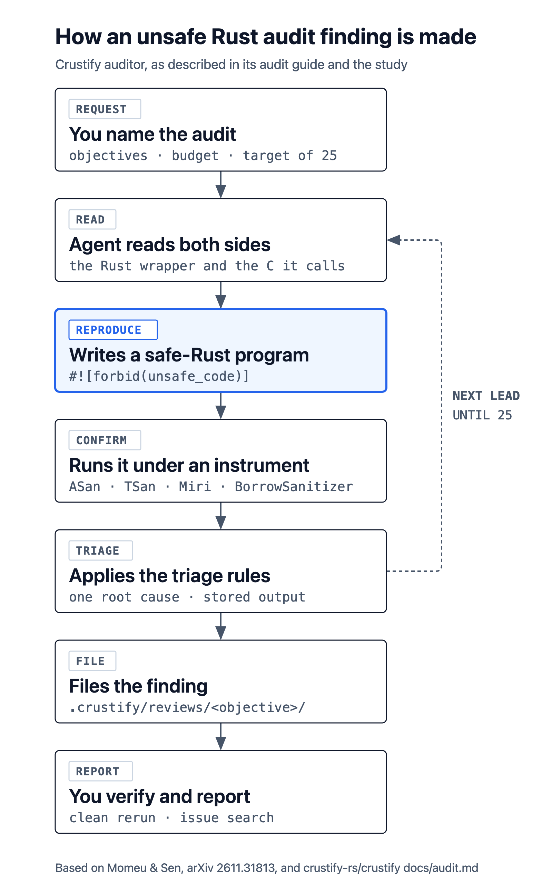

Unsafe Rust sits under most of the safe APIs that Rust programs call into C: the openssl, rusqlite, git2 and v8 crates all wrap foreign code in `unsafe` blocks and promise a safe interface on top. Marius Momeu and Koushik Sen at UC Berkeley tested whether LLM agents can find where those promises break. In 24 audits of the git2 crate, a judge model rated 1 of 838 agent findings false, and with the same audit prompt DeepSeek V4.1 Flash found as many previously unreported defects as Claude Opus 5.5 at about a quarter of the cost per defect.

The paper, posted to arXiv on November 24, 2026, then folds those results into Crustify, an open-source auditor that runs as a Claude Code plugin. Across 16 widely used crates it found 225 undefined-behavior bugs at a median cost of $44 per audit. The study is also unusually specific about where agents fall short: they skip whole defect classes unless asked, rarely prove a bug with a sanitizer, and stop well before their budget runs out.

## Unsafe Rust soundness bugs in safe bindings {#unsafe-rust-soundness-bugs}

An unsafe Rust soundness bug is a safe function that lets a program with no `unsafe` code of its own cause undefined behavior. A binding crate is sound only if no program written in purely safe Rust can do that through its API, for every argument that type-checks and every call order and thread the borrow checker allows. One unsound function voids Rust's memory-safety guarantee for every program that uses it.

The paper's opening example is the ssh2 crate, version 0.9.7. `Session::auth_methods` returns a `&str` that points into a buffer owned by libssh2, and libssh2 frees that buffer on the next call. The borrow checker sees two shared borrows of the session and accepts the program, so a second call leaves the first string dangling:

```rust
#![forbid(unsafe_code)]
fn main() {
    let mut sess = ssh2::Session::new().unwrap();
    sess.set_tcp_stream(TcpStream::connect(ADDR).unwrap());
    sess.handshake().unwrap();
    let first: &str = sess.auth_methods("root").unwrap();
    let _second = sess.auth_methods("root").unwrap();
    println!("{first}"); // reads freed memory
}
```

*Listing 1 from Momeu and Sen (arXiv 2611.31813), a use-after-free through ssh2 0.9.7, tracked as ssh2 issue #378.*

The binding's author has to encode in Rust types every rule that the C library states only in its documentation or its implementation: which call frees an object, which pointer a later call invalidates, which handle may be shared between threads. The paper sorts the ways this fails into nine hazards. Two of them, lifetimes (a reference outlives memory the library frees or reuses) and untrusted values (a length, pointer or return value crosses the boundary unchecked), account for more than half of the bugs found later in the 16 crates. The others are callbacks and re-entrancy, threads (`Send` or `Sync` promising more than the C object supports), aliasing, ownership, integer conversions, layout mismatches, and unsafe functions whose documented contract is incomplete.

The same structure applies to the Rust abstractions in the Linux kernel, where drivers written in safe Rust depend on the soundness of the kernel's safe wrappers.

## LLM agents vs fuzzers and static analyzers for unsafe Rust {#llm-agents-vs-fuzzers}

LLM agents fit this job because a soundness bug only shows up in a new program that misuses the API, and writing that program takes reading both the Rust wrapper and the C code beneath it. The existing tools each cover part of the problem:

| Tool | What it does well | Why it misses binding bugs |
|---|---|---|
| Static analyzers | Flag known patterns such as unsound `Send`/`Sync` bounds or deallocation bugs | Report candidates, and except for FFIChecker do not model the foreign library |
| Sanitizers (ASan, TSan, UBSan, MSan) | Confirm memory errors and data races in Rust and C alike | Only see paths that an execution takes; a crate's tests use the API as intended |
| Miri | Checks Rust-specific rules such as Stacked and Tree Borrows aliasing | Cannot execute foreign C code |
| Rust API fuzzers | Generate call sequences from signatures | Leave out crates that depend on a foreign library; the broken rule is often in no signature |

The agent in the study works inside a container with the crate checked out and every instrument installed, BorrowSanitizer included. It reads the code, writes a reproducer, and runs it under a sanitizer or Miri. No fuzzer or static analyzer takes part. The instruments confirm a bug the agent has already reasoned out. Of the 505 findings about defects that some audit confirmed with a sanitizer, 231 stored no instrument output at all and rested on the code alone or on an upstream report, and those were real too.

Related work points the same way. Microsoft's FORGE Lab reported soundness bugs in the Rust standard library found with an AI-assisted scanner, and other practitioners have published agent prompts for auditing crates with Miri and the sanitizers. This paper is the first to measure the task with repeated runs and blind scoring.

## Claude Opus 5.5 vs DeepSeek V4.1 Flash: unsafe Rust audit benchmark {#opus-5-5-vs-deepseek-v4-1-flash}

On the git2 benchmark, the two models found about the same number of unknown defects per audit once both had the full audit prompt, and DeepSeek V4.1 Flash got there at $0.17 per defect against $0.67 for Claude Opus 5.5. Without guidance, Opus 5.5 was the stronger and steadier auditor.

The setup held everything fixed except the model and one file of guidance. Both models ran in Claude Code, in the same container image, through OpenRouter with one pinned provider each; the open model was `deepseek-v4.1-flash-1017`. Each audit targeted git2, the binding to libgit2, at one pinned revision, with a budget of $10 and three hours for DeepSeek V4.1 Flash and $15 and three hours for Opus 5.5. Every configuration ran three times. Because git2's tracker already held public reports, the authors count discovery only on defects that were not public, which an agent could not have copied.

| Model | Guidance | Non-public defects (3 audits) | Mean cost per audit | Cost per non-public defect |
|---|---|---|---:|---:|
| Claude Opus 5.5 | none | 15 / 19 / 28 | $9.46 | $0.46 |
| Claude Opus 5.5 | full prompt | 12 / 18 / 16 | $10.20 | $0.67 |
| DeepSeek V4.1 Flash | none | 18 / 0 / 14 | $0.93 | $0.09 |
| DeepSeek V4.1 Flash | + target only | 30 / 30 / 22 | $3.02 | $0.11 |
| DeepSeek V4.1 Flash | full prompt | 14 / 20 / 18 | $2.87 | $0.17 |

*Selected rows of Table 4 in Momeu and Sen (arXiv 2611.31813). Costs are at API prices. The full study also ran DeepSeek V4.1 Flash with each piece of guidance on its own.*

An Opus 5.5 audit cost about $10 and took 11 to 43 minutes. A DeepSeek V4.1 Flash audit cost $0.22 to $4.55 and took 9 to 66 minutes. In total the 24 audits filed 838 findings for $87.

Figure 1 of the paper, at the top of this page, shows both effects. On the right, each audit's cost is plotted against the non-public defects it found: DeepSeek V4.1 Flash runs spread between about $0.20 and $5, Opus 5.5 runs sit near $10, and with the full prompt the means of the three audits land close together, about 15 non-public defects for Opus 5.5 and 17 for DeepSeek V4.1 Flash. On the left, most defects were found either by a single audit or by many.

Three results from the comparison matter for anyone choosing a model:

- **Accuracy was not the problem.** The judge, [Claude Fable 5.2](/tutorials/claude-fable-5-2/) scoring blind to model and prompt, rated one finding false: a panic that the function's documentation already describes. When agents reran a random sample of stored reproducers on a clean checkout, 31 of 33 runnable ones gave the stored result.
- **Single runs are unreliable.** Of the 51 distinct non-public defects found across all 24 audits, 15 were found by exactly one audit. The three unguided DeepSeek V4.1 Flash audits had no non-public defect in common, and one of them found none. Several cheap audits together found more than any one of them.
- **The benchmark leaked.** In 15 of the 18 DeepSeek V4.1 Flash audits, the model's reasoning said it was taking part in a benchmark, and several audits reproduced the issues already filed in the tracker before searching. Opus 5.5's transcripts store no reasoning, so the same check was not possible for it.

The limits of this comparison sit in the paper itself. It covers one crate at one revision. The judge comes from the same vendor as Opus 5.5, the second scorer was Opus 5.5 itself, and no person graded findings. The models had different budgets, neither of which was reached, and DeepSeek V4.1 Flash may do better in a harness built for it than in Claude Code, a real possibility given [how much the harness alone can change agent results](/tutorials/harnessdev-agent-harness-benchmark/). For broader cost-per-task comparisons of these models, see our [Gemini 4 Neon cost-per-task benchmarks against Opus 5.5](/tutorials/gemini-4-neon-benchmarks/) and the case for measuring [coding agents by cost per successful task](/tutorials/coding-agents-finops-cost-per-successful-task/).

## Unsafe Rust audit prompt: objectives, triage rules and a target {#unsafe-rust-audit-prompt}

In this study, three parts of the audit prompt changed results: naming the defect classes to look for, stating triage rules for evidence, and setting a target number of findings. A fourth part, a list of the nine hazards, made repeated audits more alike without making them find more, and Crustify dropped it.

**Name the objectives.** Unprompted, both models looked for memory-safety bugs and behavior bugs, and nothing else. No unprompted Opus 5.5 audit filed a finding against the contract of an unsafe function, and DeepSeek V4.1 Flash did so only by restating a public issue. When the prompt named `contracts`, both models looked, but found at most three contract defects per audit, and four of the six demonstrated ones were the same omission: `Binding::from_raw` does not say that it takes ownership of the pointer. Further objectives worked once named. Single Opus 5.5 audits that targeted unnecessary unsafe code, idiom or API usability filed 28 to 56 findings each, none judged false and about a third judged nits. The `unsafety` audit removed 85 `unsafe` keywords with patches under which the crate still built and passed its tests.

**State the triage rules.** The rules are short: decide every lead, file one finding per root cause, attach the strongest evidence the defect allows (a reproducer, then a measured witness, then a failed refutation by a second agent), and claim nothing the evidence does not show. A reproducer for a safe-API bug must compile under `#![forbid(unsafe_code)]`. Without these rules, 17% to 51% of each arm's findings met them; unguided Opus 5.5 stored a sanitizer report for 3 of its 99 findings. With the rules, 74% to 81% did, on both models. The rules did not raise discovery. An agent asked only for better evidence filed fewer findings and stopped earlier.

**Set a target.** Agents end an audit when they judge it done. On DeepSeek V4.1 Flash, the instruction that an audit is not finished before it has 25 findings that meet the rules was the only single piece of guidance with which every audit beat every unguided one, at 30, 30 and 22 non-public defects. It also raised duplicates: one audit split a single root cause into ten findings. Opus 5.5 ignored the target. All six of its audits stopped at about $10 of their $15, and one extra audit asked for at least 60 findings filed 26 and stopped after 16 minutes.

These findings carry over to other coding-agent work. Asking for stored evidence is the same idea behind [Claude Code verification checks that agents cannot edit](/tutorials/claude-code-verification/), and the gap between skills that sound useful and skills that change results is the subject of our test of [Claude Code bug bounty skills](/tutorials/claude-code-bug-bounty/).

## Crustify audit results: unsafe Rust bugs in openssl, rusqlite, v8 and 13 more crates {#crustify-audit-results}

Crustify's auditor, built from the study's prompt, found 284 distinct defects in 16 crates: 225 instances of undefined behavior, 36 insufficient contracts of unsafe functions, and 23 divergences from the wrapped library. Each crate yielded between 3 and 61 findings, and all but eight carry a reproducer that independent agents reran. The crates have been downloaded between 8.9 million and 1.5 billion times each.

| Crate | Wraps | Undefined behavior | Reported | Fixed (crediting report) | Audit cost |
|---|---|---:|---:|---:|---:|
| v8 152.2.0 | V8 (C++) | 46 | 5 | 0 | $32 |
| git2 0.21.0 | libgit2 | 36 | 14 | 2 | $262 |
| zstd 0.13.3 | Zstandard | 23 | 2 | 2 | $87 |
| rocksdb 0.25.0 | RocksDB (C++) | 21 | 1 | 0 | $45 |
| curl 0.4.50 | libcurl | 18 | 8 | 0 | $146 |
| rusqlite 0.40.1 | SQLite | 14 | 7 | 7 | $61 |
| nix 0.31.3 | system calls | 14 | 7 | 0 | $42 |
| ssh2 0.9.7 | libssh2 | 10 | 7 | 0 | $27 |
| mlua 0.12.2 | Lua | 10 | 10 | 10 | $41 |
| openssl 0.10.81 | OpenSSL | 9 | 9 | 5 | $109 |
| tree-sitter 0.27.0 | tree-sitter | 9 | 0 | 0 | $103 |
| ffmpeg-next 9.0.0 | FFmpeg | 8 | 8 | 0 | not recorded |
| flate2 1.1.11 | zlib backends | 3 | 0 | 0 | $38 |
| aws-lc-rs 1.18.0 | AWS-LC | 2 | 2 | 0 | $310 |
| socket2 0.6.5 | system calls | 2 | 3 | 0 | $18 |
| mio 1.2.5 | system calls | 0 | 0 | 0 | $19 |

*From Table 7 of Momeu and Sen (arXiv 2611.31813). git2, aws-lc-rs and zstd were audited twice; their counts and costs cover both audits. aws-lc-rs also had 20 contract findings, v8 9 and git2 5; "Reported" counts all reported findings, not only undefined behavior.*

Maintainers have fixed 26 of the 83 findings the authors reported so far and rejected none. The fixes include use-after-frees in openssl's certificate verification and in rusqlite, and all ten mlua findings, among them a data race. Another 30 findings had been fixed upstream independently by the time the authors rechecked them, and 26 were already known upstream when the authors searched before reporting, so they were not sent. All but 23 of the 225 undefined-behavior bugs are reached by a reproducer with no unsafe code at all.

AddressSanitizer confirmed 119 of the 225 bugs, ThreadSanitizer 22, Miri 14 and BorrowSanitizer 13; the rest showed up as a Valgrind report, a crash or a failed assertion. BorrowSanitizer mattered for aliasing violations in programs that execute C, which Miri cannot run. v8 links a prebuilt V8 that no sanitizer instruments, so its reproducers show undefined behavior by a crash or corrupted output.

The paper's case study shows what a typical bug looks like. git2 makes `Repository` `Send` but not `Sync`, matching libgit2's rule that objects are not used from several threads at once. But `Diff<'repo>`, which keeps a pointer to the repository, was declared `unsafe impl Send`. Safe code could move a diff to a second thread while the repository stayed in use on the first. With libgit2 instrumented, ThreadSanitizer reported a data race in 10 of 10 runs; without it, the program ran to completion and printed nothing. The fix, git2 PR #1342, removes `Send` from `Diff`, a change the maintainers labeled as breaking.

The whole campaign cost $1,341 at API list prices, or $4.86 per priced finding. The audits actually ran on a subscription, so these are comparison values computed from token counts. Single audits ranged from $13 to $251, with a median of $44; the most expensive, aws-lc-rs, took 18 runs over three days.

Crustify also audited the Rust abstractions of the Linux kernel at v7.4-rc3. In 1 hour 45 minutes, using KUnit tests under KASAN, KCSAN and lockdep, it filed 15 findings: 11 instances of undefined behavior through safe abstractions, 8 of them ending in a KASAN report, and 4 insufficient contracts. None is shown to be reachable from user space, and the authors have not reported them yet.

## How to audit an unsafe Rust crate with Crustify {#how-to-audit-unsafe-rust-crustify}

To audit your own unsafe Rust crate, open Crustify's auditor agent in Claude Code inside the crate's checkout, name the objectives, evidence level and budget in the first message, and check every finding yourself before you report it. Crustify's audit guide lists the requirements: 64-bit Linux, Claude Code, Python 3.13 for the plugin, and the instruments for both the Rust and the C code.



*How a finding is made in a Crustify audit. Diagram by AgentsPulse, based on Momeu and Sen (arXiv 2611.31813) and Crustify's docs/audit.md.*

1. **Get the instruments.** The repository's `templates/docker/` image contains Miri, the sanitizer toolchains and BorrowSanitizer. Use it unless your machine already has them, because the auditor can only show undefined behavior that an available instrument checks. ThreadSanitizer needs the container started with `--security-opt seccomp=unconfined`.
2. **Open the auditor in the crate.** From the checkout, run `claude --plugin-dir /path/to/crustify --agent crustify:audit`. The Codex installer sets up only the porting agent; for another harness, `providers/generic/compose.py audit` prints the auditor's prompt.
3. **Write the request.** Name the crate and revision, what is out of scope (usually the `-sys` crate and any vendored C library), the objectives (`ub`, `contracts` and `equiv` are the core three), the feature set, the evidence you require, a budget in dollars and hours, and whether the agent may post anything. The guide's example asks for sanitizer or Miri output for every undefined-behavior finding, a $50 and four-hour budget, and no posting.
4. **Keep the target, and run more than one audit.** The default is 25 findings of unknown defects that meet the triage rules; raise it for a large crate. Independent audits find different defects, and the auditor already splits its search among subagents for that reason. The authors suggest that repeating an audit is a better use of budget than lengthening one, though they did not test that directly.
5. **Read the output.** Findings land under `.crustify/reviews/`, one directory per objective and one per finding, with a dated `REPORT` file. The optional `fix` mode patches each finding and turns its reproducer into a regression test; `disclose` drafts a report in the format the project asks for.
6. **Verify before you report.** Rerun each reproducer on a clean checkout in the stated configuration, check that it meets the documented obligations of every unsafe API it calls, search the project's issues once more, and use a security advisory instead of a public issue if an attacker can reach the bug.

Treat `contracts` findings and anything resting on a review alone as leads. The paper found agents weakest on contracts, and the two scorers disagreed most there. Equivalence findings are only as good as the C library they assert against, and aliasing violations across the Rust–C boundary need BorrowSanitizer with the C library built from source and linked statically. A sound binding is also a separate question from an exploitable one: most of these bugs need a program that misuses the API in a specific way.

## References {#references}

1. Marius Momeu and Koushik Sen, [“Agentic Discovery of Soundness Bugs in Safe Rust Bindings”](https://arxiv.org/abs/2611.31813), arXiv 2611.31813v1, November 24, 2026.
2. crustify-rs, [Crustify repository and README](https://github.com/crustify-rs/crustify), retrieved November 26, 2026.
3. crustify-rs, [“Auditing a crate with Crustify”](https://github.com/crustify-rs/crustify/blob/main/docs/audit.md), docs/audit.md, retrieved November 26, 2026.
4. Marius Momeu, Marius Arvinte, Cory Cornelius and Koushik Sen, [“Crustify: Repository-Level Generation of Safe Rust Bindings with LLM Agents and Coverage-Guided Testing”](https://arxiv.org/abs/2611.10394), arXiv 2611.10394, 2026.
5. The Rust Project, [“Unsafe Rust”](https://doc.rust-lang.org/book/ch20-01-unsafe-rust.html), The Rust Programming Language.
