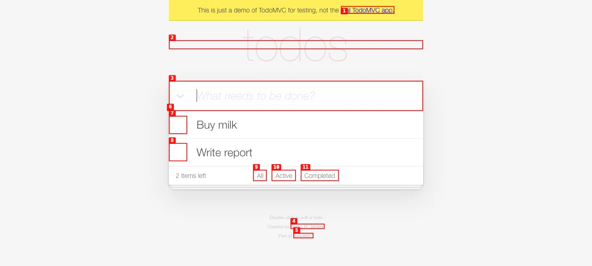

Vercel agent-browser, the Rust browser CLI from Vercel Labs, used about one fifth of the context that Playwright's tools did when we gave all of them the same 11-step job. Driving the Playwright TodoMVC demo from page load to a verified "2 items left", agent-browser's CLI printed 288 tokens of output, Playwright CLI printed 1,488 and Playwright MCP 1,550. The difference comes mostly from two design choices: agent-browser answers an action with a one-line confirmation, and its recommended snapshot lists only the elements an agent can act on.

The project's README describes agent-browser as "a native Rust CLI that gives an AI agent a browser it can drive one command at a time." Its docs claim text snapshots of "~200-400 tokens vs ~3000-5000 for full DOM", but they do not compare it with the Playwright tools most coding agents already have. We installed agent-browser 0.43.0 (released November 12, 2026), @playwright/cli 0.1.23 and @playwright/mcp 0.0.84 on one Mac and measured what each tool returns on five pages and one task.

## agent-browser vs Playwright Benchmark: Tokens and Time per Task {#agent-browser-vs-playwright-benchmark}

On the same TodoMVC task, agent-browser's CLI returned the least output and finished fastest: 288 tokens in about 0.3 seconds, against roughly 1,100 to 1,550 tokens and 3 to 5 seconds for the other three setups. Every tool completed the task in all three runs.

The task is the kind of loop a coding agent runs when it checks a feature in a browser. Each tool opened `https://demo.playwright.dev/todomvc/`, took a snapshot to find the input, added three todos, took a second snapshot, ticked the first todo and read the counter. A script parsed the element refs from each snapshot, so no model was involved and every tool did the same work.

| Setup | Calls | Tool output (tokens) | Wall time | Runs passed |
|---|---|---|---|---|
| agent-browser CLI | 11 | 288 | 0.28 s | 3/3 |
| agent-browser MCP server | 11 | 1,117 | 2.6–4.1 s | 3/3 |
| Playwright CLI (`playwright-cli`) | 11 | 1,488 | 4.9 s | 3/3 |
| Playwright MCP | 8 | 1,550 | 3.2 s | 3/3 |

*Median of three runs, Nov 15, 2026. Tokens counted with the o200k_base tokenizer on the text each tool returned. Playwright MCP needed fewer calls because `browser_type` can press Enter after typing. Times include process start-up for the CLIs.*

Where the tokens went explains the table. An agent-browser action such as `fill @e3 "Buy milk"` prints `✓ Done`, three tokens. A Playwright action prints the Playwright code it ran, the page URL and title, sometimes a console summary, and a link to a snapshot file it wrote to disk, between about 35 and 120 tokens per action. The two snapshots in the task cost 67 and 178 tokens with agent-browser's `snapshot -i` and 282 and 671 tokens with Playwright's full snapshot.

Speed shows the same split. Each Enter key press took about 0.7 seconds in Playwright CLI and about 0.5 seconds through Playwright MCP, while agent-browser's commands came back in 8 to 17 milliseconds once the page had loaded. A background daemon keeps agent-browser's browser open between commands, so each call is a short message to a running process. On an app that updates slowly, the agent should run `agent-browser wait` with a selector or text before it reads the result.

## agent-browser Snapshot Tokens on Real Pages {#agent-browser-snapshot-tokens}

On content-heavy pages, agent-browser's interactive snapshot was 53% to 74% smaller than Playwright's snapshot, and its full snapshot was 25% to 41% smaller. Large pages stay expensive with every tool: a single Wikipedia article still cost close to 40,000 tokens with the interactive filter on.

We opened five pages with each tool and counted the snapshot it returned. agent-browser's MCP server defaults to the interactive view, so its numbers match the CLI's `snapshot -i`. Playwright CLI and Playwright MCP returned the same snapshot to within a few tokens.

| Page | agent-browser `snapshot -i` | agent-browser full `snapshot` | Playwright snapshot |
|---|---|---|---|
| example.com | 12 | 268 | 339 |
| Playwright TodoMVC demo | 72 | 147 | 281 |
| playwright.dev "Installation" docs | 2,820 | 6,468 | 8,586 |
| GitHub repo page (vercel-labs/agent-browser) | 8,253 | 12,018 | 17,449 |
| Wikipedia, "Large language model" | 39,875 | 91,294 | 153,434 |

*Tokens per snapshot, median of three runs, Nov 15, 2026. Playwright figures are from @playwright/mcp 0.0.84; @playwright/cli 0.1.23 differed by four tokens or fewer. Live pages change, so expect different absolute numbers.*

The interactive filter is where most of the saving comes from, and it has a cost. `snapshot -i` keeps links, buttons and inputs and drops paragraph text. On example.com the full snapshot carried six paragraphs of text, while the `-i` version was one line: `- link "Learn more" [ref=e1]`. That suits an agent that needs to click through a form. An agent that has to read an error message or check copy on the page needs the full snapshot, `agent-browser get text <selector>`, or a snapshot scoped with `-s "#main"`.

Pages where most text is a link get less help. Wikipedia's article body is full of inline links: 1,568 of the 1,752 lines in its interactive snapshot were links. For pages like that, scoping the snapshot to a section or limiting depth with `-d` matters more than the choice of tool.

## agent-browser MCP vs CLI: Which Mode Costs Less {#agent-browser-mcp-vs-cli}

The CLI costs less. In our task, agent-browser's MCP server returned almost four times the output of its CLI, 1,117 tokens against 288, and its tool definitions take more up-front context than the skill file the CLI relies on.

`agent-browser mcp` starts a stdio MCP server with a default `core` profile for navigation, snapshots, interaction, waits, reads, screenshots and tabs. In version 0.43.0 that profile exposes 33 tools whose definitions come to 5,335 tokens; `--tools all` raises it to 64 tools and 8,591 tokens. Playwright MCP's 25 tools come to 4,568 tokens. Snapshots cost the same through MCP as through the CLI. Actions do not: each MCP fill, press or check returned about 124 tokens of JSON with launch and lifecycle metadata where the CLI printed `✓ Done`.

| Mode | Tool definitions loaded up front | Typical action response |
|---|---|---|
| agent-browser CLI | Skill stub about 680 tokens; `skills get core` about 3,300 tokens, loaded when needed | `✓ Done`, about 3 tokens |
| agent-browser MCP, `core` profile | 33 tools, 5,335 tokens | JSON with lifecycle metadata, about 124 tokens |
| Playwright MCP | 25 tools, 4,568 tokens | Code run, page URL and title, snapshot file link, about 100 tokens |

*Measured Nov 15, 2026 with agent-browser 0.43.0 and @playwright/mcp 0.0.84. The skill sizes are from the copies shipped in the agent-browser 0.41.2 npm package.*

Version matters here. The 0.41.2 build on our npm mirror repeated 14 shared arguments in every tool schema, and its `core` profile came to 18,585 tokens. In 0.43.0, per the docs, each schema lists only the shared arguments that usually matter for that tool, so update before you judge the MCP mode by its context cost.

The MCP server still has a place. The docs suggest `agent-browser mcp call <tool>` for runtimes that cannot keep a stdio session open, such as serverless agents, and MCP is the practical route for clients that cannot run shell commands. For Claude Code, Codex, Cursor or any agent with a terminal, the CLI is the cheaper path. Our [agent-desktop guide](/tutorials/agent-desktop-computer-use/) covers the sibling CLI that hands Electron and Chromium app windows to agent-browser through the same snapshot-and-ref loop.

### Why did early agent-browser benchmarks show 90% savings?

Early comparisons were measured against an older Playwright MCP. Yonatan Gross's January 2026 write-up of agent-browser v0.6.0 described Playwright MCP as returning "the full Accessibility Tree after every action" and reported 93% less context after switching. Playwright MCP 0.0.84 no longer does that. Its response to typing a todo was 13 lines: the two Playwright calls it ran, the page URL and title, a console count and a link to `.playwright-mcp/page-….yml`. The gap is still large, about five to one on our task, but it now comes from snapshot filtering and terse confirmations rather than from Playwright dumping the page after each click.

## How to Set Up agent-browser for Claude Code and Other Coding Agents {#agent-browser-claude-code-setup}

Install the CLI, download its browser once, then tell the agent to load the skill that matches the installed version. The README lists these commands:

```bash
npm install -g agent-browser   # or: brew install agent-browser
agent-browser install          # downloads Chrome for Testing (first run only)
npx skills add vercel-labs/agent-browser
```

The last command installs a short discovery skill into the agent harness. It tells the agent to run `agent-browser skills get core`, so the instructions it reads always match the CLI on the machine. If your agent does not use skills, the README suggests two lines in `AGENTS.md` instead: use `agent-browser` for browser automation, and run `agent-browser skills get core` before the first use.

From there the agent works in the loop the tool was built around:

```bash
agent-browser open http://localhost:3000
agent-browser snapshot -i            # interactive elements with refs
agent-browser fill @e3 "test@example.com"
agent-browser click @e5
agent-browser snapshot -i            # fresh refs after the page changes
```



*`agent-browser screenshot --annotate` on the TodoMVC demo after adding two todos. Each number maps to a ref, so [3] is `@e3`, the input box. Captured Nov 15, 2026 with agent-browser 0.43.0.*

A few behaviours shape how you prompt the agent. Refs stay valid while their DOM element exists, and navigation invalidates them, so the agent should snapshot again after each page change. A click fails instead of reporting success when the target is hidden, disabled, off screen or covered by something like a consent banner. Each `--session` name gets its own daemon and browser, which keeps two logins apart. And a headless browser closes after an hour without commands, discarding open tabs unless session persistence is configured.

If you already run Playwright CLI, the loop looks the same: `playwright-cli goto`, `snapshot`, then actions on refs. The difference is in what comes back, as the benchmark above shows.

## agent-browser Security Settings to Turn On First {#agent-browser-security-settings}

agent-browser's security docs state that "by default, agent-browser imposes no restrictions on navigation, actions, or output." An agent that reads an untrusted page can be steered by text on that page, so the controls below are worth setting before the first real run. Each is a CLI flag, an environment variable or, for the vault, a command.

| Flag | What it does |
|---|---|
| `--allowed-domains` | Blocks navigation, sub-resource requests, WebSocket, EventSource and `sendBeacon` traffic to domains outside the list; in Chromium it also disables WebRTC peer connections |
| `--action-policy` | Allows or denies categories of actions, such as `eval`, downloads and uploads |
| `--confirm-actions` | Holds listed actions until a human or orchestrator approves them with `confirm` or `deny` |
| `--content-boundaries` | Wraps page content in markers so the orchestrator can tell tool output from text the page supplied |
| `--max-output` | Caps how much page content one command can return, which also bounds context cost |
| `auth` vault | Stores credentials locally so passwords never enter the model's context |

The docs are explicit about the limits. The domain allowlist works inside the browser and is not an operating-system firewall, so pair it with network egress controls when you need a hard boundary. It cannot be combined with `--cdp`, `--auto-connect`, `--profile` or restored state, because pages in an existing browser may run before agent-browser can contain them. That rules it out for the common shortcut of attaching the agent to your everyday Chrome. Our piece on [AI agents with internal access](/tutorials/ai-agent-internal-access-security-boundary/) covers why identity and least privilege matter once an agent can act inside your systems, and the [stateless MCP gateway](/tutorials/stateless-mcp-agent-gateway/) article covers authorization when the browser sits behind MCP.

## agent-browser or Playwright: Which to Use {#agent-browser-or-playwright}

Use the agent-browser CLI when a coding agent with a terminal needs to check pages often and context is the constraint. Stay with Playwright's tools when you also want the agent's steps to turn into Playwright test code, or when your team already maintains Playwright fixtures and browsers.

- **Frequent UI checks inside a coding loop.** agent-browser CLI. On our task it returned about a fifth of the tokens and ran faster per command.
- **Reading page content, not just clicking.** Either tool, with scoping. Use agent-browser's full `snapshot`, `get text` or `-s`; Playwright snapshots accept a target element and `--depth`.
- **Generating regression tests.** Playwright CLI or MCP. Playwright's action responses include the Playwright code that ran, which an agent can paste into a test.
- **Clients without a shell.** An MCP server. Playwright MCP's tool definitions were slightly smaller; agent-browser MCP's snapshots were smaller.
- **Untrusted sites.** agent-browser with `--allowed-domains`, `--action-policy` and `--max-output` set, on a freshly launched browser rather than your own profile.

Vercel's own guidance on [when agents should use browser or desktop automation](https://vercel.com/articles/when-should-agents-use-browser-or-desktop-automation) adds a step before either tool: check whether an authorized API can do the job, then pick the UI tool that can observe and verify the result. For the cost side of that decision, our article on [cost per successful task for coding agents](/tutorials/coding-agents-finops-cost-per-successful-task/) explains why teams budget by cost per successful task rather than by price per token. If you are weighing other ways to cut browser-agent cost, [Jev Ultrafast's indexed DOM actions](/tutorials/jev-ultrafast-browser-agent/) take a different route to the same problem, and our [agent infrastructure section](/tutorials/category/agent-infrastructure/) collects the related tooling pieces.

## References {#references}

- Vercel Labs, [agent-browser README](https://github.com/vercel-labs/agent-browser), v0.43.0 released Nov 12, 2026.
- agent-browser docs, [Snapshots](https://agent-browser.dev/snapshots), [Commands: MCP server](https://agent-browser.dev/commands#mcp-server) and [Security](https://agent-browser.dev/security), read Nov 15, 2026.
- Ben Sabic, Vercel, ["When should agents use browser or desktop automation?"](https://vercel.com/articles/when-should-agents-use-browser-or-desktop-automation), Nov 5, 2026.
- Microsoft, [Playwright CLI for coding agents](https://playwright.dev/docs/getting-started-cli) and [Playwright MCP](https://github.com/microsoft/playwright-mcp); tested @playwright/cli 0.1.23 and @playwright/mcp 0.0.84.
- AgentsPulse benchmark, Nov 15, 2026: agent-browser 0.43.0 vs Playwright CLI and MCP on five pages and an 11-step TodoMVC task, o200k_base token counts, median of three runs.
