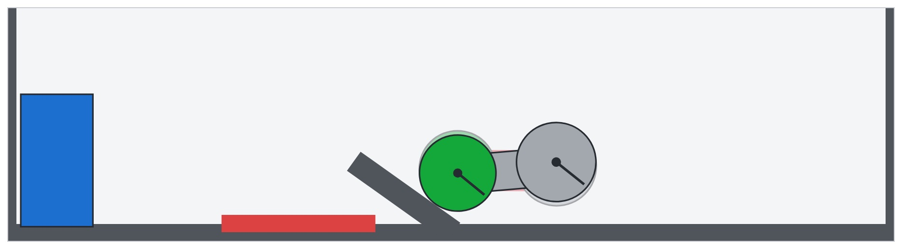
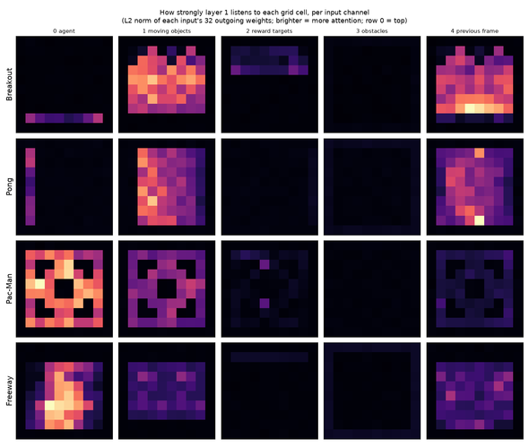

Weight-space programming is a term coined on November 2, 2026 by Rikiya Takehi, Jayden Teoh, Alex Zhang and Omar Khattab of MIT CSAIL for a frontier LLM reading and rewriting another neural network's weights directly. Their post, "Sparks of Weight-Space Programming: LLMs can natively read & write neural network weights", shows GPT-6 Astra naming what small networks were trained on, fixing a failing policy, writing game-playing networks from zero, and raising Qwen3.5-0.8B's math scores without any gradient step. This explainer covers what the term means, how it differs from training, what each experiment actually allowed, and the objections raised within a day of publication.

## What Is Weight-Space Programming

Weight-space programming (WSP) means an LLM works out what each part of a network computes, or should compute, and edits the numbers accordingly. In the authors' words, Astra "uses its reasoning to figure out what each part of a neural network computes, or should compute, and changes the weights accordingly. We call this Weight-Space Programming." Writing training loops is ruled out.

The framing places WSP next to three existing ways weights get written: optimization (gradient descent with Adam or similar), hypernetworks trained to emit weights, and compilers that turn programs into networks. LLMs already tune prompts, agent harnesses and training code; WSP asks whether the same model can skip those layers and work on the parameters themselves. The authors list the payoffs they hope for: auditing a model for backdoors without running a test set, cheaper one-shot initialization, adding or removing a capability without collecting data, and grafting a circuit from one architecture into another. They say they are now building a benchmark and harness to measure it.

## Weight-Space Programming vs Training and Fine-Tuning

Weight-space programming differs from training in where the change comes from. Training and fine-tuning compute gradients over data and let the optimizer adjust millions of weights a little at a time. In WSP, the LLM forms a hypothesis about a mechanism, such as "this direction causes looping", and writes a targeted change by hand, usually to a small fraction of the weights.

| | Gradient training / fine-tuning | Weight-space programming (as tested) |
|---|---|---|
| Signal | Loss gradients over a dataset | LLM reasoning over weights, plus limited forward passes in some experiments |
| Scope of change | Usually all trainable weights | 3.5% of a car policy; 0.016% of Qwen3.5-0.8B |
| Data needed | Training set | Task description; practice problems for Qwen |
| Output | Updated checkpoint | Updated checkpoint plus a written explanation of the edit |

The closest older relatives are model editing methods such as ROME and the "abliteration" technique that removes a refusal direction from an open-weights model. The authors cite that line of work and argue the difference is a general-purpose model, used as-is, deciding what to edit. For readers comparing ways a system can improve itself, our [self-evolving agents survey](/tutorials/self-evolving-agents-review-en/) puts weight updates alongside memory, tool and workflow changes.

## Weight-Space Programming Experiments: Read, Fix, Write

The post runs eight experiments, and the conditions change a lot between them. The table below follows the post and the per-experiment breakdown Matthew Honnibal published on November 3.

| # | Task | Network size | Tools | Runs the network? | Reported result |
|---|---|---|---|---|---|
| 1 | Name the game a PPO policy learned | 17,253 | None | No | 4 of 4 correct |
| 2 | Name the shape a diffusion MLP draws | 23,824 | None | No | 3 of 3 correct |
| 3 | Name a char-level LM's language from middle layers | 7.2M | Python | No | 3 of 3 correct |
| 4 | Fix a stuck Kinetix car policy | 171,664 | None | One recorded episode | 0% → 100% |
| 5 | Write MinAtar game policies from zero | ~20K each | None | No | Beats PPO at 100M steps |
| 6 | Write a 9×9 Go network from zero | 1,480,274 | Python | 0–50 passes | Beats equal-size PPO with 50 passes |
| 7 | Find the sycophantic Gemma 3 270M | 270M | Python | Attention patterns only | Failed on weights; 3 of 3 with attention |
| 8 | Improve Qwen3.5-0.8B at math | 0.8B | Python | Up to 50 passes | MATH-500 7.9% → 48.1% |

**Reading.** In Experiment 1 the four policies share the same 500→32→32→5 shape, the same inputs and the same actions, and differ only in which grid game (Breakout, Pong, Pac-Man, Freeway) PPO trained them on. Astra received the weights as text with no game named and identified all four, reporting 99% confidence for Breakout.

**Fixing.** Experiment 4 uses the car-and-ramp level of the Kinetix physics benchmark. The car has to reverse first to get enough runway, but the PPO policy, trained for one billion steps, drives straight at the ramp and stalls in all 256 test episodes.

*The Kinetix task from Experiment 4: back up, clear the red strip, and reach the blue box. Scene from the authors' post.*

Given the weights, the scene description and one recorded failure, Astra answered in a single reply with no tools. It added a small side path through a few units per layer that reads the car's position and speed, makes the car reverse, and switches off once the green wheel passes the red strip, after which the original network drives. The edit touched 3.5% of the weights and the car succeeded in all 1,024 evaluation episodes.

**Writing.** For three MinAtar games, Astra wrote 600→32→32→6 policies starting from all-zero weights, with no data, gradients, tools or rollouts. In Breakout it programmed the first layer to compute where the ball will land and the second to move the paddle there. Its policies beat PPO trained for 100 million steps in all three games. Against PPO at 500 million steps they scored far higher on Breakout (517.4 vs 25.3), close on Asterix (53.2 vs 55.2) and lower on Seaquest (53.1 vs 88.9).

## Weight-Space Programming on Qwen3.5-0.8B

The Qwen3.5-0.8B experiment is the headline weight-space programming result: the authors report MATH-500 rising from 7.9% to 48.1% after Astra edited 131,072 weights, 0.016% of the model. Astra worked in a CPU Python kernel over the weights, could pick practice problems from the GSM8K and MATH training sets, and had a budget of 10, 25 or 50 forward passes. No gradients were allowed.

Astra found that the base model loops: 85 of its first 96 practice answers ran to the 32,768-token cap. It traced the looping to one direction written by the MLPs in layers 15 and 19 and subtracted that direction from 64 output columns in each. Qwen's own model card already warns that the thinking mode is prone to loops and recommends a presence penalty of 1.5, which the authors used.

| Qwen3.5-0.8B (authors' evaluation, thinking on) | MATH-500 | GSM8K | IFEval | Answers hitting token limit |
|---|---|---|---|---|
| Base | 7.9% | 13.8% | 21.0% | 93.0% |
| Edited, 10 forward passes | 12.3% | 25.7% | 49.0% | 87.2% |
| Edited, 25 forward passes | 14.1% | 25.1% | 39.9% | 86.4% |
| Edited, 50 forward passes | 48.1% | 67.1% | 62.3% | 33.1% |

The authors draw the boundary themselves. On Gemma 3 270M, which rarely loops, Astra found only ordinary arithmetic and algebra errors and no edit moved MATH-500 by more than about a point (6.8% base, 7.0–7.7% edited). Their conclusion: "Editing weights could remove an obstacle that hid an ability, but it could not add an ability the model lacked." The edited Qwen checkpoint is on Hugging Face, and the full logs of every experiment are public on GitHub.

## Weight-Space Programming Criticism and Limits

Weight-space programming drew three main objections within a day, all from people who read the released material closely.

**The conditions differ by experiment.** Matthew Honnibal, author of spaCy, called the post misleading because its abstract says "just by looking at the raw weights" next to the Qwen result. By his count the no-tools, no-running setting appears only in Experiments 1, 2 and 4, on networks of 17K to 172K weights, while every experiment on a real language model used Python and the Qwen fix also ran the model on up to 50 batches. Simon Willison made a similar point: the post combines two topics, what models can do with raw weights alone and how well models armed with code can improve other models, that deserve separate treatment.

**A skilled human could do it.** Sean Goedecke argued that the game-identification task becomes easy once you compute how strongly the first layer attends to each grid cell. He did it in three lines of numpy.

*First-layer weight norms per input channel for the four game policies. Chart by Sean Goedecke.*

He also described the Qwen fix as the standard steering and abliteration playbook: contrast looping and non-looping text, find the responsible direction, trim it. His view is that LLMs will help AI research mainly by improving training. Simon Willison, testing the narrower reading claim, ran the game-identification task with Qwen 3.8 27B on his laptop. It identified the Pac-Man-like game (72% confidence, 46 minutes), Pong (75%) and Breakout (88%), and misread Freeway as the Pac-Man-like game.

**The baseline is setting-dependent.** A separate evaluation by Carlos Toledo, reported in a November 3 update by kingy.ai, measured untouched Qwen3.5-0.8B at 43.95% across 2,000 generations under non-thinking settings with a different grader. The 7.9% figure describes the base model in thinking mode where most answers never finish. The authors' 48.1% therefore measures how much the edit recovers in that configuration; it says little about gains over a well-configured base model.

For context on why reading behavior from inside a model matters, see our explainer on [measuring reward-seeking in RL models](/tutorials/measuring-reward-seeking-contrastive-beliefs/), and on the harness side, the [HarnessDev benchmark](/tutorials/harnessdev-agent-harness-benchmark/) tests whether LLMs can improve the code around a model. Teams thinking about auditing deployed agents can compare the "auditing without evaluation" goal with today's policy-based approach in [iFixAi](/tutorials/ifixai-ai-agent-auditing/). Model releases that ship community abliterated variants, such as [DeepSeek V4.1 Flash 1017](/tutorials/deepseek-v4-1-flash-1017/), show how common direction-removal edits already are in practice.

## Weight-Space Programming FAQ

### Does weight-space programming use gradients or training?

No. Every experiment bans gradient descent and training loops. Some experiments do allow a Python sandbox and a fixed budget of forward passes, which lets the model test an edit before submitting it.

### Did Astra really edit Qwen "just by looking at the raw weights"?

No. The Qwen3.5-0.8B result used a Python kernel over the weights and up to 50 forward passes on practice problems. The pure raw-weights setting, with no tools and no execution, applies to the three smallest experiments.

### How is weight-space programming different from abliteration?

Abliteration is a specific recipe that removes one direction, usually refusal, from a model's weights. The Qwen fix used a very similar operation on a looping direction. The difference the authors claim is that a general LLM chose the target, located it and wrote the edit without being told which recipe to use.

### Can a local model do weight-space programming?

For the simplest task, partly. Simon Willison's test with Qwen 3.8 27B on a laptop identified three of the four game policies, taking roughly 45 to 65 minutes each, and missed Freeway.

## References

- Rikiya Takehi, Jayden Teoh, Alex Zhang and Omar Khattab, ["Sparks of Weight-Space Programming: LLMs can natively read & write neural network weights"](https://rikiyat.github.io/blog/weight-space-programming/), MIT CSAIL, Nov 2, 2026
- [lm_understand-logs](https://github.com/RikiyaT/lm_understand-logs), complete experiment logs, and the [edited Qwen3.5-0.8B checkpoint](https://huggingface.co/RikiyaT/Qwen3.5-0.8B-weight-space-programming)
- Matthew Honnibal, ["The 'Astra can read and write weights to improve Qwen' post is misleading"](https://honnibal.dev/blog/astra-read-write-misleading), Nov 3, 2026
- Sean Goedecke, ["LLMs are not superhuman at reading and writing neural network weights"](https://www.seangoedecke.com/llms-are-not-superhuman-at-reading-and-writing-neural-network-weights/), Nov 3, 2026
- Simon Willison, ["Qwen 3.8 27B on my laptop can interpret model weights, too"](https://simonwillison.net/2026/Nov/3/qwen-can-interpret-model-weights/), Nov 3, 2026
