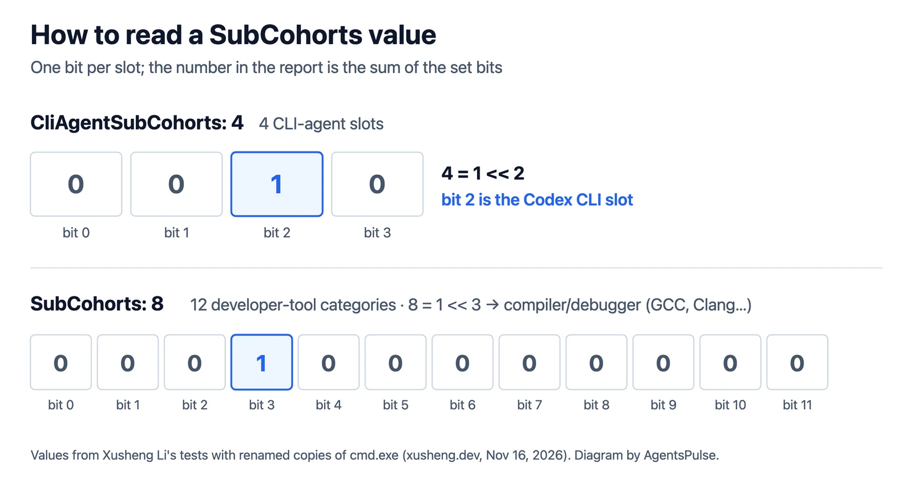

<p class="sky-direct-answer"><strong>Windows 11 telemetry now notes which AI coding agents you run.</strong> A diagnostics component records whether programs named codex.exe, claude.exe, copilot.exe, cursor.exe and a handful of others have been used, and sends that as a small bitmap to Microsoft when Send optional diagnostic data is on. You can turn it off under Settings → Privacy &amp; security → Diagnostics &amp; feedback.</p>

Security researcher Xusheng Li found the component while asking an AI agent to comb recent Windows binaries for undocumented features. On November 16, 2026 he published a [write-up](https://xusheng.dev/posts/windows-coding-agent-telemetry/) tracing it from a list of executable names inside `MissionControlAggregator.dll` to an event sitting in Windows' upload queue. By November 18 the [Hacker News thread](https://news.ycombinator.com/item?id=50524736) had 722 points and about 600 comments.

| Question | Short answer |
|---|---|
| What is tracked? | Whether 4 CLI agents, 5 desktop agents and 12 developer-tool categories were seen in a reporting window. |
| What is not? | Prompts, source code, run time, focus time and how often you used each tool. |
| Is it sent to Microsoft? | Yes, if Send optional diagnostic data is on. A clean US install had it on by default. |
| How do I stop it? | Turn off Send optional diagnostic data, or set Allow diagnostic data to Required (or Off on Enterprise and Education) by policy. |

## Windows 11 telemetry for coding agents: what it records {#windows-11-telemetry-coding-agents-what-it-records}

Windows 11 telemetry for coding agents records a set of yes/no flags: for each tool on a fixed list, whether it ran on the PC during the reporting window. The list sits in `MissionControlAggregator.dll`, and the checks for AI agents are gated by a feature flag named `CLICodingAgentUsage` (feature ID 62580080).

Li's write-up lists three groups of slots:

- **CLI agents (4 slots):** `copilot.exe`, `claude.exe`, `codex.exe` and `agy.exe`, plus the same names without `.exe` when they run inside WSL.
- **Desktop agents (5 slots):** `github.exe`, `claude.exe`, `codex.exe`, `cursor.exe` and `antigravity.exe`, which covers the GitHub, Claude, Codex, Cursor and [Antigravity](/tutorials/antigravity-teamwork/) desktop apps.
- **Developer tools (12 categories):** checks for `node.exe`, `python.exe`, `dotnet.exe`, `gcc.exe`, `clang.exe`, `gdb.exe`, `javac.exe`, `devenv.exe` (Visual Studio), `code.exe` (VS Code) and others feed broader categories rather than one flag per program.

Some developer-tool checks also look at the publisher: the Node.js slot expects the Node.js Foundation, Python expects the Python Software Foundation, and the .NET and Visual Studio slots expect Microsoft Corporation. The compiler and debugger group that holds GCC and Clang has no publisher check on this path.

The agent checks match on the file name. In Li's test, a copy of `cmd.exe` renamed to `codex.exe` was enough to set the Codex flag, and a copy named `gcc.exe` set the compiler/debugger flag. If you run several agents side by side, for example through a launcher like [T3 Code](/tutorials/t3-code/), each one sets its own flag.

## How Windows 11 telemetry detects Codex, Claude Code and Cursor {#how-windows-11-telemetry-detects-coding-agents}

Windows 11 telemetry detects coding agents by reading events Windows already produces; the component does not scan running processes itself. Its handlers subscribe to three sources and pass the program names they find to the matchers:

1. `KernelProcess.AppStateChangeSummary`, which covers ordinary Windows programs. A Windows build of `codex.exe` reaches the CLI-agent checks this way, so detection is not limited to WSL.
2. `Win32kTraceLogging.AppInteractivitySummary`, which feeds the desktop-agent checks.
3. `Microsoft.Windows.Lxss.Manager.Exec` and `ExecCritical`, the WSL launch events, read through their `imageName` field.

A match sets a slot in the component's state, which is saved to `C:\ProgramData\Microsoft\Diagnosis\AggregatorStorage\MissionControlAggregator$`. On a roughly daily boundary, a routine named `ReportCohorts<12,4,5>` turns the slots into three bitsets (12 tool categories, 4 CLI agents, 5 desktop agents) and emits an Event Tracing for Windows (ETW) event called `Segments.SubCohorts`. Each tool gets one bit. When Li ran only the renamed Codex binary, the event carried `CliAgentSubCohorts: 4`, which is `1 << 2`, the Codex CLI bit.



*Reading the numbers in a `Segments.SubCohorts` event. Values from Xusheng Li's tests with renamed copies of cmd.exe; diagram by AgentsPulse.*

If you find the event in the Diagnostic Data Viewer (see below), the same arithmetic applies: a value of 0 means none of that group's tools were seen.

The component runs inside `AggregatorHost.exe`, a child process started by DiagTrack, the Connected User Experiences and Telemetry service. On Li's Parallels Windows 11 ARM64 virtual machine (build 26200.9974, DLL version 10.0.26100.9818), DiagTrack was running with startup type Automatic and `CLICodingAgentUsage` was already switched on as a service experiment, without any manual change. The diagram at the top of this page shows the full path.

## Is Windows 11 telemetry sent to Microsoft? {#is-windows-11-telemetry-sent-to-microsoft}

Yes, the coding-agent report is sent to Microsoft when Send optional diagnostic data is on. Li found the `Segments.SubCohorts` event in DiagTrack's upload queue, a database at `EventStore.db`, with its privacy field set to `"isRequired": false`. Windows treats it as optional diagnostic data, so it only leaves the machine when that tier is allowed.

The queued event looked like this:

```json
{
  "name": "Microsoft.Windows.MissionControlAggregator.Segments.SubCohorts",
  "ext": { "privacy": { "isRequired": false } },
  "data": {
    "Version": "0.1.5",
    "CliAgentSubCohorts": [4],
    "DesktopAgentSubCohorts": [0],
    "FlushedFromSave": true
  }
}
```

Whether that tier is allowed on your PC depends on a setup screen that is easy to click through. Li installed Windows 11 Home ARM64 from the latest official ISO with the region set to the United States. Before he touched any privacy setting, the Diagnostic data screen in setup was already set to Include Optional, and after setup the `AllowTelemetry` value was 3, the level Microsoft's [diagnostic data documentation](https://learn.microsoft.com/en-us/windows/privacy/configure-windows-diagnostic-data-in-your-organization) calls Optional (Full). He did not test other regions.

Two details from Microsoft's own [privacy page](https://support.microsoft.com/en-us/windows/privacy/diagnostics-feedback-and-privacy-in-windows) matter here. Optional diagnostic data is stored with unique identifiers that can recognize a user on a device, and Microsoft collects some optional data from only a sample of devices, so not every PC with the setting on will send every optional event.

## How to check Windows 11 telemetry settings on your PC {#how-to-check-windows-11-telemetry-settings}

To check whether your PC can send the coding-agent report, look at three things: the diagnostic data setting, whether the component is loaded, and what Windows has actually queued.

**1. Read the setting.** Open Settings → Privacy &amp; security → Diagnostics &amp; feedback and look at Send optional diagnostic data. If the toggle is on, the report can be uploaded. If the options are greyed out with the note "Some settings are hidden or managed by your organization", your IT department sets the level by policy.

**2. See whether the component is running.** In an administrator PowerShell window, the commands Li used show the telemetry service, its helper process and the DLL:

```powershell
Get-Service DiagTrack | Format-Table Name,Status,StartType -AutoSize
Get-Process AggregatorHost | Format-Table ProcessName,Id -AutoSize
tasklist /m MissionControlAggregator.dll
```

If the last command lists `AggregatorHost.exe`, the aggregator is loaded on your build. That alone does not tell you whether the coding-agent feature flag is on.

**3. Look at what is being sent.** Microsoft's [Diagnostic Data Viewer](https://learn.microsoft.com/en-us/windows/privacy/diagnostic-data-viewer-overview) shows the events your device sends, in the JSON form that is uploaded. Turn on the Diagnostic Data Viewer option under Diagnostics &amp; feedback → View diagnostic data, install the viewer from the Microsoft Store, use your coding agents as usual for a day or two, then search the viewer for `MissionControlAggregator` or `SubCohorts`. The viewer only shows events collected while data viewing is on, and Microsoft warns it can use up to 1 GB of disk, so turn data viewing off when you are done; that also deletes the stored history.

On machines without the Store, the [PowerShell version](https://learn.microsoft.com/en-us/windows/privacy/microsoft-diagnosticdataviewer) does the same job from an administrator prompt:

```powershell
Install-Module -Name Microsoft.DiagnosticDataViewer
Enable-DiagnosticDataViewing
# use your tools for a while, then:
Get-DiagnosticData | Where-Object { ($_ | Out-String) -match 'MissionControlAggregator' }
Disable-DiagnosticDataViewing
```

If nothing matches, your device may have optional data off, may not have the feature enabled, or may not be in the sample for this event.

## How to disable Windows 11 telemetry for coding agents {#how-to-disable-windows-11-telemetry-for-coding-agents}

To disable Windows 11 telemetry for coding agents, stop sending optional diagnostic data. Because the `Segments.SubCohorts` report is marked as optional, dropping the device to Required diagnostic data keeps it off the upload queue. How you do that depends on the edition.

| Edition | Lowest level you can set | Where |
|---|---|---|
| Home | Required diagnostic data | Settings toggle, or decline optional data during setup |
| Pro | Required diagnostic data | Settings toggle, or Group Policy / MDM |
| Enterprise, Education, Server | Diagnostic data off | Group Policy / MDM |

**On any edition, in Settings.** Go to Settings → Privacy &amp; security → Diagnostics &amp; feedback and turn off Send optional diagnostic data. On a new install you can do the same on the Diagnostic data screen during setup. While you are there, Tailored experiences uses diagnostic data for tips, ads and recommendations, so you may want that off too.

**With Group Policy (Pro and higher).** Open the Local Group Policy Editor or the Group Policy Management Console and go to Computer Configuration → Administrative Templates → Windows Components → Data Collection and Preview Builds → Allow diagnostic data. Enable it and pick a level. Microsoft's documentation maps the levels to values: 0 for Diagnostic data off, 1 for Required, 3 for Optional, and level 0 is only available on Enterprise, Education and Server. A [Hacker News commenter](https://news.ycombinator.com/item?id=50524736) recommended the policy over the toggle, saying Windows does not override policy settings the way it can user settings. Users can still choose a more restrictive level in Settings unless the "Configure diagnostic data opt-in settings user interface" policy is also set.

**With MDM.** Intune and other MDM tools use the `System/AllowTelemetry` policy with the same values. Teams that roll coding agents out across a whole engineering org, as Revolut did with [GLM for 2,000 engineers](/tutorials/glm-for-coding/), can set this once rather than per machine.

Microsoft notes that with diagnostic data fully off, no Windows Update information is collected, and it recommends Required as the minimum for organizations that rely on Windows Update. Commenters in the thread also pointed to tools such as privacy.sexy and O&amp;O ShutUp that switch off many more telemetry features. Those changes sit outside Microsoft's documented controls, and one commenter warned that the strictest privacy.sexy profile disables Windows' internet connectivity check, which can interfere with Windows Update and some game stores. Test them on one machine before rolling them out.

## Windows 11 telemetry privacy: what the report leaves out {#windows-11-telemetry-privacy-what-the-report-leaves-out}

The Windows 11 telemetry privacy concern here is the list of tools itself. The source events the component reads carry run time, time in focus, interaction counters and resource use, but in Li's analysis the aggregator discards all of that and keeps only the bitmap. He found no prompt text or source code in the report, and its timestamps describe the collection window rather than how long you used each agent.

Even so, a record of which coding agents and developer tools someone uses, tied to device identifiers, says a lot about a developer's work and employer's toolchain. It also sits on top of whatever each agent already reports to its own vendor. It is the second coding-agent privacy story this month: in the [Claude Code email leak](/tutorials/claude-code-email-leak/), the agent itself put account addresses into requests it sent to websites. Another commenter noted that companies want the same signal for themselves, to know who uses agents and what data they can reach, which is the visibility problem behind most [AI agent security boundaries](/tutorials/ai-agent-internal-access-security-boundary/).

Several things remain unknown:

- **Why Microsoft collects it.** We found no public statement from Microsoft about the feature as of November 18, 2026.
- **How widely it is enabled.** The feature flag was on as a service experiment on one test machine. Other builds, regions and editions were not tested.
- **What happens locally with optional data off.** Turning off optional data keeps the report off the upload queue, but Li did not report whether the aggregator still records matches in its local state file.
- **How exact the matching is.** Matching on file names means a renamed binary counts, and a different program that happens to be named `codex.exe` or `agy.exe` would too.

## FAQ {#faq}

### What does optional diagnostic data mean?

Optional diagnostic data is the higher of the two diagnostic levels on Windows 11 Home and Pro. On top of Required data, it covers more detail about the device and its health, websites you browse, device activity (usage) and enhanced error reporting, including crash memory that may contain parts of open files. The coding-agent report is tagged as optional.

### Why is optional diagnostic data greyed out?

Send optional diagnostic data is usually greyed out because an organization manages the device's diagnostic level through Group Policy or MDM. Settings then shows "Some settings are hidden or managed by your organization" at the top of the Diagnostics &amp; feedback page. Ask your IT team which level the `Allow diagnostic data` policy sets.

## References {#references}

1. Xusheng Li, ["Windows 11 Is Collecting Data on Which Coding Agents and Developer Tools You Use"](https://xusheng.dev/posts/windows-coding-agent-telemetry/), xusheng.dev, November 16, 2026.
2. Microsoft Learn, ["Configure Windows diagnostic data in your organization"](https://learn.microsoft.com/en-us/windows/privacy/configure-windows-diagnostic-data-in-your-organization), accessed November 18, 2026.
3. Microsoft Support, ["Diagnostics, feedback, and privacy in Windows"](https://support.microsoft.com/en-us/windows/privacy/diagnostics-feedback-and-privacy-in-windows), accessed November 18, 2026.
4. Microsoft Learn, ["Diagnostic Data Viewer overview"](https://learn.microsoft.com/en-us/windows/privacy/diagnostic-data-viewer-overview) and ["Diagnostic Data Viewer for PowerShell"](https://learn.microsoft.com/en-us/windows/privacy/microsoft-diagnosticdataviewer), accessed November 18, 2026.
5. Hacker News, ["Windows 11 is collecting data on which coding agents and developer tools you use"](https://news.ycombinator.com/item?id=50524736), November 16, 2026.
